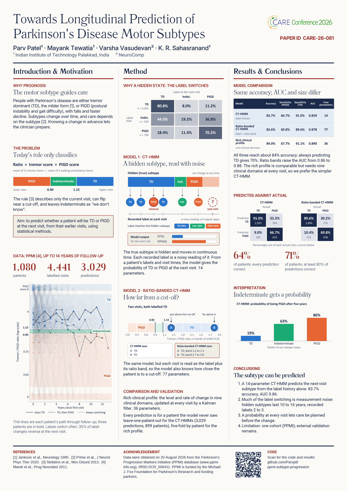
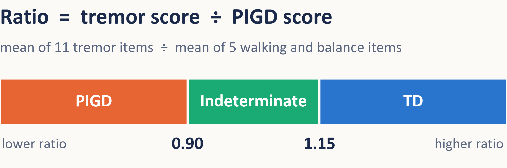
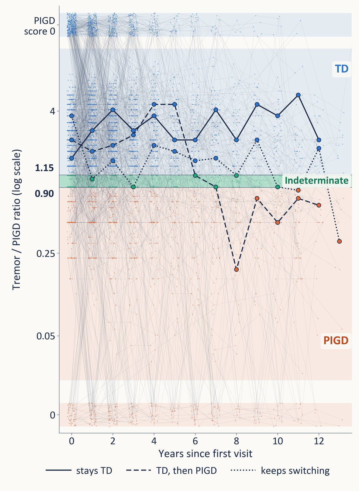
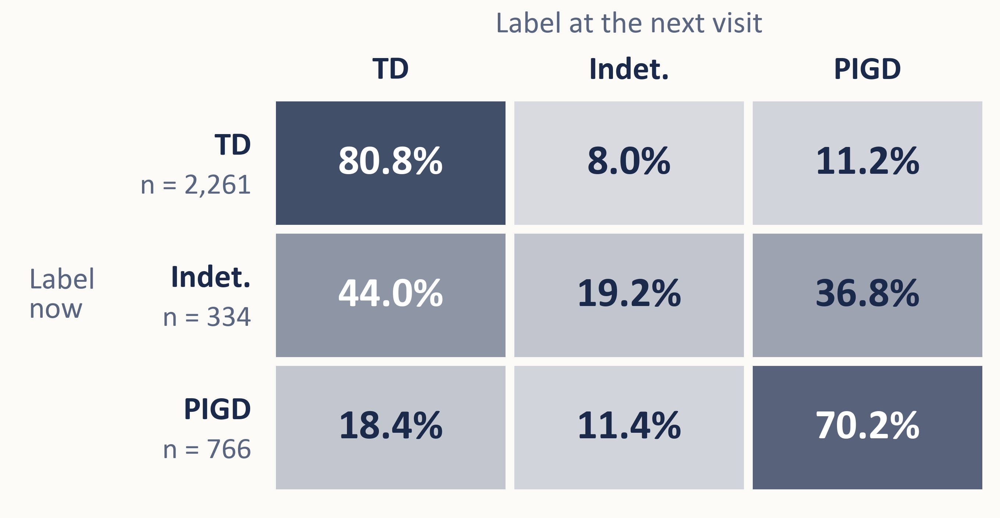
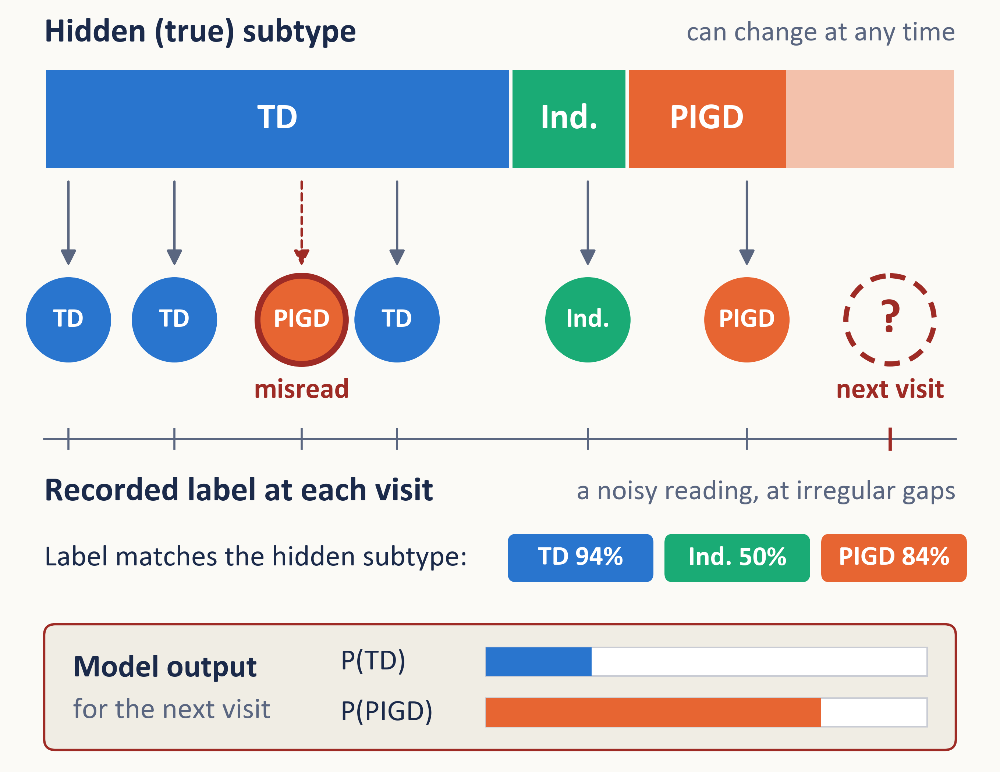
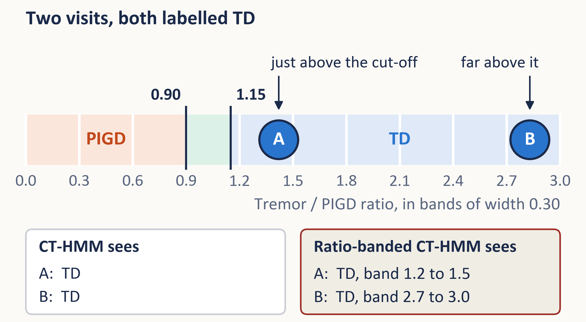
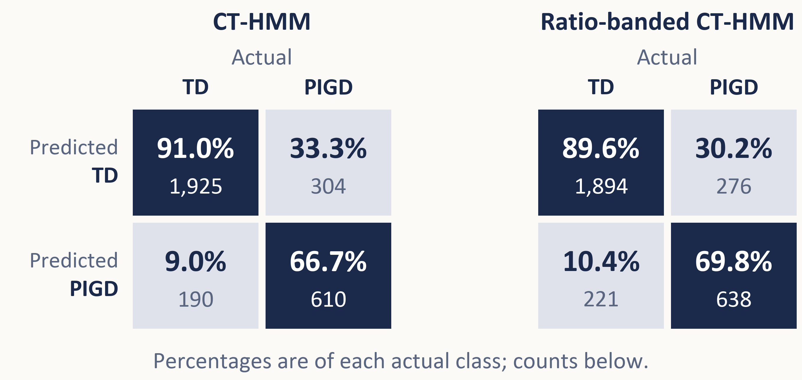
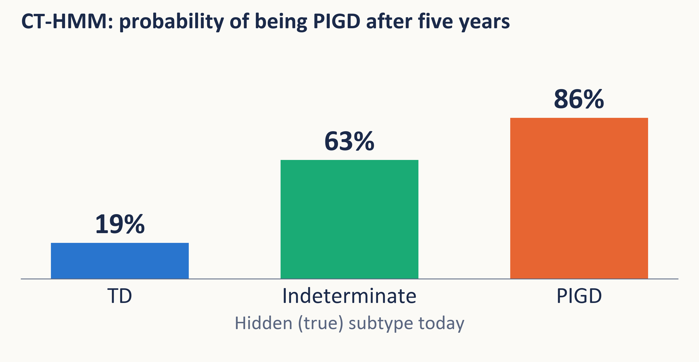

# Towards Longitudinal Prediction of Parkinson's Disease Motor Subtypes

**Parv Patel¹ · Mayank Tewatia¹ · Varsha Vasudevan² · K. R. Sahasranand¹**
¹ Indian Institute of Technology Palakkad, India  ² NeuroComp

Poster at the **CARE Conference 2026**, Paper ID **CARE-26-081** · B.Tech project, Department of Data Science, IIT Palakkad

This repository holds the code and results behind the poster: statistical
models that predict whether a person with Parkinson's disease will be
tremor dominant (TD) or PIGD at their next clinic visit, from their earlier
visits.

<p align="center">
  <a href="poster/CARE-26-081.pdf"></a>
  <br><em>The poster. Click for the full-size PDF.</em>
</p>

## Summary

The motor subtype of Parkinson's disease is assigned today by a fixed rule on
the MDS-UPDRS rating scale. The rule describes one visit; it does not say where
the patient is heading. Using 1,080 patients from the Parkinson's Progression
Markers Initiative (PPMI), followed for up to 14 years, we show that the
recorded subtype switches often, and that much of the switching is measurement
noise. A continuous-time hidden Markov model (CT-HMM) with 14 parameters, given
only a patient's label history and visit dates, predicts the next-visit subtype
for unseen patients with 83.7% accuracy and an AUC of 0.86. Adding the ratio
band to each observation raises the AUC to 0.88. A richer model of nine
clinical domains performs comparably. The model turns "Indeterminate" from
"we don't know" into a probability.

## Contents

- [Background and aim](#background-and-aim)
- [Data](#data)
- [The recorded label switches](#the-recorded-label-switches)
- [Models](#models)
- [Results](#results)
- [Conclusions](#conclusions)
- [Repository layout](#repository-layout)
- [Reproducing the analysis](#reproducing-the-analysis)
- [Data availability and acknowledgement](#data-availability-and-acknowledgement)
- [References](#references)

## Background and aim

People with Parkinson's disease are commonly grouped into two motor subtypes.
**Tremor dominant (TD)** is the milder form [1]. **PIGD** (postural instability
and gait difficulty) comes with falls and faster decline. Subtypes change over
time, and care depends on the subtype [2]: for PIGD the clinician plans fall
prevention, gait and balance training and closer monitoring. The change cannot
be prevented, but knowing it in advance lets the clinician prepare.

The subtype is assigned by the rule of Stebbins et al. [3]. Two scores are
computed from the MDS-UPDRS: a tremor score (mean of 11 items) and a PIGD score
(mean of 5 walking and balance items). Their ratio is compared with two fixed
cut-offs.

<p align="center"></p>

The rule has three gaps. It describes only the current visit. The label can
flip when the ratio sits near a cut-off. And Indeterminate amounts to
"we don't know".

> **Aim.** To predict whether a patient will be TD or PIGD at the next visit,
> from their earlier visits, using statistical methods.

## Data

The data come from PPMI [4], an international observational cohort with
repeated clinical examinations.

| | |
|---|---|
| PPMI participants in the curated data cut | 4,788 |
| Patients with sporadic Parkinson's disease (the cohort) | **1,080** |
| Visits | 5,774 |
| Visits with a subtype label (OFF-medication exam) | **4,441** (TD 2,891 · PIGD 1,109 · Indeterminate 441) |
| Consecutive labelled visit pairs | 3,361, from 934 patients |
| Predictions scored (next visit is TD or PIGD) | **3,029**, from 899 patients |
| Follow-up | up to 14 years |

**Curation.** The raw data needed four decisions before any model was fitted.

| What was messy | What we did |
|---|---|
| ON- and OFF-medication exams mixed together | Kept OFF-medication exams only; 1,195 visits with only an ON exam stay unlabelled |
| "Unable to rate" stored as the number 101 | Removed before averaging (as a score it turns TD patients into PIGD) |
| Ratio undefined when the PIGD score is 0 (16.3% of labelled visits) | Labelled by the published rule; left out of the ratio-based models only |
| 1 to 14 visits per patient, at irregular gaps | Used the actual visit dates and continuous-time models |

**Validation of the labels.** The labels we recompute from the items match
PPMI's own: 4,431 of 4,431 visits for TD against non-TD, and 1,595 of 1,597
visits for the three classes.

## The recorded label switches

<p align="center"></p>

Each thin line is one patient's path through follow-up; three patients are in
bold. The share of TD falls from 71.7% at baseline to 39.1% by year 11, but the
movement is not one-way.

<p align="center"></p>

- 18.4% of PIGD visits are followed by a TD visit.
- **35.2% of label changes reverse at the very next visit.**
- Indeterminate rarely persists: only 19.2% stay Indeterminate.

The recorded label is therefore a noisy reading of the patient's subtype. The
models below are built on that idea.

## Models

Two models are carried forward, with a third as a comparison.

### Model 1: CT-HMM

<p align="center"></p>

The true subtype is hidden and moves in continuous time, so irregular gaps
between visits are handled exactly: the transition probability over a gap Δt
is P(Δt) = exp(QΔt). Each recorded label is a noisy reading of the hidden
subtype. The recorded label matches the hidden one 94% of the time for TD, 50%
for Indeterminate and 84% for PIGD. From a patient's labels and visit times,
the forward algorithm gives the probability of TD or PIGD at the next visit.
**14 parameters.**

### Model 2: Ratio-banded CT-HMM

<p align="center"></p>

The same model, but each visit is read as the label plus its ratio band (bands
of width 0.30), so the model also knows how close the patient is to a cut-off.
**77 parameters.**

### Comparison: rich clinical profile

The level and rate of change in nine clinical domains (tremor,
gait and posture, bradykinesia and rigidity, motor and non-motor daily living,
cognition, mood, autonomic function, sleep), updated at every visit by a Kalman
filter. **36 parameters.**

### Other models fitted

| Family | Models |
|---|---|
| State-based (the sequence of labels) | Persistence (baseline); discrete-time Markov chain; continuous-time Markov chain; logistic regression on the label history; CT-HMM; ratio-banded CT-HMM |
| Ratio-based (the ratio, or its two scores) | Hierarchical Bayesian growth model; Gaussian process; mixed models and Gaussian processes on the two scores; rich clinical profile |

### Validation

Every prediction is for a patient the model never saw: leave-one-patient-out
for the CT-HMMs (3,029 predictions, 899 patients), and five-fold
cross-validation by patient for the rich profile (3,020 matched predictions,
898 patients). Intervals are 95% patient-level bootstrap intervals.

## Results

### Model comparison

| Model | Uses | Accuracy | Sensitivity (PIGD) | Specificity (TD) | AUC | Free parameters |
|---|---|---|---|---|---|---|
| **CT-HMM** | Label history | 83.7% (82.0 to 85.4) | 66.7% (62.9 to 70.1) | 91.0% (89.5 to 92.6) | 0.859 (0.840 to 0.876) | **14** |
| **Ratio-banded CT-HMM** | Label history and ratio band | 83.6% (81.9 to 85.4) | 69.8% (66.0 to 73.0) | 89.6% (87.7 to 91.4) | 0.878 (0.862 to 0.895) | 77 |
| Rich clinical profile | Nine clinical domains | 84.0% (82.5 to 85.6) | 67.7% (64.0 to 70.9) | 91.1% (89.7 to 92.5) | 0.890 (0.875 to 0.905) | 36 |

All three reach about 84% accuracy; always predicting TD gives 70%. Accuracy
does not separate the models. Ratio bands raise the AUC from 0.86 to 0.88 and
PIGD sensitivity from 67% to 70%. The rich profile is comparable but needs nine
clinical domains measured at every visit, so we prefer the simpler CT-HMM, with
the ratio-banded version as its refinement.

### Predicted against actual

<p align="center"></p>

Percentages are of each actual class. Looking at each patient separately: for
**64%** of patients every prediction is correct, and for **71%** at least 80%
of predictions are correct. Both models give almost the same picture. (The
per-patient figures come from a 10-fold patient-level cross-validation refit of
both models.)

### Interpretation: Indeterminate gets a probability

<p align="center"></p>

According to the CT-HMM, a patient whose hidden subtype is Indeterminate today
has a 63% chance of being PIGD after five years, against 19% for TD and 86% for
PIGD.

## Conclusions

1. A 14-parameter CT-HMM predicts the next-visit subtype from the label history
   alone: 83.7% accuracy, AUC 0.86.
2. Much of the label switching is measurement noise: hidden subtypes last 10 to
   16 years, recorded labels 2 to 3.
3. A probability at every visit lets care be planned before the change.
4. Limitation: one cohort (PPMI); external validation remains.

## Repository layout

```
├── README.md
├── poster/                 the CARE 2026 poster (PDF) and its figures
├── config/                 every parameter: the 16 MDS-UPDRS items, the
│                           1.15 / 0.90 cut-offs, cohort rules, medication state
├── src/ppmi_subtype/       the models and the analysis code (a Python package)
├── scripts/                one driver per experiment; they call src/ and save results
├── tests/                  unit tests for the package
├── docs/                   one written report per experiment, with figures
└── pyproject.toml
```

The main modules in `src/ppmi_subtype/`:

| Module | What it does |
|---|---|
| `subtype.py`, `panel.py`, `loaders.py`, `validate.py` | Tremor and PIGD scores, the ratio, the three-class rule; the patient-visit panel; agreement with PPMI's own labels |
| `transitions.py` | Transition matrices, reversion, time to conversion |
| `ctmc.py`, `hmm.py` | Discrete and continuous-time Markov chains; the CT-HMM (hidden state with a misclassification matrix) |
| `next_visit.py`, `loo.py` | Next-visit TD or PIGD prediction and leave-one-patient-out validation |
| `hmm_banded.py`, `ratio_bands.py`, `next_visit_banded.py` | The ratio-banded CT-HMM |
| `two_state_hmm.py`, `hmm_stability.py` | CT-HMM variants: number of hidden states, emission constraints, multi-start stability |
| `clinical_profile.py`, `clinical_states.py` | The rich clinical profile (Kalman filter) and the latent clinical-state model |
| `hbayes.py`, `gpr.py`, `mogp.py`, `jointlmm.py`, `timevarying.py` | Ratio-based models: hierarchical Bayesian growth model, Gaussian processes, mixed models |

### Experiments, scripts and reports

| Experiment | Scripts | Written report |
|---|---|---|
| Data audit, cohort and labels | `00`, `01`, `78` | [docs/DATA_REQUIREMENTS.md](docs/DATA_REQUIREMENTS.md) |
| How the label moves: transitions, reversion, cut-off sensitivity | `02`, `08`, `77`, `85` | |
| Markov chains against the CT-HMM | `03`, `09` | |
| **CT-HMM next-visit prediction** | `60` | [docs/next_visit_prediction/](docs/next_visit_prediction/) |
| **Ratio-banded CT-HMM** and its band width | `87` to `90` | [docs/ratio_banded_cthmm/](docs/ratio_banded_cthmm/), [docs/band_width_sensitivity/](docs/band_width_sensitivity/) |
| CT-HMM variants: two and five hidden states, emission constraints | `10`, `23`, `24`, `92_two_state` | [docs/two_state_hmm/](docs/two_state_hmm/) |
| **Rich clinical profile** and latent clinical states | `61` to `64`, `93` | [docs/latent_clinical_states/](docs/latent_clinical_states/) |
| Ratio-based models: growth model, first-visit model, Gaussian processes | `04` to `07`, `11`, `13` to `16` | |
| Models of the two scores: mixed model, multi-output GP, time-varying rate | `17` to `19`, `21`, `22`, `25`, `28` | |
| Model comparison: AIC and BIC, ROC and AUC, Indeterminate visits, all families under one rule | `65` to `68`, `79`, `92_aic_bic` | [docs/model_comparison/](docs/model_comparison/) |
| Does accuracy depend on the stage of follow-up? | `69` | [docs/stage_wise_evaluation/](docs/stage_wise_evaluation/) |
| How much history is needed; per-patient accuracy | `70` to `75` | [docs/history_window/](docs/history_window/) |

Script numbers are the order in which the work was done; gaps are steps that
are not part of this release.

## Reproducing the analysis

**1. Install.** Python 3.10 or later.

```bash
pip install -e ".[dev]"
```

**2. Get the data.** PPMI data cannot be redistributed, so none is in this
repository. Apply for access at <https://www.ppmi-info.org>, then download the
files listed in [docs/DATA_REQUIREMENTS.md](docs/DATA_REQUIREMENTS.md) into
`data/`.

**3. Check the data and build the labelled panel.**

```bash
python scripts/00_data_audit.py
```

```bash
python scripts/01_build_panel.py
```

This writes `outputs/visit_panel.csv` (1,080 patients, 5,774 visits, 4,441
labelled) and reports the agreement with PPMI's labels.

**4. Run the experiments.** Each script reads the panel and writes its tables
and figures under `outputs/`, or into the run directory given with `--out`.
The label analysis and the three models on the poster:

```bash
python scripts/02_transition_analysis.py
```

```bash
python scripts/60_next_visit_subtype_prediction.py --out experiments/next_visit_cthmm
```

```bash
python scripts/87_cthmm_ratio_banded_observations.py --out experiments/ratio_banded_cthmm
```

```bash
python scripts/64_clinical_profile_cv.py --out experiments/clinical_profile
```

The leave-one-patient-out runs refit the model once per patient and take a
while on a laptop.

**5. Run the tests.** They use simulated data only, so they need no PPMI
access.

```bash
python -m pytest tests/ -q
```

## Data availability and acknowledgement

Data used in the preparation of this work were obtained on 20 August 2026 from
the Parkinson's Progression Markers Initiative (PPMI) database
(<https://www.ppmi-info.org>), RRID:SCR_006431. PPMI is funded by the Michael
J. Fox Foundation for Parkinson's Research and funding partners. PPMI data are
available to qualified researchers on application; this repository contains no
participant-level data.

## Citing this work

> Patel P, Tewatia M, Vasudevan V, Sahasranand KR. *Towards Longitudinal
> Prediction of Parkinson's Disease Motor Subtypes.* Poster CARE-26-081, CARE
> Conference 2026.

A journal version is in preparation.

## References

1. Jankovic J, et al. Variable expression of Parkinson's disease: a base-line analysis of the DATATOP cohort. *Neurology* 1990;40:1529–1534. doi:10.1212/WNL.40.10.1529
2. Prime M, et al. Differentiating Parkinson disease subtypes using clinical balance measures. *J Neurol Phys Ther* 2020;44:34–41. doi:10.1097/NPT.0000000000000297
3. Stebbins GT, et al. How to identify tremor dominant and postural instability/gait difficulty groups with the MDS-UPDRS. *Mov Disord* 2013;28:668–670. doi:10.1002/mds.25383
4. Marek K, et al. The Parkinson Progression Marker Initiative (PPMI). *Prog Neurobiol* 2011;95:629–635. doi:10.1016/j.pneurobio.2011.09.005
5. Goetz CG, et al. Movement Disorder Society-sponsored revision of the Unified Parkinson's Disease Rating Scale (MDS-UPDRS): scale presentation and clinimetric testing results. *Mov Disord* 2008;23:2129–2170. doi:10.1002/mds.22340
