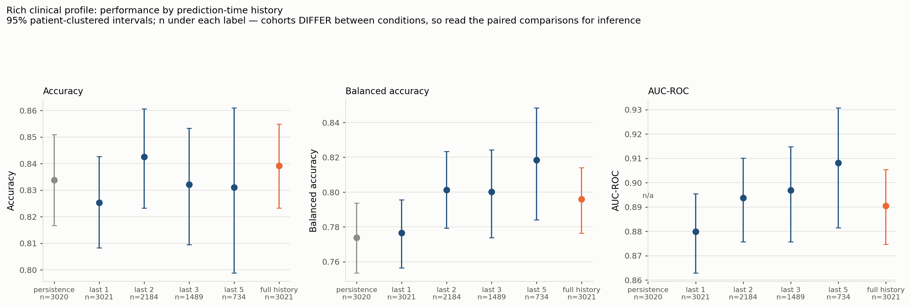
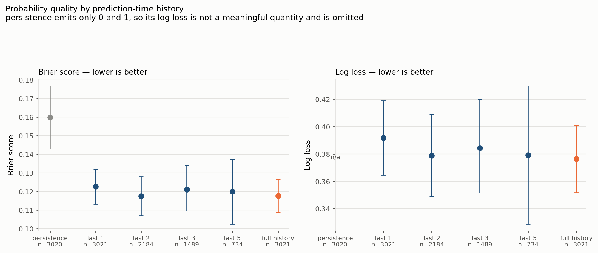
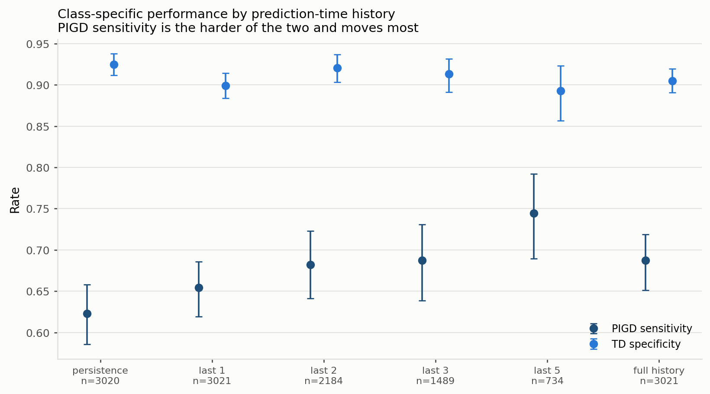
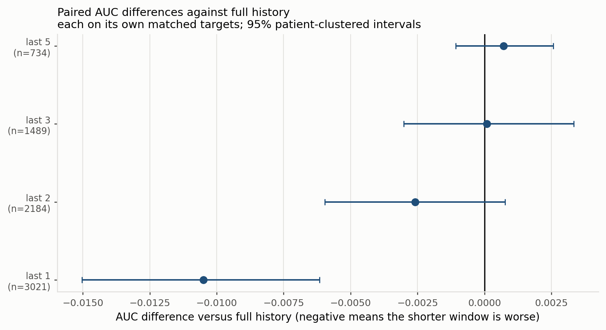

# Experiment 6A — How much recent history does the Rich Clinical Profile model need?

**Date** 2026-11-03 · **Script** `scripts/73_profile_prediction_history.py`
**Run** `experiments/20261103T052237Z_profile_prediction_history/`
**Experiment 6B (retraining on two-visit windows) was NOT performed and is out of scope.**
**No existing model code, experiment output or report was modified. Nothing committed.**

---

## 1. Executive summary

We asked whether the Rich Clinical Profile model still predicts a patient's next
motor subtype well when it is only allowed to look at their most recent few
clinical visits, instead of their whole record. The model itself was not
changed or retrained — only what it is allowed to see at prediction time.

**The answer is that two to three recent visits are enough, but one is not.**

Cutting back to a single visit makes the model measurably worse on every
measure: accuracy drops by 1.4 points, AUC by 0.011, and its ability to catch
PIGD cases falls by 3.3 points, with all of those intervals excluding zero.
Allowing two, three or five visits gives results that are indistinguishable
from the full record on accuracy, AUC and probability quality.

There is one consistent nuance that the headline numbers hide. **Every
shortened window loses a little PIGD sensitivity and gains a little TD
specificity.** The overall scores stay flat because those two effects cancel,
but the model becomes slightly more conservative about predicting PIGD as
history is removed. If identifying PIGD patients is what matters clinically,
full history is still doing something that two visits do not.

---

## 2. Research question

Earlier work in this project established that the Rich Profile model ranks
patients better than the CT-HMM (AUC 0.890 against 0.858) and that the CT-HMM
needs only two to three visits at prediction time. The equivalent question had
not been asked of the Rich Profile model, which consumes a much richer input —
nine clinical domains tracked over time rather than a sequence of subtype
labels — and so might plausibly depend on history differently.

Practically, the answer matters because a model that needs only two visits can
be applied to patients who have just entered follow-up.

---

## 3. The model, briefly

The Rich Clinical Profile model tracks nine clinical domains (bradykinesia /
rigidity, tremor, PIGD, UPDRS parts 1 and 2, MoCA, GDS, SCOPA, ESS) for each
patient. For every domain it maintains a **level** (where the patient is now)
and a **rate** (how fast they are changing), updated visit by visit with a
Kalman filter, with prescribed levodopa-equivalent dose (LEDD) as an input.

To predict the next visit it projects those levels and rates forward over the
real elapsed time, then pushes the predicted tremor and PIGD scores through the
project's own unmodified subtype rule by Monte Carlo. No new classifier and no
new threshold is introduced anywhere in this experiment.

Implementation: `src/ppmi_subtype/clinical_profile.py`, fitted and evaluated by
`scripts/64_clinical_profile_cv.py`.

---

## 4. Experimental design

Five history conditions, plus the persistence reference:

| Condition | What the model may see |
|---|---|
| persistence | not a model — carry the last observed subtype forward |
| last 1 | the single most recent clinical visit |
| last 2 | the two most recent |
| last 3 | the three most recent |
| last 5 | the five most recent |
| full history | every visit before the target |

**The model is fitted once per cross-validation fold and those parameters are
then held fixed across all five conditions.** This is the whole point of the
design: if the model were refitted per window, any difference could come from
the retraining rather than from the history restriction. A parameter
fingerprint is recorded per fold and checked to be identical across conditions.

**Restricting history is a slice, not a reset.** The filtered clinical state is
rebuilt from the retained visits only — a full-sequence filter is never
computed and then cut afterwards. Original visit dates, years-from-baseline and
inter-visit gaps are carried through unchanged.

One consequence is worth stating plainly: a truncated window starts its first
retained visit from the population prior, as though that visit were the
patient's baseline. With a single visit the level is a blend of that
observation and the training-cohort mean, and the **rate carries essentially no
patient-specific information**, because one point cannot define a slope. That
is the most likely reason the last-1 condition does badly.

**Medication.** The model takes the target visit's *prescribed* LEDD as an
input — the existing convention, preserved identically in every condition, so
it cannot affect the comparison between conditions. No target-visit motor
measurement is ever used; those are the outcome. A previous experiment measured
what this input is worth and found it negligible (accuracy −0.0013, interval
spanning zero).

---

## 5. Cohort and validation

**Validation is 5-fold patient-level cross-validation**, the Rich Profile
model's existing scheme. It was deliberately *not* switched to the CT-HMM's
leave-one-patient-out, because changing the validation design would make this
experiment incomparable with the model's own earlier results.

Every learned quantity — the model, the standardiser, the population mean and
the LOCF spread — is fitted on training patients only, inside each fold.

332 target visits whose actual subtype is
Indeterminate, or whose ratio is undefined, are excluded from the binary
TD/PIGD scoring, exactly as in every other experiment in this project.

### Cohorts differ between conditions, and this is not hidden

| Condition | Targets | Patients | TD | PIGD | PIGD prevalence |
|---|---:|---:|---:|---:|---:|
| persistence | 3020 | 898 | 2110 | 910 | 0.3013 |
| last 1 | 3021 | 898 | 2110 | 911 | 0.3016 |
| last 2 | 2184 | 740 | 1470 | 714 | 0.3269 |
| last 3 | 1489 | 481 | 955 | 534 | 0.3586 |
| last 5 | 734 | 228 | 429 | 305 | 0.4155 |
| full history | 3021 | 898 | 2110 | 911 | 0.3016 |

A patient needs five prior visits to appear in the last-5 condition, so that
condition keeps only 734 of the 3,021 targets — and those
patients are a longer-followed, more PIGD-heavy group (41.6% PIGD against
30.2% overall). **This is why the raw table in §6 shows balanced accuracy and
AUC apparently rising as the window shortens.** That is a cohort artefact, not
a model effect. All inference in this report therefore comes from the **paired
comparisons in §6.3**, where each window is compared with full history on
exactly the targets both can predict.

---

## 6. Results

### 6.1 All eligible targets per condition

Read this table for description only; the cohorts differ between rows.

| Condition | Patients | Targets | Accuracy | Balanced acc | AUC-ROC | Brier | Log loss | PIGD sens | TD spec |
|---|---:|---:|---|---|---|---:|---:|---|---|
| persistence | 898 | 3020 | 0.8338 [0.8167, 0.8509] | 0.7739 [0.7536, 0.7938] | n/a | 0.1598 | n/a | 0.6231 [0.5857, 0.6582] | 0.9246 [0.9115, 0.9377] |
| last 1 | 898 | 3021 | 0.8252 [0.8082, 0.8426] | 0.7766 [0.7564, 0.7955] | 0.8800 [0.8629, 0.8955] | 0.1227 | 0.3919 | 0.6542 [0.6192, 0.6856] | 0.8991 [0.8840, 0.9144] |
| last 2 | 740 | 2184 | 0.8425 [0.8232, 0.8606] | 0.8012 [0.7793, 0.8233] | 0.8937 [0.8757, 0.9101] | 0.1175 | 0.3787 | 0.6821 [0.6411, 0.7231] | 0.9204 [0.9034, 0.9365] |
| last 3 | 481 | 1489 | 0.8321 [0.8094, 0.8533] | 0.8002 [0.7738, 0.8243] | 0.8969 [0.8757, 0.9148] | 0.1210 | 0.3843 | 0.6873 [0.6388, 0.7306] | 0.9131 [0.8914, 0.9315] |
| last 5 | 228 | 734 | 0.8311 [0.7988, 0.8610] | 0.8185 [0.7841, 0.8484] | 0.9081 [0.8815, 0.9307] | 0.1199 | 0.3791 | 0.7443 [0.6892, 0.7922] | 0.8928 [0.8568, 0.9233] |
| full history | 898 | 3021 | 0.8391 [0.8232, 0.8549] | 0.7959 [0.7764, 0.8140] | 0.8904 [0.8747, 0.9054] | 0.1177 | 0.3763 | 0.6872 [0.6513, 0.7190] | 0.9047 [0.8907, 0.9195] |

### 6.2 The common cohort — identical 734 targets in every row

| Condition | Patients | Targets | Accuracy | Balanced acc | AUC-ROC | Brier | Log loss | PIGD sens | TD spec |
|---|---:|---:|---|---|---|---:|---:|---|---|
| persistence | 228 | 734 | 0.8270 [0.7938, 0.8584] | 0.8089 [0.7707, 0.8434] | n/a | 0.1730 | n/a | 0.7016 [0.6353, 0.7570] | 0.9161 [0.8851, 0.9424] |
| last 1 | 228 | 734 | 0.8106 [0.7749, 0.8432] | 0.7953 [0.7585, 0.8274] | 0.8961 [0.8659, 0.9213] | 0.1286 | 0.4074 | 0.7049 [0.6475, 0.7549] | 0.8858 [0.8492, 0.9163] |
| last 2 | 228 | 734 | 0.8243 [0.7902, 0.8562] | 0.8070 [0.7705, 0.8401] | 0.9066 [0.8799, 0.9298] | 0.1225 | 0.3941 | 0.7049 [0.6380, 0.7601] | 0.9091 [0.8767, 0.9369] |
| last 3 | 228 | 734 | 0.8406 [0.8088, 0.8699] | 0.8248 [0.7897, 0.8552] | 0.9092 [0.8833, 0.9315] | 0.1205 | 0.3844 | 0.7311 [0.6692, 0.7829] | 0.9184 [0.8878, 0.9452] |
| last 5 | 228 | 734 | 0.8311 [0.7988, 0.8610] | 0.8185 [0.7841, 0.8484] | 0.9081 [0.8815, 0.9307] | 0.1199 | 0.3791 | 0.7443 [0.6892, 0.7922] | 0.8928 [0.8568, 0.9233] |
| full history | 228 | 734 | 0.8338 [0.8008, 0.8649] | 0.8237 [0.7888, 0.8542] | 0.9074 [0.8806, 0.9305] | 0.1200 | 0.3791 | 0.7639 [0.7083, 0.8107] | 0.8834 [0.8468, 0.9165] |

Precision, predicted probability and calibration:

| Condition | PIGD precision | TD precision | Mean predicted P(PIGD) | Actual PIGD prevalence |
|---|---:|---:|---:|---:|
| persistence | 0.7810 | 0.8505 | 0.2496 | 0.3013 |
| last 1 | 0.7367 | 0.8576 | 0.3218 | 0.3016 |
| last 2 | 0.8063 | 0.8563 | 0.3217 | 0.3269 |
| last 3 | 0.8156 | 0.8393 | 0.3403 | 0.3586 |
| last 5 | 0.8315 | 0.8308 | 0.3911 | 0.4155 |
| full history | 0.7570 | 0.8701 | 0.3249 | 0.3016 |

Confusion matrices (all eligible targets):

| Condition | True PIGD | True TD | False PIGD | False TD |
|---|---:|---:|---:|---:|
| persistence | 567 | 1951 | 159 | 343 |
| last 1 | 596 | 1897 | 213 | 315 |
| last 2 | 487 | 1353 | 117 | 227 |
| last 3 | 367 | 872 | 83 | 167 |
| last 5 | 227 | 383 | 46 | 78 |
| full history | 626 | 1909 | 201 | 285 |

### 6.3 Paired comparisons against full history — the basis for all inference

Each comparison uses its own matched cohort: the targets both conditions can
predict. One patient resample serves both conditions within each bootstrap
replicate, so the pairing is preserved. **Bold** marks an interval excluding
zero. All 2,000 replicates were valid for every metric shown.

| Comparison | Targets | Patients | Accuracy | Balanced accuracy | AUC-ROC | Brier | Log loss |
|---|---:|---:|---|---|---|---|---|
| last 1  -  full history | 3021 | 898 | **-0.0139 [-0.0221, -0.0057]** | **-0.0193 [-0.0288, -0.0098]** | **-0.0105 [-0.0150, -0.0062]** | **+0.0050 [+0.0029, +0.0070]** | **+0.0156 [+0.0088, +0.0224]** |
| last 2  -  full history | 2184 | 740 | +0.0046 [-0.0031, +0.0123] | -0.0013 [-0.0109, +0.0086] | -0.0026 [-0.0060, +0.0008] | +0.0005 [-0.0014, +0.0023] | +0.0050 [-0.0005, +0.0103] |
| last 3  -  full history | 1489 | 481 | +0.0060 [-0.0020, +0.0138] | +0.0010 [-0.0087, +0.0101] | +0.0001 [-0.0030, +0.0033] | -0.0000 [-0.0023, +0.0021] | +0.0015 [-0.0048, +0.0078] |
| last 5  -  full history | 734 | 228 | -0.0027 [-0.0116, +0.0057] | -0.0052 [-0.0156, +0.0039] | +0.0007 [-0.0011, +0.0026] | -0.0001 [-0.0015, +0.0012] | -0.0000 [-0.0042, +0.0039] |

| Comparison | PIGD sensitivity | TD specificity |
|---|---|---|
| last 1  -  full history | **-0.0329 [-0.0499, -0.0162]** | -0.0057 [-0.0143, +0.0031] |
| last 2  -  full history | -0.0182 [-0.0362, +0.0000] | **+0.0156 [+0.0080, +0.0236]** |
| last 3  -  full history | -0.0169 [-0.0346, +0.0000] | **+0.0188 [+0.0109, +0.0285]** |
| last 5  -  full history | **-0.0197 [-0.0377, -0.0061]** | +0.0093 [+0.0000, +0.0209] |

These are **four principal comparisons and the intervals are unadjusted**. A
Bonferroni threshold across them would be α = 0.0125. The last-1 results are
far enough from zero to survive that; the class-specific results for last-2,
last-3 and last-5 are not, and are described below as a consistent pattern
rather than as individually established findings.

---

## 7. Comparison with persistence

| Comparison | Targets | Accuracy | Balanced accuracy | Brier | PIGD sensitivity | TD specificity |
|---|---:|---|---|---|---|---|
| last 2  -  persistence | 2184 | +0.0082 [+0.0000, +0.0164] | **+0.0126 [+0.0028, +0.0225]** | **-0.0467 [-0.0582, -0.0361]** | **+0.0252 [+0.0080, +0.0427]** | +0.0000 [-0.0082, +0.0086] |
| full history  -  persistence | 3020 | +0.0053 [-0.0028, +0.0131] | **+0.0219 [+0.0118, +0.0325]** | **-0.0422 [-0.0514, -0.0329]** | **+0.0637 [+0.0452, +0.0842]** | **-0.0199 [-0.0270, -0.0125]** |

The Rich Profile model with full history beats persistence on balanced accuracy
(+0.0219), Brier score (−0.0422) and PIGD sensitivity (+0.0637), all with
intervals excluding zero — but **not on plain accuracy** (+0.0053, interval
spanning zero), and it is slightly *worse* on TD specificity (−0.0199). With
only two visits it still beats persistence on balanced accuracy and Brier.

This is the same pattern seen throughout the project: the model's advantage
over the trivial baseline is in its probabilities and in catching the minority
class, not in the raw proportion of correct calls.

---

## 8. Interpretation

**Does recent history retain the predictive information?** Largely yes. Two
visits match full history on accuracy (+0.0046), AUC (−0.0026), Brier (+0.0005)
and log loss (+0.0050) — every interval contains zero. Three and five visits
are closer still; at last-3 the AUC difference is +0.0001.

**Does full history add value?** Not on the aggregate measures. It does add
something specific: **PIGD sensitivity is lower in every restricted window**
(−0.0329, −0.0182, −0.0169, −0.0197 for last-1 through last-5). The direction is
consistent across all four, even where individual intervals touch zero, and it
is offset by higher TD specificity (+0.0156 and +0.0188 at last-2 and last-3,
both excluding zero). So restricting history does not make the model worse
overall — it makes it **more conservative**, trading PIGD detection for TD
precision.

**Does AUC change more or less than accuracy?** Less, and more smoothly. From
last-1 to full history, accuracy moves 1.4 points while AUC moves 0.011. AUC is
also the metric that saturates earliest: by two visits it is within 0.003 of
full history, and by three visits it is identical. Accuracy is the noisier
measure here, with wider intervals, which is consistent with the rest of this
project's findings.

**Does probability quality change?** Only at last-1 (Brier +0.0050, log loss
+0.0156, both excluding zero). From two visits onward, probability quality is
indistinguishable from full history.

**Why does one visit fail?** The mechanism is visible in the model's structure
rather than inferred from the numbers: with a single observation the Kalman
filter cannot estimate a rate of change, so the patient's trajectory
information is absent and only their current level, shrunk toward the cohort
mean, remains. The second visit is what makes a per-patient rate estimable, and
that is where most of the gain appears.

---

## 9. Limitations

- **Cohorts differ between conditions** (3,021 targets at last-1 down to 734 at
  last-5), and the restricted-window cohorts are longer-followed and more
  PIGD-heavy. The descriptive table in §6.1 is affected by this; the paired
  comparisons in §6.3 are not, and are what the conclusions rest on.
- **Truncation changes state initialisation.** A shortened window begins from
  the population prior as if its first retained visit were a baseline. Part of
  the last-1 penalty is this initialisation effect rather than missing
  information as such, and the two cannot be separated within this design.
- **The target visit's prescribed LEDD is an input.** It is identical across
  conditions so it does not bias this comparison, but it means the prediction
  setting assumes the next visit's planned dose is known.
- **Validation differs from the CT-HMM experiments** (5-fold CV here,
  leave-one-patient-out there). Results should not be compared point-for-point
  across the two models' history experiments.
- **Four unadjusted principal comparisons**, plus two against persistence.
- Patient-clustered percentile bootstrap, 2,000 replicates, no bias correction.
- **An interval containing zero is not proof of equivalence.** The last-2
  comparison is consistent with a true accuracy difference anywhere from −0.3
  to +1.2 points; it rules out a large effect, not a small one.
- Only one repeat of the cross-validation was run.

---

## 10. Conclusion

**The Rich Clinical Profile model does retain its predictive performance using
only recent visits, provided it has at least two.** Two to three recent clinical
visits give accuracy, AUC and probability quality that cannot be distinguished
from the complete record on matched targets. A single visit is measurably
worse on every measure.

The one caveat worth carrying forward is that restricting history consistently
costs a little PIGD sensitivity, which the aggregate metrics conceal because
TD specificity rises to compensate.

---

## 11. What this means for Experiment 6B

**6B was not run.** On this evidence, the case for it is modest and specific.

Because the model performs as well at two or three visits as at full history
*without any retraining*, there is no performance gap for window-based
retraining to close at those widths. The one place retraining could plausibly
help is **last-1**, where the deficit is real and where part of the cause is
structural — the filter cannot estimate a rate from one point, and a model
fitted to single-visit inputs might calibrate its prior differently.

Two pieces of evidence should guide the decision:

1. **The CT-HMM precedent is discouraging.** The equivalent retraining
   experiment for the CT-HMM made that model worse, not better, and the damage
   came from the training change rather than the history restriction.
2. **The cost here falls on PIGD sensitivity**, so if 6B is run, PIGD
   sensitivity on matched targets — not accuracy — should be the metric it is
   judged on, and the window to investigate is **last-2** (the shortest window
   that is not already deficient) or **last-1** (where the deficit is).

A cheaper alternative that would answer the underlying question first: test
whether the last-1 deficit is an initialisation artefact by giving the
single-visit condition a per-patient rate prior drawn from the training cohort,
with no retraining at all.

---

## 12. Validation

**28 of 28 checks passed**, including the two that matter most for credibility:
refitting fold 0 with the same seed reproduced its predictions exactly and gave
an identical parameter fingerprint, and every reported metric was recomputed
from the saved prediction file and matched.

One check failed during development and was fixed rather than weakened:
`predict_sequence` reports `n_history` relative to the sequence it is handed,
so for a truncated window that column equalled the window width rather than the
patient's real history length. This also meant a "no padded visit" check was
passing vacuously. The script now records the true available history
separately, and both checks test something real.

Full list in `validation_checks.csv`. Groups covered: patient-level separation
and one fold per patient; parameters fixed across conditions within a fold;
each target once per condition; window kept exactly the W visits ending at the
current visit; no padding; original timestamps verified against the parent
sequences; every historical visit precedes its target; intervals positive and
preserved; state rebuilt from retained visits only with no smoothing;
target-visit LEDD identical across conditions; Indeterminate excluded;
probabilities finite, in [0, 1] and summing to one; hard calls follow the
project's decision rule; bootstrap resamples patients with one sample shared
across both conditions in a pair.

## 13. Files

`experiments/20261103T052237Z_profile_prediction_history/`: `window_predictions.csv`, `window_metrics.csv`,
`paired_comparisons.csv`, `cohort_counts.csv`, `confusion_matrices.csv`,
`validation_checks.csv`, `summary.json`, `report.txt`, `driver.log`,
`MANIFEST.sha256`, and four figures.
