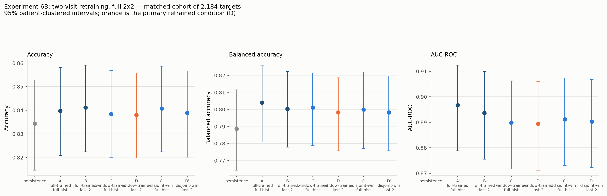
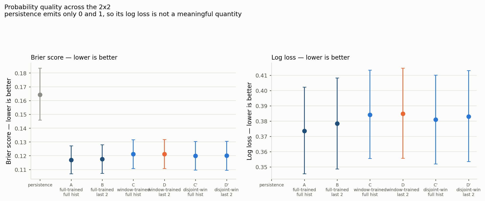
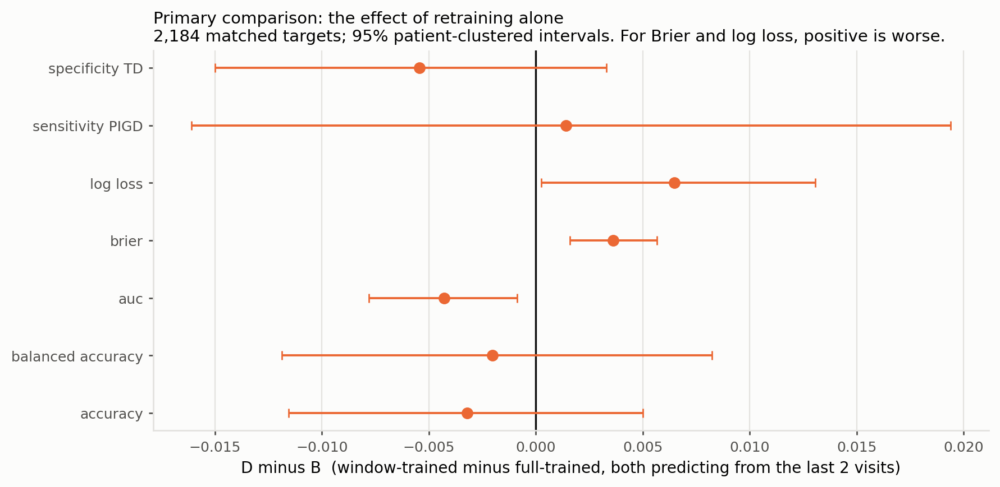
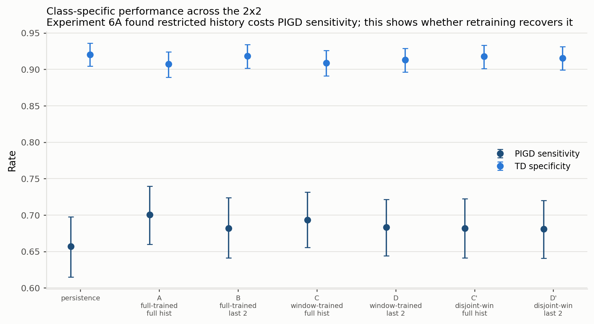

# Experiment 6B — Does retraining the Rich Clinical Profile on two-visit windows help?

**Date** 2026-11-03 · **Script** `scripts/74_profile_two_visit_retraining.py`
**Run** `experiments/20261103T072507Z_profile_two_visit_retraining/`
**Experiment 6A, the CT-HMM experiments and all earlier work are unchanged. Nothing committed.**

---

## 1. Executive summary

Experiment 6A showed that the Rich Clinical Profile model predicts just as well
from a patient's last two visits as from their whole record — but it loses a
little of its ability to catch PIGD cases when history is cut back. This
experiment asked whether **retraining** the model on two-visit windows, so that
training matches how it will be used, recovers that loss.

**It does not. Retraining leaves the model no better, and measurably worse on
the quality of its probabilities.**

Comparing like with like — both models predicting from the last two visits, so
the only difference is how they were trained — retraining left accuracy and
balanced accuracy unchanged (−0.0032 and −0.0020, intervals spanning zero) and
made all three probability measures worse: AUC −0.0043, Brier +0.0036, log loss
+0.0065, every interval excluding zero. **PIGD sensitivity did not recover**
(+0.0014, interval spanning zero).

**Full-sequence training should be kept.** It is the existing procedure, it is
no worse on any measure, and it is better on the measures where this model's
value actually lies.

---

## 2. Background

Experiment 6A held the model fixed and varied only what it could see at
prediction time. Two or three visits matched the full record on accuracy, AUC
and probability quality; a single visit did not. The one consistent cost of
restricting history was PIGD sensitivity, which fell in every shortened window
and was offset by a rise in TD specificity.

That raised a fair question: 6A's model was trained on complete sequences but
then asked to predict from two visits. Perhaps a model *trained* the way it is
*used* would do better. Experiment 6B tests exactly that.

The CT-HMM's equivalent experiment had already answered the same question
negatively for that model, with the damage coming from the training change
rather than the history restriction. That was a reason to be sceptical, not a
reason to skip the test.

---

## 3. Research question

Does training on two-visit windows improve next-visit subtype prediction when
predictions are also made from the last two visits — in balanced accuracy, PIGD
sensitivity, AUC and probability quality — and is any change attributable to the
training procedure rather than the history restriction?

---

## 4. The model, briefly

The Rich Clinical Profile model tracks nine clinical domains per patient, each
with a **level** (where the patient is) and a **rate** (how fast they are
changing), updated visit by visit with a Kalman filter, with prescribed LEDD as
an input. To predict, it projects levels and rates forward over the real
elapsed time and pushes the predicted tremor and PIGD scores through the
project's own unmodified subtype rule.

Implementation: `src/ppmi_subtype/clinical_profile.py`. Nothing in it was
changed for this experiment.

---

## 5. Experimental design — the full 2×2

|  | Prediction: full history | Prediction: last 2 visits |
|---|---|---|
| **Training: full sequences** | **A** | **B** |
| **Training: two-visit windows** | **C** | **D** ← primary |

**The primary comparison is D versus B.** Both predict from the last two
visits, so the only difference is how the model was trained — which is what
isolates the training effect. Comparing D with full-history-trained,
full-history prediction (A) would change training *and* inference at once and
could not separate them; that is why the complete 2×2 is required.

Two further conditions, C′ and D′, repeat C and D with **disjoint** rather than
overlapping windows, and persistence is included as a reference baseline.

Validation is **5-fold patient-level cross-validation**, Experiment 6A's scheme,
with identical fold construction — the fold sizes [187, 187, 187, 187, 186]
match 6A exactly. Within each fold, the standardiser, population quantities and
all three models are fitted on training patients only, and each model's
parameters are then held fixed across both prediction conditions. A parameter
fingerprint is recorded per training strategy and checked.

---

## 6. Training-window construction, and what it does to the objective

This is the methodological heart of the experiment, and the answer is not the
tidy one.

`filter_domain` accumulates **one one-step-ahead Gaussian term per visit**, and
the term at `k = 0` is a prediction from the model's fixed prior, not from data.
So a full sequence of n visits contributes **1 prior term and n−1 transition
terms**, while a two-visit window contributes **1 of each**. Measured per fold:

| Training set (fold 0) | Windows | Observation terms | Prior terms | Transition terms | Prior : transition |
|---|---:|---:|---:|---:|---|
| full sequences | — | 3418 | 747 | 2671 | 1 : 3.6 |
| overlapping windows | 2671 | 5342 | 2671 | 2671 | 1 : 1 |
| disjoint windows | 1526 | 3052 | 1526 | 1526 | 1 : 1 |

Two consequences, both reported rather than glossed:

1. **Overlapping windows duplicate observations.** Each interior visit appears
   twice — once as a window's second visit (a genuine one-step prediction) and
   once as the next window's first visit (a prior prediction). Observation terms
   rise from 3,418 to 5,342, a factor of 1.56.
2. **The prior-to-transition weighting changes drastically**, for overlapping
   *and* disjoint windows alike: from 1 : 3.6 to 1 : 1. Initialisation terms
   stop being an edge effect and become half the objective.

**Neither window objective is therefore "the same likelihood on shorter
sequences".** The overlapping objective is a **composite (pseudo) likelihood**
whose value is not comparable with the full-sequence likelihood — which is why
the log-likelihood row below is marked as such and never used to compare
columns. The disjoint objective is a proper likelihood over non-overlapping
pairs, but still carries the reweighting in (2).

The disjoint rule is: pairs start at visit 0 and step by two — (0,1), (2,3), …
With an odd number of visits the final unpaired visit is **dropped**, never
padded and never joined to a non-adjacent visit. The rule looks only at visit
positions, never at a label or at performance.

### Did the rate component survive?

A two-visit window contains only one transition, so it is reasonable to worry
that the model cannot identify a rate of change at all and silently degenerates
into a level-only random walk. **It does not.** This was measured per fold
rather than assumed:

| Training set | Domains with rate switched off | Max rate_var | Max init_rate_var |
|---|---:|---:|---:|
| full sequences | 0.0 of 9 | 2.16e-02 | 1.22e-02 |
| overlapping windows | 0.0 of 9 | 8.33e-03 | 3.33e-02 |
| disjoint windows | 0.0 of 9 | 1.17e-02 | 2.82e-02 |

The rate component survives in all nine domains under every training set. It is
**shrunk**, not switched off:

| Quantity | Full sequences | Overlapping windows | Disjoint windows |
|---|---:|---:|---:|
| obs_var | 0.1943 | 0.1475 | 0.1702 |
| level_var | 0.1032 | 0.1892 | 0.1345 |
| rate_var | 0.0031 | 0.0010 | 0.0013 |
| init_rate_var | 0.0021 | 0.0008 | 0.0016 |
| log-likelihood (not comparable across columns) | -36653.2313 | -68110.0651 | -38590.9960 |

Window training roughly halves the fitted rate variances and raises the level
variance — the model leans more on where the patient is and less on where they
are heading. That is a plausible mechanism for the probability-quality loss
reported below, though this experiment measures the effect rather than proving
the mechanism.

### Timeline

Windows are slices. Original visit dates, years-from-baseline, inter-visit
gaps, clinical values and medication inputs are carried through unchanged, and
time is never reset to zero. Only consecutive visits of one patient ever share a
window, so no artificial transition is created.

---

## 7. Validation and cohort

332 target visits with an Indeterminate actual
subtype or an undefined ratio are excluded from binary scoring, as everywhere
else in this project.

All conditions are evaluated on a **matched cohort of
2,184 targets from 740 patients** — every target that all
seven conditions can predict, which requires at least two prior visits.

| Condition | Targets | Patients | TD | PIGD |
|---|---:|---:|---:|---:|
| persistence | 3020 | 898 | 2110 | 910 |
| A: full-trained, full history | 3021 | 898 | 2110 | 911 |
| B: full-trained, last 2 | 2184 | 740 | 1470 | 714 |
| C: window-trained, full history | 3021 | 898 | 2110 | 911 |
| D: window-trained, last 2 | 2184 | 740 | 1470 | 714 |
| C': disjoint-window-trained, full history | 3021 | 898 | 2110 | 911 |
| D': disjoint-window-trained, last 2 | 2184 | 740 | 1470 | 714 |

---

## 8. Results

All rows below are the same 2,184 targets, so they are
directly comparable.

| Condition | Patients | Targets | Accuracy | Balanced acc | AUC-ROC | Brier | Log loss | PIGD sens | TD spec |
|---|---:|---:|---|---|---|---:|---:|---|---|
| persistence | 740 | 2184 | 0.8342 [0.8146, 0.8528] | 0.7886 [0.7643, 0.8115] | n/a | 0.1642 | n/a | 0.6569 [0.6148, 0.6976] | 0.9204 [0.9042, 0.9358] |
| A: full-trained, full history | 740 | 2184 | 0.8397 [0.8208, 0.8581] | 0.8039 [0.7808, 0.8260] | 0.8966 [0.8788, 0.9124] | 0.1169 | 0.3736 | 0.7003 [0.6601, 0.7395] | 0.9075 [0.8893, 0.9242] |
| B: full-trained, last 2 | 740 | 2184 | 0.8411 [0.8224, 0.8591] | 0.8002 [0.7778, 0.8222] | 0.8936 [0.8755, 0.9099] | 0.1176 | 0.3783 | 0.6821 [0.6411, 0.7239] | 0.9184 [0.9016, 0.9342] |
| C: window-trained, full history | 740 | 2184 | 0.8384 [0.8198, 0.8568] | 0.8011 [0.7787, 0.8213] | 0.8898 [0.8716, 0.9062] | 0.1212 | 0.3841 | 0.6933 [0.6558, 0.7313] | 0.9088 [0.8913, 0.9257] |
| D: window-trained, last 2 | 740 | 2184 | 0.8379 [0.8198, 0.8558] | 0.7982 [0.7756, 0.8186] | 0.8893 [0.8712, 0.9060] | 0.1212 | 0.3848 | 0.6835 [0.6442, 0.7216] | 0.9129 [0.8963, 0.9286] |
| C': disjoint-window-trained, full history | 740 | 2184 | 0.8407 [0.8224, 0.8586] | 0.7999 [0.7770, 0.8219] | 0.8911 [0.8731, 0.9073] | 0.1199 | 0.3810 | 0.6821 [0.6410, 0.7222] | 0.9177 [0.9010, 0.9333] |
| D': disjoint-window-trained, last 2 | 740 | 2184 | 0.8388 [0.8201, 0.8566] | 0.7982 [0.7756, 0.8197] | 0.8903 [0.8723, 0.9068] | 0.1201 | 0.3829 | 0.6807 [0.6408, 0.7199] | 0.9156 [0.8991, 0.9313] |

Confusion matrices and precision:

| Condition | True PIGD | True TD | False PIGD | False TD | PIGD precision | TD precision |
|---|---:|---:|---:|---:|---:|---:|
| persistence | 469 | 1353 | 117 | 245 | 0.8003 | 0.8467 |
| A: full-trained, full history | 500 | 1334 | 136 | 214 | 0.7862 | 0.8618 |
| B: full-trained, last 2 | 487 | 1350 | 120 | 227 | 0.8023 | 0.8561 |
| C: window-trained, full history | 495 | 1336 | 134 | 219 | 0.7870 | 0.8592 |
| D: window-trained, last 2 | 488 | 1342 | 128 | 226 | 0.7922 | 0.8559 |
| C': disjoint-window-trained, full history | 487 | 1349 | 121 | 227 | 0.8010 | 0.8560 |
| D': disjoint-window-trained, last 2 | 486 | 1346 | 124 | 228 | 0.7967 | 0.8551 |

---

## 9. Paired comparisons

Each row is computed on identical targets, with one patient resample shared by
both conditions in every replicate. **Bold** marks an interval excluding zero.

| Comparison | Accuracy | Balanced accuracy | AUC-ROC | Brier | Log loss | PIGD sens | TD spec |
|---|---|---|---|---|---|---|---|
| **PRIMARY** — training effect, history fixed at last 2 | -0.0032 [-0.0116, +0.0050] | -0.0020 [-0.0119, +0.0082] | **-0.0043 [-0.0078, -0.0009]** | **+0.0036 [+0.0016, +0.0057]** | **+0.0065 [+0.0003, +0.0131]** | +0.0014 [-0.0161, +0.0194] | -0.0054 [-0.0150, +0.0033] |
| training effect, history fixed at full | -0.0014 [-0.0089, +0.0064] | -0.0028 [-0.0122, +0.0062] | **-0.0068 [-0.0101, -0.0037]** | **+0.0042 [+0.0024, +0.0060]** | **+0.0105 [+0.0048, +0.0163]** | -0.0070 [-0.0237, +0.0090] | +0.0014 [-0.0069, +0.0094] |
| history effect, training fixed at full-sequence | +0.0014 [-0.0060, +0.0083] | -0.0037 [-0.0129, +0.0050] | -0.0030 [-0.0063, +0.0004] | +0.0007 [-0.0012, +0.0025] | +0.0048 [-0.0011, +0.0107] | **-0.0182 [-0.0362, -0.0014]** | **+0.0109 [+0.0035, +0.0183]** |
| history effect, training fixed at windows | -0.0005 [-0.0065, +0.0055] | -0.0029 [-0.0097, +0.0040] | -0.0005 [-0.0021, +0.0010] | +0.0001 [-0.0008, +0.0009] | +0.0007 [-0.0020, +0.0037] | -0.0098 [-0.0217, +0.0026] | +0.0041 [-0.0026, +0.0108] |
| disjoint vs overlapping windows | +0.0009 [-0.0047, +0.0064] | -0.0000 [-0.0063, +0.0061] | +0.0009 [-0.0006, +0.0025] | **-0.0011 [-0.0019, -0.0003]** | -0.0019 [-0.0046, +0.0006] | -0.0028 [-0.0134, +0.0073] | +0.0027 [-0.0034, +0.0087] |
| vs persistence | +0.0037 [-0.0046, +0.0122] | **+0.0096 [+0.0001, +0.0196]** | n/a | **-0.0430 [-0.0541, -0.0325]** | n/a | **+0.0266 [+0.0101, +0.0441]** | -0.0075 [-0.0175, +0.0020] |
| vs persistence | +0.0069 [-0.0010, +0.0154] | **+0.0116 [+0.0017, +0.0215]** | n/a | **-0.0466 [-0.0581, -0.0361]** | n/a | **+0.0252 [+0.0084, +0.0426]** | -0.0020 [-0.0104, +0.0066] |

**The primary result.** With prediction history held fixed at the last two
visits, retraining is neutral on the threshold metrics (accuracy −0.0032,
balanced accuracy −0.0020, both spanning zero) and **worse on all three
probability metrics** (AUC −0.0043, Brier +0.0036, log loss +0.0065, all
excluding zero).

**The same penalty appears at full history.** Condition C against A gives
AUC −0.0068, Brier +0.0042, log loss +0.0105, all excluding zero. So the
training change hurts regardless of what the model is allowed to see at
prediction time — it is a worse model, not a mismatch between training and use.

**A useful consistency check.** The history effect under full-sequence training
(B − A) reproduces Experiment 6A exactly: PIGD sensitivity **−0.0182**, the same
value 6A reported for last-2 against full history, with TD specificity +0.0109.
Two independently written scripts agreeing to four decimal places is reassurance
that both are measuring what they claim.

**Once trained on windows, history stops mattering** (D − C): every interval
spans zero, including PIGD sensitivity. A window-trained model has in effect
learned to work from two visits — it simply works slightly less well.

Seven comparisons, one pre-specified primary; a Bonferroni threshold over the
other six is α = 0.0083. The AUC and Brier results for both training contrasts
would survive it; the log-loss result for the primary comparison (lower bound
+0.0003) would not.

---

## 10. PIGD sensitivity — the question 6A raised

**Retraining does not recover it.** The primary comparison gives
+0.0014 [−0.0161, +0.0194] — centred almost exactly on zero with an interval far
too wide to call either way. Restricting history still costs PIGD sensitivity
under full-sequence training (−0.0182, excluding zero), and retraining does not
undo that.

Both model conditions still beat persistence on PIGD sensitivity (+0.0266 for D,
+0.0252 for B, both excluding zero), so neither is bad at the task in absolute
terms — retraining simply fails to deliver the specific improvement that
motivated the experiment.

---

## 11. Probability quality

This is where retraining does real harm, and it matters because probability
quality is where the Rich Profile model earns its place in this project — it was
chosen over the CT-HMM on AUC, Brier and log loss, not on accuracy.

AUC falls from 0.8936 to 0.8893 and Brier rises from 0.1176 to 0.1212 when the
model is retrained (conditions B → D). The effects are small in absolute terms
but consistent, and present at both prediction-history settings.

**Overlapping versus disjoint windows** behaves as the duplication concern
predicts: disjoint windows are slightly *better* on Brier
(−0.0011, excluding zero) with AUC and log loss indistinguishable. So a little
of the penalty is attributable to the double-counting of interior visits rather
than to the two-visit width itself — but only a little, and disjoint training is
still worse than full-sequence training.

---

## 12. Limitations

- **The window objectives are not the full-sequence likelihood.** The
  overlapping one is a composite likelihood with duplicated observations; both
  reweight prior terms from 1 : 3.6 to 1 : 1 against transition terms. This is a
  genuine confound between "two-visit training" and "differently weighted
  objective" that the design cannot separate.
- **Fewer effective transitions** under disjoint windows (1,526 against 2,671
  per fold), so C′ and D′ are fitted on roughly half the dynamic information.
- **Matched cohort excludes first-visit targets.** Requiring two prior visits
  drops targets with only one, so the cohort is 2,184 of 3,021 and skews to
  longer-followed patients.
- **State initialisation.** A truncated window starts from the population prior
  as if its first retained visit were a baseline; this affects conditions B and
  D equally so it does not bias the primary comparison, but it is part of why
  short histories behave as they do.
- **Target-visit prescribed LEDD is an input**, identical across all conditions,
  so it cannot affect these comparisons.
- **One repeat** of the cross-validation; seven unadjusted comparisons.
- **An interval spanning zero is not equivalence.** The primary accuracy
  interval is consistent with anything from −1.2 to +0.5 points.
- Only width 2 was tested, as specified. A width-3 window would carry two
  transitions per window and might behave differently.

---

## 13. Conclusion

**Two-visit retraining did not improve the Rich Clinical Profile model.**

On the comparison that isolates it, retraining was neutral on accuracy and
balanced accuracy, failed to recover PIGD sensitivity, and was significantly
worse on AUC, Brier score and log loss. The same penalty appeared when
prediction history was held at full, so this is a worse model rather than a
training-inference mismatch. Window construction mattered only marginally:
disjoint windows were slightly better than overlapping ones on Brier, consistent
with the duplication they avoid, but still worse than full-sequence training.

**Full-sequence training remains preferable** — it is the existing procedure, it
is no worse on any measure here, and it is better on the probability measures
that are this model's reason for being in the project.

Taken with Experiment 6A, the practical position is now settled for this model:
**predict from the last two or three visits if that is convenient, but keep
training on complete sequences.**

## 14. Files

`experiments/20261103T072507Z_profile_two_visit_retraining/`: `condition_predictions.csv`, `condition_metrics.csv`,
`paired_comparisons.csv`, `cohort_counts.csv`, `confusion_matrices.csv`,
`parameter_comparison.csv`, `fold_parameters.csv`, `window_accounting.csv`,
`validation_checks.csv`, `summary.json`, `report.txt`, `driver.log`,
`MANIFEST.sha256`, and four figures.
