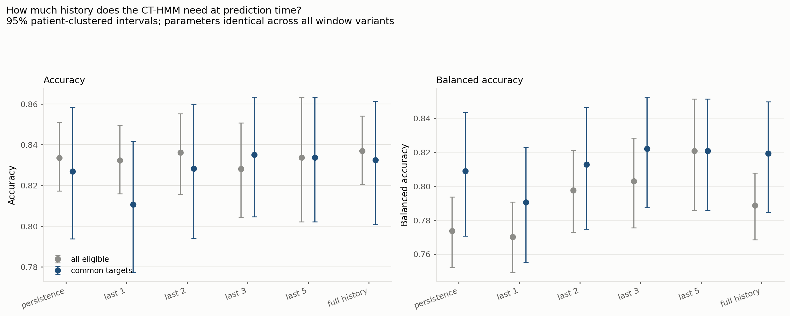
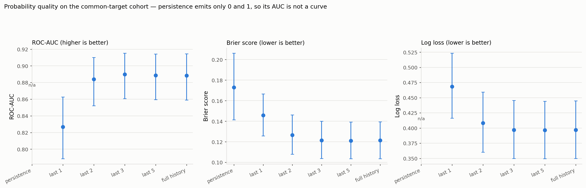
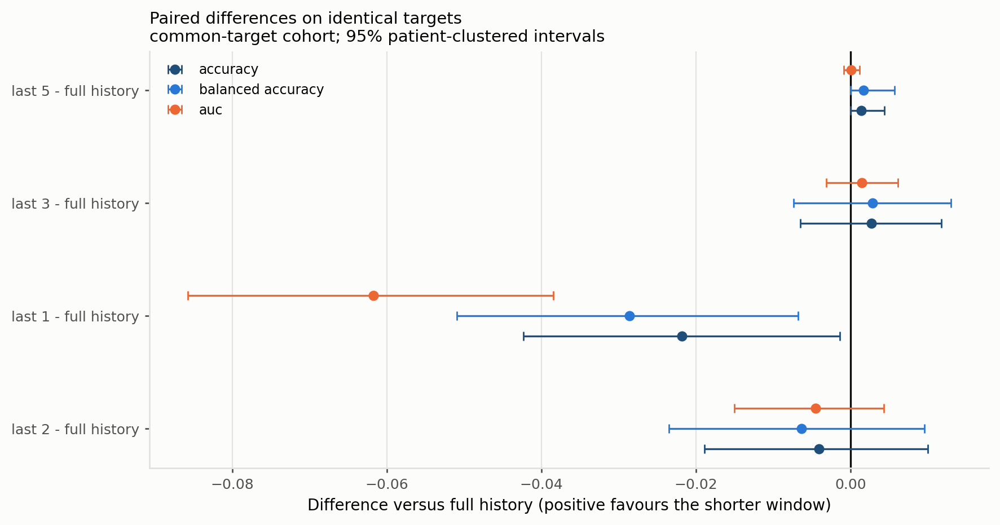
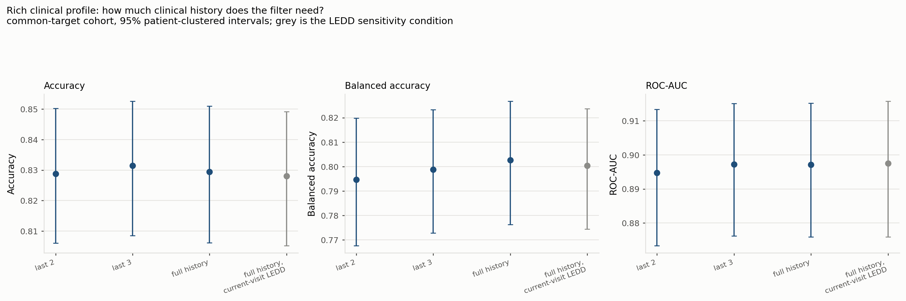

# Does older subtype history add predictive value? A controlled history-window experiment

**Date** 2026-10-24
**Primary (CT-HMM)** `scripts/70_history_window_experiment.py` · run `experiments/20261024T042417Z_history_window_experiment/`
**Secondary (rich profile)** `scripts/71_profile_history_window.py` · run `experiments/20261024T042811Z_profile_history_window/`
**No existing model implementation, experiment output or report was modified. Nothing committed.**

## Verdict

**Two to three visits of history are enough. Older visits add nothing
measurable — but going down to a single visit does cost real accuracy.**

On the pre-specified primary comparison, the CT-HMM restricted to the **last 2
visits** is statistically indistinguishable from **full history** on every
metric: accuracy −0.0041 (95% CI −0.0189 to +0.0100), balanced accuracy
−0.0063, ROC-AUC −0.0045, Brier +0.0051, log loss +0.0112 — all five intervals
contain zero. **Last 3 is indistinguishable from full history too**, with point
estimates near zero on every metric (AUC +0.0014, Brier +0.0001).

**Last 1 is genuinely worse**, and this is the clearest result in the study:
accuracy −0.0218 (CI −0.0423 to −0.0014), balanced accuracy −0.0286, and AUC
−0.0617 (CI −0.0858 to −0.0385). So the second-most-recent visit carries real
information; the fourth and beyond do not.

The rich clinical profile behaves the same way, independently: last 2 versus
full history gives accuracy −0.0007 (CI −0.0102 to +0.0085) and AUC −0.0025
(CI −0.0069 to +0.0016).

---

## 1. What the inspection found

The brief asked for eight things to be documented before implementing. All
paths were verified in the repository rather than assumed; the modules named in
the brief as bare filenames live under `src/ppmi_subtype/`.

**1. How the CT-HMM constructs the observation sequence.** `loo.prepare` keeps
visits with a non-null `subtype`, sorts by `PATNO` then `years_from_baseline`,
and `hmm.build_sequences` emits one dict per patient holding `labels` (integer
subtype codes) and `gaps` (`np.diff(times)` in years). `next_visit.build_cases`
then creates one prediction case per transition, with `history = labels[: k+1]`
and `n_history = k + 1`.

**2. How transition and emission parameters are fitted.** Multistart maximum
likelihood through `hmm_stability.fit_multistart`, with starts generated by
`next_visit.audited_starts` from the configured seed, restart count (4) and
emission floor (0.5). The fitted object carries the generator `Q`, the
emission matrix `E` and the initial distribution `pi`.

**3. How next-visit probabilities are calculated.** `hmm.predictive_distributions`
runs the forward filter: `alpha = pi * E[:, labels[0]]`, normalise; then for each
gap, `latent_next = alpha @ expm(Q*gap)`, `predicted = latent_next @ E`, and only
*afterwards* `alpha = latent_next * E[:, labels[k+1]]`. The prediction for a visit
is therefore formed before that visit's label is absorbed.

**4. Fixed or refitted across variants.** This was the central design decision
and it is **fixed**: see §2.

**5. How elapsed time is handled.** `expm(Q·gap)` with the real gap, looked up
per unique gap rounded to 3 decimals. Truncation preserves the actual gaps
between retained visits; nothing is re-spaced.

**6. How the rich profile constructs and updates its filtered state.**
`ProfileModel.filter_domain` runs a Kalman filter per domain from a fixed prior
(`m = 0`, `P = diag([INIT_LEVEL_VAR, init_rate_var])`; zero is the training-cohort
mean on the standardised scale). `predict_next` propagates the **filtered** state
at visit k — not a smoothed state — over the real `dt`.

**7. How splits, labels and metrics are produced.** CT-HMM: leave-one-patient-out,
934 folds, with `loo.assert_no_leakage` inside every fold. Rich profile: 5-fold
patient cross-validation, with the standardiser, population mean and LOCF spread
refitted per fold on training patients and an explicit `RuntimeError` if a
held-out patient appears in training. Labels come from `subtype.classify` on the
frozen panel; Indeterminate targets are excluded from binary scoring.

**8. What could be reused.** The persistence baseline was reused from the
validated run (matched on patient and visit index). Everything else had to be
regenerated, because truncating history changes the filter input and no run had
saved per-fold parameters. **The full-history condition was regenerated and
checked against the original**: it reproduces it with a maximum absolute
difference in `P_PIGD` of **1.1e-16** and identical hard calls.

No change to any existing module was needed.

---

## 2. Protocol, and the one design choice that matters

**Parameters are fitted once per fold on the training patients' full sequences
and shared by every window variant. Only the held-out patient's prediction-time
history is truncated.**

That is deliberate. Refitting per window would change the training data and the
estimator at the same time as the window, and no difference could then be
attributed to history length alone. The question asked here is *how much history
the filter needs at prediction time*, and this design isolates it.

The assumption it creates is named rather than hidden: **a truncated window
treats its first retained visit as a baseline drawn from `pi`**, when in fact it
sits mid-trajectory. A variant that also refits on truncated training sequences
would be a different modelling choice and is listed in §9 as the recommended
next experiment.

| | |
|---|---|
| Validation | leave-one-patient-out, 934 folds, CT-HMM |
| Panel | frozen `outputs/visit_panel.csv`, md5 `fb038ddbdc19ab3368e13940f398e7ba`, verified |
| Seed / restarts / emission floor | 42 / 4 / 0.5, from `config` |
| Conditions | persistence, last 1, last 2, last 3, last 5, full history |
| Primary comparison | **last 2 vs full history, common-target cohort — pre-specified** |
| Indeterminate targets excluded | 332 per condition |
| Common-target cohort | 734 targets, 228 patients (n_history ≥ 5, eligible in every condition) |

Eligibility is never padded: a target with fewer visits than a window simply
does not appear in that window's all-eligible cohort. Of the 734 targets long
enough for every window, **0 were dropped** for being ineligible in some
condition.

---

## 3. CT-HMM results

### All targets eligible for each window

Cohorts differ between rows here, so these are *not* directly comparable; the
common-target table below is the fair comparison.

| Condition | Targets | Patients | TD | PIGD | Accuracy | Balanced acc | PIGD sens | PIGD spec | ROC-AUC | Brier | Log loss |
|---|---:|---:|---:|---:|---:|---:|---:|---:|---:|---:|---:|
| persistence | 3029 | 899 | 2115 | 914 | 0.8336 | 0.7737 | 0.6225 | 0.9248 | n/a | 0.1598 | n/a |
| last 1 | 3029 | 899 | 2115 | 914 | 0.8323 | 0.7702 | 0.6138 | 0.9267 | 0.7978 | 0.1326 | 0.4303 |
| last 2 | 2192 | 742 | 1475 | 717 | 0.8362 | 0.7977 | 0.6862 | 0.9092 | 0.8633 | 0.1227 | 0.3988 |
| last 3 | 1495 | 487 | 961 | 534 | 0.8281 | 0.8030 | 0.7154 | 0.8907 | 0.8691 | 0.1276 | 0.4123 |
| last 5 | 734 | 228 | 429 | 305 | 0.8338 | 0.8208 | 0.7443 | 0.8974 | 0.8885 | 0.1211 | 0.3964 |
| full history | 3029 | 899 | 2115 | 914 | 0.8369 | 0.7888 | 0.6674 | 0.9102 | 0.8587 | 0.1214 | 0.3961 |

### Common-target cohort — the fair comparison

Identical 734 targets from 228 patients in every row.

| Condition | Targets | Patients | TD | PIGD | Accuracy | Balanced acc | PIGD sens | PIGD spec | ROC-AUC | Brier | Log loss |
|---|---:|---:|---:|---:|---:|---:|---:|---:|---:|---:|---:|
| persistence | 734 | 228 | 429 | 305 | 0.8270 | 0.8089 | 0.7016 | 0.9161 | n/a | 0.1730 | n/a |
| last 1 | 734 | 228 | 429 | 305 | 0.8106 | 0.7906 | 0.6721 | 0.9091 | 0.8267 | 0.1458 | 0.4685 |
| last 2 | 734 | 228 | 429 | 305 | 0.8283 | 0.8129 | 0.7213 | 0.9044 | 0.8839 | 0.1266 | 0.4082 |
| last 3 | 734 | 228 | 429 | 305 | 0.8351 | 0.8220 | 0.7443 | 0.8998 | 0.8899 | 0.1215 | 0.3967 |
| last 5 | 734 | 228 | 429 | 305 | 0.8338 | 0.8208 | 0.7443 | 0.8974 | 0.8885 | 0.1211 | 0.3964 |
| full history | 734 | 228 | 429 | 305 | 0.8324 | 0.8192 | 0.7410 | 0.8974 | 0.8884 | 0.1214 | 0.3970 |

With confidence intervals:

| Condition | Accuracy [95% CI] | Balanced accuracy [95% CI] | ROC-AUC [95% CI] |
|---|---|---|---|
| persistence | 0.8270 [0.7938, 0.8584] | 0.8089 [0.7707, 0.8434] | n/a |
| last 1 | 0.8106 [0.7773, 0.8418] | 0.7906 [0.7554, 0.8229] | 0.8267 [0.7885, 0.8628] |
| last 2 | 0.8283 [0.7941, 0.8597] | 0.8129 [0.7748, 0.8464] | 0.8839 [0.8521, 0.9102] |
| last 3 | 0.8351 [0.8047, 0.8634] | 0.8220 [0.7874, 0.8524] | 0.8899 [0.8608, 0.9152] |
| last 5 | 0.8338 [0.8021, 0.8632] | 0.8208 [0.7857, 0.8513] | 0.8885 [0.8594, 0.9143] |
| full history | 0.8324 [0.8008, 0.8615] | 0.8192 [0.7846, 0.8498] | 0.8884 [0.8591, 0.9146] |

Confusion matrix on the common-target cohort:

| Condition | True PIGD | True TD | False PIGD | False TD |
|---|---:|---:|---:|---:|
| persistence | 214 | 393 | 36 | 91 |
| last 1 | 205 | 390 | 39 | 100 |
| last 2 | 220 | 388 | 41 | 85 |
| last 3 | 227 | 386 | 43 | 78 |
| last 5 | 227 | 385 | 44 | 78 |
| full history | 226 | 385 | 44 | 79 |

**Persistence has no ROC-AUC or log loss.** It emits only 0 and 1, so it has one
operating point rather than a curve, and its log loss would be nothing but the
arbitrary clipping constant times its error rate. Both are reported as
unavailable rather than forced; its Brier score is reported, but note that for a
0/1 predictor Brier equals the misclassification rate.

---

## 4. Paired comparisons

Each row is computed on identical targets, with patients — never individual
targets — resampled 2,000 times.

| Role | Comparison | Accuracy | Balanced accuracy | ROC-AUC | Brier | Log loss |
|---|---|---|---|---|---|---|
| PRIMARY (pre-specified) | last 2 - full history | -0.0041 [-0.0189, +0.0100] | -0.0063 [-0.0235, +0.0096] | -0.0045 [-0.0150, +0.0043] | +0.0051 [-0.0005, +0.0106] | +0.0112 [-0.0028, +0.0248] |
| secondary | last 2 - persistence | +0.0014 [-0.0085, +0.0108] | +0.0040 [-0.0064, +0.0148] | n/a | -0.0465 [-0.0635, -0.0307] | n/a |
| secondary | last 3 - persistence | +0.0082 [-0.0083, +0.0239] | +0.0132 [-0.0047, +0.0308] | n/a | -0.0515 [-0.0698, -0.0346] | n/a |
| secondary | last 1 - persistence | -0.0163 [-0.0298, -0.0040] | -0.0183 [-0.0329, -0.0041] | n/a | -0.0272 [-0.0441, -0.0116] | n/a |
| secondary | full history - persistence | +0.0054 [-0.0109, +0.0222] | +0.0103 [-0.0079, +0.0291] | n/a | -0.0516 [-0.0708, -0.0341] | n/a |
| exploratory | last 1 - full history | -0.0218 [-0.0423, -0.0014] | -0.0286 [-0.0509, -0.0068] | -0.0617 [-0.0858, -0.0385] | +0.0244 [+0.0162, +0.0329] | +0.0715 [+0.0494, +0.0946] |
| exploratory | last 3 - full history | +0.0027 [-0.0065, +0.0117] | +0.0028 [-0.0074, +0.0129] | +0.0014 [-0.0032, +0.0061] | +0.0001 [-0.0036, +0.0037] | -0.0003 [-0.0100, +0.0093] |
| exploratory | last 5 - full history | +0.0014 [+0.0000, +0.0043] | +0.0016 [+0.0000, +0.0057] | +0.0001 [-0.0009, +0.0011] | -0.0003 [-0.0011, +0.0003] | -0.0006 [-0.0026, +0.0009] |

**Multiplicity.** The primary comparison was fixed before any result was seen.
The remaining seven comparisons are secondary or exploratory; a Bonferroni
threshold over them would be α = 0.0071, and no unadjusted interval here is
treated as confirmatory. The last-1 results would survive such a correction on
AUC, Brier and log loss; the accuracy and balanced-accuracy intervals for
last-1, whose upper bounds are −0.0014 and −0.0068, would not.

---

## 5. Does older history add value? The seven questions

**1. Does last-2 outperform persistence?** On accuracy, **no**: +0.0014
(CI −0.0085 to +0.0108). On probability quality, **yes**: Brier −0.0465
(CI −0.0635 to −0.0307). Same calls, better-calibrated probabilities.

**2. Does last-3 outperform persistence?** Same pattern: accuracy +0.0082
(CI −0.0083 to +0.0239), Brier −0.0515 (CI −0.0698 to −0.0346).

**3. Does last-2 outperform full history on matched targets?** **No — and that
is the point.** All five intervals contain zero. Two visits are as good as
everything, not better.

**4. Are the differences meaningful across metrics?** Only for last-1, where
every metric moves in the same direction and four of five intervals exclude
zero. Between last-2, last-3, last-5 and full history, nothing is
distinguishable on any metric.

**5. Are gains driven by one subtype, particularly PIGD sensitivity?** **Yes.**
Across the common cohort PIGD sensitivity rises 0.6721 → 0.7213 → 0.7443 from
last-1 to last-2 to last-3, while PIGD specificity barely moves
(0.9091 → 0.9044 → 0.8998). The value of the second and third visit is almost
entirely in catching PIGD cases that a single visit misses.

**6. Does performance depend on the number of visits or the gap?** Exploratory,
and the gap split is the more interesting one:

| Subgroup | n targets | persistence | last 1 | last 2 | last 3 | last 5 | full history |
|---|---:|---:|---:|---:|---:|---:|---:|
| n_history 5-6 | 371 | 0.8221 | 0.7978 | 0.8167 | 0.8275 | 0.8275 | 0.8248 |
| n_history >=7 | 363 | 0.8320 | 0.8237 | 0.8402 | 0.8430 | 0.8402 | 0.8402 |
| last gap < 1y | 381 | 0.8530 | 0.8346 | 0.8451 | 0.8399 | 0.8268 | 0.8268 |
| last gap >= 1y | 353 | 0.7989 | 0.7847 | 0.8102 | 0.8300 | 0.8414 | 0.8385 |

When the last gap is **a year or more**, last-1 falls furthest behind full
history (0.7847 vs 0.8385); when the gap is **under a year** it does not
(0.8346 vs 0.8268). That is mechanically sensible — a stale single label is
weak evidence — but the subgroups are small, uncorrected and chosen after
seeing the main result.

**7. Robust to restricting to long histories?** Yes: the common-target cohort
*is* the long-history subset (n_history ≥ 5), and the conclusions above are all
drawn from it. The `n_history ≥ 7` row adds no change.

**A caution the brief asked for explicitly.** None of this shows older visits
are *harmful*. Where a shorter window scores marginally higher, the difference
is within noise and could equally come from the `pi` assumption in §2, from
parameter estimation, or from cohort variability. The defensible claim is
**"no measurable incremental value beyond about three visits"**, not "older
visits hurt".

---

## 6. Secondary experiment: rich clinical profile

Feasible with no architectural change, as §1.6 established: a window is a slice
of `Y`, `d`, `times`, `labels`, `events` and `visit_index`, and the filtered
state is **rebuilt from the retained visits only** — never reused from a pass
that had already absorbed visits outside the window. 5-fold patient CV, one
repeat; model, standardiser, population mean and LOCF spread fitted per fold on
training patients. Common-target cohort: **1,489 targets, 481 patients**
(n_history ≥ 3), 332 Indeterminate targets excluded.

| Condition | Targets | Patients | PIGD | Accuracy | Balanced acc | PIGD sens | PIGD spec | ROC-AUC | Brier | Log loss |
|---|---:|---:|---:|---:|---:|---:|---:|---:|---:|---:|
| last 2 | 1489 | 481 | 534 | 0.8287 | 0.7947 | 0.6742 | 0.9152 | 0.8947 | 0.1219 | 0.3921 |
| last 3 | 1489 | 481 | 534 | 0.8314 | 0.7988 | 0.6835 | 0.9141 | 0.8972 | 0.1209 | 0.3842 |
| full history | 1489 | 481 | 534 | 0.8294 | 0.8026 | 0.7079 | 0.8974 | 0.8972 | 0.1207 | 0.3822 |
| full history, current-visit LEDD | 1489 | 481 | 534 | 0.8281 | 0.8003 | 0.7022 | 0.8984 | 0.8974 | 0.1208 | 0.3819 |

| Role | Comparison | Accuracy | Balanced accuracy | ROC-AUC | Brier | Log loss |
|---|---|---|---|---|---|---|
| PRIMARY (pre-specified) | last 2 - full history | -0.0007 [-0.0102, +0.0085] | -0.0080 [-0.0196, +0.0033] | -0.0025 [-0.0069, +0.0016] | +0.0013 [-0.0013, +0.0038] | +0.0099 [+0.0015, +0.0193] |
| exploratory | last 3 - full history | +0.0020 [-0.0062, +0.0096] | -0.0038 [-0.0130, +0.0052] | +0.0000 [-0.0030, +0.0030] | +0.0002 [-0.0018, +0.0022] | +0.0020 [-0.0040, +0.0079] |
| LEDD sensitivity | full history, current-visit LEDD - full history | -0.0013 [-0.0056, +0.0026] | -0.0023 [-0.0078, +0.0024] | +0.0003 [-0.0008, +0.0014] | +0.0001 [-0.0005, +0.0007] | -0.0002 [-0.0022, +0.0017] |

**Same conclusion, reached independently.** Last 2 versus full history is
indistinguishable on accuracy, balanced accuracy, AUC and Brier; last 3 is
indistinguishable on everything, with AUC exactly 0.0000 apart. One interval
does exclude zero — **log loss, last 2 − full history, +0.0099 (CI +0.0015 to
+0.0193)** — a roughly 2.6% relative penalty, one of 15 intervals, on the single
metric most sensitive to the tails. It does not change the reading.

**Target-visit LEDD, audited as required.** `predict_next` takes the target
visit's prescribed dose. It is held identical across the three window
conditions, and a fourth clearly labelled condition repeats full history with
the *current* visit's dose instead. The difference is negligible: accuracy
−0.0013 (CI −0.0056 to +0.0026), AUC +0.0003, Brier +0.0001, log loss −0.0002.
**The disclosed asymmetry between the two models is therefore worth essentially
nothing**, which is reassuring for every earlier comparison in this project.
No target-visit motor measurement is used anywhere; those are the outcome.

---

## 7. Validation checks

**CT-HMM: 20 of 20 passed. Rich profile: 18 of 18 passed.** Both scripts exit
non-zero and write nothing further if any check fails, and all three earlier
failures were real (see §8). `validation_checks.csv` records every outcome.

The two that carry the most weight:

- **Tamper test.** Inside every fold, each sub-sequence's final label — the
  target, and only the target — is changed to a different state and the
  predictive distribution recomputed. Across **934 folds and 11,644 cases the
  maximum absolute change was exactly 0.0**. The target cannot be informing its
  own prediction.
- **Reproduction.** The full-history condition reproduces the original validated
  run to 1.1e-16 with identical hard calls.

Also checked: chronological ordering and positive intervals; `n_history ==
visit_index + 1`; no window used a padded visit; retained gaps are the real
elapsed times and every window agrees on the final gap; all windows predict the
same target for a given case; held-out patient never in training; parameters
fitted on a strict subset; every fit converged; standardiser/population/LOCF
refit per fold on training patients only; Indeterminate excluded consistently;
the common cohort is identical in every condition; probabilities finite, in
[0, 1] and summing to 1; the bootstrap resamples patients rather than targets;
the LEDD sensitivity condition genuinely swapped the dose; fixed seed recorded.

---

## 8. What failed along the way

Reported because the brief asks for precision about what ran:

1. **The first full run died in the confidence-interval pass.** `patient_boot`
   concatenated ~900 patient DataFrames 2,000 times for each of 60 metric and
   condition pairs. The 934-fold LOPO had completed, so no fitting was lost.
   Rewritten index-based, computing all metrics from one set of resamples; the
   pass now takes seconds. Results from the rerun are byte-identical to the
   first attempt's where both produced output.
2. **The tamper test failed on first run — correctly.** It had perturbed every
   label after the first, which corrupts later cases' *history*, not just their
   targets. Rewritten to perturb only each sub-sequence's final element.
3. **The common-cohort checks failed under `--limit`.** Persistence was merged
   over the whole cohort while the windows covered a subset. Fixed by
   restricting persistence to the processed cases, and the common cohort is now
   the intersection of eligible targets across all conditions rather than an
   assumption.

---

## 9. Limitations

- **Indeterminate targets are excluded** from all binary scoring (332 per
  condition), consistent with the rest of the project. Conclusions concern the
  TD-versus-PIGD task only.
- **Cohorts shrink with window size** in the all-eligible table (3,029 → 734 as
  the window widens from 1 to 5), which is why the common-target cohort exists
  and why only it is used for inference.
- **Parameters are not refit per window** (§2). A truncated window is evaluated
  under parameters estimated from full sequences, and treats its first retained
  visit as a baseline drawn from `pi`.
- **The two models keep different validation schemes** — LOPO for the CT-HMM,
  5-fold CV for the rich profile — so the two experiments answer the same
  question separately and their numbers should not be compared directly to each
  other.
- **The rich profile uses the target visit's prescribed LEDD.** Disclosed,
  preserved across variants, and shown in §6 to be worth almost nothing.
- **Multiple comparisons**: one pre-specified primary, fifteen further intervals
  for the CT-HMM and fifteen for the rich profile, unadjusted.
- Patients contribute several targets; all intervals are patient-clustered
  percentile bootstraps from 2,000 draws, without bias correction.
- Subgroup analyses in §5.6 are exploratory, small and uncorrected.

---

## 10. Conclusion, and the next experiment

**Are two or three visits sufficient?** Yes. Three visits match full history on
every metric for both models; two visits match it on every metric for the
CT-HMM and on all but log loss for the rich profile.

**Does full history add measurable value?** **No** — not beyond about the third
most recent visit. But history is not worthless: dropping to a single visit
costs about 2 points of accuracy and 6 points of AUC in the CT-HMM, almost
entirely in PIGD sensitivity, and most of that cost appears when the gap to the
last visit is a year or more.

**Recommended next experiment.** The honest gap in this design is that
parameters were estimated from full sequences and then applied to truncated
ones. The natural follow-up is to **refit the CT-HMM on sliding windows of the
training sequences** — matching the input the model will actually see, while
preserving training data volume — and test whether a model fitted and evaluated
at width 2 or 3 beats the current fixed-parameter version. That would separate
"the filter does not need older visits" from "the estimator does not need them
either", which this experiment deliberately did not try to answer.

## 11. Files

CT-HMM run `experiments/20261024T042417Z_history_window_experiment/`: `window_predictions.csv`, `window_metrics.csv`,
`paired_comparisons.csv`, `subgroups.csv`, `validation_checks.csv`,
`tamper_check.csv`, `summary.json`, `report.txt`, `driver.log`,
`MANIFEST.sha256`, three figures.

Rich-profile run `experiments/20261024T042811Z_profile_history_window/`: `profile_window_predictions.csv`,
`profile_window_metrics.csv`, `profile_paired_comparisons.csv`,
`validation_checks.csv`, `summary.json`, `report.txt`, `driver.log`,
`MANIFEST.sha256`, one figure.
