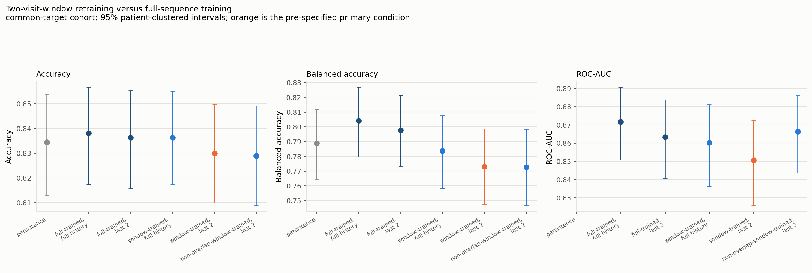

# Retraining the CT-HMM on two-visit sliding windows

**Date** 2026-10-24 · **Script** `scripts/72_retrained_two_visit_cthmm.py`
**Run** `experiments/20261024T052343Z_retrained_two_visit_cthmm/`
**No existing model code, frozen artefact, report or experiment output was modified. Nothing committed.**

## Verdict

**Retraining does not help. It makes the model measurably worse, and the damage
comes from the change in *training*, not from restricting prediction history.**

On the pre-specified primary comparison — two-visit-window-trained with a last-2
prediction history, against the full-history-trained model with full prediction
history, on 2,192 common targets — accuracy is statistically unchanged
(−0.0082, 95% CI −0.0193 to +0.0026) but **every probability-sensitive metric
is worse with an interval excluding zero**: balanced accuracy −0.0312
(−0.0441 to −0.0183), ROC-AUC −0.0210 (−0.0301 to −0.0120), Brier +0.0099,
log loss +0.0397.

The 2×2 design separates the two causes, which was the point of running it:

| Effect | Balanced accuracy | ROC-AUC |
|---|---|---|
| **Changing the training set** (history fixed at last 2) | **−0.0248 (−0.0354 to −0.0147)** | **−0.0127 (−0.0197 to −0.0060)** |
| **Restricting prediction history** (training fixed at full) | −0.0064 (−0.0150 to +0.0023) | −0.0084 (−0.0144 to −0.0026) |

Restricting prediction history is close to free, as script 70 found. Retraining
on windows costs about four times as much on balanced accuracy, and costs it
whether the prediction history is truncated or not (−0.0203 at full history).

**So the `pi` mismatch that motivated this experiment was not the limiting
factor.** Fixing it does not recover anything, because fitting on two-visit
windows degrades the transition and emission estimates by more than the
corrected initial distribution gains. Script 70's conclusion stands unchanged.

---

## 1. What the inspection established

Grounded in the code, not in the standard CT-HMM equations.

**1. Training sequences.** `loo.prepare` keeps visits with a non-null `subtype`,
sorts by `PATNO` then `years_from_baseline`, and `hmm.build_sequences` emits one
dict per patient with `labels` (integer state codes) and `gaps`
(`np.diff(times)`, in years). `min_length` defaults to **2**, so a two-visit
sequence is already a legal input.

**2. Initial-state distribution.** `pi = softmax(init_logits)` — a free
parameter estimated jointly by maximum likelihood, not a separate empirical
count. It multiplies the first observation's emission:
`alpha_0 = pi * E[:, labels[0]]`.

**3. Transition-rate matrix.** `Q` is estimated jointly in the same
optimisation, via `transition_probabilities(Q, gaps)` → `expm(Q·Δt)`,
pre-computed per unique gap rounded to 3 decimals. The model is fitted by
direct likelihood maximisation with multistart (`hmm_stability.fit_multistart`),
**not** by EM.

**4. Emission probabilities.** A categorical misclassification matrix `E`,
constrained by an emission floor of 0.5 on the diagonal — the floor is what
makes the latent layer identifiable and prevents label switching.

**5. Time homogeneity.** The model is **time-homogeneous** and carries **no**
absolute-time, visit-number or disease-duration covariate. Elapsed time enters
only through `Δt` in `expm(Q·Δt)`.

**6. Temporal representation.** `years_from_baseline` per visit; gaps are
first differences. There is no visit-index feature.

**7. Propagation to the target.** `hmm.predictive_distributions` runs the
forward filter: normalise `alpha`, then per gap
`latent_next = alpha @ expm(Q·gap)`, `predicted = latent_next @ E`, and **only
afterwards** `alpha = latent_next * E[:, labels[k+1]]`. The prediction for a
visit is formed before that visit's label is absorbed.

**8. Temporal features used.** Elapsed time between observations only. **There
is therefore nothing to reindex when a window is taken** — a point the brief
asked to be settled explicitly rather than assumed.

**9. Missing and undefined labels.** Visits without a `subtype` are dropped
before sequence construction; Indeterminate is a real observed state in the
input history and is never recoded, but Indeterminate *targets* are excluded
from binary scoring.

**10. Existing LOPO and intervals.** 934 folds, `loo.assert_no_leakage` inside
each; confidence intervals are patient-clustered percentile bootstraps.

---

## 2. The estimation objective, and what it costs

A sliding window is a contiguous slice of one patient's sequence, kept as **its
own sequence**. Windows are never concatenated, so no transition is manufactured
between patients or between disconnected windows. This needed **no change to
`hmm.py`**.

**The objective is a composite (pseudo) likelihood, not a likelihood.** Each
*transition* appears exactly once across the overlapping windows, but each
*interior visit* appears twice — as the second element of one window and the
first of the next — so emissions are double-counted. Cohort-wide that is
**3,361 overlapping windows** (exactly one
per transition, 3,361) covering 6,715
window-observations drawn from 4,290 real ones. The objective's *value* is
therefore not comparable to the full-sequence log-likelihood
(−5,147.1 against −2,965.9 per fold on average) and its curvature gives no valid
standard errors. Point estimates remain usable and everything here is judged
out-of-sample, so the estimator is defensible for this question — but it is not
presented as a likelihood.

Because that concern is real, a **disjoint-window variant** was fitted as a
sensitivity: 1,916 non-overlapping pairs,
which *is* a proper likelihood at the cost of roughly half the transitions.
Section 5 reports what it found, and the answer is not a footnote.

No regularisation, smoothing or minimum-count constraint was added. The existing
emission floor (0.5), restart count (4) and seed (42) are unchanged, and all
three fits in a fold use the same training patients, the same starts and the same
floor, so the only thing differing between conditions is what the brief varies.

### What the parameters did

| Parameter | Full-sequence fit | Two-visit-window fit | Difference |
|---|---:|---:|---:|
| pi[TD] | 0.7269 | 0.7542 | +0.0273 |
| pi[Indeterminate] | 0.1553 | 0.0443 | -0.1110 |
| pi[PIGD] | 0.1178 | 0.2016 | +0.0837 |
| Q diag [TD] | -0.0971 | -0.0588 | +0.0383 |
| Q diag [Indeterminate] | -0.4688 | -0.4367 | +0.0321 |
| Q diag [PIGD] | -0.0546 | -0.0106 | +0.0439 |
| E diag [TD] | 0.9401 | 0.8751 | -0.0649 |
| E diag [Indeterminate] | 0.5000 | 0.6651 | +0.1651 |
| E diag [PIGD] | 0.8718 | 0.8804 | +0.0086 |

`pi` is the latent distribution at a window's **first** visit. Under full
sequences that is the patient's baseline; under sliding windows it is the
marginal over all visit positions. **These are different quantities, and the
change is the intended one** — a truncated prediction window starts
mid-trajectory, so a `pi` estimated mid-trajectory matches it. The
Indeterminate mass collapses from 0.1553 to 0.0443 and PIGD mass nearly doubles.

The side effects are the problem. `Q`'s PIGD diagonal moves from −0.0546 to
−0.0106, making the PIGD state far more persistent, and the Indeterminate
emission rises off its floor from 0.5000 to 0.6651. The observable consequence
is a model much less willing to call PIGD: PIGD sensitivity falls from 0.7057 to
0.6081 while specificity rises from 0.9024 to 0.9376.

---

## 3. Design and protocol

| | |
|---|---|
| Validation | leave-one-patient-out, 934 folds, 0 failed |
| Panel | frozen `outputs/visit_panel.csv`, md5 `fb038ddbdc19ab3368e13940f398e7ba`, verified |
| Seed / restarts / emission floor | 42 / 4 / 0.5 |
| Fits per fold | 3 (full sequences, overlapping windows, disjoint windows) |
| Indeterminate / undefined targets excluded | 332 |
| Common-target cohort | **2,192 targets, 742 patients** (last-2 needs n_history ≥ 2) |
| Primary comparison | **window-trained, last 2 vs full-trained, full history** — pre-specified |

The conditions form a 2×2 on {training set} × {prediction history}, plus
persistence and the disjoint-window sensitivity. Persistence is reused from the
validated original run, matched on patient and visit index, and restricted to
the cases these folds produced.

### Reproduction of the two earlier runs

- **full-trained/full-history vs original run**: 3,361 rows, max |ΔP| 1.110e-16, identical calls True
- **full-trained/last-2 vs script 70**: 2,427 rows, max |ΔP| 9.714e-17, identical calls True

Both are exact to floating-point noise with identical hard calls. This is the
strongest evidence that the pipeline is measuring only what it claims to: the
full-trained conditions regenerate the previously validated predictions
bit-for-bit, so any difference in the window-trained conditions is attributable
to the retraining alone.

---

## 4. Results

### All targets eligible for each condition

Cohorts differ between rows, so this table is descriptive only.

| Condition | Targets | Patients | TD | PIGD | Accuracy | Balanced acc | PIGD sens | PIGD spec | ROC-AUC | Brier | Log loss |
|---|---:|---:|---:|---:|---:|---:|---:|---:|---:|---:|---:|
| persistence | 3029 | 899 | 2115 | 914 | 0.8336 | 0.7737 | 0.6225 | 0.9248 | n/a | 0.1598 | n/a |
| full-trained, full history | 3029 | 899 | 2115 | 914 | 0.8369 | 0.7888 | 0.6674 | 0.9102 | 0.8587 | 0.1214 | 0.3961 |
| full-trained, last 2 | 2192 | 742 | 1475 | 717 | 0.8362 | 0.7977 | 0.6862 | 0.9092 | 0.8633 | 0.1227 | 0.3988 |
| window-trained, full history | 3029 | 899 | 2115 | 914 | 0.8362 | 0.7725 | 0.6116 | 0.9333 | 0.8460 | 0.1279 | 0.4312 |
| window-trained, last 2 | 2192 | 742 | 1475 | 717 | 0.8298 | 0.7729 | 0.6081 | 0.9376 | 0.8506 | 0.1310 | 0.4345 |
| non-overlap-window-trained, last 2 | 2192 | 742 | 1475 | 717 | 0.8289 | 0.7725 | 0.6095 | 0.9356 | 0.8663 | 0.1268 | 0.4105 |

### Common-target cohort — the fair comparison

Identical 2,192 targets from 742 patients in every row.

| Condition | Targets | Patients | TD | PIGD | Accuracy | Balanced acc | PIGD sens | PIGD spec | ROC-AUC | Brier | Log loss |
|---|---:|---:|---:|---:|---:|---:|---:|---:|---:|---:|---:|
| persistence | 2192 | 742 | 1475 | 717 | 0.8344 | 0.7888 | 0.6569 | 0.9207 | n/a | 0.1640 | n/a |
| full-trained, full history | 2192 | 742 | 1475 | 717 | 0.8380 | 0.8040 | 0.7057 | 0.9024 | 0.8717 | 0.1210 | 0.3947 |
| full-trained, last 2 | 2192 | 742 | 1475 | 717 | 0.8362 | 0.7977 | 0.6862 | 0.9092 | 0.8633 | 0.1227 | 0.3988 |
| window-trained, full history | 2192 | 742 | 1475 | 717 | 0.8362 | 0.7837 | 0.6318 | 0.9356 | 0.8602 | 0.1292 | 0.4405 |
| window-trained, last 2 | 2192 | 742 | 1475 | 717 | 0.8298 | 0.7729 | 0.6081 | 0.9376 | 0.8506 | 0.1310 | 0.4345 |
| non-overlap-window-trained, last 2 | 2192 | 742 | 1475 | 717 | 0.8289 | 0.7725 | 0.6095 | 0.9356 | 0.8663 | 0.1268 | 0.4105 |

With confidence intervals:

| Condition | Accuracy [95% CI] | Balanced accuracy [95% CI] | ROC-AUC [95% CI] |
|---|---|---|---|
| persistence | 0.8344 [0.8128, 0.8539] | 0.7888 [0.7640, 0.8118] | n/a |
| full-trained, full history | 0.8380 [0.8173, 0.8568] | 0.8040 [0.7795, 0.8269] | 0.8717 [0.8507, 0.8908] |
| full-trained, last 2 | 0.8362 [0.8156, 0.8553] | 0.7977 [0.7729, 0.8212] | 0.8633 [0.8405, 0.8837] |
| window-trained, full history | 0.8362 [0.8172, 0.8550] | 0.7837 [0.7582, 0.8076] | 0.8602 [0.8362, 0.8810] |
| window-trained, last 2 | 0.8298 [0.8098, 0.8498] | 0.7729 [0.7471, 0.7986] | 0.8506 [0.8256, 0.8725] |
| non-overlap-window-trained, last 2 | 0.8289 [0.8087, 0.8491] | 0.7725 [0.7465, 0.7983] | 0.8663 [0.8435, 0.8860] |

Confusion matrix:

| Condition | True PIGD | True TD | False PIGD | False TD |
|---|---:|---:|---:|---:|
| persistence | 471 | 1358 | 117 | 246 |
| full-trained, full history | 506 | 1331 | 144 | 211 |
| full-trained, last 2 | 492 | 1341 | 134 | 225 |
| window-trained, full history | 453 | 1380 | 95 | 264 |
| window-trained, last 2 | 436 | 1383 | 92 | 281 |
| non-overlap-window-trained, last 2 | 437 | 1380 | 95 | 280 |

**Persistence has no ROC-AUC or log loss.** It emits only 0 and 1, so it has a
single operating point rather than a curve, and its log loss would be the
arbitrary clipping constant times its error rate. Both are reported as
unavailable rather than forced.

---

## 5. Paired comparisons

Each row is computed on identical targets, resampling patients — never
individual targets — 2,000 times. **Bold** marks an interval excluding zero.

| Role | Comparison | Accuracy | Balanced accuracy | ROC-AUC | Brier | Log loss |
|---|---|---|---|---|---|---|
| PRIMARY (pre-specified) | window-trained, last 2  -  full-trained, full history | -0.0082 [-0.0193, +0.0026] | **-0.0312 [-0.0441, -0.0183]** | **-0.0210 [-0.0301, -0.0120]** | **+0.0099 [+0.0049, +0.0152]** | **+0.0397 [+0.0222, +0.0576]** |
| training effect, history fixed | window-trained, last 2  -  full-trained, last 2 | -0.0064 [-0.0155, +0.0027] | **-0.0248 [-0.0354, -0.0147]** | **-0.0127 [-0.0197, -0.0060]** | **+0.0082 [+0.0044, +0.0120]** | **+0.0357 [+0.0204, +0.0516]** |
| history effect, training fixed | full-trained, last 2  -  full-trained, full history | -0.0018 [-0.0089, +0.0054] | -0.0064 [-0.0150, +0.0023] | **-0.0084 [-0.0144, -0.0026]** | +0.0017 [-0.0009, +0.0042] | +0.0041 [-0.0021, +0.0104] |
| training effect, full history | window-trained, full history  -  full-trained, full history | -0.0018 [-0.0120, +0.0076] | **-0.0203 [-0.0320, -0.0099]** | **-0.0115 [-0.0189, -0.0047]** | **+0.0082 [+0.0041, +0.0125]** | **+0.0458 [+0.0274, +0.0652]** |
| vs persistence | window-trained, last 2  -  persistence | -0.0046 [-0.0153, +0.0061] | **-0.0159 [-0.0290, -0.0028]** | n/a | **-0.0331 [-0.0419, -0.0253]** | n/a |
| vs persistence | full-trained, full history  -  persistence | +0.0036 [-0.0057, +0.0130] | **+0.0153 [+0.0042, +0.0268]** | n/a | **-0.0430 [-0.0533, -0.0333]** | n/a |
| disjoint-window sensitivity | non-overlap-window-trained, last 2  -  window-trained, last 2 | -0.0009 [-0.0036, +0.0014] | -0.0003 [-0.0035, +0.0031] | **+0.0156 [+0.0094, +0.0224]** | **-0.0042 [-0.0060, -0.0025]** | **-0.0239 [-0.0332, -0.0156]** |

Seven comparisons, one pre-specified primary; a Bonferroni threshold over the
other six would be α = 0.0083. The primary result's balanced-accuracy, AUC,
Brier and log-loss intervals are far enough from zero to survive that.

### Attribution: training, prediction history, or both?

**Overwhelmingly the training change.** Holding prediction history fixed at the
last 2 visits, swapping full-sequence training for window training costs
−0.0248 balanced accuracy and −0.0127 AUC, both intervals excluding zero.
Holding training fixed, restricting prediction history costs −0.0064 balanced
accuracy (interval contains zero) and −0.0084 AUC. The training effect is also
present at full prediction history (−0.0203 balanced accuracy), so it is not an
interaction with truncation — it is a straightforwardly worse model.

### Against persistence

The full-history-trained model beats persistence on balanced accuracy
(+0.0153, +0.0042 to +0.0268) and Brier (−0.0430). **The window-trained model
falls below persistence** on balanced accuracy (−0.0159, −0.0290 to −0.0028),
while still beating it on Brier (−0.0331). Retraining pushed the model under the
trivial baseline on the metric that weights both classes equally.

### The disjoint-window sensitivity is not a footnote

Fitting on **non-overlapping** pairs — a proper likelihood over half the
transitions — beats the overlapping-window fit on every probability metric:
AUC **+0.0156 (+0.0094 to +0.0224)**, Brier −0.0042, log loss −0.0239, all
excluding zero, with accuracy and balanced accuracy unchanged. So a meaningful
part of the window-training penalty is attributable to the **double-counted
emissions in the composite likelihood**, not to the two-visit width as such.
That vindicates flagging the objective rather than quietly maximising it, and it
is the most useful methodological finding here.

---

## 6. Temporal integrity and leakage checks

**24 of 24 passed.** The script exits non-zero and writes nothing further if any
check fails; `validation_checks.csv` records every outcome.

Windows and timeline: every window audited against its parent sequence in every
fold (0 bad shapes, labels, gaps or unknown patients, across all folds);
overlapping windows number exactly one per transition; no window spans more than
one patient; the last-2 condition retained exactly the two visits before the
target (`retained_from_index == visit_index − 1`); the retained gap equals the
original interval to 1e-12; `n_history` is unchanged by truncation; targets are
strictly after their current visit; all conditions predict the same target for a
given case.

Leakage: held-out patient absent from both the training sequences and the
training windows (asserted in-fold); parameters fitted on a strict subset of
patients; every fit converged in every fold.

**The two checks that carry the most weight, and why the zero one is not
vacuous.** The tamper test changes only each sub-sequence's final label — the
target — and recomputes: across **2,427 last-2 cases** the
maximum absolute change was **exactly 0.0**. The brief rightly warns against
accepting such a result at face value, so a companion check confirms the code
path is live: retraining moves P(PIGD) by up to
**0.2353** on identical rows. The
predictions do change when the model changes; they do not change when only the
target label changes. Separately, 172 folds have no
last-2 case at all — their patient has exactly two visits — and the check is
written to require coverage of every scored last-2 row rather than every fold,
after an initial version failed on exactly this point.

---

## 7. Limitations

- **The window objective is a composite likelihood** (§2). Its value is not
  comparable to the full-sequence log-likelihood and yields no valid standard
  errors; §5 shows the double-counting carries a real cost.
- **`pi` is not the same quantity** in the two training regimes, by design. The
  comparison is between two differently-specified estimators, not between two
  fits of one model.
- **Identifiability was established empirically, not analytically.** All three
  fits converged in all 934 folds with interpretable parameters, but a two-visit
  window contains at most one transition, and the latent layer is pinned mainly
  by the 0.5 emission floor. Weak identification cannot be ruled out.
- **Indeterminate targets excluded** (332), consistent with the project.
- **Cohort differs by condition** in the all-eligible table (3,029 versus 2,192);
  only the common-target cohort is used for inference.
- Seven comparisons, one pre-specified, the rest unadjusted.
- Patient-clustered percentile bootstraps, 2,000 draws, no bias correction.
- Only width 2 was retrained. Width 3 was not, so "two visits of training
  windows" is tested, not "short training windows" in general.

---

## 8. Conclusion

**Two-visit-window retraining is not worth adopting.** It leaves accuracy
unchanged and degrades every probability-sensitive metric, and the decomposition
shows the cost is in the training change rather than the prediction-history
restriction. The honest reading of the pair of experiments is:

- **Prediction-time history beyond two or three visits adds nothing** — script
  70's finding, reconfirmed here as the "history effect" row.
- **Training-time history matters.** The full-sequence likelihood is the better
  estimator, and the mid-trajectory `pi` it cannot represent is a smaller
  problem than the degraded `Q` and `E` that window fitting produces.

**Recommended next step, if this line is pursued:** the disjoint-window result
suggests the penalty is partly an artefact of double-counted emissions rather
than of window width. A width-3 disjoint-window fit would separate those two
explanations, and is cheap given the machinery now exists. It is not, on this
evidence, a promising route to a better model — the more valuable direction
remains improving the probabilities rather than the history representation.

## 9. Files

`experiments/20261024T052343Z_retrained_two_visit_cthmm/`: `condition_predictions.csv`, `condition_metrics.csv`,
`paired_comparisons.csv`, `parameter_comparison.csv`, `fold_parameters.csv`,
`window_integrity_by_fold.csv`, `tamper_check.csv`, `validation_checks.csv`,
`summary.json`, `report.txt`, `driver.log`, `MANIFEST.sha256`,
`fig1_conditions.png`.
