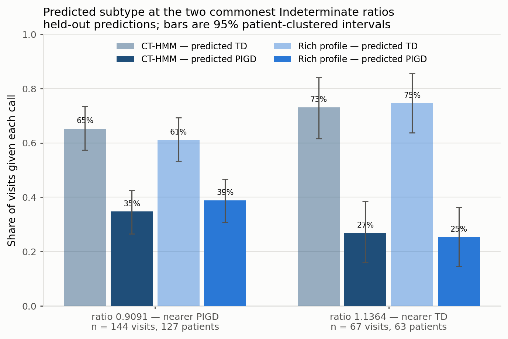
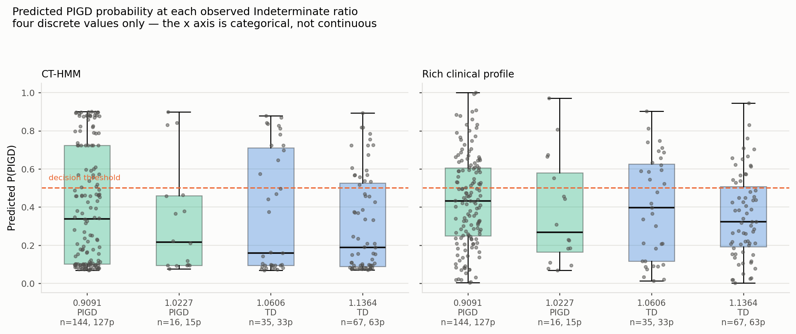
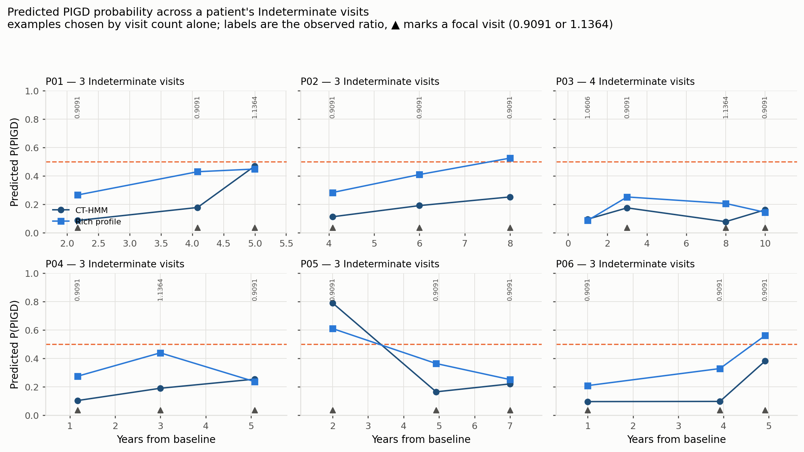

# The two commonest Indeterminate ratios, 0.9091 and 1.1364, in detail

**Date** 2026-10-24 · **Script** `scripts/68_indeterminate_ratio_detail.py`
**Run** `experiments/20261023T211836Z_indeterminate_ratio_scrutiny/`
**Neither model was retrained or modified; held-out predictions only.**

## Verdict in one paragraph

Across the two ratios that dominate the Indeterminate band, **the predicted
PIGD probability is higher at 0.9091 than at 1.1364 for both models, by about
8–9 percentage points, and both intervals exclude zero.** That is a real but
small signal, and it is the strongest evidence of boundary sensitivity found
anywhere in this project. It does **not** carry into the forced TD/PIGD label
for the CT-HMM, it is **not monotone** across the two intermediate ratios, and
it is one of several uncorrected comparisons. Treat it as exploratory. It
refines the earlier whole-band null result rather than overturning it.

---

## 1. Method and provenance

### Predictions are out-of-sample, and this is asserted, not assumed

| Model | Scheme | Check run in the script |
|---|---|---|
| CT-HMM | Leave-one-patient-out | `held_out_patient == PATNO` on **every** row |
| Rich clinical profile | 5-fold patient CV, repeat 0 | each patient appears in **exactly one** fold |

Nothing was refitted. The rich profile's fold identifier is not present in
`derived_label_predictions.csv` and was joined in from
`profile_predictions.csv`; visit dates and the observed ratio were joined from
`outputs/visit_panel.csv`.

### Sample

| | n |
|---|---|
| Indeterminate-target visits scored by **both** models | 332 |
| Ratio undefined (PIGD subscore zero) — excluded | 45 |
| **Analysed** | **287** visits, **220** patients |
| **Focal set** (ratio 0.9091 or 1.1364) | **211** visits, **170** patients |

The ratio distribution reproduces `scripts/67`'s `ratio_values.csv` **exactly**,
value for value and count for count; the script fails hard if it does not. No
field was missing for any analysed visit. All counts below are computed from
the visit-level records, not derived from aggregates.

### Resampling

The unit is the **patient**, not the visit. Patients are drawn with
replacement and all of a patient's visits travel together, because 35 of the
170 focal patients contribute more than one visit and **20 contribute visits at
both focal ratios**. Intervals are 95% percentile intervals from 4,000 draws,
no bias correction.

### The statistic that actually tests the hypothesis

Reporting "agreement with the nearer boundary" separately for each group is
**misleading here**, and the report does not lead with it. At 0.9091 agreeing
means predicting PIGD, which both models do rarely; at 1.1364 agreeing means
predicting TD, which both do often. A model that always said TD would score 0%
at one ratio and 100% at the other while using no information at all.

The honest test is the **difference between the two groups**:

> P(predict PIGD | ratio 0.9091) − P(predict PIGD | ratio 1.1364)

A ratio-blind model scores exactly zero on this. The same contrast is also run
on the predicted probabilities, which do not depend on a threshold.

---

## 2. Ratio 0.9091 — n = 144 visits, 127 patients (nearer the PIGD boundary by 0.0091)

| Model | Predicted TD | Predicted PIGD | % PIGD | % TD | Mean P(PIGD) | Median P(PIGD) | Mean P(TD) | Median P(TD) |
|---|---|---|---|---|---|---|---|---|
| CT-HMM | 94 | **50** | **34.7%** | 65.3% | 0.3978 | 0.3384 | 0.6022 | 0.6616 |
| Rich clinical profile | 88 | **56** | **38.9%** | 61.1% | 0.4323 | 0.4329 | 0.5677 | 0.5671 |

Predicted P(PIGD) quantiles:

| Model | q10 | q25 | q50 | q75 | q90 |
|---|---|---|---|---|---|
| CT-HMM | 0.0807 | 0.1024 | 0.3384 | 0.7236 | 0.8777 |
| Rich clinical profile | 0.1076 | 0.2495 | 0.4329 | 0.6064 | 0.7513 |

The CT-HMM's distribution is far more spread — a tenth of these visits sit
below P(PIGD) = 0.08 and a tenth above 0.88 — whereas the rich profile keeps
most of its mass between 0.25 and 0.61. Both medians sit below the 0.5
threshold, which is why both models call TD on roughly two thirds of visits
that are a hundredth of a point away from being classified PIGD outright.

## 3. Ratio 1.1364 — n = 67 visits, 63 patients (nearer the TD boundary by 0.0136)

| Model | Predicted TD | Predicted PIGD | % TD | % PIGD | Mean P(PIGD) | Median P(PIGD) | Mean P(TD) | Median P(TD) |
|---|---|---|---|---|---|---|---|---|
| CT-HMM | **49** | 18 | **73.1%** | 26.9% | 0.3044 | 0.1893 | 0.6956 | 0.8107 |
| Rich clinical profile | **50** | 17 | **74.6%** | 25.4% | 0.3521 | 0.3226 | 0.6479 | 0.6774 |

Predicted P(PIGD) quantiles:

| Model | q10 | q25 | q50 | q75 | q90 |
|---|---|---|---|---|---|
| CT-HMM | 0.0764 | 0.0890 | 0.1893 | 0.5255 | 0.7238 |
| Rich clinical profile | 0.0910 | 0.1931 | 0.3226 | 0.5071 | 0.6536 |

**The 73–75% here is not 73–75% skill.** It is mostly the models' standing
preference for TD, which is the majority next-visit label throughout the
cohort. Compare it with the 65% TD rate at 0.9091 and the real effect — about
8 points — becomes visible.

---

## 4. All four observed ratios

| Ratio | Nearer | n visits | n patients | CT-HMM PIGD calls | CT-HMM mean P(PIGD) | Profile PIGD calls | Profile mean P(PIGD) |
|---|---|---|---|---|---|---|---|
| **0.9091** | PIGD | 144 | 127 | 50 / 144 (34.72%) | **0.3978** | 56 / 144 (38.89%) | **0.4323** |
| 1.0227 | PIGD | 16 | 15 | 3 / 16 (18.75%) | 0.3339 | 5 / 16 (31.25%) | 0.3782 |
| 1.0606 | TD | 35 | 33 | 12 / 35 (34.29%) | 0.3674 | 15 / 35 (42.86%) | 0.3969 |
| **1.1364** | TD | 67 | 63 | 18 / 67 (26.87%) | **0.3044** | 17 / 67 (25.37%) | **0.3521** |

**The ordering is not monotone, and this matters.** 1.0227 is *nearer* the PIGD
boundary than 1.0606, yet both models assign it a *lower* mean P(PIGD) and a
lower PIGD call rate. If boundary proximity were driving the probabilities, that
pair would be the wrong way round. With n = 16 and n = 35 the two middle values
are thinly sampled and this could be noise, but it is evidence against a clean
"probability tracks proximity" story and is reported as such.

The four values are **discrete and very unevenly represented** (144, 16, 35,
67). The figure below uses a categorical axis for exactly this reason: nothing
here should be read as a continuous trend, and no line is drawn across the
categories.

---

## 5. Uncertainty, patient-clustered

### The four requested proportions

| Quantity | Model | Estimate | 95% CI |
|---|---|---|---|
| P(predict PIGD \| 0.9091) | CT-HMM | 0.3472 | 0.2703 – 0.4266 |
| P(predict PIGD \| 0.9091) | Rich profile | 0.3889 | 0.3087 – 0.4685 |
| P(predict TD \| 1.1364) | CT-HMM | 0.7313 | 0.6154 – 0.8382 |
| P(predict TD \| 1.1364) | Rich profile | 0.7463 | 0.6338 – 0.8507 |

These are descriptive. Their null is each model's own call rate, not zero, so
"the interval excludes zero" would mean nothing and is not claimed.

### The boundary-sensitivity contrasts — the actual tests

| Contrast | Model | Estimate | 95% CI | Excludes 0 |
|---|---|---|---|---|
| **Labels**: P(PIGD\|0.9091) − P(PIGD\|1.1364) | CT-HMM | +0.0786 | −0.0499 – +0.2046 | no |
| **Labels**: P(PIGD\|0.9091) − P(PIGD\|1.1364) | Rich profile | +0.1352 | **+0.0053** – +0.2601 | yes, barely |
| **Probabilities**: mean P(PIGD) difference | CT-HMM | +0.0934 | **+0.0128** – +0.1711 | yes |
| **Probabilities**: mean P(PIGD) difference | Rich profile | +0.0802 | **+0.0145** – +0.1457 | yes |

All four point estimates are **positive**, i.e. in the direction boundary
proximity predicts. The two probability contrasts exclude zero for both models.
The label contrast excludes zero only for the rich profile, and its lower bound
is **+0.0053** — about as marginal as a positive result can be.

### Model-vs-model, paired on identical visits

| Contrast | Estimate | 95% CI | Excludes 0 |
|---|---|---|---|
| Profile − CT-HMM, P(predict PIGD \| 0.9091) | +0.0417 | −0.0072 – +0.0929 | no |
| Profile − CT-HMM, P(predict TD \| 1.1364) | +0.0149 | −0.0312 – +0.0725 | no |

The two models are **not distinguishable** on this subgroup. They agree on the
call for **194 of 211 focal visits (91.9%)**.

### Multiplicity

Six contrasts are tested against a zero null with **no correction applied**.
Two of the three "significant" lower bounds are within 0.015 of zero. Under any
correction for six comparisons, the label-level result would not survive, and
the probability results would be borderline. **No claim of statistical
significance is made.**

---

## 6. Patients with repeated visits

Of the 170 patients in the focal set, **35 contribute more than one focal
visit**, supplying **36.0%** of the 211 focal visits. Just under two thirds of
the focal set therefore comes from patients who appear in it once, so the
group-level contrasts in §5 are not an artefact of a handful of
heavily-repeated patients — and the bootstrap resamples patients in any case.

### These ratios are per-visit measurements, not patient traits

Of those 35 patients, only **15 stay at a single focal ratio** across all their
focal visits. The other **20 move between 0.9091 and 1.1364**. A patient sitting
a hundredth above the PIGD boundary at one visit is, more often than not, found
a hundredth below the TD boundary at another. This is direct evidence for the
measurement-error caveat: "distance to the nearer boundary" describes a single
day's score, not a stable property of the patient.

### Predictions move even when the ratio does not

There are **18 patient-ratio blocks** — one patient, one ratio value, two or
more visits. Within them:

| | CT-HMM | Rich profile |
|---|---|---|
| Median within-block range of P(PIGD) | 0.1091 | 0.1600 |
| Maximum within-block range of P(PIGD) | 0.6252 | 0.4628 |
| Blocks where the forced **call** changes | **6 of 18** | **6 of 18** |

So with the observed ratio held exactly fixed, the predicted probability still
moves by about 0.11–0.16 on average, and the hard call flips in a third of such
blocks. This is expected — both models predict from clinical history, and the
target visit's ratio is not an input to either — but it is the clearest
demonstration that **the ratio is not what drives these predictions**.

The two models disagree on **17 of 211 focal visits (8.1%)**.

### Examples

Selected by a rule that never inspects a prediction: patients with more than one
focal visit, ranked by visit count, ties broken by lowest patient id. All their
Indeterminate visits are shown, not only the focal ones.

| Patient | Visit | Years | Ratio | Focal | CT-HMM call | CT-HMM P(PIGD) | Profile call | Profile P(PIGD) |
|---|---|---|---|---|---|---|---|---|
| P01 | V06 | 2.17 | 0.9091 | yes | TD | 0.086 | TD | 0.266 |
| P01 | V10 | 4.08 | 0.9091 | yes | TD | 0.178 | TD | 0.429 |
| P01 | V12 | 5.00 | 1.1364 | yes | TD | 0.469 | TD | 0.448 |
| P02 | V10 | 4.08 | 0.9091 | yes | TD | 0.112 | TD | 0.283 |
| P02 | V13 | 6.00 | 0.9091 | yes | TD | 0.191 | TD | 0.409 |
| P02 | V15 | 8.00 | 0.9091 | yes | TD | 0.252 | **PIGD** | 0.525 |
| P03 | V04 | 1.00 | 1.0606 | no | TD | 0.096 | TD | 0.087 |
| P03 | V08 | 3.00 | 0.9091 | yes | TD | 0.175 | TD | 0.252 |
| P03 | V15 | 8.00 | 1.1364 | yes | TD | 0.078 | TD | 0.206 |
| P03 | V17 | 10.00 | 0.9091 | yes | TD | 0.161 | TD | 0.144 |
| P04 | V04 | 1.17 | 0.9091 | yes | TD | 0.103 | TD | 0.274 |
| P04 | V08 | 3.00 | 1.1364 | yes | TD | 0.189 | TD | 0.439 |
| P04 | V12 | 5.08 | 0.9091 | yes | TD | 0.253 | TD | 0.236 |
| P05 | V06 | 2.00 | 0.9091 | yes | **PIGD** | 0.789 | **PIGD** | 0.609 |
| P05 | V12 | 4.92 | 0.9091 | yes | TD | 0.164 | TD | 0.363 |
| P05 | V14 | 7.00 | 0.9091 | yes | TD | 0.220 | TD | 0.251 |
| P06 | V04 | 1.00 | 0.9091 | yes | TD | 0.095 | TD | 0.208 |
| P06 | V10 | 3.92 | 0.9091 | yes | TD | 0.097 | TD | 0.328 |
| P06 | V12 | 4.92 | 0.9091 | yes | TD | 0.381 | **PIGD** | 0.560 |

Read honestly, these cut both ways:

- **P05** shows the largest within-ratio swing in the data: P(PIGD) of 0.789 at
  year 2 falling to 0.164 and 0.220 at years 4.9 and 7.0, with the ratio fixed
  at 0.9091 throughout, and the CT-HMM's call flipping from PIGD to TD.
- **P02** and **P06** drift upward at a fixed ratio of 0.9091 until the rich
  profile crosses the threshold, which is the behaviour the hypothesis predicts.
- **P01** and **P04** go the other way. P01's P(PIGD) *rises* as its ratio moves
  from 0.9091 towards the TD boundary at 1.1364 — the opposite of the
  group-level direction. P04's rich-profile probability likewise peaks at its
  1.1364 visit.

In 19 example visits the models produce only three PIGD calls between them.
That is the baseline TD preference visible at the individual level.

---

## 7. The six questions, answered directly

**1. Among the 144 visits at ratio 0.9091, how many times did each model predict PIGD?**
CT-HMM: **50 of 144 (34.7%)**. Rich clinical profile: **56 of 144 (38.9%)**.
So both models predict TD — the *farther* boundary — on about two thirds of
visits that are 0.0091 away from being PIGD.

**2. Among the 67 visits at ratio 1.1364, how many times did each model predict TD?**
CT-HMM: **49 of 67 (73.1%)**. Rich clinical profile: **50 of 67 (74.6%)**.
This looks far better than Q1 but is not: TD is what both models predict by
default. The comparison between the two groups, not either figure alone, is
what carries information.

**3. Are the differences between the models meaningful given the uncertainty and clustering?**
**No.** The paired differences are +0.0417 (CI −0.0072 to +0.0929) at 0.9091 and
+0.0149 (CI −0.0312 to +0.0725) at 1.1364; both intervals contain zero, and the
models agree on 91.9% of focal calls. The rich profile leans very slightly more
towards PIGD at 0.9091, in the direction proximity predicts, but not
distinguishably so.

**4. Do predicted probabilities give stronger evidence than the final labels?**
**Yes, clearly.** The probability contrast excludes zero for *both* models
(+0.093, CI +0.013 to +0.171; +0.080, CI +0.015 to +0.146), while the label
contrast excludes zero for only one and only marginally. Thresholding at 0.5
destroys the signal: both models' probability distributions at both ratios sit
mostly below 0.5, so a shift of roughly 0.08 in the mean moves few visits across
the cut. This matches the project's wider finding that accuracy is the least
sensitive metric available here and that continuous scores should be preferred.

**5. Is the pattern consistent across patients, or driven by a few repeat contributors?**
**Neither, strictly — and the distinction matters.**

The group-level contrast is **not** driven by repeat contributors: 135 of the
170 focal patients appear once, supplying 64.0% of focal visits, and every
interval resamples patients rather than visits.

But the pattern is **not consistent within patients either**. Holding the
observed ratio exactly fixed, the predicted probability still moves by a median
of 0.11 (CT-HMM) to 0.16 (rich profile), and the forced call flips in 6 of the
18 patient-ratio blocks that have repeats. And 20 of the 35 repeat patients
*move between* 0.9091 and 1.1364 across visits, so these ratios are properties
of a visit, not of a patient.

The honest reading is that the §5 contrast is a **weak average tendency across
visits**, not a rule that holds for individual patients, and that the models'
predictions are driven by clinical history rather than by where the target
visit's ratio happens to fall.

**6. What can and cannot be concluded?**

*Can be concluded, as exploratory findings:*
- Both models assign a **higher PIGD probability at 0.9091 than at 1.1364**, by
  about 8–9 points, with patient-clustered intervals excluding zero. The
  direction matches boundary proximity for both models and both statistics.
- The two models are **indistinguishable** on this subgroup.
- The signal lives in the **probabilities, not the labels**.

*Cannot be concluded:*
- **Not** that the forced TD/PIGD call tracks the nearer boundary. For the
  CT-HMM the label contrast's interval contains zero; for the rich profile it
  barely misses it and would not survive any multiplicity correction.
- **Not** that predicted probability varies systematically with boundary
  proximity in general. The two intermediate ratios are **ordered backwards**
  (§4), so the effect cannot be described as tracking distance; what is observed
  is a difference between the two *extreme* values of the band.
- **Not** anything about the patient's true subtype. Boundary proximity is a
  mathematical property of an observed ratio of two subscale means, measured on
  one day with measurement error. A visit recorded at 0.9091 might have been
  recorded at 0.88 — and classified PIGD outright — on a different day. Nothing
  here is an independently verified clinical subtype, and agreement with the
  nearer boundary is **not** evidence that a model got a patient right.
- **Not** statistical significance in any confirmatory sense: six uncorrected
  contrasts, two lower bounds within 0.015 of zero, n = 16 and n = 35 for two of
  the four ratio groups.

---

## 8. Relation to the earlier analysis

`scripts/67` concluded the hypothesis was **not supported**, testing agreement
between the forced label and the nearer boundary across the whole band against
an independence null. This analysis does not contradict that:

- At the **label** level it agrees — no robust effect.
- At the **probability** level, restricted to the two extreme ratios, it finds a
  weak positive contrast that the whole-band label test could not see.

The reason is construction, not disagreement. Script 67 pooled eleven ratio
values, nine of which are within 0.2 of the midpoint and carry almost no
proximity contrast, and it thresholded the probabilities away. This analysis
contrasts the two ends of the band — the largest available separation, a ratio
gap of 0.227 — and keeps the probabilities. That is a sharper test, and it
finds a small amount of signal.

**The practical recommendation is unchanged:** excluding Indeterminate targets
from scoring remains correct, and these forced binary calls should not be
awarded partial credit.

---

## 9. Limitations

- **Exploratory.** Six uncorrected contrasts; no pre-registered hypothesis for
  the specific 0.9091-versus-1.1364 comparison, which was chosen *after* seeing
  that these two values dominate the band.
- **Non-monotone ordering** across the four ratios (§4) undercuts a
  proximity-driven explanation; n = 16 and n = 35 for the middle values.
- **45 of 332** Indeterminate targets have no defined ratio and are excluded.
- The two models come from **different validation schemes** (LOPO vs 5-fold CV).
  Matching the visits removes the evaluation-set difference, not the scheme
  difference.
- **Percentile bootstrap**, 4,000 draws, no bias correction; the smaller groups
  give coarse intervals.
- The observed ratio is itself a **noisy single-day measurement**, so "distance
  to the boundary" has less resolution than the decimals imply.

## 10. Files

Run directory `experiments/20261023T211836Z_indeterminate_ratio_scrutiny/`:
`visit_level_records.csv` (287 rows), `per_ratio_tables.csv`,
`patient_clustered_intervals.csv`, `example_trajectories.csv`,
`within_patient_same_ratio.csv`, `fig1_calls_at_focal_ratios.png`,
`fig2_probability_by_ratio.png`, `fig3_patient_trajectories.png`,
`summary.json`, `report.txt`, `driver.log`, `MANIFEST.sha256`.
All 10 built-in checks pass.
