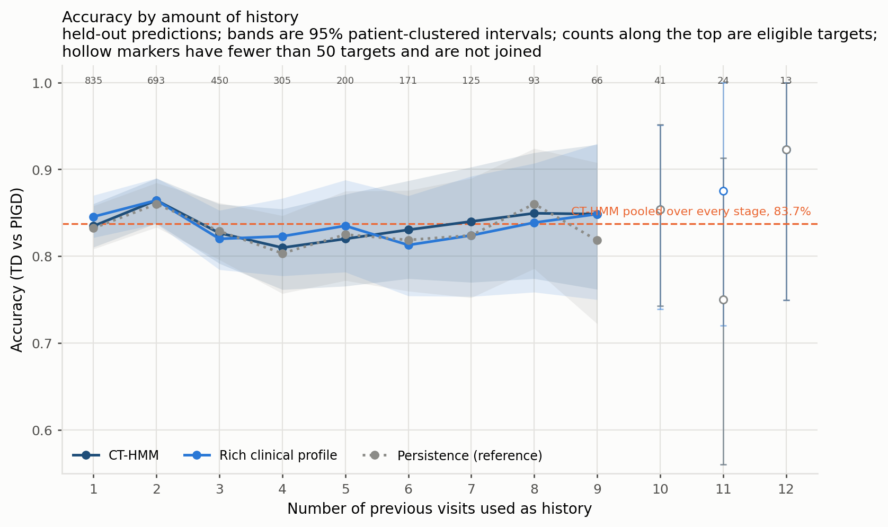
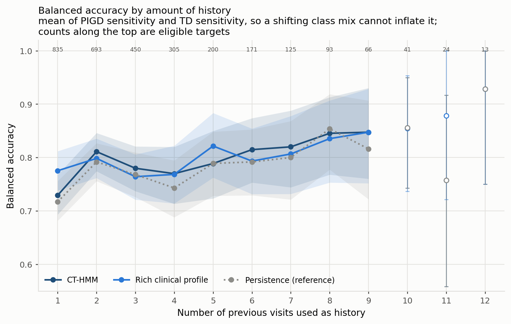
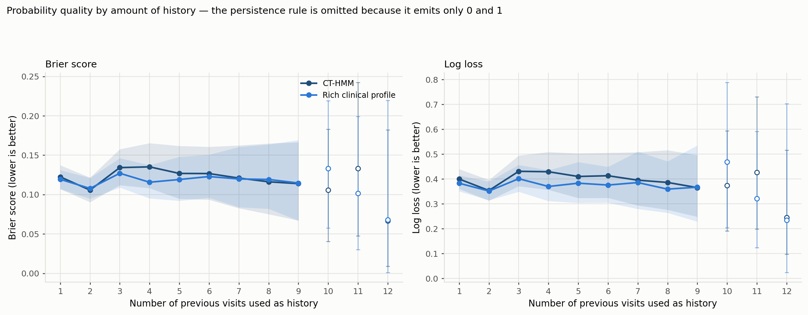
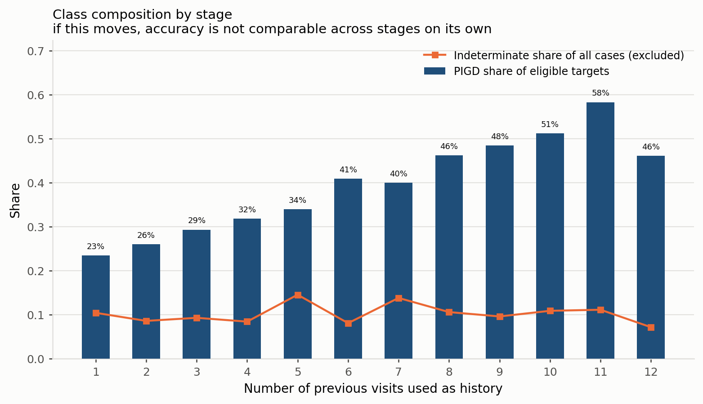
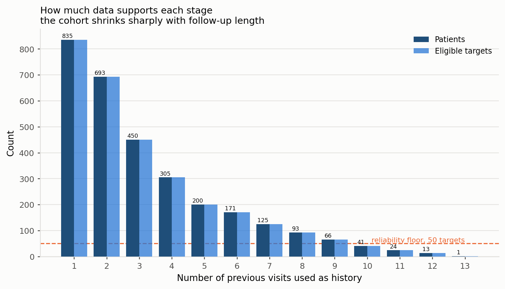

# Stage-wise next-visit prediction: does more history help?

**Date** 2026-10-24 · **Script** `scripts/69_stage_wise_evaluation.py`
**Run** `experiments/20261023T214819Z_stage_wise_evaluation/` · **Neither model was retrained or modified**

## Verdict

**The project's ~84% figure is not an artefact of accumulated history. It is
essentially the stage-1 number.** Predicting visit 2 from visit 1 alone gives
83.5% (CT-HMM) and 84.6% (rich profile), against pooled figures of 83.7% and
84.1%. Accuracy then stays flat: every change from stage 1 has a confidence
interval containing zero, for both models, at every interpretable stage.

Balanced accuracy *does* rise with history — but **so does the persistence
rule's**, which uses no model at all, and the PIGD share of targets rises from
23% to 48% over the same stages. The rise is cohort composition, not learning.

The one paired model difference whose interval excludes zero is at **stage 1**,
where the rich profile has the *least* history. Its edge is richer
cross-sectional measurement, not longitudinal modelling.

---

## 1. Why existing predictions could be reused

The brief warned against regrouping predictions that were generated with future
information. They were not, and the script re-checks each claim numerically
rather than taking it on trust:

| | CT-HMM | Rich clinical profile |
|---|---|---|
| History used for visit k+1 | `labels[: k + 1]` in `build_cases` | **filtered** state at visit k in `predict_next` |
| Population parameters | leave-one-patient-out | 5-fold patient CV, refit per fold |
| Scaling / imputation | n/a | standardiser, population mean and LOCF spread refit on training patients only |
| Leak guard in code | `n_history == visit_index + 1` | `raise RuntimeError` if a held-out patient is in training |

The rich profile uses the Kalman **filter**, not the smoother. That distinction
is the whole question — a smoothed state at visit k would carry information
from visits k+1 onward — and it is asserted by check 8, which matches the exact
source line that indexes the filtered arrays.

**Stage 1, the hardest case for both.** With one visit the CT-HMM has a single
observed label, so its prediction is the population initial-state distribution
updated by one emission and propagated over the gap. The rich profile has one
observation of nine clinical domains: its *level* is a shrunk blend of that
observation and the training-cohort mean, and its *rate* is still essentially
the fitted prior, because one point cannot identify a slope. So at stage 1 the
rich profile contributes cross-sectional breadth but no patient-specific trend.

### Sample

| | n |
|---|---|
| Matched cases scored by both models | 3,352 |
| Stage disagreed between models — dropped | 3 |
| Indeterminate targets — excluded from binary scoring | 332 |
| **Eligible binary targets** | **3,017** (896 patients) |

Within a stage each patient contributes **exactly one** target, so observations
are independent across patients at a given stage; clustering matters only for
the pooled figure and the cross-stage contrasts, and the bootstrap handles both.

---

## 2. Main results

Stages with fewer than 50 eligible targets are marked `*` and should not be
read as estimates. Stage 13 has a single target and is omitted from the figures.

| History available | Target visit | Eligible patients | TD | PIGD | CT-HMM acc | Profile acc | CT-HMM bal acc | Profile bal acc |
|---|---|---:|---:|---:|---:|---:|---:|---:|
| Visit 1 | Visit 2 | 835 | 639 | 196 | 0.8347 | 0.8455 | 0.7293 | 0.7753 |
| Visits 1-2 | Visit 3 | 693 | 513 | 180 | 0.8644 | 0.8644 | 0.8110 | 0.7984 |
| Visits 1-3 | Visit 4 | 450 | 318 | 132 | 0.8267 | 0.8200 | 0.7799 | 0.7641 |
| Visits 1-4 | Visit 5 | 305 | 208 | 97 | 0.8098 | 0.8230 | 0.7698 | 0.7684 |
| Visits 1-5 | Visit 6 | 200 | 132 | 68 | 0.8200 | 0.8350 | 0.7888 | 0.8215 |
| Visits 1-6 | Visit 7 | 171 | 101 | 70 | 0.8304 | 0.8129 | 0.8148 | 0.7934 |
| Visits 1-7 | Visit 8 | 125 | 75 | 50 | 0.8400 | 0.8240 | 0.8200 | 0.8067 |
| Visits 1-8 | Visit 9 | 93 | 50 | 43 | 0.8495 | 0.8387 | 0.8453 | 0.8353 |
| Visits 1-9 | Visit 10 | 66 | 34 | 32 | 0.8485 | 0.8485 | 0.8474 | 0.8474 |
| Visits 1-10 | Visit 11 | 41 * | 20 | 21 | 0.8537 | 0.8537 | 0.8560 | 0.8548 |
| Visits 1-11 | Visit 12 | 24 * | 10 | 14 | 0.7500 | 0.8750 | 0.7571 | 0.8786 |
| Visits 1-12 | Visit 13 | 13 * | 7 | 6 | 0.9231 | 0.9231 | 0.9286 | 0.9286 |

### With confidence intervals

Percentile intervals from 2,000 patient-clustered bootstrap draws.

| Stage | CT-HMM accuracy [95% CI] | Profile accuracy [95% CI] | CT-HMM bal acc [95% CI] | Profile bal acc [95% CI] |
|---|---|---|---|---|
| 1 | 0.8347 [0.8104, 0.8604] | 0.8455 [0.8214, 0.8701] | 0.7293 [0.6931, 0.7678] | 0.7753 [0.7381, 0.8119] |
| 2 | 0.8644 [0.8379, 0.8897] | 0.8644 [0.8372, 0.8899] | 0.8110 [0.7743, 0.8459] | 0.7984 [0.7616, 0.8354] |
| 3 | 0.8267 [0.7916, 0.8600] | 0.8200 [0.7845, 0.8528] | 0.7799 [0.7370, 0.8208] | 0.7641 [0.7211, 0.8058] |
| 4 | 0.8098 [0.7616, 0.8544] | 0.8230 [0.7774, 0.8667] | 0.7698 [0.7133, 0.8199] | 0.7684 [0.7139, 0.8221] |
| 5 | 0.8200 [0.7655, 0.8713] | 0.8350 [0.7817, 0.8878] | 0.7888 [0.7233, 0.8497] | 0.8215 [0.7624, 0.8833] |
| 6 | 0.8304 [0.7742, 0.8869] | 0.8129 [0.7543, 0.8696] | 0.8148 [0.7531, 0.8736] | 0.7934 [0.7315, 0.8541] |
| 7 | 0.8400 [0.7699, 0.9027] | 0.8240 [0.7536, 0.8921] | 0.8200 [0.7442, 0.8877] | 0.8067 [0.7318, 0.8777] |
| 8 | 0.8495 [0.7742, 0.9192] | 0.8387 [0.7586, 0.9070] | 0.8453 [0.7679, 0.9129] | 0.8353 [0.7531, 0.9067] |
| 9 | 0.8485 [0.7619, 0.9286] | 0.8485 [0.7500, 0.9296] | 0.8474 [0.7602, 0.9302] | 0.8474 [0.7517, 0.9286] |

### Sensitivity, specificity and macro F1

PIGD sensitivity and PIGD specificity are TD specificity and TD sensitivity
respectively — in a two-class problem they are the same two numbers.

| Stage | CT-HMM PIGD sens | CT-HMM PIGD spec | CT-HMM macro F1 | Profile PIGD sens | Profile PIGD spec | Profile macro F1 |
|---|---:|---:|---:|---:|---:|---:|
| 1 | 0.5306 | 0.9280 | 0.7485 | 0.6429 | 0.9077 | 0.7807 |
| 2 | 0.7000 | 0.9220 | 0.8190 | 0.6611 | 0.9357 | 0.8138 |
| 3 | 0.6667 | 0.8931 | 0.7861 | 0.6288 | 0.8994 | 0.7740 |
| 4 | 0.6598 | 0.8798 | 0.7757 | 0.6186 | 0.9183 | 0.7829 |
| 5 | 0.6912 | 0.8864 | 0.7949 | 0.7794 | 0.8636 | 0.8181 |
| 6 | 0.7286 | 0.9010 | 0.8206 | 0.6857 | 0.9010 | 0.8002 |
| 7 | 0.7200 | 0.9200 | 0.8280 | 0.7200 | 0.8933 | 0.8125 |
| 8 | 0.7907 | 0.9000 | 0.8473 | 0.7907 | 0.8800 | 0.8368 |
| 9 | 0.8125 | 0.8824 | 0.8479 | 0.8125 | 0.8824 | 0.8479 |

### Probability quality

| Stage | CT-HMM Brier | Profile Brier | CT-HMM log loss | Profile log loss |
|---|---:|---:|---:|---:|
| 1 | 0.1225 | 0.1193 | 0.3996 | 0.3827 |
| 2 | 0.1056 | 0.1077 | 0.3535 | 0.3514 |
| 3 | 0.1342 | 0.1270 | 0.4306 | 0.4009 |
| 4 | 0.1352 | 0.1156 | 0.4290 | 0.3697 |
| 5 | 0.1268 | 0.1191 | 0.4099 | 0.3829 |
| 6 | 0.1266 | 0.1229 | 0.4129 | 0.3754 |
| 7 | 0.1209 | 0.1198 | 0.3950 | 0.3854 |
| 8 | 0.1162 | 0.1192 | 0.3859 | 0.3590 |
| 9 | 0.1138 | 0.1146 | 0.3650 | 0.3669 |

---

## 3. Is the trend real, or is it the cohort?

### Change from stage 1, same bootstrap draws

| Model | Metric | Stage vs 1 | Change [95% CI] | Excludes 0 |
|---|---|---|---|---|
| CT-HMM | accuracy | 2 | +0.0296 [-0.0055, +0.0623] | no |
| CT-HMM | accuracy | 3 | -0.0081 [-0.0517, +0.0303] | no |
| CT-HMM | accuracy | 4 | -0.0249 [-0.0762, +0.0205] | no |
| CT-HMM | accuracy | 5 | -0.0147 [-0.0736, +0.0441] | no |
| CT-HMM | accuracy | 6 | -0.0043 [-0.0653, +0.0579] | no |
| CT-HMM | accuracy | 7 | +0.0053 [-0.0660, +0.0700] | no |
| CT-HMM | accuracy | 8 | +0.0147 [-0.0647, +0.0843] | no |
| CT-HMM | accuracy | 9 | +0.0138 [-0.0773, +0.0968] | no |
| CT-HMM | balanced accuracy | 2 | +0.0817 [+0.0307, +0.1289] | **yes** |
| CT-HMM | balanced accuracy | 3 | +0.0506 [-0.0077, +0.1044] | no |
| CT-HMM | balanced accuracy | 4 | +0.0405 [-0.0238, +0.0978] | no |
| CT-HMM | balanced accuracy | 5 | +0.0595 [-0.0121, +0.1343] | no |
| CT-HMM | balanced accuracy | 6 | +0.0855 [+0.0155, +0.1522] | **yes** |
| CT-HMM | balanced accuracy | 7 | +0.0907 [+0.0057, +0.1654] | **yes** |
| CT-HMM | balanced accuracy | 8 | +0.1160 [+0.0301, +0.1921] | **yes** |
| CT-HMM | balanced accuracy | 9 | +0.1181 [+0.0242, +0.2062] | **yes** |
| Rich clinical profile | accuracy | 2 | +0.0188 [-0.0153, +0.0518] | no |
| Rich clinical profile | accuracy | 3 | -0.0255 [-0.0685, +0.0142] | no |
| Rich clinical profile | accuracy | 4 | -0.0226 [-0.0729, +0.0210] | no |
| Rich clinical profile | accuracy | 5 | -0.0105 [-0.0699, +0.0462] | no |
| Rich clinical profile | accuracy | 6 | -0.0326 [-0.0945, +0.0291] | no |
| Rich clinical profile | accuracy | 7 | -0.0215 [-0.0960, +0.0492] | no |
| Rich clinical profile | accuracy | 8 | -0.0068 [-0.0936, +0.0658] | no |
| Rich clinical profile | accuracy | 9 | +0.0030 [-0.0966, +0.0876] | no |
| Rich clinical profile | balanced accuracy | 2 | +0.0231 [-0.0273, +0.0690] | no |
| Rich clinical profile | balanced accuracy | 3 | -0.0112 [-0.0685, +0.0460] | no |
| Rich clinical profile | balanced accuracy | 4 | -0.0068 [-0.0703, +0.0516] | no |
| Rich clinical profile | balanced accuracy | 5 | +0.0463 [-0.0258, +0.1192] | no |
| Rich clinical profile | balanced accuracy | 6 | +0.0181 [-0.0535, +0.0890] | no |
| Rich clinical profile | balanced accuracy | 7 | +0.0314 [-0.0518, +0.1086] | no |
| Rich clinical profile | balanced accuracy | 8 | +0.0601 [-0.0337, +0.1380] | no |
| Rich clinical profile | balanced accuracy | 9 | +0.0722 [-0.0332, +0.1620] | no |

**Accuracy never changes significantly.** Across both models and all eleven
contrasts, **not one accuracy interval excludes zero**. Balanced accuracy rises
for the CT-HMM with intervals excluding zero at stages 2, 6, 7, 8 and 9 — and
also at stages 10 and 12, which are too small to interpret — but for the rich
profile at **no stage at all**.

### The persistence rule shows the same rise

This is the decisive comparison. "Predict the last non-Indeterminate label"
learns nothing and uses no history beyond the most recent label, so any trend it
shows is a property of the cohort:

| Stage | Persistence accuracy | Persistence balanced accuracy | CT-HMM bal acc | Profile bal acc |
|---|---:|---:|---:|---:|
| 1 | 0.8323 | 0.7171 | 0.7293 | 0.7753 |
| 2 | 0.8600 | 0.7919 | 0.8110 | 0.7984 |
| 3 | 0.8289 | 0.7682 | 0.7799 | 0.7641 |
| 4 | 0.8033 | 0.7430 | 0.7698 | 0.7684 |
| 5 | 0.8250 | 0.7890 | 0.7888 | 0.8215 |
| 6 | 0.8187 | 0.7917 | 0.8148 | 0.7934 |
| 7 | 0.8240 | 0.8000 | 0.8200 | 0.8067 |
| 8 | 0.8602 | 0.8537 | 0.8453 | 0.8353 |
| 9 | 0.8182 | 0.8162 | 0.8474 | 0.8474 |

Persistence balanced accuracy climbs from 0.7171 to 0.8162 across the same
stages, tracking both models closely. **Whatever is making later stages look
better is not something the models are learning.**

### Class composition moves sharply

The PIGD share of eligible targets rises monotonically from **23% at stage 1 to
48% at stage 9**. Balanced accuracy is not inflated by prevalence directly, but
the *task* changes: at stage 1 the models must find 196 PIGD cases among 835,
and the CT-HMM finds 53% of them; by stage 9 the classes are nearly balanced
and it finds 81%. Patients who stay in the study long enough to reach stage 9
are not the stage-1 cohort.

---

## 4. Holding the patients fixed

If the trend were genuine learning it should appear *within* the same patients.

### Patients eligible at every stage 1–5 (n = 148)

| Stage | CT-HMM accuracy | Profile accuracy | CT-HMM bal acc | Profile bal acc |
|---|---:|---:|---:|---:|
| 1 | 0.8378 | 0.8378 | 0.7433 | 0.7670 |
| 2 | 0.9324 | 0.9459 | 0.8917 | 0.9220 |
| 3 | 0.8514 | 0.8581 | 0.7928 | 0.7883 |
| 4 | 0.8919 | 0.9189 | 0.8607 | 0.8873 |
| 5 | 0.8581 | 0.8581 | 0.8116 | 0.8266 |

**No monotone improvement.** Within one fixed group of patients the series goes
up, down, up, down. Stage 5 is no better than stage 2.

### Within-patient change, later (stage ≥5) minus early (stages 1–2)

225 patients contribute eligible targets to both phases.

| Model | Mean change | 95% CI | Improved | Worsened | Unchanged |
|---|---:|---|---:|---:|---:|
| CT-HMM | **−0.0243** | −0.0749 to +0.0284 | 46 | 68 | 111 |
| Rich clinical profile | **−0.0345** | −0.0893 to +0.0198 | 43 | 69 | 113 |

Both point estimates are **negative**, and more patients get worse than better.
The same patients do not become easier to predict with more history.

---

## 5. Model versus model, paired on identical visits

| Stage | Accuracy diff [95% CI] | Balanced accuracy diff [95% CI] |
|---|---|---|
| 1 | +0.0108 [-0.0036, +0.0253] | **+0.0460 [+0.0229, +0.0695]** |
| 2 | +0.0000 [-0.0141, +0.0143] | -0.0126 [-0.0343, +0.0077] |
| 3 | -0.0067 [-0.0251, +0.0131] | -0.0158 [-0.0378, +0.0062] |
| 4 | +0.0131 [-0.0165, +0.0418] | -0.0014 [-0.0362, +0.0301] |
| 5 | +0.0150 [-0.0203, +0.0500] | +0.0328 [-0.0094, +0.0738] |
| 6 | -0.0175 [-0.0645, +0.0298] | -0.0214 [-0.0737, +0.0307] |
| 7 | -0.0160 [-0.0548, +0.0234] | -0.0133 [-0.0561, +0.0310] |
| 8 | -0.0108 [-0.0612, +0.0353] | -0.0100 [-0.0566, +0.0341] |
| 9 | +0.0000 [-0.0606, +0.0625] | +0.0000 [-0.0625, +0.0625] |

Only **stage 1 balanced accuracy** excludes zero: **+0.0460 [+0.0229, +0.0695]**
for the rich profile. It comes from PIGD sensitivity — 0.6429 against 0.5306 —
at a small cost in specificity.

Two cautions. This is one result out of **24 paired tests** (12 stages × 2
metrics) with no multiplicity correction. And it is the opposite of the
intuitive story: the rich profile's advantage is largest where history is
shortest, consistent with its edge being the nine clinical domains measured at
the current visit rather than any trend it estimates from repeated visits.

---

## 6. The eight questions

**1. How accurately does each model predict visit 2 from visit 1 alone?**
CT-HMM **0.8347 [0.8104, 0.8604]**; rich profile **0.8455 [0.8214, 0.8701]**, on
835 targets from 835 patients. Balanced accuracy 0.7293 and 0.7753.

**2. Does accuracy improve with two, three or more previous visits?**
**No.** Every change-from-stage-1 interval contains zero for both models. Point
estimates wander between −0.033 and +0.030 with no direction.

**3. At what stage does performance stabilise?**
Accuracy is flat from stage 1, so there is nothing to stabilise. Balanced
accuracy drifts upward to about stage 8–9, but see Q6 — that drift is matched by
the persistence rule.

**4. Does the rich profile outperform the CT-HMM early, late, both or neither?**
**Early only, and only on balanced accuracy** (stage 1, +0.0460, CI excludes
zero). At stages 2–9 every paired interval contains zero, and the point
estimates alternate sign. On raw accuracy no stage separates them.

**5. Are the apparent improvements supported by the intervals?**
Accuracy improvements: **no**. Balanced-accuracy improvements for the CT-HMM:
nominally yes at five stages, but unsupported as evidence of learning once
persistence is in view.

**6. Could composition or class balance explain the trend?**
**Yes, and that is the most likely explanation.** PIGD share goes 23% → 48%; the
cohort shrinks from 835 to 66 targets; and the persistence rule's balanced
accuracy rises by almost exactly as much as the models'.

**7. How many patients remain, and when do estimates become unreliable?**
835, 693, 450, 305, 200, 171, 125, 93, 66 at stages 1–9, then 41, 24, 13, 1.
Below 50 targets the intervals span 20 points or more; **stage 9 is the last
usable stage**, and stages 10+ are reported but should not be interpreted.

**8. Does more history genuinely improve prediction, or does 84% conceal a gap
between early and later predictions?**
**It conceals nothing.** Early prediction is as accurate as late prediction. The
pooled 83.7% is within 0.3 points of the stage-1 figure. There is no hidden
weakness at stage 1 and no hidden gain at stage 8.

---

## 7. What this means

The subtype label is **highly persistent**, and nearly all of the achievable
accuracy is available from the single most recent label. Persistence alone
scores 0.8339 pooled, against 0.8373 for the CT-HMM and 0.8406 for the rich
profile — gaps of 0.3 and 0.7 points. Neither model's extra machinery converts
into materially better calls at any stage.

That is consistent with everything else measured in this project: the models
separate on ranking (AUC) and on probability quality (Brier, log loss) but not
on thresholded accuracy, because the endpoint is near-saturated and strongly
auto-correlated.

**Practical reading.** If the goal is to predict the next visit's motor subtype,
one visit is enough, and a persistence rule is a serious baseline. The case for
either model has to rest on the probabilities they produce, not on their
accuracy, and not on having a long history to condition on.

---

## 8. Limitations

- **Validation schemes differ by construction**: leave-one-patient-out for the
  CT-HMM, 5-fold patient cross-validation (repeat 0) for the rich profile.
  Matching the cases removes the evaluation-set difference, not the scheme
  difference. The CT-HMM is the more favourably validated of the two.
- **Target-visit information.** Both models use the target visit's *timing*; the
  rich profile additionally uses its prescribed **LEDD**. Neither uses the
  target visit's motor measurements, which are the outcome, but the rich profile
  does see one more piece of the target visit than the CT-HMM does.
- **Stage is not randomly assigned.** Reaching stage k requires k+1 visits, so
  later stages are a selected, longer-followed, more PIGD-heavy subgroup. The
  fixed-subset and within-patient analyses in §4 are the partial remedy; neither
  is a randomised comparison.
- **3 of 3,352 cases** had a stage disagreement between the models and were
  dropped so that every scored case has one unambiguous stage.
- **332 Indeterminate targets excluded**, 97 of them at stage 1; counts are given
  per stage in `stage_exclusions.csv`.
- **No multiplicity correction** across 24 paired tests and 44 cross-stage
  contrasts.
- **Stage 13 (a single target) is excluded from every contrast.** A bootstrap
  over one observation returns that observation every draw, so its "interval"
  is a point and would spuriously exclude zero. It remains in the per-stage
  metric table, flagged.
- Intervals are percentile bootstraps from 2,000 draws, no bias correction.
- Stages 10–13 (41, 24, 13 and 1 targets) are reported for completeness only.

### Per-stage exclusion ledger

| Stage | All cases | Eligible | Indeterminate excluded | Patients |
|---|---:|---:|---:|---:|
| 1 | 932 | 835 | 97 | 932 |
| 2 | 758 | 693 | 65 | 758 |
| 3 | 496 | 450 | 46 | 496 |
| 4 | 333 | 305 | 28 | 333 |
| 5 | 234 | 200 | 34 | 234 |
| 6 | 186 | 171 | 15 | 186 |
| 7 | 145 | 125 | 20 | 145 |
| 8 | 104 | 93 | 11 | 104 |
| 9 | 73 | 66 | 7 | 73 |
| 10 | 46 | 41 | 5 | 46 |
| 11 | 27 | 24 | 3 | 27 |
| 12 | 14 | 13 | 1 | 14 |
| 13 | 1 | 1 | 0 | 1 |

---

## 9. Validation checks

All **20** checks pass; `validation_checks.csv` records each one.

Chronology and causality: target strictly after current visit; every interval
positive; CT-HMM history length equals visits up to the current one; cases built
from `labels[: k + 1]`; profile predicts from the filtered state, not the
smoother. Held-out discipline: CT-HMM leave-one-patient-out; each patient in
exactly one CV fold; every fold trained on a strict subset of patients;
standardiser, population mean and LOCF spread refit per fold; the fold raises if
a held-out patient leaks into training. Matching and traceability: matched cases
account exactly for eligible plus excluded; both models report the same
eligibility; no duplicated case; stage and actual label agree between models;
no Indeterminate target enters the binary metrics; exclusions identical for both
models; every prediction traceable to patient, stage, target visit and fold;
probabilities finite and in [0, 1]; stage counts reconcile with the ledger.

## 10. Files

Run directory `experiments/20261023T214819Z_stage_wise_evaluation/`:
`stage_predictions.csv` (3,017 rows), `stage_metrics.csv`, `stage_exclusions.csv`,
`paired_differences.csv`, `cross_stage_contrasts.csv`, `fixed_subset.csv`,
`within_patient_change.csv`, `validation_checks.csv`, `summary.json`,
`report.txt`, `driver.log`, `MANIFEST.sha256` (15/15 verified), and the five
figures.
