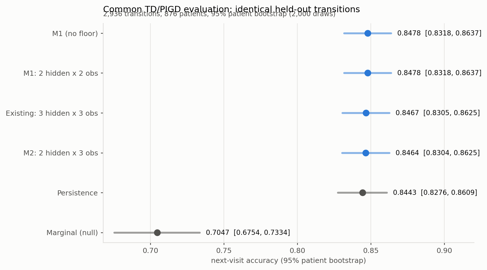
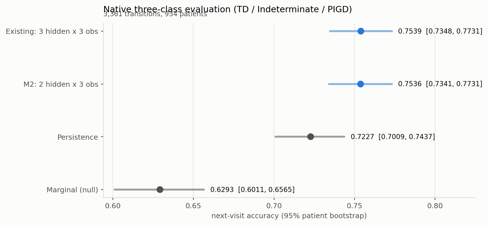
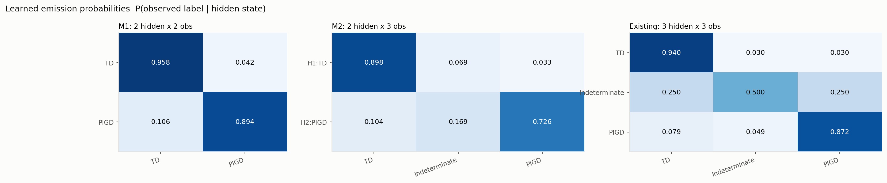
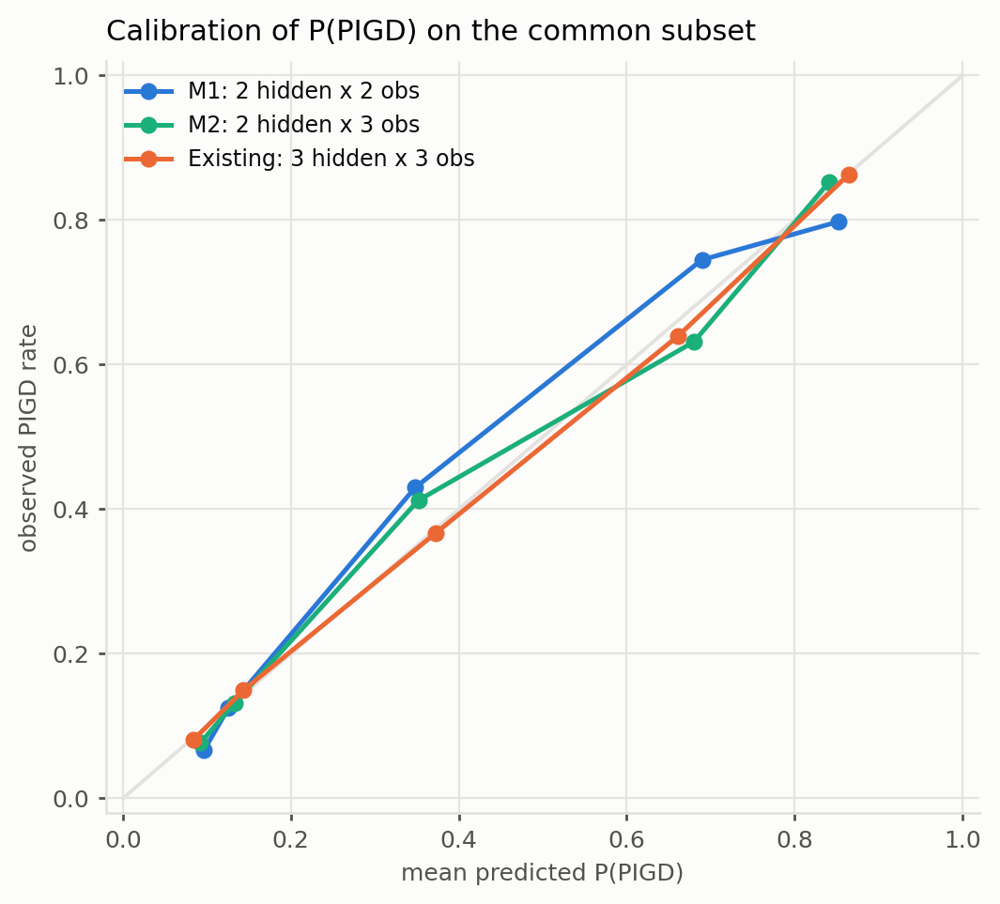

# Two-hidden-state CT-HMM variants against the existing three-state model

*2026-11-10. Machine outputs: `experiments/20261110T141727Z_two_state_hmm/`.
Code: `src/ppmi_subtype/two_state_hmm.py`, `scripts/92_two_state_hmm_comparison.py`,
`tests/test_two_state_hmm.py` (37 tests). Panel MD5 `fb038ddbdc19ab3368e13940f398e7ba`.*

## Summary

Two reduced models were fitted, both with **two** hidden states (TD and PIGD)
instead of the existing three:

- **Model 1 — 2 hidden × 2 observed.** Indeterminate visits are removed from
  the observation sequences; the actual elapsed time between the retained
  visits is kept. 5 free parameters.
- **Model 2 — 2 hidden × 3 observed.** Every visit is kept and Indeterminate is
  an *observed* label that either hidden state may emit, with the probability
  learned. 7 free parameters.

On the common TD/PIGD task — 2,936 identical held-out transitions over 876
patients — **all three CT-HMMs and the persistence rule are statistically
indistinguishable.** Every paired confidence interval includes zero. The two
hidden states lose nothing against three; they also gain nothing, and neither
does the latent machinery against "predict the last observed label".

Two results do separate. In-sample, the existing three-state model is clearly
preferred (ΔAIC 69, ΔBIC 25 against Model 2 on identical observations). And on
the **three-class** task the latent models beat persistence decisively on
accuracy (+0.031, CI excludes zero) while *losing* to it on macro-F1, because
neither latent model ever predicts Indeterminate at all.

**There is no winning model here.** The honest reading is that a two-state
latent representation is sufficient for next-visit TD/PIGD prediction, and that
the prediction task itself is close to saturated by the previous label.

## A. Dataset

| | Model 2 view (TD / Ind / PIGD) | Model 1 view (TD / PIGD) |
|---|---|---|
| Patients | 934 | 876 |
| Labelled visits | 4,295 | 3,812 |
| Transitions | 3,361 | 2,936 |

Both views come from the same frozen panel and the same cohort (1,080 sporadic
PD patients, 4,441 labelled visits; 934 have the ≥2 labelled visits a
transition requires). The only difference is which visits enter the sequences.

Indeterminate exclusion, in detail:

- **431** Indeterminate visits dropped.
- **483** visits lost to Model 1 in total — more than 431, because dropping an
  Indeterminate visit can leave a patient with a single retained visit, which
  removes their remaining visits too.
- **58** patients excluded from Model 1 (fewer than two TD/PIGD visits).

Elapsed time between retained visits is the **actual** gap, never a count of
annual visits. On **177** of the 2,936 eligible transitions an Indeterminate
visit was dropped in between, so Model 1 filters from an older visit across a
wider gap (median gap 1.002 y both views; Model 1's maximum gap 12.92 y).

Target labels over all 3,361 transitions: TD 2,115 (62.9%), Indeterminate 332
(9.9%), PIGD 914 (27.2%).

**Validation design.** Leave-one-patient-out, this project's established
next-visit protocol — not a single 70/30 split. Each of the 934 folds refits
all four CT-HMM arms on the other patients only, in both observation views, and
recomputes the rule's and the null's priors from the training patients.
`loo.assert_no_leakage` is called on both views every fold. Both models share
the same held-out patients by construction: in fold *p* the patient is out of
every fit. Model 1's *training pool* is smaller (876 sequences against 934),
which is a structural consequence of the exclusion, not a difference in the
held-out set.

**Prediction is forward filtering only.** α is advanced through the labels at
the visits *before* the target and propagated through exp(QΔ); no backward pass
runs and no quantity depending on the target label enters. Elapsed time to the
target is an input — the model is told *when* the next examination happens,
never what it records. That is this project's panel-data convention throughout,
and it is an assumption worth stating because PPMI's visit schedule is not
independent of disease course.

## B. Model configuration

All four arms converged in 934/934 folds (0 failures) and from 16/16 dispersed
starts on the full-cohort fits, with the largest spread in any generator or
emission entry among those starts ~1e-7 — **no flat ridge, no local-optimum
problem.**

### Model 1 — 2 hidden × 2 observed (5 parameters)

```
Q (per year)          TD       PIGD        E                TD      PIGD
         TD     -0.06204    0.06204            TD      0.95771   0.04229
       PIGD      0.01629   -0.01629          PIGD      0.10576   0.89424

initial:  TD 0.808,  PIGD 0.192        mean sojourn:  TD 16.1 y,  PIGD 61.4 y
```

### Model 2 — 2 hidden × 3 observed (7 parameters)

```
Q (per year)       H1:TD    H2:PIGD      E              TD  Indeterminate   PIGD
      H1:TD     -0.06870    0.06870        H1:TD   0.89772      0.06910   0.03319
    H2:PIGD      0.01579   -0.01579      H2:PIGD   0.10430      0.16932   0.72639

initial:  H1:TD 0.792,  H2:PIGD 0.208   mean sojourn:  14.6 y,  63.3 y
```

### Existing model — 3 hidden × 3 observed (14 parameters)

```
Q (per year)         TD      Ind      PIGD     E            TD     Ind    PIGD
         TD    -0.09713  0.08841   0.00872        TD    0.94010 0.03031 0.02959
        Ind     0.14944 -0.46924   0.31981       Ind    0.25000 0.50000 0.25000
       PIGD     0.00004  0.05469  -0.05473      PIGD    0.07936 0.04878 0.87186
```

Parameter counts verified against `hmm._n_params`: 5, 7 and **14** (6 rates + 6
emission + 2 initial). All emission rows sum to one, all off-diagonal rates are
non-negative, every generator diagonal equals minus its row sum, and exp(QΔ) is
a valid stochastic matrix at 0.5, 1, 2, 5 and 10 years — 32 structural checks,
all passing.

**The emission floor does nothing to Model 1.** Fitted with and without the
0.5 floor, the 2×2 model reaches the *identical* log-likelihood (−1613.7437)
and identical Q, E and π: the unconstrained optimum already records TD
correctly 95.8% and PIGD 89.4% of the time. So the constraint asymmetry between
Model 1 (floored, because it is square) and Model 2 (unfloored, because the
floor is undefined for 2 hidden × 3 observed) **is not a confound** — the
no-floor 2×2 arm was carried through the whole evaluation as the control and is
identical to Model 1 on every one of the 2,936 transitions.

By contrast the floor **is** binding on the existing model's Indeterminate row,
which sits exactly at 0.25/0.50/0.25. That is the degeneracy `hmm.py`'s own
comment documents: unconstrained, the latent Indeterminate state emits
uniformly and carries no information.

## C. Results

### Comparison A — native prediction, each model in its own space

These two tasks are **not comparable** and are never averaged: a three-class
prediction is harder on its face, and the eligible sets differ (3,361 targets
over 934 patients vs 2,936 over 876). Model 1 is absent from the three-class
table because it has no Indeterminate category — scoring it there would mean
giving it a zero for a class it was never asked about.

| Model | Hidden | Observed | Accuracy | Macro F1 | Balanced acc. | Transitions |
|---|---|---|---|---|---|---|
| Existing CT-HMM | 3 | 3 | 0.7539 | 0.5037 | 0.5255 | 3,361 |
| **Model 2** | 2 | 3 | 0.7536 | 0.5030 | 0.5249 | 3,361 |
| Persistence | — | 3 | 0.7227 | **0.5559** | 0.5484 | 3,361 |
| Marginal (null) | — | 3 | 0.6293 | 0.2575 | 0.3333 | 3,361 |
| **Model 1** | 2 | 2 | 0.8478 | 0.8098 | 0.7988 | 2,936 |

Model 1's 0.8478 is **not** comparable with the rows above it. It is a
two-class number on a smaller, easier set.

### Comparison B — the common TD/PIGD evaluation

All six arms on the **identical 2,936 transitions over 876 patients**, with the
three-label models renormalised onto {TD, PIGD} by
`next_visit.conditional_two_class`:
P(TD | TD or PIGD) = p_TD / (p_TD + p_PIGD). Verified identical scored sets.

| Model | Accuracy | 95% CI (patient bootstrap) | Macro F1 | Balanced acc. | Brier | Log loss |
|---|---|---|---|---|---|---|
| **Model 1** (2×2) | **0.8478** | [0.8318, 0.8637] | 0.8098 | 0.7988 | 0.2397 | 0.3955 |
| Existing (3×3) | 0.8467 | [0.8305, 0.8625] | 0.8098 | 0.8005 | **0.2348** | **0.3868** |
| **Model 2** (2×3) | 0.8464 | [0.8304, 0.8625] | 0.8097 | **0.8009** | 0.2375 | 0.3918 |
| Persistence | 0.8443 | [0.8276, 0.8609] | 0.8033 | 0.7897 | 0.3113 | 4.3009 |
| Marginal (null) | 0.7047 | [0.6754, 0.7334] | 0.4134 | 0.5000 | 0.4171 | 0.6080 |

The whole spread between the three CT-HMMs is **0.0014** — one and a half
transitions in a thousand. Note that Model 1 leads on accuracy while the
existing model leads on Brier and log loss, which is what a tie looks like.

## D. Statistical comparison

Paired patient-level bootstrap, 2,000 draws, **the same resampled patients for
every contrast and every single-model interval**.

| Contrast | Δ accuracy | 95% CI | Includes zero? |
|---|---|---|---|
| Model 2 − Model 1 | −0.0014 | [−0.0044, +0.0017] | **yes** |
| Model 1 − Existing | +0.0010 | [−0.0038, +0.0057] | **yes** |
| Model 2 − Existing | −0.0003 | [−0.0049, +0.0042] | **yes** |
| Model 1 − Model 1 (no floor) | 0.0000 | [0.0000, 0.0000] | **yes** |
| Model 1 − Persistence | +0.0034 | [−0.0003, +0.0072] | **yes** |
| Model 2 − Persistence | +0.0020 | [−0.0027, +0.0070] | **yes** |
| Existing − Persistence | +0.0024 | [−0.0035, +0.0085] | **yes** |
| Model 1 − Marginal | +0.1431 | [+0.1159, +0.1708] | no |

On the common task **only the null is beaten.** Model 1 vs persistence is the
closest call (+0.0034, upper CI +0.0072, lower −0.0003) and it still includes
zero. The discordance counts show how thin this is: Model 1 and Model 2 disagree
on just 22 of 2,936 transitions (9 vs 13).

On the **native three-class** task the picture differs:

| Contrast | Δ accuracy | 95% CI | Includes zero? |
|---|---|---|---|
| Model 2 − Existing | −0.0003 | [−0.0046, +0.0039] | **yes** |
| Model 2 − Persistence | +0.0309 | [+0.0223, +0.0408] | no |
| Existing − Persistence | +0.0312 | [+0.0223, +0.0411] | no |

So the latent models *do* beat persistence, significantly, but only on the task
that includes the Indeterminate targets persistence handles badly. Restricted to
the TD/PIGD subset where persistence is strongest, the advantage vanishes.

**Model 2 − Existing is indistinguishable from zero on both tasks.** Halving
the hidden states and the parameter count (14 → 7) costs nothing measurable in
held-out prediction.

## E. Model selection

`n` in BIC is the number of likelihood terms: one per **visit** in the fitted
sequences (`hmm.HMMFit.n_observations`), this project's convention from
`scripts/65_model_selection_criteria.py`. The HMM likelihood factorises over
whole sequences and every visit contributes a term, including each patient's
first, which the initial distribution accounts for; the transition count would
undercount it by exactly the number of patients.

| Model | Observation set | log L | k | n | AIC | BIC |
|---|---|---|---|---|---|---|
| Model 1 (2×2) | TD/PIGD visits only | −1613.744 | 5 | 3,812 | 3237.487 | 3268.717 |
| Model 1, no floor | TD/PIGD visits only | −1613.744 | 5 | 3,812 | 3237.487 | 3268.717 |
| Model 2 (2×3) | all labelled visits | −3010.697 | 7 | 4,295 | 6035.394 | 6079.950 |
| Existing (3×3) | all labelled visits | −2969.059 | 14 | 4,295 | 5966.119 | 6055.232 |

**Comparable:** Model 2 against the existing model — same 4,295 visits, same
three-label alphabet. **ΔAIC +69.28 and ΔBIC +24.72 both favour the existing
three-state model.** It buys 41.6 log-likelihood points for 7 extra parameters,
which survives even BIC's stiffer penalty.

**Not comparable:** Model 1 against either. Its likelihood is over 3,812 visits
on a two-label alphabet. Its much lower AIC reflects *fewer and easier
observations*, not a better model. It is comparable only with its own no-floor
variant, which shares its observations exactly.

This is a genuine **in-sample / held-out dissociation**: the third hidden state
earns its parameters on the likelihood and returns nothing in prediction. The
same pattern is recorded in `docs/model_comparison/01`. AIC and BIC also assume
independent observations; visits are clustered within patients, so the effective
sample size is below the term count and BIC's penalty is, if anything, too weak.

## F. Interpretation

**What "two hidden states" means.** The patient is taken to be in one of two
underlying motor phenotypes, TD or PIGD, moving between them in continuous time
at rates q(TD→PIGD) and q(PIGD→TD), with each examination reading that state
imperfectly. Both two-state fits agree on the clinical picture: progression
toward PIGD runs roughly **four times faster** than reversion (0.062 vs 0.016
per year in Model 1; 0.069 vs 0.016 in Model 2), with a mean TD sojourn near 15
years and a PIGD sojourn near 60.

**What "three emissions" means.** Model 2 keeps two phenotypes but lets either
produce an Indeterminate reading. It is *not* told which side Indeterminate
belongs to; the probabilities are learned.

**How Indeterminate is handled, and what the model says about it.** Both hidden
states place substantial mass on Indeterminate — **6.9% from the TD-like state
and 16.9% from the PIGD-like one.** It is not a label one side owns, though the
PIGD-like state produces it about 2.5× more often. That is the direct answer to
whether Indeterminate can be represented as an observation of either state:
yes, and the data puts it on both.

**But the model never predicts Indeterminate.** Across 3,361 held-out
transitions Model 2 selected Indeterminate as the most likely next label
**zero** times (the existing three-state model: once). This is structural, not
an accident of fitting: no hidden state emits Indeterminate with majority
probability, so the filtered predictive mass on it can never exceed ~0.17 and
can never win an argmax. Indeterminate is a 9.9% minority class defined as a
*band between* the other two, and a modal prediction will not choose it.

The consequence is visible in macro-F1, and it is the one place persistence
wins: carrying the previous label forward does predict Indeterminate (334
times, F1 0.192), giving persistence a macro-F1 of 0.5559 against the latent
models' 0.503 — **despite 3 points worse accuracy.** Reporting accuracy alone
would hide that.

**Which model performs better.** On the common task, none of them, and the
differences are not meaningful. Calibration is the only axis with a visible
ordering: the existing three-state model's largest gap between predicted and
observed PIGD rate in any bin is **0.022**, against **0.060** for Model 2 and
**0.082** for Model 1. Model 1 is over-confident at the top — it predicts 0.852
where 0.798 is observed — which is consistent with having discarded the
ambiguous visits and so seeing a cleaner, more separable history than the data
really offers. (The bin edges are not identical across models: the sparse-bin
merge rule inherited from `next_visit.calibration` gives Model 1 and Model 2 a
top bin of 0.75–0.90 and the existing model one of 0.75–1.00, so the per-bin
gaps are compared as maxima rather than bin by bin.)

**What limitations the reduction brings.** Model 1 cannot represent an
Indeterminate reading at all, so it cannot be asked about one and cannot
predict one; it also discards 483 visits and 58 patients, and on 177
transitions it must filter from an older visit across a wider gap, because the
evidence it dropped is evidence the other models still hold. Model 2 keeps
every visit but, having only two states, cannot give Indeterminate a dynamics
of its own — in the existing model the latent Indeterminate state is the
fast-moving one (mean sojourn 2.1 years against 10.3 and 18.3), and that
transient structure is what the reduction to two states removes. It is also
what AIC and BIC say is worth 41 log-likelihood points.

## G. Conclusion

The professor's suggestion is sound and worth reporting: **two hidden states are
enough for next-visit TD/PIGD prediction.** Dropping from three latent states to
two, and from 14 parameters to 7, changes held-out accuracy by 0.0003 — an
interval squarely centred on zero — on both the three-class task and the common
TD/PIGD task.

Which of the two reductions to prefer cannot be settled from these results, and
should not be claimed: Model 1 is nominally ahead on accuracy (0.8478 vs
0.8464) while Model 2 is ahead on balanced accuracy and keeps every patient and
visit. The paired difference is −0.0014 [−0.0044, +0.0017]. They disagree on 22
of 2,936 transitions.

Three findings are worth taking to the meeting as results rather than
non-results:

1. **Indeterminate behaves like an observation, not a state** — both hidden
   states emit it, so it does not have to be modelled as a phenotype of its
   own. This is consistent with (but does not establish) a measurement
   interpretation; predictive accuracy cannot decide that question, and nothing
   here shows TD and PIGD to be true biological states.
2. **No latent model beats persistence on the TD/PIGD task** (best Δ +0.0034,
   CI includes zero). The one-step prediction is close to saturated by the
   previous label. The latent layer earns its place only on the three-class
   task, and there mainly on accuracy rather than macro-F1.
3. **In-sample and held-out criteria disagree**, and the disagreement is large
   (ΔBIC 25 favouring three states; Δ accuracy 0.0003 favouring nothing). AIC
   and BIC should not be used on their own to pick the hidden-state count here.

All of this describes observational model comparisons on one cohort under one
labelling rule. None of it is evidence about disease biology.

## Reproducibility

- 934/934 folds completed, 0 failures; all arms converged in every fold.
- 32 structural checks and 24 leakage/correctness checks, all passing — including
  that no patient appears in both train and test, that every arm is scored on
  the identical common subset, that Model 1's interval is never shorter than the
  three-label interval, and that the bootstrap resamples patients.
- The **existing three-state results are untouched and reproduced**: the
  published run's `MANIFEST.sha256` verifies byte-for-byte, and the 3×3 arm
  refitted here matches the published per-case probabilities to **9.7e-17**
  across all 3,361 cases. The comparison is therefore against the existing
  model itself, not a look-alike.
- The published headline (0.8369 over 3,029 eligible transitions) is **not** the
  0.8467 reported here. The common subset is smaller: 93 TD/PIGD targets have no
  preceding TD/PIGD visit, so Model 1 cannot predict them. **The two numbers
  must not be quoted against each other.**
- Seed 42, 4 restarts per fold, 16 dispersed starts for the reporting fits,
  2,000 bootstrap draws. 654 s on 16 workers, `~/envs/ppmi`
  (Python 3.13.16 / numpy 2.2.4 / pandas 2.2.3 / scipy 1.15.2), commit `c61ad99`.

## Figures








