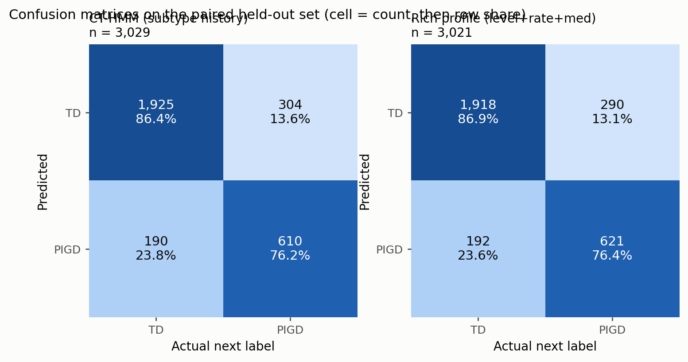
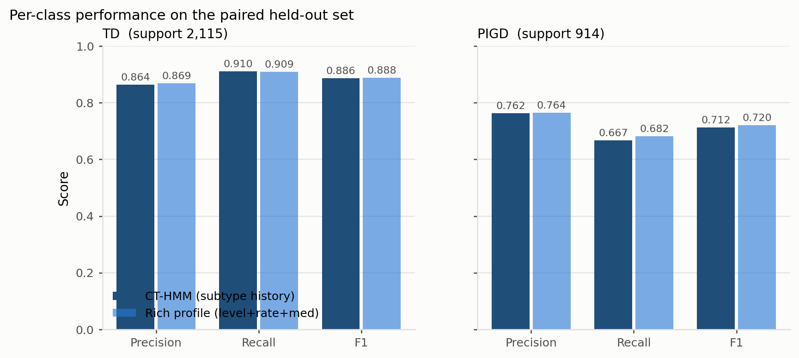

# Predicting the next clinical state in Parkinson's disease: a continuous-time hidden Markov model of motor subtype and a rich longitudinal clinical profile

**PPMI subtype-progression project — manuscript for research meeting, 21 October 2026**

---

## Abstract

**Background.** Patients with Parkinson's disease are routinely summarised by a
three-level motor subtype — tremor dominant (TD), indeterminate, or postural
instability / gait difficulty (PIGD). The label is a thresholded ratio of two
symptom subscores, so it discards most of what is measured at a visit. We asked
two questions: how well the next observed subtype can be predicted from a
patient's subtype history alone, and whether a richer multidimensional
representation of the patient predicts their next clinical state better.

**Methods.** Using the PPMI curated longitudinal panel (1,080 sporadic PD
patients, 4,433 visits with complete clinical profiles), we developed two
methods. **Method 1** is a continuous-time hidden Markov model (CT-HMM) in
which a latent phenotype evolves under a generator matrix and is observed
through a misclassification matrix; it predicts the next observed subtype from
the label history and the elapsed time. It was evaluated by leave-one-patient-out
(LOPO) validation over 934 patients and 3,361 prediction opportunities.
**Method 2**, inspired by but not reproducing Severson et al. (2021), represents
each patient by a *level* and a *rate of change* in each of nine clinical
domains, filtered causally from their own history, with levodopa-equivalent
daily dose (LEDD) entered as an input rather than as a domain. Its primary
target is the next visit's nine measured quantities; the subtype label is a
secondary endpoint derived from the predicted tremor and PIGD scores through
the project's own unmodified classification rule. It was evaluated by 5-fold
patient-level cross-validation repeated four times.

**Results.** On 3,020 paired held-out TD-or-PIGD next visits, the CT-HMM
reached 0.8371 accuracy (95% CI 0.8202–0.8540) and the rich profile 0.8404
(0.8248–0.8566); the paired difference was +0.0033 (95% CI −0.0050 to +0.0112),
so the two methods are statistically indistinguishable on this endpoint. Both
exceeded a simple persistence rule by a margin whose interval includes zero.
Both under-called PIGD, with recall near two thirds. On its own primary target,
the rich profile predicted the next visit's measurements better than carrying
the last observation forward (+0.0733 log-density per domain observation, 95%
CI +0.0657 to +0.0813) and far better than a population-average trajectory
(+0.3889, +0.3628 to +0.4167). Decomposing that gain, the rate-of-change
component contributed +0.0040 (+0.0019 to +0.0062) and the medication input
+0.0058 (+0.0041 to +0.0075) — each statistically distinguishable from zero but
together under a sixth of the total. The representation was genuinely
multidimensional: seven principal components were needed for 90% of
across-patient variance.

**Conclusion.** The next observed subtype is predictable to roughly 84%, but
largely because the label is persistent; a model built specifically for it has
no measurable advantage over one that predicts nine clinical measurements and
derives the label afterwards. A rich profile is a better description of a
patient and predicts their next measurements well, but the benefit comes from
knowing precisely *where* each patient is across domains rather than from
inferring where they are heading.

---

## 1. Introduction and motivation

The TD/PIGD classification (Stebbins et al., 2013) is the standard way to
summarise motor phenotype in Parkinson's disease. It is computed as

    ratio = mean(11 tremor items) / mean(5 gait and postural items)

with `ratio ≥ 1.15` giving TD, `ratio ≤ 0.90` giving PIGD, and the band between
giving Indeterminate. It is a single ordinal label derived from two numbers.

Two limitations motivate this work. First, the label is **persistent**: most
patients keep the same subtype from visit to visit, so a prediction task framed
on it can be close to saturated by a trivial rule, and any model must be
measured against that rule rather than against chance. Second, the label is
**lossy**: two patients both labelled TD may differ substantially in gait,
bradykinesia, cognition, mood, autonomic symptoms, daily function and
medication burden, and the label treats them as equivalent.

Method 1 addresses the first point directly: if the observed label is a noisy
reading of a latent phenotype, then a model with an explicit latent state and
an explicit misclassification process should predict the next *observed* label
better than a chain in the observed label itself. Method 2 addresses the
second: it replaces the label with a continuous, multidimensional, patient-specific
representation and asks whether that predicts the patient's subsequent clinical
state.

### Relationship to Severson et al. (2021)

Method 2 takes its motivation from Severson et al. (2021), who built disease
states from many clinical measurements rather than from a predefined label, and
reported that progression is heterogeneous and non-sequential. **This work is
inspired by that paper and is not a reproduction of it.** We implement neither
its contrastive latent variable model nor its personalised input–output hidden
Markov model, and we do not adopt its eight-state solution. What we carry over
is the *principle*: use many clinical axes rather than one label; separate the
patient's own level from shared structure; treat medication as an input rather
than a feature; allow progression rates to differ between patients; and assess
clinical relevance against outcomes not used in fitting. Section 4.1 states the
differences explicitly.

We were unable to obtain the full text of the Lancet Digital Health article
(access was refused by the publisher and by every indexing service we tried;
no repository holds the full text). We therefore worked from its abstract
together with the two underlying method papers by the same authors — Severson
et al. (2020) for the input–output HMM and Severson, Ghosh & Ng (2019) for the
contrastive model — both of which we read in full. No claim in this manuscript
depends on material we could not read.

---

## 2. Dataset and preprocessing

**Source.** PPMI Curated Data Cut (public release 2026-05-11), item-level
MDS-UPDRS Part II and Part III files, and the participant status file. All
analyses use the frozen project panel `outputs/visit_panel.csv`
(MD5 `fb038ddbdc19ab3368e13940f398e7ba`), which both experiment runs verify
before doing anything else.

**Cohort.** Sporadic PD only (1,080 patients, 5,774 patient-visits).
Unscheduled and premature-withdrawal visits are excluded, as is follow-up
beyond 15 years.

**Subtype labels.** Computed per visit by the project's `subtype.classify`
following Stebbins et al. (2013), from the OFF-medication or untreated Part III
examination. PPMI's "unable to rate" sentinel (coded 101 in the same numeric
field as a 0–4 rating) is blanked before any subscore is averaged; a single
such value left in place would lift a five-item mean to about 20 and relabel a
tremor-dominant visit as PIGD. Visits with more than the permitted number of
missing constituent items yield no label. This gives **4,441 labelled visits**.

**Clinical profile domains.** Nine measurements per visit, each an established
scale or a subscore built from its items:

| Domain | Source | Coverage |
|---|---|---|
| Bradykinesia / rigidity | mean of 20 Part III items that are neither tremor nor PIGD constituents | 0.9998 |
| Tremor | project 11-item tremor score | 1.0000 |
| PIGD | project 5-item gait/postural score | 1.0000 |
| MDS-UPDRS Part II | motor experiences of daily living, total | 0.9980 |
| MDS-UPDRS Part I | non-motor experiences of daily living, total | 0.9968 |
| MoCA | global cognition (higher is better) | 0.9928 |
| GDS-15 | depressive symptoms | 0.9946 |
| SCOPA-AUT | autonomic dysfunction | 0.9901 |
| ESS | daytime sleepiness | 0.9971 |

The bradykinesia/rigidity subscore is new to this work. `updrs3_score` is the
Part III *total* and already contains the tremor and PIGD items, so adding it to
a set that carries both would count those items twice. Instead we take the 20
Part III items that are neither — speech, facial expression, the five rigidity
items, finger tapping, hand movements, pronation–supination, toe tapping, leg
agility, arising from chair, posture, and global spontaneity of movement — and
build them with the project's own medication-state selection, duplicate
resolution and sentinel handling, so the new score is constructed exactly like
the two it sits beside.

A visit enters Method 2 only if it carries at least 8 of the 9 domains; 97.6%
carry all nine. This yields **4,433 visits over 1,080 patients**, of whom
**934 have two or more visits** and so contribute at least one prediction.

**Medication.** Levodopa-equivalent daily dose (LEDD), coverage 1.000. It is
highly dynamic in this cohort: 98.7% of patients are untreated at baseline (a
consequence of the PPMI protocol) and 790 of 1,080 begin treatment during
follow-up. This is why Method 2 treats LEDD as a model *input* rather than as
one of the measurements to be predicted — see §4.1.

**Missing data.** Never imputed in either method. Method 1's sequences use
labelled visits only. Method 2 marginalises absent measurements exactly: with a
diagonal observation covariance the emission log-density is a sum over domains,
so a domain not recorded at a visit simply contributes no term to that visit's
update.

---

## 3. Method 1 — Continuous-time hidden Markov model of motor subtype

### 3.1 Motivation from the data

A chain in the observed label is rejected by the data. Over 2,427 labelled
triples, a patient currently labelled TD who was previously TD stays TD 84.9%
of the time and moves to PIGD 8.6% of the time; one currently TD who was
previously PIGD stays TD only 48.2% of the time and moves to PIGD 39.3% of the
time (χ² = 156.6, df = 4, p = 7.9 × 10⁻³³). Under a Markov chain in the
observed label these two rows would be identical. The dependence on history is
the signature of a latent state read through noise.

### 3.2 Model

A latent phenotype `X(t)` takes one of three values and evolves as a
continuous-time Markov chain with generator `Q`, so the transition probability
over elapsed time `t` is `P(t) = exp(Qt)`. What is observed at visit `k` is not
`X(t_k)` but a noisy reading `Y_k` related to it by a misclassification matrix

    E[a, b] = P(observed label is b | true state is a)

The likelihood of a patient's whole sequence marginalises over every latent
path by the forward algorithm. Off-diagonal rates are parameterised as
`exp(θ)`; emission rows are softmax-parameterised.

**Identifiability constraint.** Each state must be recorded correctly more
often than not (diagonal of `E` ≥ 0.5). Without it the maximum-likelihood
solution is degenerate and identical across restarts: the latent Indeterminate
state emits uniformly, carrying no information, and PIGD becomes absorbing with
its exit rate pinned at the parameter boundary. The constraint costs nothing in
held-out performance (+0.027 log-likelihood per transition at the floor against
+0.026 unconstrained).

**Fitting.** Maximum likelihood by L-BFGS-B, four restarts from a perturbed
deterministic start, seed 42. `P(t)` is evaluated by eigendecomposition rather
than a matrix exponential per interval.

### 3.3 Prediction

For a patient's visit `k`, the filtered distribution over the latent state
given labels `0..k` is propagated over the **actual** elapsed time to visit
`k+1` and pushed through the emission matrix, giving a distribution over the
next *observed* label:

    p(next label) = α_k · exp(Q·Δt) · E

This is **filtering**, not smoothing: no backward pass is run, so no prediction
can use the visit it is predicting.

### 3.4 The two reported probabilities

Hidden-state posteriors are not next-label probabilities, and the three-class
distribution includes mass on Indeterminate. We report two **conditional**
probabilities,

    P_TD = p_TD / (p_TD + p_PIGD),   P_PIGD = p_PIGD / (p_TD + p_PIGD)

computed only when the denominator is positive. These are conditional on the
next observed label being TD or PIGD; they are *not* unconditional next-visit
probabilities. The Indeterminate mass is retained in the output table rather
than discarded (CT-HMM mean `p_Indeterminate` = 0.1033). The predicted class is
TD when `P_TD > P_PIGD` and PIGD otherwise; exact ties resolve to PIGD, the
clinically costlier error to miss. **No ties occurred** in 3,029 scored
predictions.

---

## 4. Method 2 — Rich longitudinal clinical profile

### 4.1 What is taken from Severson et al., and what is not

| Component | Severson et al. | This work |
|---|---|---|
| Input | 59 raw MDS-UPDRS items | 9 established scales and subscores |
| Nuisance variation | contrastive model against 196 healthy controls | **not implemented** |
| Patient-specific component | random offset `r_i` in a discrete-state emission | per-domain **level and rate**, continuous |
| Medication | LEDD as an input modulating emission | LEDD as an input in the observation equation |
| Progression process | input–output HMM, upper-triangular (progressive) transitions | continuous local linear trend, no discrete states |
| Number of states | eight, selected by cross-validation | **none** — the representation is not discretised |
| Clinical validation | seven independent outcomes | four available outcomes (§5.4) |
| External cohort | PDBP, n = 610 | **none available** |

The decision not to discretise is empirical, not stylistic. An earlier
experiment in this project compressed the same measurements into six and eight
latent severity states and lost accuracy relative to the subtype-history model;
a diagnostic attributed the loss to the discretisation itself. Healthy controls
*are* available in the raw data (330 patients, 2,169 visits), so the contrastive
step was declined on these grounds rather than for want of data.

### 4.2 Representation

For patient `i`, domain `d`, with visits separated by `Δ` years:

    y[i,d,t]       = level[i,d,t] + β[d] · LEDD[i,t] + ε,   ε ~ N(0, σ²_obs[d])
    level[i,d,t+Δ] = level[i,d,t] + Δ · rate[i,d,t] + w_L
    rate[i,d,t+Δ]  = rate[i,d,t]                    + w_R

with innovation covariance

    Cov([w_L, w_R]) = [[σ²_L·Δ + σ²_R·Δ³/3,  σ²_R·Δ²/2],
                       [σ²_R·Δ²/2,           σ²_R·Δ   ]]

The `σ²_R` terms are the exact integrated-Brownian covariance of a diffusing
rate; the `σ²_L·Δ` term is the level's own diffusion. **Both are needed.** With
only the integrated term the model cannot represent a level that wanders
without a trend, so it would not nest the random walk, and the level-only
comparison in §6.2 would contrast two parameterisations rather than isolate the
rate component. With `σ²_R = 0` the model reduces exactly to a random walk. The
prior variance on a patient's initial rate is also fitted, for the same reason:
the Kalman likelihood is a prequential one-step-ahead score, so a model forced
to carry initial slope uncertainty it does not need would pay for it on every
early prediction.

**The representation of patient `i` at visit `k` is the filtered posterior over
(level, rate) across the nine domains** — 18 continuous numbers with
uncertainty attached, not a discrete state. The level carries where the patient
is; the rate carries where they are going; both are per-domain, so a
tremor-dominant patient with deteriorating gait is not collapsed onto one
severity number.

Because `Δ` enters the transition directly, irregular visit spacing is handled
exactly rather than approximated on a fixed grid.

### 4.3 Inference and prediction

Inference is a Kalman filter and smoother. Parameters (`σ²_obs`, `σ²_L`,
`σ²_R`, the initial rate prior, and `β`) are shared across patients and fitted
by maximum likelihood on **training patients only**; the smoother is used only
for fitting, and every prediction comes from the filter alone. Temporal
causality is therefore structural: the filtered state after visit `k` is a
function of visits `0..k` by construction.

Prediction propagates the filtered state over the actual elapsed time to visit
`k+1` and adds the medication term at its `k+1` value, giving a Gaussian
predictive mean and variance per domain.

### 4.4 Deriving the subtype label (secondary endpoint)

We verified that the project's own `subtype.classify`, applied to the recorded
tremor and PIGD scores, reproduces the recorded panel label on **4,433 of 4,433
visits**. A predicted *distribution* over those two scores therefore induces a
distribution over the label: we draw (tremor, PIGD) pairs from the predictive
Gaussians, clip to the possible score range, push each through the unmodified
rule, and count. No new classifier is fitted and no new threshold introduced,
and a prediction sitting near a ratio boundary correctly yields an uncertain
label rather than a falsely confident one. The same conditional two-class
restriction and tie rule as Method 1 are then applied.

---

## 5. Evaluation protocol

### 5.1 The two targets are different

This is the central distinction in the manuscript and the two numbers must not
be compared as if interchangeable:

* **Clinical measurement prediction** (Method 2's primary target): predict the
  nine measured quantities at the next visit, as a probability distribution,
  scored against what was actually recorded. The target is *measured*, so it
  does not move when the model changes.
* **Categorical subtype prediction** (Method 1's target, Method 2's secondary
  endpoint): predict the next observed TD/Indeterminate/PIGD label. The subtype
  is a thresholded ratio of two of the nine measurements, so this endpoint
  tests two coordinates of the profile, not the profile.

### 5.2 Validation

| | Method 1 (CT-HMM) | Method 2 (rich profile) |
|---|---|---|
| Scheme | leave-one-patient-out | 5-fold patient-level CV × 4 repeats |
| Folds | 934 | 20 |
| Patients | 934 | 934 |
| Prediction opportunities | 3,361 | 3,353 |
| Eligible for two-class scoring | 3,029 | 3,021 |
| Failed folds | 0 | 0 |
| Automated checks passed | 19/19 | 13/13 |

In both, the entire patient is held out from every fit **and** from every
learned transformation — standardisation, model parameters, and (for Method 2)
the population-mean baseline and the last-observation spread are all refitted
inside each fold on training patients only.

The two schemes differ, and this is a genuine caveat on direct comparison.
Leave-one-patient-out for Method 2 was measured at roughly eight hours across
its four model variants, against split-to-split standard deviations of 0.0005;
cross-validation was chosen on that basis and every patient still contributes
held-out predictions. Where the two methods are compared head to head (§6.1)
the comparison is **paired on matched visit pairs**, which removes the
evaluation-set difference even though it does not remove the scheme difference.

### 5.3 Indeterminate outcomes

Indeterminate is retained throughout as input evidence and is never recoded.
Visits whose *actual* next label is Indeterminate (332 of 3,361 for Method 1,
9.9%) are reported separately and **never scored**: the conditioning event
"next label is TD or PIGD" did not occur, so neither class is the right answer,
and any rule for scoring them would be a decision about the label rather than a
measurement of the model.

### 5.4 Independent clinical outcomes

For Method 2 we additionally assessed whether the representation at a patient's
**second** visit is associated with clinical outcomes recorded **strictly
later** and never used in fitting: Hoehn & Yahr stage ≥ 3 (a separate clinical
staging instrument), MCI derived from HVLT and Benton test scores (not from
MoCA), and MDS-UPDRS Part IV motor complications (Part IV is excluded from the
feature set). An investigator cognitive diagnosis was also examined but is
flagged as not fully independent, being a clinician judgement plausibly
informed by cognitive testing.

### 5.5 Statistics

All intervals resample **patients**, not predictions, because a patient with
many visits contributes many correlated rows. Head-to-head comparisons are
**paired** on identical held-out cases. We do not describe a difference as an
improvement when its confidence interval includes zero.

---

## 6. Results

### 6.1 Next observed subtype: the two methods compared

On the **3,020 held-out TD-or-PIGD next visits shared by every model**
(Figure 1, Table 1):

| Model | Accuracy | 95% CI | Brier | Log loss |
|---|---|---|---|---|
| Rich profile: level only | 0.8440 | 0.8285–0.8598 | 0.1195 | 0.3814 |
| Rich profile: level + rate + medication | 0.8404 | 0.8248–0.8566 | 0.1177 | 0.3766 |
| Rich profile: level + rate, no medication | 0.8404 | 0.8249–0.8563 | 0.1175 | 0.3759 |
| **CT-HMM (Method 1)** | **0.8371** | 0.8202–0.8540 | 0.1215 | 0.3963 |
| Persistence (last non-Indeterminate label) | 0.8338 | 0.8167–0.8509 | 0.1598 | 4.1959 † |
| Markov chain in the observed label | 0.8298 | 0.8130–0.8471 | 0.1327 | 0.4311 |
| Last observation carried forward | 0.8252 | 0.8083–0.8425 | 0.1235 | 0.3941 |
| Population mean trajectory | 0.6914 | 0.6677–0.7153 | 0.2083 | 0.6067 |

† Persistence emits 0/1 probabilities; its log loss is finite only because it
is clipped and is not comparable with the fitted models.

Paired contrasts against the CT-HMM:

| Contrast | Δ accuracy | 95% CI | a right / b right |
|---|---|---|---|
| Rich profile (level+rate+med) − CT-HMM | +0.0033 | −0.0050 to +0.0112 | 81 / 71 |
| Rich profile (level only) − CT-HMM | +0.0070 | −0.0010 to +0.0149 | 81 / 60 |

**Both intervals include zero. We therefore report no significant difference
between the two methods on this endpoint.** The rich-profile route achieves
nominally better probability quality (Brier 0.1175–0.1195 against 0.1215; log
loss 0.3759–0.3814 against 0.3963) while predicting nine domains rather than
being built for this label, but we do not claim that as a demonstrated
improvement either.

The CT-HMM's own LOPO evaluation, on its full 3,029 eligible cases, gives
0.8369 (0.8204–0.8541) — consistent with the 0.8371 it scores on the paired
subset.

**The honest framing of the headline number is that the subtype label is
persistent.** The persistence rule reaches 0.8338 with no fitted parameters. The
useful separation between models is in probability quality, not accuracy.

### 6.2 Where each class is predicted well

Figures 2 and 3 give confusion matrices and per-class metrics. Both methods
recover TD well and PIGD poorly:

| | CT-HMM | | Rich profile | |
|---|---|---|---|---|
| | TD | PIGD | TD | PIGD |
| Precision | 0.8636 | 0.7625 | 0.8687 | 0.7638 |
| Recall | 0.9102 | 0.6674 | 0.9090 | 0.6817 |
| F1 | 0.8863 | 0.7118 | 0.8884 | 0.7204 |
| Support | 2,115 | 914 | 2,110 | 911 |

Each method is scored here on **its own** eligible set — 3,029 cases for the
CT-HMM and 3,021 for the rich profile — which is why the supports differ
slightly. The paired head-to-head comparison is §6.1; this table is for reading
the error structure, not for ranking the methods.

**Roughly a third of actual PIGD next visits are missed by both methods**
(recall 0.667 and 0.682). This is the clinically consequential error direction
and is the clearest shared weakness.

### 6.3 Patient-wise actual versus predicted subtype

Figure 4 shows every one of the 934 patients as a row, with visits in the
patient's own temporal order and held-out predictions only. Correct and
incorrect predictions, ineligible visits (actual next label Indeterminate, never
scored) and absent visits are distinguished. Patients are ordered by number of
held-out predictions, **not** by accuracy. Over the cohort the CT-HMM records
2,535 correct and 494 incorrect predictions with 332 not scored; the rich
profile records 2,539 correct and 482 incorrect with 332 not scored.

Figure 5 gives six readable patient panels. The six were chosen by fixed rules
applied to each patient's **observed label sequence only** — stable TD, stable
PIGD, a recorded TD→PIGD change, a recorded PIGD→TD change, a trajectory
passing through Indeterminate, and the patient with the most recorded label
changes — with ties broken by the lowest patient identifier. **No criterion
refers to model output**, so the panels cannot have been selected to flatter
either method. Both methods' predictions are plotted at the class they
predicted, offset vertically so a wrong prediction is visible as a marker away
from the observed path.

![**Figure 5.** Actual and predicted subtype for six example patients, in temporal order. The grey line and filled circles are the observed label path, coloured by class. Open triangles are held-out predictions from each method, offset vertically so a wrong prediction appears away from the observed path; grey triangles mark predictions that are not scored because the actual next label was Indeterminate. The six patients were chosen by fixed rules on their observed label sequences only — never by model accuracy.](figures/fig05_patientwise_examples.png)

### 6.4 Clinical measurement prediction (Method 2's primary target)

On 3,353 held-out prediction opportunities (Figures 6 and 7):

| Model | Log density per domain observation | 95% CI | RMSE (std.) | 95% coverage |
|---|---|---|---|---|
| **Profile: level + rate + medication** | **−1.0453** | −1.0706 to −1.0215 | **0.7007** | 0.941 |
| Profile: level only (random walk) | −1.0492 | −1.0744 to −1.0260 | 0.7025 | 0.941 |
| Profile: level + rate, no medication | −1.0511 | −1.0765 to −1.0270 | 0.7055 | 0.940 |
| Last observation carried forward | −1.1187 | −1.1434 to −1.0946 | 0.7426 | 0.944 |
| Population mean trajectory | −1.4342 | −1.4693 to −1.4021 | 1.0129 | 0.945 |

Paired contrasts:

| Contrast | Δ log density | 95% CI | share better |
|---|---|---|---|
| Rich profile − last value carried forward | **+0.0733** | +0.0657 to +0.0813 | 75.1% |
| Rich profile − population mean | **+0.3889** | +0.3628 to +0.4167 | 86.6% |
| Rate component contributes | **+0.0040** | +0.0019 to +0.0062 | 65.2% |
| Medication input contributes | **+0.0058** | +0.0041 to +0.0075 | 62.4% |

All four intervals exclude zero. The decomposition matters more than the
verdict: of the +0.0733 total gain over assuming no change, the rate component
supplies +0.0040 and the medication input +0.0058 — **together under a sixth**.
Most of the gain is the level being *filtered* across a patient's history
rather than read off their last visit.

Per-domain errors in clinical units (rich profile): bradykinesia/rigidity RMSE
0.374, tremor 0.309, PIGD 0.328, MDS-UPDRS II 4.13, MDS-UPDRS I 3.80, MoCA
2.20, GDS 1.98, SCOPA-AUT 4.50, ESS 3.01.

### 6.5 What the representation contains

Figure 9a: the across-patient representation needs **seven principal components
for 90% of its variance**; the first explains 42.2% of the levels and 37.2% of
the rates, with participation ratios of 4.34 and 5.11. The representation is
genuinely multidimensional and is not a severity score in disguise.

Figure 9b: fitted rates are heterogeneous across patients in some domains and
absent in others. The across-patient standard deviation of the fitted annual
rate is 0.375 for MDS-UPDRS II and 0.090 for PIGD, but **0.0002 for tremor**,
whose fitted rate innovation variance is exactly zero (as is MoCA's). Over
roughly one-year intervals, tremor and cognition behave like a noisy level that
wanders rather than like a quantity with a direction.

### 6.6 Association with independent clinical outcomes

Univariate AUC of the single strongest representation coordinate against the
subtype label as reference, for outcomes recorded after the representation
visit and never used in fitting:

| Outcome | n (events) | Best level coordinate | Subtype label | Δ | 95% CI |
|---|---|---|---|---|---|
| Hoehn & Yahr ≥ 3 | 761 (127) | MDS-UPDRS II level, 0.685 | 0.579 | **+0.105** | +0.054 to +0.156 |
| MCI (HVLT/Benton) | 818 (298) | MoCA level, 0.710 | 0.549 | **+0.161** | +0.109 to +0.213 |
| Part IV motor complications | 736 (470) | brady/rigidity level, 0.531 | 0.496 | +0.035 | −0.017 to +0.083 |
| Investigator cognitive dx † | 816 (327) | MoCA level, 0.678 | 0.558 | **+0.119** | +0.069 to +0.169 |

The corresponding best *rate* coordinates gave +0.053, +0.045, +0.041 and
+0.036, **all with intervals including zero**.

† not fully independent of the feature set.

So the levels carry clinical information the subtype label does not, on three
of four outcomes. **The rates are not established as clinically informative on
any of them.** These are univariate comparisons with the coordinate chosen on
the same data it is compared on, so each Δ is an upper bound on what one
coordinate buys.

### 6.7 Calibration

Figure 8a: both methods' two-class subtype probabilities track the observed
PIGD frequency closely across the probability range. Figure 8b: rich-profile
95% predictive intervals cover 94.1% of held-out measurements overall, slightly
below nominal, and below 0.95 in most domains — the intervals are a little too
narrow.

### 6.8 Convergence and stability

Method 1: 934/934 folds converged; every fold terminated on the
relative-reduction criterion and the worst projected gradient across all folds
was 0.0252. Method 2: all 20 folds converged under a projected-gradient
criterion relative to the likelihood scale; results varied across the four
independent splits by a standard deviation of 0.0003–0.0011 in log density,
an order of magnitude smaller than the rate contribution it is used to judge.
Across-fold parameter standard deviations were small relative to their means
(for example, the PIGD rate innovation variance 0.0206 ± 0.0033).

---

## 7. Discussion

**The two methods are not distinguishable on the subtype endpoint, and neither
is clearly better than a persistence rule.** This is the single most important
result for interpretation. The next observed subtype is predictable to about
84%, but a parameter-free rule that repeats the last non-Indeterminate label
reaches 0.8338. The CT-HMM's latent structure is well motivated by the
history-dependence in the data (§3.1) and it does produce calibrated
probabilities where the persistence rule produces only 0 and 1 — but on
accuracy alone the margin over that rule is small and its interval includes
zero.

**The richer representation is a better description of a patient, and that is
demonstrable without reference to the subtype label.** Seven principal
components are needed for 90% of its across-patient variance, and single
coordinates of it discriminate prospective Hoehn & Yahr progression and MCI
substantially better than the subtype label does. This is the clearest positive
finding in the manuscript and it concerns representation quality rather than
prediction accuracy.

**But the gain in prediction comes from the level, not the rate.** The
rate-of-change component contributes about 5% of the model's advantage over
assuming no change, and does not reach significance against the subtype label
on any clinical outcome. Two domains fit an exactly zero rate variance. The
plain reading is that over roughly one-year intervals these measures behave
much more like noisy levels that wander than like trajectories with a
persistent direction, and that what the model buys is precise estimation of
where a patient currently is across nine domains.

**Medication.** Including LEDD as an input improves profile prediction by
+0.0058 log-density (CI excluding zero). The fitted coefficients associate
higher LEDD with *worse* scores in eight of nine domains. **This is almost
certainly confounding by indication** — patients with more severe disease are
prescribed more levodopa — and is emphatically not evidence that levodopa
worsens symptoms. The coefficient is doing useful statistical work by removing
dose-correlated variation from the estimated level; it supports no causal
reading whatsoever. This is also the reason LEDD is an input rather than a
domain: a representation that includes LEDD among the measurements encodes
"has started treatment" as part of the patient's clinical state.

**Why this differs from Severson et al.** Their contribution was the discovery
of disease states and the finding that progression trajectories are
heterogeneous and non-sequential. We did not implement their architecture and
cannot speak to their states. Our result that rates add little is specific to
our nine aggregated domains, our roughly annual intervals and our follow-up;
it is not a refutation of their findings, which concerned a different
representation and a different set of questions.

---

## 8. Limitations

1. **Evaluation protocols differ between the methods** — leave-one-patient-out
   for Method 1, repeated 5-fold cross-validation for Method 2. The head-to-head
   comparison is paired on matched visit pairs, which removes the
   evaluation-set difference but not the scheme difference.
2. **The subtype endpoint tests two of nine coordinates.** The label is a
   thresholded ratio of tremor and PIGD, so a good profile prediction can still
   give a wrong label when the ratio sits near a threshold.
3. **The conditional probabilities are conditional.** `P_TD` and `P_PIGD`
   assume the next label is TD or PIGD. About 10% of next visits are
   Indeterminate and are excluded from scoring, so the headline accuracy
   describes 90% of prediction opportunities.
4. **Bounded clinical scales modelled as Gaussian.** These are bounded sums of
   integer item ratings; the linear-Gaussian state space can predict outside a
   scale's range and treats a one-point change at the floor as it does in the
   middle. Predictions are not truncated, and interval coverage is 0.941
   against a nominal 0.95.
5. **Domains are modelled independently** in Method 2 — no cross-domain
   innovation covariance — so the representation preserves domain differences
   but does not model their correlation.
6. **Medication enters linearly, through the observation only, and on average.**
   There is no patient-specific drug response and no effect on progression.
7. **Prediction, not causal inference.** No coefficient in either model
   supports a causal claim, and the medication coefficients are confounded by
   indication (§7).
8. **Elapsed time and the next visit's dose are inputs.** Both models are told
   *when* the next examination occurs. PPMI's visit schedule is not independent
   of disease course.
9. **Missing data.** Neither method imputes, but Method 2 requires 8 of 9
   domains for a visit to be used, which drops 8 visits relative to Method 1's
   cohort.
10. **Clinical-relevance analysis is univariate**, with the coordinate chosen on
    the same data it is compared on, so each reported Δ AUC is an upper bound.
11. **No external validation cohort.** PDBP is not available in this project.
    Nothing here has been validated outside PPMI.
12. **The target is the project's own classification rule and recorded
    measurements**, not independently adjudicated diagnoses, so accuracy
    measures agreement with a noisy record.

---

## 9. Conclusion

A continuous-time hidden Markov model of the motor subtype predicts the next
observed TD-versus-PIGD label with 0.8371 accuracy under leave-one-patient-out
validation. A rich longitudinal clinical profile — per-domain levels and rates
filtered from a patient's own history, with medication as an input — reaches
0.8404 on the same paired cases, a difference whose confidence interval
includes zero. Neither clearly beats a persistence rule on accuracy, because
the subtype label is highly persistent, though both produce calibrated
probabilities that the rule cannot.

On its own primary target the rich profile predicts the next visit's nine
clinical measurements better than assuming no change, and its representation is
genuinely multidimensional and more strongly associated with prospective
Hoehn & Yahr progression and MCI than the subtype label is. The benefit comes
from knowing precisely where a patient currently is across several clinical
domains, not from inferring the direction in which they are moving: the
rate-of-change component contributes under a sixth of the predictive gain and
is not established as clinically informative.

For the project, the practical implication is that effort is better spent on
representing the patient richly at the current visit than on extrapolating
short-interval trends, and that the TD/PIGD label — being persistent and
derived from two of nine measurements — is a weak endpoint on which to
discriminate between progression models.

---

## 10. References

1. Stebbins GT, Goetz CG, Burn DJ, Jankovic J, Khoo TK, Tilley BC. How to
   identify tremor dominant and postural instability/gait difficulty groups
   with the movement disorder society unified Parkinson's disease rating scale:
   comparison with the unified Parkinson's disease rating scale.
   *Movement Disorders*. 2013;28(5):668–670.
2. Severson KA, Chahine LM, Smolensky LA, Dhuliawala M, Frasier M, Ng K,
   Ghosh S, Hu J. Discovery of Parkinson's disease states and disease
   progression modelling: a longitudinal data study using machine learning.
   *The Lancet Digital Health*. 2021;3(9):e555–e564.
   doi:10.1016/S2589-7500(21)00101-1
   *(abstract consulted; full text could not be obtained — see §1)*
3. Severson KA, Chahine LM, Smolensky L, Ng K, Hu J, Ghosh S. Personalized
   input-output hidden Markov models for disease progression modeling.
   *Proceedings of Machine Learning Research* (Machine Learning for
   Healthcare). 2020;126:309–330.
4. Severson KA, Ghosh S, Ng K. Unsupervised learning with contrastive latent
   variable models. *Proceedings of the AAAI Conference on Artificial
   Intelligence*. 2019;33:4862–4869. arXiv:1811.06094.
5. Goetz CG, Tilley BC, Shaftman SR, et al. Movement Disorder Society-sponsored
   revision of the Unified Parkinson's Disease Rating Scale (MDS-UPDRS): scale
   presentation and clinimetric testing results. *Movement Disorders*.
   2008;23(15):2129–2170.
6. Tomlinson CL, Stowe R, Patel S, Rick C, Gray R, Clarke CE. Systematic review
   of levodopa dose equivalency reporting in Parkinson's disease.
   *Movement Disorders*. 2010;25(15):2649–2653.
7. Marek K, Jennings D, Lasch S, et al. The Parkinson Progression Marker
   Initiative (PPMI). *Progress in Neurobiology*. 2011;95(4):629–635.
8. Bengio Y, Frasconi P. An input output HMM architecture. *Advances in Neural
   Information Processing Systems*. 1995;8:427–434.

---

## Data and code availability

PPMI data are obtained per user from LONI under the PPMI Data Use Agreement and
are not redistributed with this project. All analysis code is in the project
repository; the two experiment runs behind this manuscript are
`experiments/20261020T104756Z_next_visit_td_pigd_prediction/` (Method 1) and
`experiments/20261020T180515Z_clinical_profile_cv/` (Method 2), each carrying a
`MANIFEST.sha256` over its own outputs. See `manuscript/README.md` for how to
regenerate every figure and table in this document.
