# Label Reliability, Not Model Capacity, Limits Longitudinal Prediction of Parkinson's Disease Motor Subtypes

Authors: Parv Patel, Mayank Tewatia, and Dr. Sahasranand K. R.

Affiliation: Indian Institute of Technology Palakkad, India

## Abstract

**Background.** The tremor-dominant (TD) and postural instability and gait difficulty (PIGD) motor subtypes of Parkinson's disease are defined by a thresholded ratio of two MDS-UPDRS item means. Whether a patient's next recorded subtype can be predicted from their longitudinal record, and whether richer models predict it better, has not been settled. We reconstruct a complete programme of experiments on the Parkinson's Progression Markers Initiative (PPMI) cohort that asked this question with models of increasing capacity, and we report the programme in full, including its negative results.

**Methods.** From the curated PPMI data cut (19,450 visits, 4,788 participants) we built a frozen visit panel of 1,080 sporadic Parkinson's disease participants and 5,774 visits, of which 4,441 carried an OFF-medication subtype label; 934 participants had at least two labelled visits and contributed 3,361 consecutive labelled transitions. We characterised the label's dynamics (transition matrices with patient-clustered bootstrap intervals, reversion, Kaplan-Meier conversion, a Markov-property test, a threshold-sensitivity recount, a lag-1 residual test, a posterior-predictive check of a Student-t growth model) and fitted, under leave-one-patient-out or repeated patient-level cross-validation, discrete- and continuous-time Markov chains in the recorded label, a three-state continuous-time hidden Markov model (CT-HMM) with an explicit misclassification matrix, a five-state HMM, a hierarchical Bayesian growth model and its Student-t variants, a first-visit multinomial model, Gaussian-process regression on the ratio and on the two subscores, a joint linear mixed model, multi-output Gaussian processes, a time-varying linear-spline mixed model, a latent clinical-state CT-HMM over ten clinical measurements, a per-domain Kalman level-and-rate clinical profile with levodopa-equivalent dose as input, direct logistic models, a ratio-banded CT-HMM with a joint subtype-by-band observation alphabet, and a band-width sweep. All families were re-scored on one harmonised decision rule and evaluation set. Prediction history windows, retraining on two-visit windows, stage-wise and patient-level accuracy were examined separately.

**Results.** The recorded label is unstable: 35.2% (95% CI 31.8 to 38.8) of observed label changes reverted at the next visit; requiring a conversion to hold for two consecutive visits removed 51.7% of apparent TD-to-PIGD conversions; the observed label violates the first-order Markov property (chi-square 156.6 on 4 degrees of freedom for current TD); and narrowing the thresholds by 0.02 relabels 6.7% of visits, all of them Indeterminate. Residual changes in the ratio are negatively autocorrelated at lag 1 (−0.22) but less than independent noise implies (−0.33), and a Student-t growth model does not reproduce the observed Indeterminate share or direct-reversion rate. On the harmonised three-class task every fitted family, from a six-parameter chain to a multi-output Gaussian process, scored between 0.745 and 0.758 against 0.723 for recorded-label persistence and 0.629 for the marginal null; the CT-HMM reached 0.754 (95% CI 0.735 to 0.773) and 94.3% of its margin over persistence came from the 9.9% of transitions that start from an Indeterminate label. On the two-class next-visit task (3,029 transitions) the CT-HMM reached 0.837 (0.820 to 0.854), persistence 0.834, a direct logistic model 0.836 and the clinical profile 0.840; no paired accuracy contrast between fitted models excluded zero, while a latent clinical-state model lost 11.3 points. Richer observations improved ranking but not accuracy: the clinical profile raised AUC from 0.858 to 0.890 and the ratio-banded CT-HMM from 0.859 to 0.876, with no accuracy gain and a worse calibration gap; the band-width optimum was interior and small. Truncating the prediction history to the last two visits or retraining on two-visit windows changed accuracy by less than one point, and no change in accuracy across disease stages excluded zero.

**Conclusions.** Across every family tried, held-out accuracy at reproducing the next recorded subtype saturates two to three points above persistence, and the saturation is set by the reliability of the label rather than by the capacity of the model. The result is a negative one for subtype prediction as currently defined and a positive one for the continuous representations, which carry information about later clinical outcomes that the label does not.

**Keywords.** Parkinson's disease; motor subtype; tremor dominant; postural instability and gait difficulty; longitudinal prediction; label reliability; hidden Markov model; Gaussian process; calibration; PPMI.

## 1. Introduction

Parkinson's disease is clinically heterogeneous, and the most widely used description of that heterogeneity in motor terms divides patients into a tremor-dominant (TD) group, a postural instability and gait difficulty (PIGD) group, and an Indeterminate group in between. In the MDS-UPDRS era the division is operational rather than mechanistic: Stebbins and colleagues defined it as the ratio of the mean of eleven tremor items to the mean of five gait and postural items, with TD at a ratio of at least 1.15, PIGD at a ratio of at most 0.90, and Indeterminate between [1]. The rule is simple to apply, it is what PPMI distributes as a derived variable, and it is what most longitudinal studies of subtype stability have used.

Those stability studies agree on one thing: the subtype moves. In the PPMI de novo cohort 39% of PIGD and 18% of TD patients changed subtype within a year [4]; across four years the TD share of the same cohort fell from 68% to 45% while PIGD rose from 23% to 44% [5]; in a clinic-based cohort only 15% to 36% of baseline TD patients were still TD at follow-up, depending on the algorithm [7]; and the three competing subtyping schemes agree with one another only fairly, with kappa near 0.37 [8]. The critical appraisal endorsed by the Movement Disorder Society noted that for most published subtype systems longitudinal stability had not been assessed at all [2], and the subsequent purpose-driven framework recommends asking what a subtype is for before asking whether it is real [14].

That movement raises a modelling question that is distinct from the clinical one. If the subtype at the next visit is partly determined by the subtype now and partly by measurement, then a model that treats the recorded label as a noisy reading of a slower latent state should predict the next recorded label better than a chain in the label itself, and a model that reads the underlying item scores, or the whole clinical picture, should do better again. The programme reported here was designed to test exactly that ladder of hypotheses on one cohort, with one frozen data panel, one evaluation protocol and one patient-clustered uncertainty method, and to keep every rung of the ladder in the record whether or not it held.

The ladder has four rungs. The first describes the recorded label's own dynamics: its transition probabilities, its tendency to revert, its conversion incidence under naive and sustained definitions, and its violation of the Markov property. The second fits the label with chains in the observed label and with a continuous-time hidden Markov model (CT-HMM) that carries an explicit misclassification matrix, under leave-one-patient-out validation, and asks whether the latent layer helps. The third replaces the label with the continuous quantities it is cut from, the ratio and then the two subscores, and fits growth models, Gaussian processes, mixed models and multi-output processes to them, deriving the label afterwards through the unchanged rule. The fourth widens the observation to ten clinical measurements and to medication, first through a discrete latent clinical state and then through a continuous per-domain level-and-rate profile, and finally adds the ratio band to the CT-HMM's own observation alphabet.

The answer at every rung is the same, and the title of this paper states it. On the same transitions, under the same decision rule, every fitted family scores between 0.745 and 0.758 on the three-class task, two to three points above carrying the current label forward; on the two-class task that excludes Indeterminate outcomes, every fitted family scores between 0.83 and 0.84. The margins over persistence come almost entirely from the Indeterminate stratum, which a persistence rule handles worst and which the threshold rule makes least reliable. Richer observations raise the models' ability to rank a PIGD visit above a TD visit, and they carry information about later clinical outcomes, but they do not raise the accuracy of the next-label call. The reliability of the label, not the capacity of the model, is the ceiling.

This paper reports the complete programme. Section 2 states the objectives and contributions, Section 3 the related work, Sections 4 and 5 the data and preprocessing, Section 6 the models in mathematical form matching the implementation, Section 7 the experimental design with a full inventory, and Section 8 the evaluation protocol. Section 9 reports every included experiment in its own subsection with its question, setup, cohort, baselines, numbers, uncertainty, figures, interpretation, limitations and contribution. Sections 10 to 12 discuss, limit and conclude. The supplementary material records the run identifiers, the software and test suite, and the work that was excluded or left incomplete.

## 2. Research objectives and contributions

### 2.1 Objectives

The programme set out to answer six questions, in order.

1. **How reliable is the recorded motor-subtype label over time?** Quantify its transition structure, its reversion, its conversion incidence under naive and sustained definitions, its dependence on the elapsed interval, its violation of the first-order Markov property, and its sensitivity to the placement of the thresholds and to the integer lattice of attainable ratios.
2. **Does a latent-state model predict the next recorded label better than a chain in the label itself?** Compare a discrete-time Markov chain, a continuous-time Markov chain and a three-state CT-HMM with an explicit misclassification matrix, under leave-one-patient-out validation, with persistence and the marginal distribution as references; check whether more latent states help and whether the fitted optimum is stable.
3. **Does modelling the continuous quantity the label is cut from predict the label better?** Fit a hierarchical Bayesian growth model and its Student-t variants, Gaussian-process regressions with several kernels and mean functions, a joint bivariate mixed model, multi-output Gaussian processes and a time-varying linear-spline mixed model to the ratio and to the two subscores; derive the label through the unchanged rule; and compare all families on one harmonised decision rule and evaluation set.
4. **Does a richer clinical observation predict the next label better?** Compare a discrete latent clinical-state CT-HMM over ten clinical measurements, a continuous per-domain level-and-rate profile with medication as an input, direct logistic models on the same inputs, and the CT-HMM reading the ratio band as well as the subtype, on the two-class next-visit task; separate changes in ranking from changes in accuracy and calibration.
5. **How much history does the prediction need, and does the answer depend on the training regime, the disease stage or the patient?** Truncate the prediction history to the last one, two, three or five visits; retrain on two-visit windows; evaluate by prediction stage; and audit accuracy at the patient level.
6. **Does a continuous representation carry information the label does not?** Test the profile's level and rate coordinates against subsequently recorded clinical outcomes that were never used in fitting.

### 2.2 Contributions

1. A frozen, fully reconstructed PPMI visit panel with an exact re-implementation of the Stebbins rule, verified against PPMI's own derived labels (agreement 4,431 of 4,431 on the two-class label and 1,595 of 1,597 on the three-class label), and a participant-flow ledger that accounts for every excluded visit.
2. A quantitative characterisation of label unreliability with patient-clustered uncertainty: a pooled reversion rate of 0.352 (95% CI 0.318 to 0.388), design effects of 1.38 (TD to TD) and 1.46 (PIGD to PIGD) on the transition probabilities, a 51.7% reduction in apparent conversions under a sustained definition, a 6.7% relabelling under a 0.02 threshold shift, and a lag-1 residual autocorrelation of −0.22 that is less negative than independent noise implies (−0.33).
3. A pre-registered posterior-predictive check showing that a Student-t hierarchical growth model on the ratio does not reproduce the observed Indeterminate share or direct-reversion rate, together with a descriptive localisation of the misfit to the integer lattice of the ratio inside the Indeterminate band and to the TD-to-PIGD direction.
4. The first harmonised comparison of five model families on identical transitions with one decision rule and common-random-number Monte Carlo propagation of continuous predictions through the classification rule, showing a three-class accuracy range of 0.745 to 0.758 across all fitted specifications and locating 94.3% of the CT-HMM's margin over persistence in the Indeterminate stratum.
5. A two-class next-visit evaluation framework with conditional probabilities and explicit accounting of Indeterminate outcomes, on which the CT-HMM, a direct logistic model and the clinical profile are statistically indistinguishable, and the latent clinical-state model is clearly worse.
6. Evidence that richer observations improve ranking but not accuracy: AUC 0.858 to 0.890 (clinical profile) and 0.859 to 0.876 (ratio bands) with accuracy contrasts that include zero, a worse calibration gap, no gain in partial AUC in the operating region, and an interior, small band-width optimum.
7. Evidence that prediction accuracy is insensitive to the history window, to retraining on two-visit windows, and to the disease stage, and that patient-level accuracy is bimodal and set by the composition of each patient's recorded labels.
8. Evidence that the profile's level coordinates discriminate Hoehn and Yahr stage 3 or worse and mild cognitive impairment better than the subtype label does, with bounded, pre-stated optimism.
9. A complete, auditable research record: every number in this paper is read from a saved result file of a named run, the figures and tables are copied or generated from those files by scripts kept with the manuscript, and the audit lists every experiment with its inclusion decision.

## 3. Related work

### 3.1 The motor subtype and its stability

The MDS-UPDRS [3] replaced the UPDRS in 2008, and Stebbins and colleagues [1] derived the TD/PIGD rule used here by matching the older Jankovic classification: a ratio of the mean of eleven tremor items (Part II item 2.10 and Part III items 3.15 to 3.18) to the mean of five gait and postural items (Part II items 2.12 and 2.13 and Part III items 3.10 to 3.12), with TD at or above 1.15, PIGD at or below 0.90, and Indeterminate between. The PPMI study [15] distributes the resulting label as a derived variable.

Within PPMI, Simuni and colleagues [4] found that 39% of PIGD and 18% of TD de novo patients changed subtype between baseline and twelve months, that dopaminergic therapy did not drive the change (p = 0.59), and that the baseline distribution was 71% TD, 18% PIGD and 11% Indeterminate. Lee and colleagues [5] followed 325 drug-naive PPMI participants for four years and found the TD share falling from 68.0% to 44.6% while PIGD rose from 23.1% to 44.2%, using the older cut-offs (TD at or above 1.5, PIGD at or below 1.0). Kohat and colleagues [10] reported the three-year stability of the MDS-UPDRS subtypes in early disease. Outside PPMI, Erro and colleagues [6] found substantial switching under both PIGD and akinetic-rigid schemes, von Coelln and colleagues [7] found that prevalence varies widely by algorithm and that only 15% to 36% of baseline TD patients remained TD after a mean of 6.2 years, and Ren and colleagues [8, 9] found only fair agreement between three subtyping systems in de novo disease, with the Jankovic-type ratio the least stable. Kotagal [11] questioned whether PIGD is a legitimate subtype at all, since data-driven analyses recover a tremor cluster but not reliably a PIGD cluster, and Nutt [12] asked whether the motor subtypes are different disorders or different stages. The Movement Disorder Society's critical appraisal [2] found that longitudinal stability could not be evaluated for most subtype systems because it had not been assessed, Fereshtehnejad and colleagues [13] proposed clinical criteria for subtyping with biomarker and progression validation, Marras and colleagues [14] proposed moving from subtyping to purpose-driven precision medicine, and Urso and colleagues [16] showed that disentangling the PIGD classification matters for predicting cognitive impairment.

The present work takes the instability as its starting point and asks a question the stability literature does not: given the instability, how well can the next recorded label be predicted from the record, and does the answer depend on the model?

### 3.2 Longitudinal and latent-state models of progression

Multistate Markov models for interval-censored panel data with an explicit classification-error matrix were formalised by Jackson and colleagues [17] and are implemented in the msm package [18]; the CT-HMM in this paper is exactly that model with three latent states and three recorded labels, fitted by maximum likelihood with a constrained emission diagonal. Severson and colleagues [19] fitted a personalised input-output hidden Markov model with a contrastive latent variable model to PPMI and PDBP and found eight disease states; their observation model carries no misclassification matrix and their states are not the motor subtypes. Dadu and colleagues [20] predicted data-driven progression-rate subtypes from baseline with machine learning in two cohorts, reporting five-year projection AUCs of 0.87 to 0.95 without calibration. Gaussian-process regression [21] is used here as the flexible nonparametric reference for the continuous quantities.

### 3.3 Evaluation of clinical prediction models

Bouwmeester and colleagues [22] found that only 12% of prediction studies in high-impact journals reported calibration and 27% discrimination; Van Calster and colleagues [23] called calibration the Achilles heel of predictive analytics. Strictly proper scoring rules [24] are the principled way to score probabilistic forecasts, and the TRIPOD+AI statement [25] and the STROBE statement [26] set the current reporting standards for prediction models and observational cohorts. Every probabilistic comparison in this paper reports a proper score (Brier, log loss, CRPS or log predictive density) beside accuracy, and every interval resamples patients rather than visits.

### 3.4 Positioning

Relative to the stability literature, this paper adds patient-clustered uncertainty, a sustained-conversion definition, a test of the Markov property, a threshold-sensitivity recount, a residual-autocorrelation test and a posterior-predictive check of a generative model. Relative to the progression-modelling literature, it adds a harmonised comparison across five model families on identical transitions, a two-class framework with explicit Indeterminate accounting, and a separation of ranking from accuracy and calibration. Relative to both, it reports a negative result in full.

## 4. Dataset

### 4.1 Source

All data come from the Parkinson's Progression Markers Initiative (PPMI) database [15], downloaded from the LONI Image and Data Archive on 20 August 2026 (the motor assessment files MDS-UPDRS Parts I to IV, the curated participant and visit tables, and the demographic, cognitive, autonomic, sleep, imaging and medication tables used as covariates). The curated data cut, as published, holds 19,450 visits of 4,788 participants across all PPMI cohorts. No PPMI data are reproduced in this paper or in its supplementary files; every table reports aggregates.

### 4.2 The subtype rule

The label is the Stebbins rule [1] re-implemented from the item level (Section 5). With the tremor score T the mean of the eleven tremor items and the PIGD score P the mean of the five gait and postural items, each item scored 0 to 4,

```
ratio r = T / P
TD             if r >= 1.15, or if P = 0 and T > 0
PIGD           if r <= 0.90
Indeterminate  if 0.90 < r < 1.15, or if P = 0 and T = 0
```

Both boundaries belong to the extreme classes (outer boundaries). Because T is a mean of eleven integers and P a mean of five, the ratio is a ratio of integer sums scaled by 5/11, and only a finite lattice of values is attainable; inside the Indeterminate band only eleven distinct ratio values occur in the cohort, and two of them, 10/11 = 0.9091 and 25/22 = 1.1364, hold 78% of the Indeterminate visits (Section 9.4). The re-implemented label agrees with PPMI's own derived label at 4,431 of 4,431 visits on the two-class TD/PIGD variable and at 1,595 of 1,597 visits (0.9987) on the three-class variable among the 390 participants for whom PPMI distributes it.

### 4.3 Cohort and participant flow

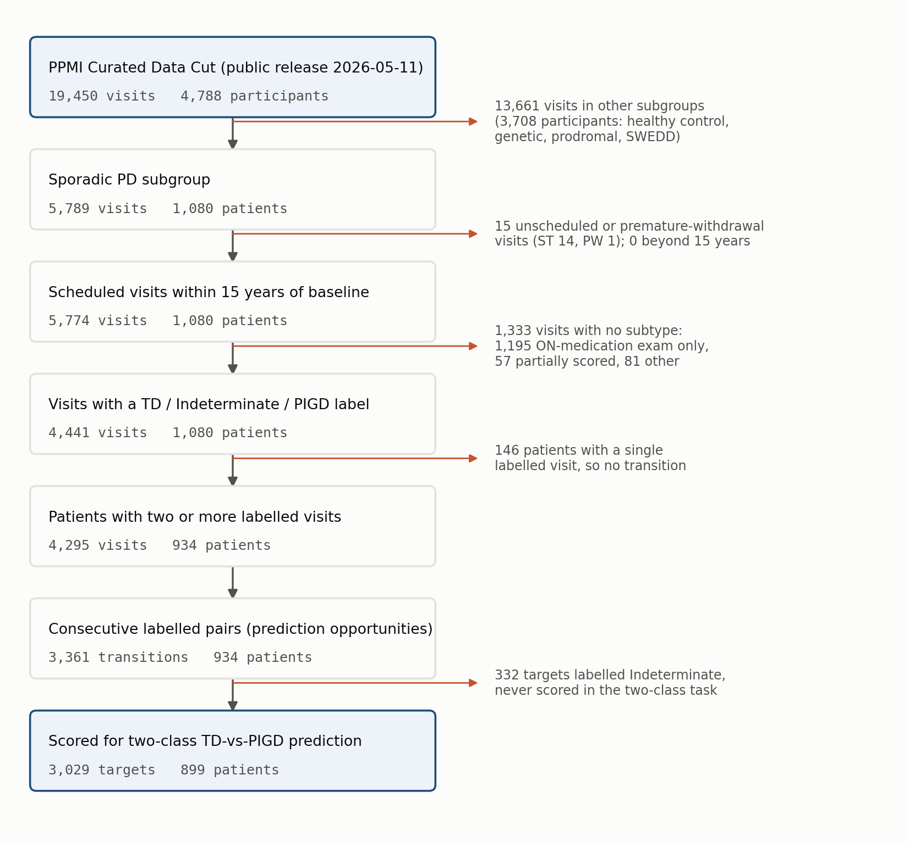

**Figure 1.** Participant flow from the curated PPMI data cut to the analysed cohort. *(Source: `experiments/20261103T192414Z_e5_participant_flow/fig1_participant_flow.png`.)*

**Table 1.** Participant flow from the curated PPMI data cut to the analysed cohort. Each exclusion is counted at the step that applied it.

| stage | visits | patients | note |
|---|---|---|---|
| curated data cut, as published | 19450 | 4788 |  |
| subgroup in ['Sporadic PD'] | 5789 | 1080 | -13,661 visits, -3,708 patients |
| exclude events ['PW', 'ST', 'U01', 'U02'] | 5774 | 1080 | -15 visits |
| follow-up <= 15 years | 5774 | 1080 | -0 visits |
| cohort patient-visits | 5774 | 1080 |  |
| with a TD/PIGD subtype label | 4441 | 1080 | -1,333 visits unlabelled |
| labelled visits | 4441 | 1080 |  |
| patients with >= 2 labelled visits | 4295 | 934 | -146 patients with one only |
| consecutive labelled visit pairs | 3361 | 934 | one prediction opportunity each |
| eligible for two-class TD-vs-PIGD scoring | 3029 | 899 | -332 Indeterminate targets |

*Machine-readable copy: `tables/table001_participant_flow.csv`. Source: `experiments/20261103T192414Z_e5_participant_flow/flow_ledger.csv`.*

The analysed cohort is the sporadic Parkinson's disease subgroup of the curated cut: 1,080 participants and 5,789 visits, reduced to 5,774 by excluding the premature-withdrawal, screening-termination and unscheduled events (15 visits). A visit carries a label only when all sixteen items are rated at an OFF-medication or untreated examination; 4,441 visits (76.9%) do. Table 2 accounts for the 1,333 visits that do not: at 1,195 of them (89.6%) only an ON-medication Part III examination exists, 65 have no Part III record, 57 have a partially scored examination, and the remainder lack the Part II items. Of the 1,080 participants, 934 have at least two labelled visits; they contribute 4,295 labelled visits and 3,361 consecutive labelled pairs, which are the prediction opportunities for every three-class model. Of those 3,361 pairs, 3,029 (899 participants) have a TD or PIGD outcome and are the eligible cases for every two-class model; the 332 pairs whose outcome is Indeterminate are counted but never scored on the two-class task.

**Table 2.** Why 1,333 eligible visits carry no subtype label.

| reason | visits | share |
|---|---|---|
| only an ON-medication Part III exam exists, so it is excluded | 1195 | 0.8965 |
| no Part III row in the source file at all | 65 | 0.0488 |
| Part III exam partially scored (>=1 item unrateable or absent) | 57 | 0.0428 |
| all 13 Part III items present; Part II blocked the label | 16 | 0.012 |

*Machine-readable copy: `tables/table002_unlabelled_visits_reasons.csv`. Source: `experiments/20261103T192414Z_e5_participant_flow/unlabelled_diagnosis.csv`.*

### 4.4 Descriptive characteristics

**Table 3.** Cohort summary: labelled visits, label distribution, visit spacing and follow-up.

| quantity | value |
|---|---|
| patients in the eligible cohort | 1080 |
| visits in the eligible cohort | 5774 |
| visits with a subtype label | 4441 |
| patients with at least two labelled visits | 934 |
| patients with at least three labelled visits | 762 |
| patients with at least five labelled visits | 333 |
| patients with at least eight labelled visits | 145 |
| labelled visits per patient, median (max) | 3 (14) |
| labelled visits: TD | 2891 |
| labelled visits: Indeterminate | 441 |
| labelled visits: PIGD | 1109 |
| baseline (year 0) labelled visits: TD / Indeterminate / PIGD | 772 / 109 / 195 of 1076 |
| ratio computable (PIGD subscore > 0) | 3716 |
| ratio undefined (PIGD subscore = 0) | 725 |
| share of labelled visits with PIGD item sum = 0 | 0.1633 |
| share of labelled visits with tremor item sum = 0 | 0.0723 |
| ratio: median (IQR) | 1.59 (0.68-2.95) |
| interval between consecutive labelled visits, years: 10th / 25th / 50th / 75th / 90th percentile | 0.914 / 0.999 / 1.002 / 1.164 / 1.999 |
| labelled follow-up per patient, years: 10th / 25th / 50th / 75th / 90th percentile | 1.166 / 2.078 / 3.083 / 6.913 / 11.001 |

*Machine-readable copy: `tables/table003_cohort_summary.csv`. Source: `experiments/20261015T221426Z_partC_raw_scores/results.json; outputs/panel_summary.txt; outputs/transitions/prevalence_by_year.csv`.*

Over all labelled visits the label is TD at 2,891 (65.1%), Indeterminate at 441 (9.9%) and PIGD at 1,109 (25.0%); at baseline it is TD at 772 (71.7%), Indeterminate at 109 (10.1%) and PIGD at 195 (18.1%) of 1,076 labelled baseline visits, matching the PPMI baseline distribution reported by Simuni and colleagues [4]. The ratio is undefined at 725 labelled visits (16.3%) because the PIGD score is zero; 665 of those are TD by the degenerate-case rule and 60 are Indeterminate. The median interval between consecutive labelled visits is 1.00 years (10th to 90th percentile 0.91 to 2.00), and the median labelled follow-up per participant is 3.1 years (10th to 90th percentile 1.2 to 11.0). The share of labelled visits at which the ratio is defined rises from 0.74 at baseline to above 0.90 after year five (Table 32), so the ratio-based models see a cohort that drifts towards the PIGD-bearing participants.

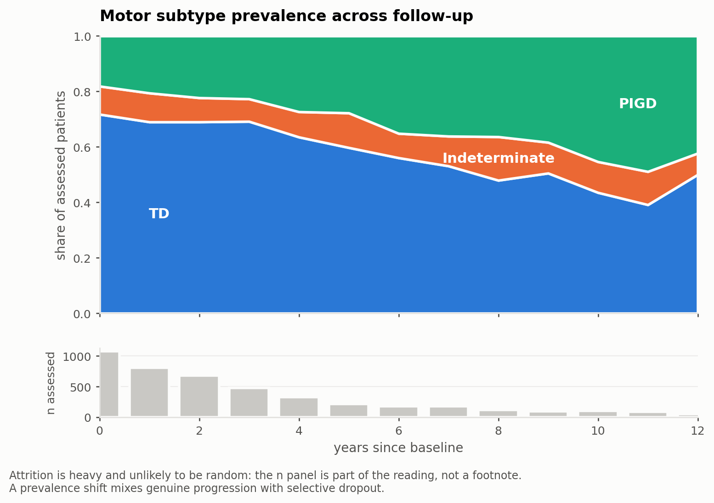

**Figure 7.** Label prevalence by study year. *(Source: `outputs/transitions/figures/prevalence_over_time.png`.)*

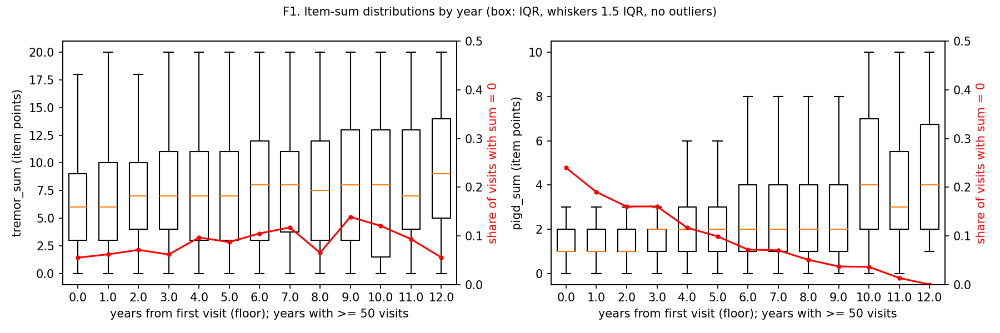

**Figure 10.** Distributions of the tremor and PIGD item sums over labelled visits. *(Source: `experiments/20261015T221426Z_partC_raw_scores/figures/F1_item_sum_distributions.png`.)*

### 4.5 The frozen panel

Every experiment reads one frozen visit panel, `outputs/visit_panel.csv`, whose MD5 checksum (fb038ddbdc19ab3368e13940f398e7ba) is verified by each run script before fitting. The panel was built once by the pipeline described in Section 5 and never rebuilt; the threshold-sensitivity experiment (Section 9.3) wrote a separate perturbed panel with its own checksum and left the frozen panel untouched. The project's outputs directory is read-only by rule, and every later experiment writes to its own timestamped directory under `experiments/`.

## 5. Preprocessing

### 5.1 Examination selection

PPMI records the MDS-UPDRS Part III examination in the OFF state, the ON state, or both at a visit. The label uses the OFF-medication examination when one exists and the untreated examination otherwise; an ON-only visit is never labelled. Where a visit holds more than one eligible Part III record the earliest is kept, and duplicates are removed by participant, event and examination state. The same-visit OFF and ON examinations were kept separately for the audit of Section 9.3, which measures their label agreement.

### 5.2 Item handling

PPMI codes an item that could not be rated as 101. The postural-stability item (3.12) carries this code at 4,302 raw records, 3,206 after OFF-state selection and 3,205 after de-duplication; the code is blanked before any arithmetic. The missing-item policy is strict: both subscores require all of their items, so a visit with any missing tremor item has no tremor score and a visit with any missing PIGD item has no PIGD score, and no label. Nothing is imputed anywhere in the pipeline. The reconstruction of the item sums from the raw item tables was checked against the frozen panel at every one of the 5,774 visits with zero mismatches in the tremor score, the PIGD score and the label.

### 5.3 Time axis and covariates

Time is measured in years from each participant's baseline visit using the recorded visit dates. For the clinical-measurement models (Sections 6.12 and 6.13) ten measurements were built from the same visit tables: a bradykinesia and rigidity score (the mean of the twenty Part III items that are neither tremor nor gait and postural items), the tremor and PIGD scores above, the MDS-UPDRS Part II and Part I totals, the Montreal Cognitive Assessment total, the 15-item Geriatric Depression Scale, the SCOPA-AUT autonomic score, the Epworth Sleepiness Scale, and the levodopa-equivalent daily dose (LEDD). All ten measurements are present at 97.6% of labelled visits. The first-visit model (Section 6.6) uses ten baseline measures: age, sex, disease duration, the REM sleep behaviour disorder screening questionnaire, the SCOPA-AUT score, the UPSIT smell identification score, the MoCA total, the bilateral putamen DaT-scan binding, the Hoehn and Yahr stage and the MDS-UPDRS Part II total. Each measurement is standardised with the mean and standard deviation of the training participants of the fold in which it is used; missing measurements are marginalised exactly in the Gaussian models rather than imputed. The one exception is the first-visit model, whose missing baseline covariates are mean-imputed inside the training split of each fit.

### 5.4 Software and tests

The pipeline is a Python 3.13 package (numpy 2.2, scipy 1.15, pandas 2.2, scikit-learn for the ranking metrics) run on CPU nodes of a SLURM cluster; every fit is deterministic given its seed (42 throughout), and every run directory records the git commit, the panel checksum, the installed package versions and, for the later experiments, a SHA-256 manifest of its output files. The test suite holds 841 collected tests covering the label rule, the panel construction, the transition and survival estimators, each model's likelihood and gradient, the leakage checks of each validation driver, and the bootstrap helpers; the Stage 1 audit of 4 November 2026 recorded 758 tests passing at that date, and tests added since are collected in the current suite.

## 6. Methods

Every model below is described as the code implements it. Section 6.1 fixes the notation; Sections 6.2 to 6.15 give the models in the order the programme fitted them; the evaluation protocol common to all of them is in Section 8.

### 6.1 Notation

Patient *i* has labelled visits *k* = 0, …, *n*<sub>*i*</sub> − 1 at times *t*<sub>*ik*</sub> (years from baseline), with recorded labels *y*<sub>*ik*</sub> ∈ {TD, Indeterminate, PIGD} = {0, 1, 2}, tremor score *T*<sub>*ik*</sub>, PIGD score *P*<sub>*ik*</sub> and, where *P*<sub>*ik*</sub> > 0, ratio *r*<sub>*ik*</sub> = *T*<sub>*ik*</sub> / *P*<sub>*ik*</sub>. The interval to the next visit is Δ<sub>*ik*</sub> = *t*<sub>*i,k*+1</sub> − *t*<sub>*ik*</sub>. A prediction opportunity is a labelled visit *k* followed by a labelled visit *k* + 1 of the same patient; the model may use visits 0, …, *k* and the value of Δ<sub>*ik*</sub>, never the label at *k* + 1 or anything later. Across the 934 patients with at least two labelled visits there are 3,361 such opportunities. Throughout, "history" means the labels or measurements at visits 0, …, *k*, and the elapsed interval is an input: the model is told when the next examination happens, not what it records.

### 6.2 Chains in the recorded label

**Discrete-time Markov chain (DTMC).** The next label depends only on the current label, and the interval is ignored. The transition matrix is estimated from the consecutive pairs of the training patients with Laplace smoothing, one pseudo-count per cell:

```
P_ab = (n_ab + 1) / (n_a + 3),   a, b in {TD, Ind, PIGD}
```

and the predictive distribution at a prediction opportunity is the row of *P* for the current label.

**Continuous-time Markov chain (CTMC).** A generator matrix *Q* with off-diagonal rates *q*<sub>*ab*</sub> = exp(θ<sub>*ab*</sub>) ≥ 0, diagonal entries equal to minus the row sums, and transition probabilities over an interval Δ

```
P(Δ) = exp(Q Δ)
```

computed by eigendecomposition of the 3 × 3 generator. The panel data are interval-censored, so the likelihood of a training pair (*a*, *b*, Δ) is *P*(Δ)<sub>*ab*</sub> and the log-likelihood is the sum over pairs. The six log-rates are bounded to [−12, 4] (rates between about 6 × 10<sup>−6</sup> and 55 per year) and maximised by L-BFGS-B. The predictive distribution at a prediction opportunity is the row of *P*(Δ<sub>*ik*</sub>) for the current label. Mean sojourn times are −1/*Q*<sub>*aa*</sub>.

### 6.3 The continuous-time hidden Markov model (CT-HMM)

The latent state *X*(*t*) is a CTMC with generator *Q* as in Section 6.2 and initial distribution π. The recorded label at visit *k* is a noisy reading of the latent state through a misclassification (emission) matrix

```
E[a, b] = P(recorded label = b | latent state = a).
```

The likelihood of one patient's sequence marginalises over every latent path by the forward recursion

```
alpha_0      = pi ∘ E[:, y_0]
alpha_{k+1}  = (alpha_k P(Δ_k)) ∘ E[:, y_{k+1}]
log L_i      = log sum_a alpha_{n_i - 1}[a]
```

where ∘ is the element-wise product, so the cost is linear in the number of visits. Prediction uses filtering only: the predictive distribution of the next label is

```
p(y_{k+1} | y_{0..k}, Δ_k) ∝ alpha_k P(Δ_k) E
```

normalised over the three labels; no backward pass is run and nothing at or after visit *k* + 1 enters the prediction.

**Parameterisation.** π is the softmax of two free logits bounded to [−8, 8] (the third fixed at zero). Each row of *E* is a softmax of three logits with one entry pinned to zero. The six free emission logits are bounded above so that each diagonal entry of *E* is at least a floor *f*: with logits (0, *b*, *b*) the diagonal probability is 1 / (1 + (*S* − 1) e<sup>*b*</sup>), so the bound is *b* ≤ log((1/*f* − 1) / (*S* − 1)), which for *f* = 0.5 and *S* = 3 is log 0.5. The floor is not cosmetic: unconstrained, the maximum-likelihood solution is degenerate and identical across restarts, with the latent Indeterminate state emitting uniformly and PIGD absorbing with an exit rate at its lower bound. Requiring that each state be recorded correctly more often than not removes both degeneracies at no cost in held-out performance (Section 9.6). The model has 14 free parameters: 2 for π, 6 for *Q* and 6 for *E*. The negative log-likelihood is minimised by L-BFGS-B (maximum 3,000 iterations, function tolerance 10<sup>−11</sup>, gradient tolerance 10<sup>−9</sup>) with finite-difference gradients from four restarts seeded from 42 (the configured value; twenty to forty starts in the stability study); the Stage 4 study established that scipy's success flag alone under-reports convergence of this fit and that the projected-gradient norm is the right criterion, which the later experiments record for every fold.

**Alternative configurations.** The stability study (Section 9.6) fitted the same model with floors of 0.6 and 0.7, with no floor (C3_free), and with four and five latent states and three recorded labels (C4_free, C5_free; the floor is undefined when the number of latent states differs from the number of labels). An earlier five-state leave-one-patient-out run is also reported (Section 9.6); its fits converged in 404 of 934 folds.

### 6.4 The hierarchical Bayesian growth model and its Student-t variants

For the ratio-defined visits of patient *i* (PIGD score greater than zero),

```
r_ik = (beta_0 + b_0i) + (beta_1 + b_1i) t_ik + e_ik,
b_0i ~ N(0, tau_0^2),  b_1i ~ N(0, tau_1^2),  e_ik ~ N(0, sigma^2).
```

The proposal's observation and process noise terms are additive on the same observation and are identified only through their sum, so the sampler estimates σ<sup>2</sup> = *s*<sub>proc</sub><sup>2</sup> + *s*<sub>obs</sub><sup>2</sup> and says so. Priors are weakly informative: N(0, 100<sup>2</sup>) on β<sub>0</sub>, β<sub>1</sub> and inverse-gamma(0.01, 0.01) on the three variances. Inference is a single Gibbs chain with conjugate updates (the random effects of all patients drawn as a batch of bivariate normals; 2,000 draws after a burn-in of 500 for the main fit, 1,500 after 500 inside the longitudinal cross-validation); no R-hat or effective sample size was computed, so the posterior summaries are descriptive. A label probability is obtained from the predictive distribution of the ratio by integrating over the threshold intervals: P(TD) = P(*r* ≥ 1.15), P(PIGD) = P(*r* ≤ 0.90), P(Indeterminate) the remainder.

**Student-t variants.** Four variants cross Gaussian (G) and Student-t (T) distributions on the residual and on the patient slope: GG (the model above), GT (t residuals), TG (t slopes) and TT (both). The t distributions are scale mixtures of normals, with the residual degrees of freedom ν<sub>*e*</sub> and the slope degrees of freedom ν<sub>*s*</sub> on a 400-point log-spaced grid over [1, 300] under a Gamma(2, 0.1) prior; the slope degrees of freedom are updated by a collapsed slice step that integrates the mixing weights out (hbayes_tt_nu), which the original grid update could not mix. Each split fit draws 4,000 samples after a burn-in of 2,000 (thinning 5); the full-cohort fits thin by 10 and run four chains with R-hat and effective-sample-size thresholds of 1.01 and 400. The pre-registered questions were Q1 (do t residuals improve held-out prediction), Q2 (is the slope distribution heavy-tailed, judged by ν<sub>*s*</sub> having a 97.5% posterior quantile below 10 in at least five of seven patient splits, with calibration scenarios bounding the false-positive rate) and Q3 (do the variants improve the class-label metric over GG). Held-out log predictive density per visit and the class-label metric use 400 posterior draws with 20 inner draws for the patient-level random effects; intervals are patient bootstraps of 2,000 resamples.

### 6.5 The first-visit (new-patient) model

A patient at a first visit has no history. The first-visit model is a multinomial logistic regression (scikit-learn) of the label at a later visit on the first-visit label, the horizon in years, the first-visit ratio and ten baseline measures (age, sex, disease duration, the RBD screening questionnaire, SCOPA-AUT, UPSIT, MoCA, bilateral putamen DaT binding, Hoehn and Yahr stage and MDS-UPDRS Part II). Covariates are standardised and, where missing, mean-imputed inside the training split. Nested variants drop the covariates, the ratio, or both, and the importance of each covariate is the held-out cost of dropping it from the full model. Evaluation is on ten random 70/30 patient-stratified splits.

### 6.6 Gaussian-process regression of the ratio

For patient *i*, *r*<sub>*ik*</sub> = *f*<sub>*i*</sub>(*t*<sub>*ik*</sub>) + ε<sub>*ik*</sub> with ε ~ N(0, σ<sub>*n*</sub><sup>2</sup>) and *f*<sub>*i*</sub> ~ GP(*m*, *k*). The mean is linear, *m*(*t*) = β<sub>0</sub> + β<sub>1</sub>*t*, profiled out by generalised least squares inside the marginal likelihood. Four kernels were fitted:

```
K0  constant + linear                       (the growth model in function-space form)
K1  constant + RBF
K2  constant + linear + RBF
K3  constant + linear + Matern-3/2
```

K0 is the hierarchical growth model: its covariance τ<sub>0</sub><sup>2</sup> + τ<sub>1</sub><sup>2</sup>*t t′* + σ<sup>2</sup>[*t* = *t′*] is a constant kernel plus a linear kernel plus white noise, so the comparison of K2 with K0 is a nested test of whether a flexible term earns its place. Hyperparameters are shared across patients and estimated once per fold by maximising the summed marginal likelihood over the training patients (log-parameters bounded to [log 10<sup>−6</sup>, log 10<sup>6</sup>], several restarts); each held-out patient's posterior is the shared prior conditioned on that patient's own earlier visits through a Cholesky factor. Visit *k* is predicted from visits 0, …, *k* − 1 (one-step), and in the multi-step analysis every visit after the first ⌈*n*<sub>*i*</sub>/2⌉ visits is forecast from those. Four cohorts were run: the unfiltered 821 ratio-defined patients and three cohorts that remove extreme patients under rules A4, D1 and E2. A zero-mean K2 arm was fitted inside the same folds as the fitted-mean arm to test the mean function on held-out data.

### 6.7 Models of the two subscores

The ratio is undefined at 16.3% of labelled visits and compresses two nearly uncorrelated signals (overall Pearson correlation 0.047 between the subscores) into one volatile number. The following models therefore predict the pair (*T*, *P*) and derive the label afterwards.

**Independent subscore GPs.** Two K1 GPs on the raw tremor and PIGD scores, fitted exactly as in Section 6.6, on all 3,361 one-step points of the 934 patients.

**Joint linear mixed model (LMM).** For outcomes *d* ∈ {T, P},

```
T_ik = alpha_T + beta_T t_ik + b_Ti + e_Tik
P_ik = alpha_P + beta_P t_ik + b_Pi + e_Pik
(b_Ti, b_Pi) ~ N(0, Sigma_b),  (e_Tik, e_Pik) ~ N(0, Sigma_e)
```

with unstructured 2 × 2 random-intercept and residual covariances, fitted by REML through the closed-form inverse of the block covariance *V* = *J*<sub>*n*</sub> ⊗ Σ<sub>*b*</sub> + *I*<sub>*n*</sub> ⊗ Σ<sub>*e*</sub>. There are no random slopes: the median patient contributes four visits over 3.1 years, and a patient-specific linear term in the GP ladder was pinned at its lower bound in 821 of 821 folds.

**Multi-output GP (linear model of coregionalisation).** Stacking the two outputs per visit,

```
K[(j,d),(j',d')] = sum_c B_c[d,d'] k_c(t_j, t_j') + Sigma_e[d,d'] delta_jj'
```

with scalar temporal components *k*<sub>*c*</sub> from {constant, linear, RBF, Matérn-3/2} and 2 × 2 positive semi-definite coregionalisation matrices *B*<sub>*c*</sub>. The "full" and "diag" variants differ in exactly one thing, whether the off-diagonals of every *B*<sub>*c*</sub> and of Σ<sub>*e*</sub> are free or pinned to zero, so their difference isolates the cross-output dependence. Means are linear per output and profiled out; hyperparameters are shared across patients as in Section 6.6.

**Time-varying linear-spline LMM.** The joint LMM with the population mean replaced by a linear spline in time with knots at 2 and 5 years (fixed in advance, never estimated):

```
slope on [0, 2) = b_1,  on [2, 5) = b_1 + b_2,  on [5, inf) = b_1 + b_2 + b_3
```

so that "is the rate constant" is the linear contrast *b*<sub>2</sub> = *b*<sub>3</sub> = 0. Random-slope versions were fitted to show that the fixed-effect result survives letting patients differ. The Stage 5 temporal audit refitted the same model with other mean bases (quadratic, cubic, natural splines, single knots on a grid), under maximum likelihood for comparability, with patient-weighted bootstrap refits, a parametric-bootstrap supremum likelihood-ratio test of a single slope change (200 null cohorts under random-intercept and random-slope nulls), an attrition model, and completer-only slopes.

**Deriving the label.** A continuous model's predictive distribution for (*T*, *P*) is propagated through the unchanged classification rule by Monte Carlo: draws are clipped at zero, the degenerate cases (PIGD score zero) are handled exactly as the rule handles them, and the label frequencies over draws give a three-label probability vector (4,000 draws in the original runs, 10,000 with common random numbers in the harmonised comparison). The argmax of that vector is the predicted label; a "point rule" that classifies the point prediction is reported separately where the original run used it.

### 6.8 The posterior-predictive label check (D-1) and the Stage 1 diagnostics

The D-1 check asks whether the Student-t growth model on the ratio reproduces the recorded labels' dynamics. On the 821 patients and 3,528 ratio-defined visits, with five disjoint whole-patient folds stratified by first label: (A) the TT model is fitted on four folds (collapsed slice sampler, Gamma(2, 0.1) prior on ν, 4,000 draws, burn-in 2,000, thinning 5); (B) for each test patient the random effects and mixing weights are drawn given that patient's own ratios and each of 500 posterior draws; (C) fresh t noise at the patient's own visit times gives a replicate ratio sequence and, through the fixed thresholds, a replicate label sequence; (D) five pre-registered statistics are computed on the observed and the replicate sequences: S1 the Indeterminate share, S2 the reversion rate after an entry into Indeterminate (*R*<sub>*E*</sub>), S3 the reversion rate after a direct TD-PIGD change (*R*<sub>*D*</sub>), S4 their difference, S5 the observed-to-expected within-patient clustering of Indeterminate visits (a sixth, two-step persistence, is descriptive). The discrepancy for each statistic is the mid-*p* tail probability of the observed value under the replicates, converted to *z* = Φ<sup>−1</sup>(*p*) and capped at ±3.09 (the floor of 1/1001 on *p*), and the test statistic is *T* = max |*z*| over S1 to S5. The threshold *c* is the 95th percentile of *T* over 500 synthetic cohorts generated from a frozen full-cohort TT posterior; the pre-registered verdict is "reproduced" if *T*<sub>obs</sub> ≤ *c*. Four positive-control scenarios (100 cohorts each) with pre-stated detection rates calibrate the power. The Stage 1 diagnostics that followed are descriptive: they compare the observed Indeterminate share by PIGD item sum, the ratio distribution around the band, and the direction-specific reversion rates against the covariate-blind expectation under the same frozen generator, computed by deterministic quadrature, and attach no verdict.

### 6.9 Label-construction audits

**Part C.** The item sums were rebuilt from the raw item tables and checked against the frozen panel at every visit. The OFF and ON examinations of the same visit were labelled separately and their agreement measured, once with all sixteen items (the Part II items are shared by both examinations) and once with the Part III items only. The Indeterminate audit computed, with patient-bootstrap intervals (2,000 resamples), the reversion rate after an entry into Indeterminate and after a direct change, their difference, the shares of Indeterminate entries sustained at the next visit and at two later visits, the share of exits that return, and an observed-to-expected within-patient clustering ratio for each label, with a pre-registered reading rule (the entry-reversion contrast would support transient boundary-crossing only if the clustering ratio for Indeterminate also excluded one).

**Threshold sensitivity (O-4).** The frozen panel was relabelled with the perturbed rule TD if *r* > 1.13, PIGD if *r* < 0.91 (inner boundaries), writing a separate panel, and the relabelled visits were counted by class and by participant. The recount is deterministic, so no interval applies; agreement with PPMI's own derived labels was recomputed under both rules.

**Lag-1 residual autocorrelation (E-1).** For each of the 397 patients with at least four finite-ratio visits spanning at least one year, residuals from the patient's own ordinary-least-squares linear trend were formed, and the lag-1 autocorrelation of consecutive residuals was computed over 2,050 pairs. The null is independent noise with the same visit pattern (2,000 Monte Carlo draws), the observed statistic carries a 2,000-draw patient-clustered bootstrap, and the difference carries a combined resample.

### 6.10 The two-class next-visit framework

Every two-class model produces, at each prediction opportunity, the conditional probabilities

```
P_TD = p_TD / (p_TD + p_PIGD),   P_PIGD = p_PIGD / (p_TD + p_PIGD)
```

from its three-label distribution, so Indeterminate is never recoded in the inputs (it remains a third observed label in every history, which the latent models emit, the chains transition through, and the discriminative model reads as a feature) and only the target is restricted. A prediction opportunity whose actual next label is Indeterminate is a case in which the conditioning event did not occur; it is excluded from the two-class score, counted, and reported with what each model would have said. The predicted class is PIGD when *P*<sub>PIGD</sub> > 0.5 (no ties occurred). The raw Indeterminate mass is carried through and reported. Seven models were compared on identical cases: the CT-HMM (Section 6.3, unchanged), the CTMC and the DTMC (Section 6.2), a direct L2-penalised logistic regression (ridge penalty 1.0 on standardised coefficients, intercept excluded) on ten causal history features (indicators of the current label being TD or Indeterminate, whether the previous non-Indeterminate label was PIGD and whether none exists, the fractions of PIGD and Indeterminate labels in the history, the log run length of the current label, the log number of prior visits, the current time and the log interval), the same model without the interval feature, persistence of the last non-Indeterminate label, and the two-class marginal prior. All are fitted inside the leave-one-patient-out loop of Section 8.

### 6.11 The latent clinical-state CT-HMM

Ten clinical measurements (Section 5.3) are standardised on the training patients and read by a CT-HMM with *K* latent states, the same generator machinery as Section 6.3, and a diagonal multivariate Gaussian emission per state with mean μ<sub>*k*</sub> and variance vector σ<sub>*k*</sub><sup>2</sup>. With a diagonal covariance the emission log-density is a sum over features, so a missing feature is dropped from the sum: missing measurements are marginalised exactly, and a visit with no measurements contributes a flat likelihood. Parameters are fitted by expectation-maximisation (forward-backward smoothing on the training sequences, numerical maximisation for the generator, at most 150 iterations, several dispersed starts initialised from symptom-burden quantiles); prediction uses the forward filter only. The predicted distribution of the next latent state is mapped to a label distribution through a state-to-label table estimated on the training sequences with Laplace smoothing. The number of states was selected on a 280-patient development set (four cells) by held-out next-visit log-density, with the one-standard-error rule and the maximum both reported, and the selected models were evaluated by leave-one-patient-out on the remaining 654 patients. A direct L2-penalised logistic model on the same ten standardised measurements and the interval was fitted as the no-bottleneck comparator.

### 6.12 The rich clinical profile

Each of nine clinical domains *d* (the ten measurements of Section 5.3 without LEDD, which becomes the medication input) follows a continuous-time local linear trend (integrated Brownian motion) with the medication entering the observation equation:

```
y[i,d,t]        = level[i,d,t] + beta[d] * ledd[i,t] + N(0, s_obs[d])
level[i,d,t+Δ]  = level[i,d,t] + Δ * rate[i,d,t] + w_L
rate[i,d,t+Δ]   = rate[i,d,t]                    + w_R
Cov([w_L, w_R]) = q[d] * [[Δ^3/3, Δ^2/2], [Δ^2/2, Δ]]
```

so irregular spacing is handled exactly. The per-domain parameters (observation variance, level and rate innovation variances, the initial rate variance and the medication coefficient; 45 in all, 27 for the level-only random-walk variant and 36 for the variant without medication) are shared across patients and fitted on training patients only by maximising the Kalman-filter log-likelihood with L-BFGS-B (at most 600 iterations, function tolerance 10<sup>−10</sup>, variances kept positive by floors and log-bounds); convergence is judged by the projected gradient relative to the log-likelihood scale. Inference is a Kalman filter, so the filtered state after visit *k* is a function of visits 0, …, *k* only; the smoother is used only for fitting on training patients. Missing domains are dropped from the update. Each patient's representation at each visit is the filtered level and rate in every domain (18 coordinates). The next visit's domain vector is predicted from the filtered state and Δ; the label is derived from the predicted tremor and PIGD distributions through the rule (Section 6.7). Baselines are last observation carried forward (LOCF) and the population mean trajectory. Validation is 5-fold patient cross-validation repeated four times (20 fits).

### 6.13 The ratio-banded CT-HMM

The CT-HMM of Section 6.3 reads, instead of the three labels, the joint categories (subtype, ratio band). Bands are left-closed, right-open: the main range [0, 3) in fixed bands of width *w* (0.10 in the primary experiment; 0.05, 0.20, 0.30 and 0.50 in the sweep), a tail from 3.0 in 0.25-wide candidates merged upward until each tail band holds at least 30 training observations from at least 20 patients (the topmost band is closed as [lo, ∞)), and one "undefined" category per subtype that can produce a zero PIGD score. The emission is rectangular and factorises as

```
E[a, (s, b)] = M[a, s] * C[a, s, b],   sum_b E[a, (s, b)] = M[a, s]
```

with *M* the 3 × 3 subtype misclassification matrix, parameterised and bounded exactly as the square model's *E* (floor 0.5 on its diagonal), and *C*[*a*, *s*, ·] a softmax distribution over the bands of subtype *s* for latent state *a*. The latent process, the forward recursion and the optimiser settings are unchanged, the gradient is exact, four restarts are used, and the aggregated next-label prediction is α*P*(Δ)*M*, the same functional form as the square model: bands can change the prediction only through the filtered belief α. The square model is the special case with one band per subtype, which the tests check numerically. The parameter count is 14 + 3 Σ<sub>*s*</sub> (*n*<sub>bands,*s*</sub> − 1): with 30 TD, 4 Indeterminate and 10 PIGD categories at *w* = 0.10, 137. A control arm runs the subtype-only model through the joint code path.

### 6.14 The harmonised comparison

Fourteen specifications from five families were re-scored on the same 3,361 transitions: every model expressed as a probability vector over (TD, Indeterminate, PIGD), the chains and HMMs natively and the subscore models by a fresh Monte Carlo of 10,000 draws through the unmodified classification rule with common random numbers across models (the joint predictive covariance for the GP family, independent draws for the models that saved no covariance), and the argmax of that vector as the decision rule for every model without exception. Two persistence rules appear and are not interchangeable: recorded-label persistence, which names the current recorded label, is the canonical reference for every contrast; subscore LOCF persistence carries the last subscores forward through the rule and is a separate baseline.

### 6.15 History windows, retraining, stages and patient-level audit

A history window "last *m*" retains only the last *m* labelled visits of the history, including the current visit, with their real gaps; nothing is re-spaced or padded, the filtered state is rebuilt from the retained visits only, and the first retained visit is treated as drawn from π. A tamper test inside every fold perturbs the final label of each sub-sequence and confirms that the recomputed prediction changes by the amount the model implies (and that untouched cases change by exactly zero). "Full-trained" models are fitted on the training patients' complete sequences; "window-trained" models are fitted on all overlapping two-visit windows of the training sequences (3,354 windows from 933 patients in a representative fold), and "disjoint-window-trained" on non-overlapping windows (1,912). Paired comparisons are made on the common targets available to every window. The stage-wise evaluation scores stage *k*, the prediction of visit *k* + 1 from visits 1 to *k*, separately for *k* = 1, …, 12, and within patients across stages. The patient-level audit recomputes each patient's accuracy, PIGD sensitivity and TD specificity from the saved predictions of experiments 6A and 6B, groups patients by the composition of their recorded target labels (all TD, majority TD, evenly split, majority PIGD, all PIGD; defined after prediction from recorded labels only), and pairs patients across conditions.

## 7. Experimental design

### 7.1 Validation designs

Four validation designs were used, and no number in this paper is compared across designs without saying so.

1. **A single stratified 70/30 patient split** (seed 42), with ten further random splits for robustness, for the first comparison of the chains and the CT-HMM (Section 9.5), the growth model's head-to-head (Section 9.7) and the first-visit model (Section 9.8). Held-out pairs on the main split: 1,002.
2. **Leave-one-patient-out (LOPO)**, 934 folds, for every three-class and two-class label model: the model is refitted from scratch on the other 933 patients and the held-out patient's labels are predicted one visit at a time from that patient's own earlier visits. Every fold refits from the same seed. The GPR runs use the same design on the 821 ratio-defined patients and the 934 subscore patients.
3. **5-fold patient cross-validation repeated four times** (20 fits) for the rich clinical profile and its baselines, whose Kalman-filter fits are too expensive for 934 refits; the derived-label comparison of the profile with the CT-HMM pairs the profile's cross-validated predictions with the CT-HMM's LOPO predictions on the same cases.
4. **Development and evaluation sets** for the latent clinical-state model: 280 development patients (four cells) for selecting the number of states, 654 evaluation patients under LOPO for the comparison.

### 7.2 Leakage control

Every validation driver carries explicit checks that are asserted at run time and written to a `validation_checks.csv` or `checks.json`: the held-out patient is absent from the training set; the history strictly precedes the target; the history length equals the target index; every arm is scored on identical points and observations; targets match the frozen panel; persistence equals the immediately preceding visit; standardisation statistics come from training patients only; no window used a padded or fabricated visit. The history-window experiments add the tamper test of Section 6.15 (zero spurious change over 934 folds and 11,644 cases). The ratio-band tail merging uses training observations only, and a held-out ratio above the training tail is still assignable.

### 7.3 Pre-specification and multiplicity

Each later experiment's write-up names its primary contrast before the run (labelled PRIMARY in the saved tables) and marks the rest secondary or exploratory; this paper keeps those labels. No correction for multiple comparisons was applied; instead every contrast is reported with its interval, the number of contrasts in each family is stated, and an isolated interval that excludes zero among many that do not is read as such. Exploratory groupings defined after prediction (the patient-level composition groups) are labelled exploratory.

### 7.4 Experiment inventory

Table A below lists every experiment included in this paper with its question, cohort, validation design, primary metric, run location and the section that reports it. The excluded and incomplete work is listed in Supplementary Section S3 and in the research audit that accompanies this manuscript.

| ID | Experiment | Question | Cohort (patients / units) | Validation | Primary metric | Run or output location | Status | Section |
|---|---|---|---|---|---|---|---|---|
| E01 | Cohort construction and participant flow | How many visits carry a label and why not? | 1,080 / 5,774 visits | descriptive | counts | `experiments/20261103T192414Z_e5_participant_flow/` | completed | 4.3 |
| E02 | Transition structure, reversion, conversion, interval dependence | How does the label move? | 934 / 3,361 pairs | patient bootstrap (2,000) | transition probabilities | `outputs/transitions/`; `experiments/20261103T193205Z_e2_transition_patient_bootstrap/` | completed | 9.1 |
| E03 | Markov-property test | Is the observed label first-order Markov? | 2,427 labelled triples | chi-square | chi-square | `outputs/model/markov_property_test.csv` | completed | 9.1 |
| E04 | Raw-score reconstruction and OFF/ON agreement (Part C) | Is the label reconstructed exactly, and how does it depend on the examination? | 1,080 / 5,774; 2,343 OFF/ON pairs | descriptive | mismatches; agreement | `experiments/20261015T221426Z_partC_raw_scores/` | completed | 9.2 |
| E05 | Indeterminate audit (Part C) | Is Indeterminate a transient boundary crossing? | 934 | patient bootstrap | reversion contrast, O/E clustering | `experiments/20261015T221426Z_partC_indeterminate/` | completed; pre-registered reading inconclusive | 9.2 |
| E06 | Threshold sensitivity (O-4) | How many labels move under a 0.02 threshold shift? | 1,080 / 4,441 | deterministic recount | share relabelled | `experiments/20261104T002308Z_o4_threshold_sensitivity/` | completed | 9.2 |
| E07 | Lag-1 residual autocorrelation (E-1) | Are within-patient residual changes independent? | 397 / 2,050 pairs | patient bootstrap, Monte Carlo null | lag-1 correlation | `experiments/20261103T191408Z_e1_lag1_residual_resolution/` | completed | 9.2 |
| E08 | Posterior-predictive label check (D-1) | Does the Student-t growth model reproduce the label dynamics? | 821 / 3,528 ratio visits | 5-fold, 500 replicates, 500 null cohorts | T = max abs z against c | `experiments/20261016T070746Z_d1_full/` | completed; not reproduced | 9.3 |
| E09 | D-1 Stage 1 diagnostics | Where does the misfit sit? | 821 / 3,528 | descriptive, quadrature | shares and rates | `experiments/20261016T133134Z_d1_stage1_checks/` | completed, no verdict | 9.3 |
| E10 | DTMC, CTMC and CT-HMM on the 70/30 split | Does a latent layer help? | 1,002 held-out pairs | 70/30 split, 10 further splits | held-out log-likelihood per pair | `outputs/model/` | completed | 9.4 |
| E11 | Leave-one-patient-out three-class prediction | Does the result hold under LOPO? | 934 / 3,361 | LOPO | accuracy, log-likelihood, Brier | `outputs/loo/` | completed | 9.5 |
| E12 | HMM stability study (Stage 4) | Is the fitted optimum unique and the choice of configuration consequential? | 934 / 3,361 | 40 starts; nested CV | log-likelihood spread; held-out accuracy | `experiments/20261014T094649Z_s4_hmm_stability/`; `experiments/20261014T100057Z_s4_hmm_cv/` | completed | 9.5 |
| E13 | Five-state HMM under LOPO | Do more latent states help? | 934 / 3,361 | LOPO | accuracy; convergence | `outputs/loo_5hidden/` | completed; converged in 404 of 934 folds | 9.5 |
| E14 | Hierarchical Bayesian growth model | Does a continuous growth model of the ratio predict the label? | 821 ratio-defined; 825 head-to-head pairs | 70/30 split; longitudinal CV | log-likelihood per pair | `outputs/hbayes/`; `outputs/validation/`; `outputs/exploration/` | completed | 9.6 |
| E15 | Student-t variants and Q2 reassessment | Are residuals or slopes heavy-tailed, and does it matter? | 821 | 7 patient splits; 4 chains | held-out log predictive density | `experiments/20261015T190228Z_student_t_four_model_full/`; `experiments/20261015T203325Z_q2_reassessment/` | completed | 9.6 |
| E16 | First-visit model | What can be predicted with no history? | 1,002 held-out rows | 10 splits | log-likelihood per prediction | `outputs/newpatient/` | completed | 9.7 |
| E17 | GPR of the ratio: kernels, mean function, multi-step | Does a flexible trajectory model help? | 821 / 2,707 one-step points | LOPO; 4 cohorts | MAE, CRPS | `outputs/step3_gpr/` | completed | 9.8 |
| E18 | Independent subscore GPs | Does modelling the subscores help? | 934 / 3,361 | LOPO | MAE | `outputs/step3_gpr/subscore_*`; `outputs/joint_subscore_gp/` | completed | 9.9 |
| E19 | Joint bivariate LMM | What is the interpretable baseline on the subscores? | 934 / 8,590 obs | LOPO | MAE; fixed effects | `outputs/joint_subscore/` | completed | 9.9 |
| E20 | Multi-output GP (LMC) | Does the cross-output block help? | 934 / 3,361 | LOPO | MAE, paired | `outputs/joint_subscore_gp/` | completed | 9.9 |
| E21 | Stage 3 held-out subscore comparison | Do K2/K3 and the joint covariance help on proper scores? | 934 / 3,361 | LOPO, 4,000 bootstrap | CRPS, log score | `experiments/20261014T094751Z_s3_subscore_heldout/analysis/` | completed | 9.9 |
| E22 | Time-varying linear-spline LMM | Does the population rate change over follow-up? | 934 | LOPO; Wald | period slopes | `outputs/time_varying/` | completed | 9.10 |
| E23 | Stage 5 temporal audit | Is the slope change identifiable and are the intervals honest? | 934 | parametric bootstrap, patient bootstrap | sup-LR; SE ratio | `experiments/20261014T100107Z_s5_temporal_audit/` | completed | 9.10 |
| E24 | Harmonised family comparison (E-8) | How do all families compare on one rule and one set? | 934 / 3,361 | re-scoring of saved LOPO predictions | accuracy, Brier, log loss | `experiments/20261103T202632Z_e8_harmonised_family_comparison/` | completed | 9.11 |
| E25 | Next-visit two-class prediction | Which of latent state and elapsed time matters for TD vs PIGD? | 899 / 3,029 | LOPO | accuracy, Brier, log loss | `experiments/20261020T104756Z_next_visit_td_pigd_prediction/` | completed | 9.12 |
| E26 | Latent clinical-state CT-HMM | Does a discrete latent clinical state beat the subtype history? | 280 dev; 654 eval / 2,091 | LOPO | accuracy | `experiments/20261020T142040Z_clinical_state_selection/`; `…142446Z_clinical_state_lopo_k6/`; `…145228Z_clinical_state_lopo_k8/`; `…145500Z_clinical_features_direct/` | completed; negative | 9.13 |
| E27 | Rich clinical profile (A-2) | Does a continuous level-and-rate profile predict the clinical record and carry outcome information? | 934 / 3,353; 30,099 domain obs | 5-fold CV × 4 | log-density per domain observation | `experiments/20261103T220147Z_a2p_outcome_table_fullprec/` | completed | 9.14 |
| E28 | Profile-derived two-class label (A-3) | Does the profile predict the next label better than the CT-HMM? | 898 / 3,020 | 5-fold CV vs LOPO, paired | accuracy | `experiments/20261104T085320Z_a3_profile_cv_with_baseline/` | completed | 9.14 |
| E29 | Model-selection criteria | What do AIC and BIC say within each likelihood family? | full cohort | in-sample | AIC, BIC | `experiments/20261023T194317Z_model_selection_criteria/` | completed | 9.15 |
| E30 | ROC and AUC | Does the profile rank better than the CT-HMM? | 898 / 3,020 | paired patient bootstrap | AUC | `experiments/20261023T202640Z_roc_auc_comparison/` | completed | 9.15 |
| E31 | Indeterminate boundary and focal-ratio scrutiny | What do the models say at Indeterminate visits? | 220 / 287 visits | patient bootstrap | agreement excess | `experiments/20261023T203431Z_indeterminate_boundary/`; `…211836Z_indeterminate_ratio_scrutiny/` | completed | 9.16 |
| E32 | Stage-wise evaluation | Does accuracy change with disease stage? | 896 / 3,017 | per-stage; within-patient | accuracy, balanced accuracy | `experiments/20261023T214819Z_stage_wise_evaluation/` | completed | 9.17 |
| E33 | CT-HMM history windows | How much history does the CT-HMM need? | 228 / 734 common targets | LOPO, paired | accuracy, AUC | `experiments/20261024T042417Z_history_window_experiment/` | completed | 9.18 |
| E34 | Profile history windows | How much history does the profile need? | 481 / 1,489 | 5-fold CV, paired | accuracy, AUC | `experiments/20261024T042811Z_profile_history_window/` | completed | 9.18 |
| E35 | CT-HMM retrained on two-visit windows | Does the training regime matter? | 742 / 2,192 | LOPO, paired | accuracy, balanced accuracy, AUC | `experiments/20261024T052343Z_retrained_two_visit_cthmm/` | completed | 9.19 |
| E36 | Experiment 6A: profile prediction history | Profile with last 1, 2, 3, 5 visits | 898 / 3,021 | 5-fold CV, paired | accuracy, AUC, PIGD sensitivity | `experiments/20261103T052237Z_profile_prediction_history/` | completed | 9.20 |
| E37 | Experiment 6B: profile two-visit retraining | Training by history 2 × 2 design | 740 / 2,184 | 5-fold CV, paired | accuracy, AUC | `experiments/20261103T072507Z_profile_two_visit_retraining/` | completed | 9.20 |
| E38 | Patient-level accuracy audit | How is accuracy distributed across patients? | 898 | per-patient, paired | per-patient accuracy | `experiments/20261103T175003Z_patient_level_accuracy_audit/` | completed | 9.21 |
| E39 | Ratio-banded CT-HMM, AUC and emission diagnostic | Does the ratio band sharpen the latent state? | 899 / 3,029 | LOPO, paired | accuracy; AUC | `experiments/20261104T152154Z_cthmm_ratio_banded_observations/`; `…172138Z_ratio_banded_auc_roc/`; `…155439Z_ratio_band_emission_diagnostic/` | completed | 9.22 |
| E40 | Band-width sweep | Is there a better band width? | 899 / 3,029 | LOPO, paired | AUC, PR-AUC, partial AUC | `experiments/20261105T003425Z_cthmm_ratio_band_width_sensitivity/`; `…025024Z_cthmm_ratio_band_width_extended/` | completed | 9.23 |

### 7.5 Compute

All fits ran on CPU nodes (the models are small and sequential, and the bootstrap, not the fit, dominates). The CT-HMM LOPO run takes minutes per fold-batch; the clinical profile's twenty fits are the largest single cost; the GPR mean-function hold-out took 44 minutes over 821 folds; the band-width sweep fitted 934 folds for each of six arms. No experiment was re-run for this manuscript; every number is read from the saved outputs of the runs listed above.

## 8. Evaluation protocol

### 8.1 Targets

The target of every label model is the patient's next recorded subtype label, produced by the rule of Section 4.2 from the next examination. It is not an independently verified clinical state. Accuracy at this target is accuracy at reproducing a record that itself carries measurement variability, and the whole paper should be read with that in mind. The three-class task scores all 3,361 prediction opportunities; the two-class task scores the 3,029 whose next label is TD or PIGD, with the 332 Indeterminate outcomes counted and reported but never scored. The continuous models are scored on their own targets (the ratio, or the two subscores) and, separately, on the label derived from their predictions.

### 8.2 Metrics

- **Accuracy** of the argmax (three-class) or of the 0.5 threshold on *P*<sub>PIGD</sub> (two-class); **balanced accuracy** as the mean of class recalls; per-class **precision, recall, F1** and macro-F1; **PIGD sensitivity** and **TD specificity** on the two-class task.
- **Mean per-patient accuracy** and its distribution, because visit-level accuracy over-weights patients with long follow-up.
- **Log-likelihood per prediction** (three-class) and **log loss** (two-class) as the proper score of the probability vector; persistence rules are one-hot, so their log loss is undefined and is reported clipped at a probability floor and flagged.
- **Brier score**: the multiclass Brier (sum over classes of squared probability error, range 0 to 2) for the three-class task and the two-class Brier for the two-class task; the two are not comparable.
- **Calibration**: reliability bins of the maximum predicted probability or of *P*<sub>PIGD</sub>; the **calibration gap** is the mean absolute difference between mean predicted and observed PIGD rate over bins.
- **AUC-ROC** with PIGD positive and the conditional *P*<sub>PIGD</sub> as score (ties take half credit); **PR-AUC** as average precision; **partial AUC** over false-positive rate at most 0.2, McClish-standardised so that 0.5 is chance in the region; the **operating point** (true- and false-positive rate at the 0.5 threshold).
- For continuous targets: **MAE** pooled over points and averaged within patients, **RMSE**, **CRPS**, **log predictive score**, 50/80/95% **interval coverage**, the **predictive mass below zero** (a diagnostic of Gaussian misspecification on a non-negative score), and a PIT Kolmogorov-Smirnov statistic.

### 8.3 Uncertainty

Every interval in this paper resamples **patients**, not visits: a patient with fourteen visits contributes fourteen correlated rows, and a visit-level interval would understate the uncertainty (Section 9.1 measures the design effect at 1.38 to 1.46 on the diagonal transition probabilities). The intervals are 95% percentile intervals from 2,000 bootstrap resamples with seed 42 unless stated (4,000 in the GPR and Stage 3 runs, 1,000 in the Stage 5 refits), and the same resampled patients are used for every model in a comparison, so a **paired contrast** reflects the within-patient correlation of the two models' errors. A contrast is reported as the difference of the first-named model minus the second with its interval; "excludes zero" is a description of the interval, not a hypothesis test, and McNemar *p*-values that ignore clustering are saved beside the contrasts but not used for inference. Wald intervals are reported where the original run produced them and are compared with the bootstrap in Section 9.10. Monte Carlo error of the harmonised propagation was bounded by comparing half-draw estimates (maximum difference 0.0015 in accuracy).

### 8.4 Reporting rules

The following rules were applied when writing this paper and are the reason some comparisons that the project's working documents drew are absent here.

1. Metrics from different cohorts or protocols are never placed in one comparison: LOPO three-class accuracies (3,361 cases) are not compared with two-class accuracies (3,029 cases); the five-fold profile and the LOPO CT-HMM are compared only through their paired predictions on identical cases.
2. Latent-to-latent quantities of the CT-HMM (sojourn times, horizon probabilities) are labelled as such and never presented as probabilities of the recorded label.
3. A claim that has no saved result file behind it is not made. One such claim in a module docstring (that the CT-HMM's advantage over a lookup table grows from +0.005 to +0.047 with history length) has no saved source and is not used.
4. A negative or inconclusive result is reported with the same prominence as a positive one, and the pre-registered reading rules of the audits are applied as written.

## 9. Results

Each subsection reports one experiment or one tightly linked group of experiments. The structure is the same throughout: the question, the setup and cohort, the baselines, the results with their uncertainty, the figures and tables, the interpretation, the limitations specific to that experiment, and what it contributes to the paper's conclusion. The cohort itself (E01) is reported in Section 4.3.

### 9.1 Dynamics of the recorded label (E02, E03)

**Question.** How does the recorded subtype label move between consecutive visits, how often does a change persist, how does the movement depend on the elapsed interval, and does the observed label behave as a first-order Markov chain?

**Setup and cohort.** All 3,361 consecutive labelled pairs of the 934 patients with at least two labelled visits. Transition probabilities are row-normalised counts; intervals are Wilson intervals that treat pairs as independent and patient-clustered percentile bootstrap intervals (2,000 resamples of patients, seed 42) from the E-2 run, which also reports the design effect. Reversion is the share of observed label changes whose next recorded label is the origin label. Conversion is the Kaplan-Meier cumulative incidence of a first PIGD label among the 885 patients at risk (not PIGD at their first labelled visit), under a naive definition (any PIGD label) and a sustained definition (PIGD at two consecutive visits). The Markov-property test is a chi-square test, for each current label, of whether the next label is independent of the previous label.

**Results.** **Table 4.** Transition probabilities between consecutive labelled visits (3,361 pairs, 934 patients), with Wilson intervals that treat transitions as independent and patient-clustered percentile bootstrap intervals (2,000 resamples of patients, seed 42). The design effect is the squared ratio of the bootstrap to the binomial standard error.

| from_state | to_state | n_from | n_transitions | probability | Wilson 95% CI (independent transitions) | patient-bootstrap 95% CI | design effect |
|---|---|---|---|---|---|---|---|
| TD | TD | 2261 | 1827 | 0.808 | [0.7913, 0.8238] | [0.7881, 0.8264] | 1.38 |
| TD | Indeterminate | 2261 | 181 | 0.0801 | [0.0696, 0.0920] | [0.0684, 0.0918] | 1.15 |
| TD | PIGD | 2261 | 253 | 0.1119 | [0.0996, 0.1256] | [0.0984, 0.1275] | 1.23 |
| Indeterminate | TD | 334 | 147 | 0.4401 | [0.3879, 0.4937] | [0.3809, 0.5000] | 1.2 |
| Indeterminate | Indeterminate | 334 | 64 | 0.1916 | [0.1530, 0.2372] | [0.1484, 0.2339] | 1.08 |
| Indeterminate | PIGD | 334 | 123 | 0.3683 | [0.3183, 0.4212] | [0.3179, 0.4169] | 0.91 |
| PIGD | TD | 766 | 141 | 0.1841 | [0.1582, 0.2131] | [0.1535, 0.2180] | 1.36 |
| PIGD | Indeterminate | 766 | 87 | 0.1136 | [0.0930, 0.1380] | [0.0914, 0.1381] | 1.08 |
| PIGD | PIGD | 766 | 538 | 0.7023 | [0.6690, 0.7337] | [0.6605, 0.7380] | 1.46 |

*Machine-readable copy: `tables/table004_transition_probabilities.csv`. Source: `experiments/20261103T193205Z_e2_transition_patient_bootstrap/transition_probabilities.csv`.*

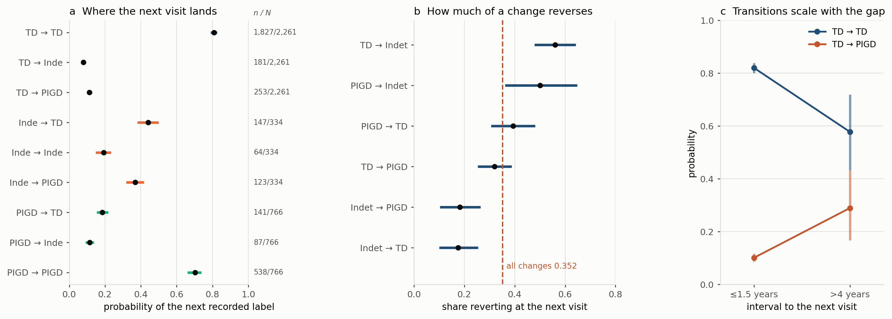

**Figure 2.** Instability of the recorded label: transition probabilities with patient-clustered bootstrap intervals, reversion at the next visit by change type, and transitions stratified by elapsed interval. *(Source: `manuscript/npj/fig2_label_instability.png`.)*

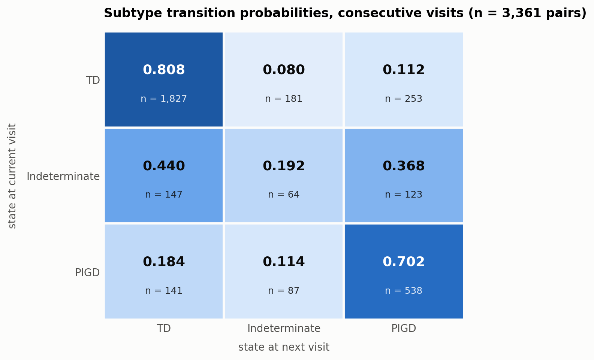

**Figure 3.** Transition matrix between consecutive labelled visits (3,361 pairs). *(Source: `outputs/transitions/figures/transition_matrix.png`.)*

The label persists at 0.808 (TD to TD; patient-bootstrap 95% CI 0.788 to 0.826) and 0.702 (PIGD to PIGD; 0.661 to 0.738), but Indeterminate persists at only 0.192 (0.148 to 0.234): an Indeterminate visit is followed by TD at 0.440 and by PIGD at 0.368. The bootstrap intervals are wider than the Wilson intervals on every diagonal cell, with design effects of 1.38 (TD to TD) and 1.46 (PIGD to PIGD), so visit-level intervals understate the uncertainty by a factor the patient clustering explains (Figure 8).

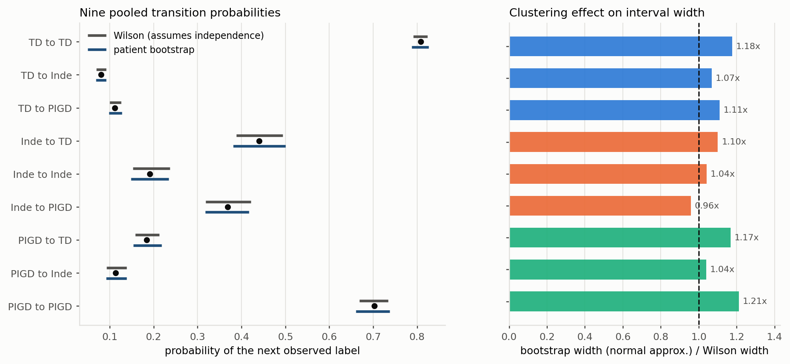

**Figure 8.** Wilson intervals that treat transitions as independent against patient-clustered bootstrap intervals for the nine transition probabilities. *(Source: `experiments/20261103T193205Z_e2_transition_patient_bootstrap/fig1_wilson_vs_patient_bootstrap.png`.)*

**Table 5.** Reversion and conversion quantities with patient-clustered bootstrap intervals: the pooled reversion rate (share of observed label changes that returned to the origin label at the following visit), reversion by change type, Kaplan-Meier cumulative incidence of a first PIGD label under the naive and the sustained definition, and the interval-stratified TD-to-PIGD probabilities.

| quantity | estimate | patient-bootstrap 95% CI | bootstrap SE |
|---|---|---|---|
| reversion_pooled | 0.3522 | [0.3180, 0.3880] | 0.0176 |
| revert[TD->PIGD] | 0.3198 | [0.2530, 0.3883] | 0.0346 |
| revert[TD->Indeterminate] | 0.5597 | [0.4782, 0.6417] | 0.042 |
| revert[PIGD->TD] | 0.3929 | [0.3053, 0.4808] | 0.0449 |
| revert[Indeterminate->TD] | 0.1759 | [0.1000, 0.2547] | 0.0396 |
| revert[Indeterminate->PIGD] | 0.1828 | [0.1026, 0.2644] | 0.0414 |
| revert[PIGD->Indeterminate] | 0.5 | [0.3617, 0.6481] | 0.0725 |
| km_naive_yr2 | 0.1252 | [0.1025, 0.1504] | 0.0121 |
| km_naive_yr5 | 0.3525 | [0.3077, 0.3988] | 0.0232 |
| km_sustained_yr2 | 0.0654 | [0.0490, 0.0846] | 0.009 |
| km_sustained_yr5 | 0.1533 | [0.1200, 0.1902] | 0.018 |
| sustained_removes_share | 0.5171 | [0.4572, 0.5774] | 0.0306 |
| p[TD->PIGD \| <=1.5y] | 0.1004 | [0.0865, 0.1161] | 0.0076 |
| p[TD->PIGD \| >4y] | 0.2889 | [0.1667, 0.4318] | 0.0679 |
| p[TD->TD \| <=1.5y] | 0.8203 | [0.7999, 0.8392] | 0.0102 |
| p[TD->TD \| >4y] | 0.5778 | [0.4317, 0.7188] | 0.0757 |
| n_pairs | 3361.0 | [3187.0000, 3537.0000] | 91.1243 |
| n_patients_with_transition | 934.0 | [913.0000, 955.0000] | 10.9404 |
| n_changes | 673.0 | [600.0000, 753.0000] | 38.6913 |
| naive_at_risk | 885.0 | [861.0000, 909.0000] | 12.262 |
| naive_converted | 263.0 | [236.0000, 291.0000] | 14.0205 |
| sustained_converted | 127.0 | [106.0000, 148.0000] | 10.564 |

*Machine-readable copy: `tables/table005_reversion_and_conversion.csv`. Source: `experiments/20261103T193205Z_e2_transition_patient_bootstrap/other_quantities.csv`.*

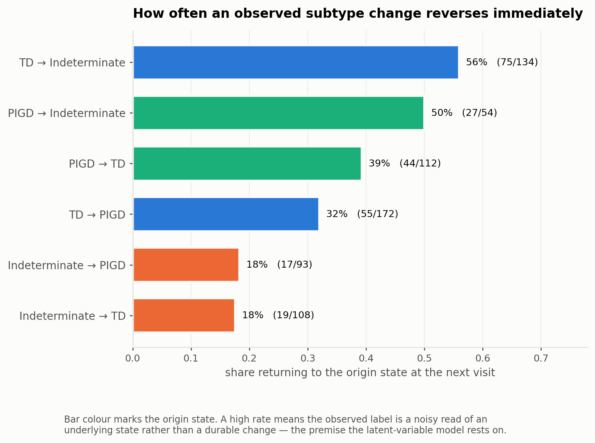

**Figure 5.** Reversion to the origin label at the next visit, by type of change. *(Source: `outputs/transitions/figures/reversion.png`.)*

Of the 673 observed label changes with an observed next visit, 35.2% reverted to the origin label at that next visit (0.352, 95% CI 0.318 to 0.388). Reversion is highest for the moves into Indeterminate (TD to Indeterminate 0.560, PIGD to Indeterminate 0.500) and lowest for the moves out of it (Indeterminate to PIGD 0.183, Indeterminate to TD 0.176); the direct moves revert at 0.320 (TD to PIGD) and 0.393 (PIGD to TD). Of the 934 patients, 476 never change label; 86 distinct label pathways occur (Table 8).

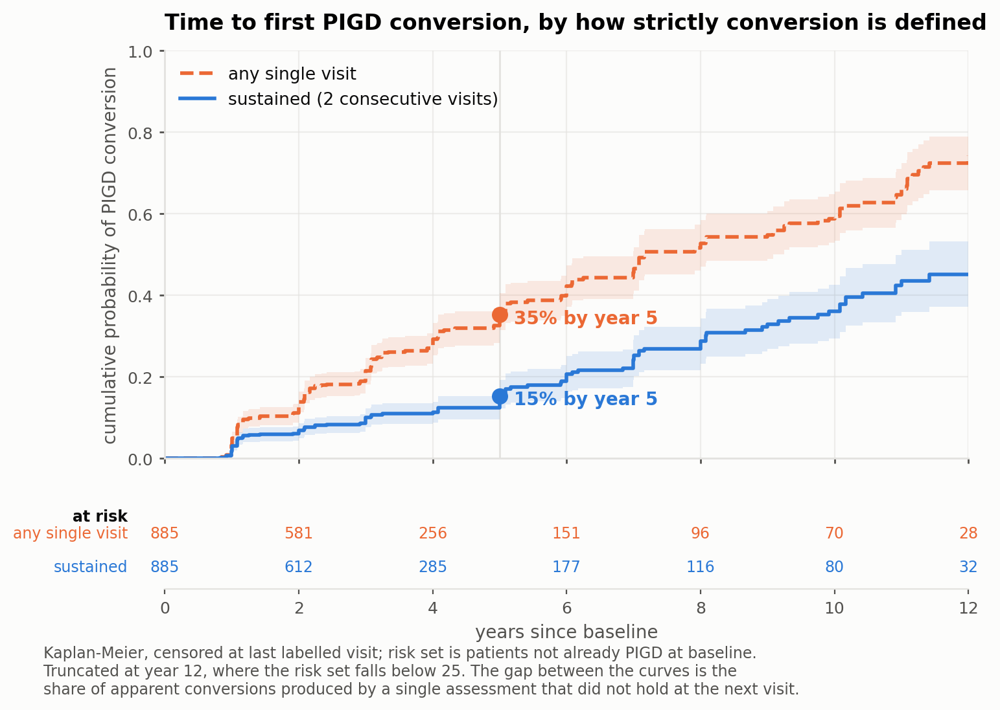

**Figure 6.** Kaplan-Meier cumulative incidence of first PIGD label among patients not PIGD at baseline, under the naive and the sustained (two consecutive visits) definitions. *(Source: `outputs/transitions/figures/time_to_pigd_conversion.png`.)*

Under the naive definition the Kaplan-Meier cumulative incidence of a first PIGD label is 0.125 by year two and 0.353 (0.308 to 0.399) by year five; under the sustained definition it is 0.065 and 0.153 (0.120 to 0.190). Requiring the conversion to hold for two consecutive visits removes 0.517 (0.457 to 0.577) of the apparent conversions: 263 first PIGD labels become 127 sustained ones among the 885 patients at risk.

**Table 7.** Transition probabilities stratified by the elapsed interval between the two visits (Wilson intervals; the patient-clustered intervals for the TD-to-PIGD cells are in Table 5).

| interval | from_state | to_state | n_from | n_transitions | probability | Wilson 95% CI |
|---|---|---|---|---|---|---|
| ≤ 1.5 | TD | TD | 1942 | 1593 | 0.8203 | [0.8026, 0.8367] |
| ≤ 1.5 | TD | Indeterminate | 1942 | 154 | 0.0793 | [0.0681, 0.0922] |
| ≤ 1.5 | TD | PIGD | 1942 | 195 | 0.1004 | [0.0878, 0.1146] |
| ≤ 1.5 | Indeterminate | TD | 279 | 133 | 0.4767 | [0.4188, 0.5352] |
| ≤ 1.5 | Indeterminate | Indeterminate | 279 | 55 | 0.1971 | [0.1547, 0.2478] |
| ≤ 1.5 | Indeterminate | PIGD | 279 | 91 | 0.3262 | [0.2738, 0.3832] |
| ≤ 1.5 | PIGD | TD | 661 | 127 | 0.1921 | [0.1639, 0.2239] |
| ≤ 1.5 | PIGD | Indeterminate | 661 | 76 | 0.115 | [0.0929, 0.1416] |
| ≤ 1.5 | PIGD | PIGD | 661 | 458 | 0.6929 | [0.6567, 0.7269] |
| 1.5 – 2.5 | TD | TD | 202 | 154 | 0.7624 | [0.6991, 0.8158] |
| 1.5 – 2.5 | TD | Indeterminate | 202 | 14 | 0.0693 | [0.0417, 0.1130] |
| 1.5 – 2.5 | TD | PIGD | 202 | 34 | 0.1683 | [0.1230, 0.2260] |
| 1.5 – 2.5 | Indeterminate | TD | 30 | 6 | 0.2 | [0.0951, 0.3731] |
| 1.5 – 2.5 | Indeterminate | Indeterminate | 30 | 6 | 0.2 | [0.0951, 0.3731] |
| 1.5 – 2.5 | Indeterminate | PIGD | 30 | 18 | 0.6 | [0.4232, 0.7541] |
| 1.5 – 2.5 | PIGD | TD | 70 | 7 | 0.1 | [0.0493, 0.1923] |
| 1.5 – 2.5 | PIGD | Indeterminate | 70 | 7 | 0.1 | [0.0493, 0.1923] |
| 1.5 – 2.5 | PIGD | PIGD | 70 | 56 | 0.8 | [0.6918, 0.8770] |
| 2.5 – 4.0 | TD | TD | 72 | 54 | 0.75 | [0.6391, 0.8356] |
| 2.5 – 4.0 | TD | Indeterminate | 72 | 7 | 0.0972 | [0.0479, 0.1874] |
| 2.5 – 4.0 | TD | PIGD | 72 | 11 | 0.1528 | [0.0875, 0.2532] |
| 2.5 – 4.0 | Indeterminate | TD | 16 | 6 | 0.375 | [0.1848, 0.6136] |
| 2.5 – 4.0 | Indeterminate | Indeterminate | 16 | 2 | 0.125 | [0.0350, 0.3602] |
| 2.5 – 4.0 | Indeterminate | PIGD | 16 | 8 | 0.5 | [0.2800, 0.7200] |
| 2.5 – 4.0 | PIGD | TD | 23 | 4 | 0.1739 | [0.0698, 0.3714] |
| 2.5 – 4.0 | PIGD | Indeterminate | 23 | 3 | 0.1304 | [0.0454, 0.3213] |
| 2.5 – 4.0 | PIGD | PIGD | 23 | 16 | 0.6957 | [0.4913, 0.8440] |
| > 4.0 | TD | TD | 45 | 26 | 0.5778 | [0.4330, 0.7103] |
| > 4.0 | TD | Indeterminate | 45 | 6 | 0.1333 | [0.0626, 0.2618] |
| > 4.0 | TD | PIGD | 45 | 13 | 0.2889 | [0.1773, 0.4337] |
| > 4.0 | Indeterminate | TD | 9 | 2 | 0.2222 | [0.0632, 0.5474] |
| > 4.0 | Indeterminate | Indeterminate | 9 | 1 | 0.1111 | [0.0199, 0.4350] |
| > 4.0 | Indeterminate | PIGD | 9 | 6 | 0.6667 | [0.3542, 0.8794] |
| > 4.0 | PIGD | TD | 12 | 3 | 0.25 | [0.0889, 0.5323] |
| > 4.0 | PIGD | Indeterminate | 12 | 1 | 0.0833 | [0.0149, 0.3539] |
| > 4.0 | PIGD | PIGD | 12 | 8 | 0.6667 | [0.3906, 0.8619] |

*Machine-readable copy: `tables/table007_transitions_by_interval.csv`. Source: `outputs/transitions/transitions_by_interval.csv`.*

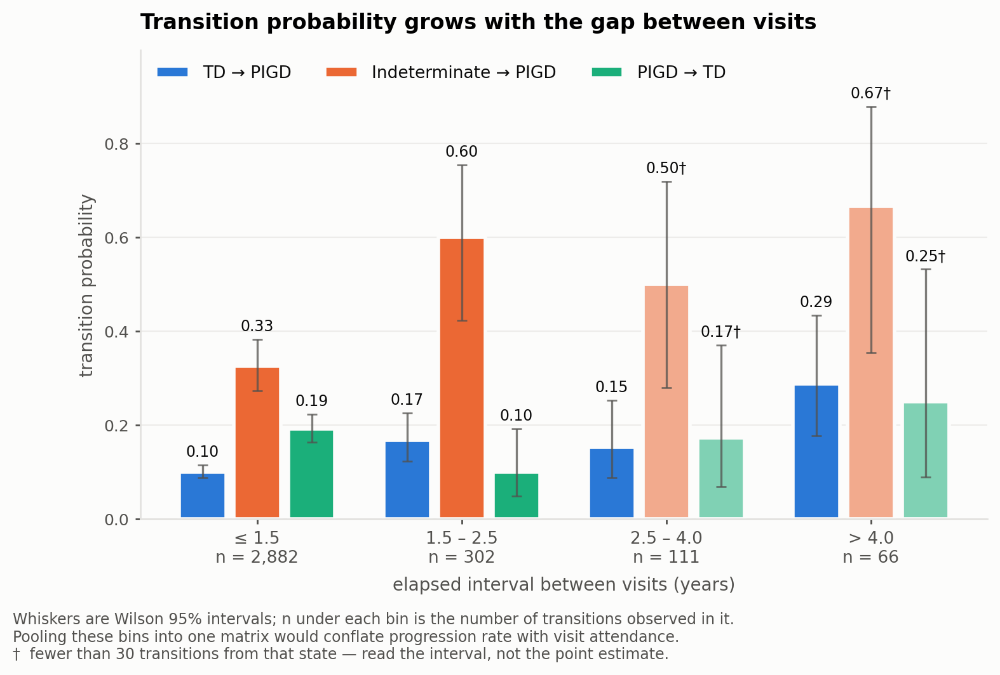

**Figure 4.** Transition probabilities by elapsed interval between visits. *(Source: `outputs/transitions/figures/transitions_by_interval.png`.)*

The transition probabilities depend on the elapsed interval. TD to PIGD is 0.100 (0.087 to 0.116) when the two visits are at most 1.5 years apart and 0.289 (0.167 to 0.432) when they are more than four years apart; TD to TD falls from 0.820 to 0.578 across the same strata. A discrete-time chain indexed by "next visit" would absorb PPMI's attendance schedule (annual early, biennial later) into its progression estimate, which is why the continuous-time models of Section 9.4 exist.

**Table 6.** Test of the first-order Markov property in the observed label: chi-square test that the next label is independent of the previous label given the current label, on labelled triples.

| current_state | n_triples | chi2 | dof | p_value |
|---|---|---|---|---|
| TD | 1583 | 156.5856 | 4 | 0.0 |
| Indeterminate | 235 | 15.2825 | 4 | 0.0041 |
| PIGD | 609 | 61.1504 | 4 | 0.0 |

*Machine-readable copy: `tables/table006_markov_property_test.csv`. Source: `outputs/model/markov_property_test.csv`.*

The observed label is not first-order Markov. Given a current TD label, the next label depends strongly on the previous one (chi-square 156.6 on 4 degrees of freedom, *p* = 7.9 × 10<sup>−33</sup>, 1,583 triples): a patient currently TD who was previously TD moves to PIGD with probability 0.086, a patient currently TD who was previously PIGD with probability 0.393. The dependence is also present for a current PIGD label (chi-square 61.2, *p* = 1.7 × 10<sup>−12</sup>, 609 triples) and, weakly, for a current Indeterminate label (chi-square 15.3, *p* = 0.004, 235 triples).

**Table 8.** The twelve most frequent label pathways (sequence of distinct labels in visit order) among the 934 patients with at least two labelled visits.

| pathway | n_patients | share |
|---|---|---|
| TD | 399 | 0.4272 |
| TD → PIGD | 83 | 0.0889 |
| PIGD | 71 | 0.076 |
| TD → Indeterminate | 39 | 0.0418 |
| TD → Indeterminate → TD | 35 | 0.0375 |
| Indeterminate → PIGD | 27 | 0.0289 |
| Indeterminate → TD | 26 | 0.0278 |
| PIGD → TD | 24 | 0.0257 |
| TD → Indeterminate → PIGD | 21 | 0.0225 |
| TD → PIGD → TD | 20 | 0.0214 |
| PIGD → TD → PIGD | 19 | 0.0203 |
| Indeterminate → TD → PIGD | 11 | 0.0118 |

*Machine-readable copy: `tables/table008_label_pathways.csv`. Source: `outputs/transitions/pathways.csv`.*

**Table 9.** Label prevalence by study year (years 0 to 10).

| YEAR | n_TD | n_Indeterminate | n_PIGD | prop_TD | prop_Indeterminate | prop_PIGD | n_total |
|---|---|---|---|---|---|---|---|
| 0 | 772 | 109 | 195 | 0.7175 | 0.1013 | 0.1812 | 1076 |
| 1 | 556 | 84 | 166 | 0.6898 | 0.1042 | 0.206 | 806 |
| 2 | 467 | 59 | 151 | 0.6898 | 0.0871 | 0.223 | 677 |
| 3 | 332 | 39 | 109 | 0.6917 | 0.0812 | 0.2271 | 480 |
| 4 | 209 | 30 | 90 | 0.6353 | 0.0912 | 0.2736 | 329 |
| 5 | 129 | 27 | 60 | 0.5972 | 0.125 | 0.2778 | 216 |
| 6 | 102 | 16 | 64 | 0.5604 | 0.0879 | 0.3516 | 182 |
| 7 | 94 | 19 | 64 | 0.5311 | 0.1073 | 0.3616 | 177 |
| 8 | 58 | 19 | 44 | 0.4793 | 0.157 | 0.3636 | 121 |
| 9 | 50 | 11 | 38 | 0.5051 | 0.1111 | 0.3838 | 99 |
| 10 | 47 | 12 | 49 | 0.4352 | 0.1111 | 0.4537 | 108 |

*Machine-readable copy: `tables/table009_prevalence_by_year.csv`. Source: `outputs/transitions/prevalence_by_year.csv`.*

**Interpretation.** Where a patient came from changes the probability of moving to PIGD by a factor of 4.6, which is exactly the signature of a latent state read through noise: if a patient's underlying state is PIGD but one examination scores them TD, the next examination is likely to score PIGD again. That observation motivated the CT-HMM. At the same time, the 35% reversion rate, the 52% loss of apparent conversions under a sustained definition, and the near-total impermanence of the Indeterminate label (0.192) set an upper bound on how predictable the next recorded label can be from any model, because they measure how much of the record is measurement rather than state.

**Limitations.** The pathways and reversion rates are conditional on a next visit being observed; 102 of 346 direct changes in the D-1 cohort had no observed outcome (Section 9.3). The Kaplan-Meier incidence treats loss to follow-up as non-informative, which Section 9.10 shows it is not. The chi-square test ignores the clustering of triples within patients.

**Contribution.** The quantitative characterisation of label unreliability with patient-clustered uncertainty, and the first piece of evidence for the paper's claim: the instability is large, interval-dependent and history-dependent in exactly the way measurement noise on a slow latent state would be.

### 9.2 Label construction: reconstruction, OFF/ON agreement, the Indeterminate band, threshold placement and residual autocorrelation (E04 to E07)

**Question.** Is the label reconstructed exactly from the items? How much of the label's movement is attributable to the examination rather than the patient? Is the Indeterminate label a transient boundary crossing? How sensitive is the label to the placement of the thresholds, and are within-patient residual changes in the ratio independent?

**Setup.** Part C rebuilt the item sums from the raw item tables (Section 6.9); the OFF/ON audit labelled the two examinations of the same visit separately (2,343 pairs with both labels from 714 patients; 2,353 pairs for the Part III-only construction); the Indeterminate audit computed the pre-registered reversion and clustering statistics on the 934-patient cohort with 2,000 patient-bootstrap resamples; O-4 relabelled the frozen panel under the perturbed rule; E-1 computed the lag-1 autocorrelation of residuals from each patient's own linear trend on 397 patients and 2,050 pairs.

**Results: reconstruction and the lattice.** The reconstruction matched the frozen panel at all 5,774 visits (zero mismatches in the tremor score, the PIGD score and the label). The PIGD item sum is zero at 16.3% of labelled visits and the tremor sum at 7.2%; the PIGD sum is one or two at about 59% of visits. Because the ratio is a ratio of integer sums, only a lattice of values is attainable (Figure 9), and every Indeterminate visit in the cohort is one item point away from another label.

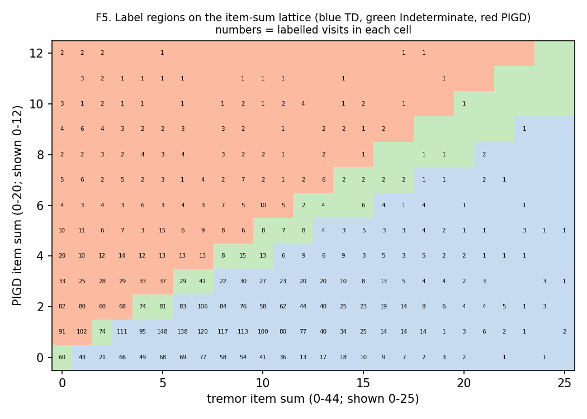

**Figure 9.** The label as a function of the integer tremor and PIGD item sums: the lattice of attainable ratios and the three label regions. *(Source: `experiments/20261015T221426Z_partC_raw_scores/figures/F5_label_lattice.png`.)*

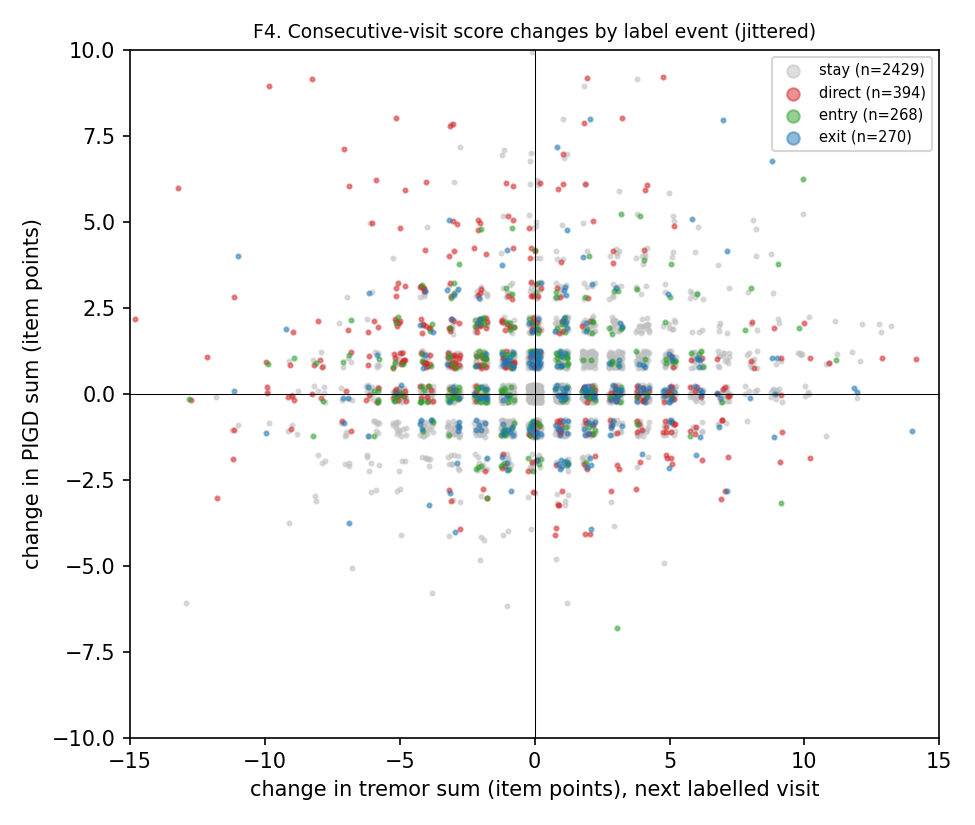

**Figure 11.** Changes in the item sums between consecutive visits. *(Source: `experiments/20261015T221426Z_partC_raw_scores/figures/F4_consecutive_changes.png`.)*

**Results: OFF against ON.** **Table 10.** Agreement of the subtype label between the OFF-medication and the ON-medication examination of the same visit (medication response, time of day, order and rater effects combined; not test-retest reliability). ON minus OFF tremor item sum: 10th/25th/50th/75th/90th percentiles -7.0 / -4.0 / -2.0 / 0.0 / 0.0; PIGD item sum: -1.0 / -1.0 / 0.0 / 0.0 / 0.0.

| label construction | same-visit OFF/ON pairs with both labels | patients | label agreement OFF vs ON |
|---|---|---|---|
| all 16 items (Part II shared) | 2343 | 714 | 0.7516 |
| Part III items only | 2353 | 714 | 0.7208 |

*Machine-readable copy: `tables/table010_off_on_agreement.csv`. Source: `experiments/20261015T221426Z_partC_raw_scores/results.json`.*

The same visit, labelled from the OFF examination and from the ON examination, carries the same label at 75.2% of pairs with all sixteen items and at 72.1% with the Part III items only (which removes the Part II items the two examinations share); a label built from Part III only agrees with the full label at 83.2% of visits. ON minus OFF tremor item sums have a median of −2 points (10th to 90th percentile −7 to 0) against a median of 0 for the PIGD sum. This is medication response, time of day, order and rater effects combined, not test-retest reliability, but it bounds the within-visit stability of the label at about three quarters.

**Results: the Indeterminate audit.** **Table 11.** Indeterminate-label audit (Part C). Entries into Indeterminate: 268 events, 188 with an observed next visit (102 reverted, 33 sustained, 53 moved on). Direct TD-PIGD changes: 394 events, 284 observed (99 reverted). Entries with two later visits: 135, of which 3 stayed Indeterminate at both. Reading: inconclusive.

| quantity | estimate | patient-bootstrap 95% CI |
|---|---|---|
| reversion after an entry into Indeterminate (R_E) | 0.5426 | [0.4709, 0.6154] |
| reversion after a direct TD<->PIGD change (R_D) | 0.3486 | [0.2982, 0.3966] |
| difference R_E - R_D | 0.194 | [0.1079, 0.2809] |
| Indeterminate sustained at the next visit | 0.1755 | [0.1221, 0.2333] |
| Indeterminate followed by the other extreme label | 0.2819 | [0.2169, 0.3463] |
| Indeterminate sustained at two later visits | 0.0222 | [0.0000, 0.0500] |
| direct change sustained at the next visit | 0.5141 | [0.4637, 0.5669] |
| exit from Indeterminate followed by return to Indeterminate | 0.1791 | [0.1229, 0.2346] |
| observed/expected within-patient clustering, TD | 1.0522 | [1.0378, 1.0671] |
| observed/expected clustering, Indeterminate | 1.1794 | [0.9882, 1.3907] |
| observed/expected clustering, PIGD | 1.1439 | [1.1015, 1.1886] |

*Machine-readable copy: `tables/table011_indeterminate_audit.csv`. Source: `experiments/20261015T221426Z_partC_indeterminate/results.json`.*

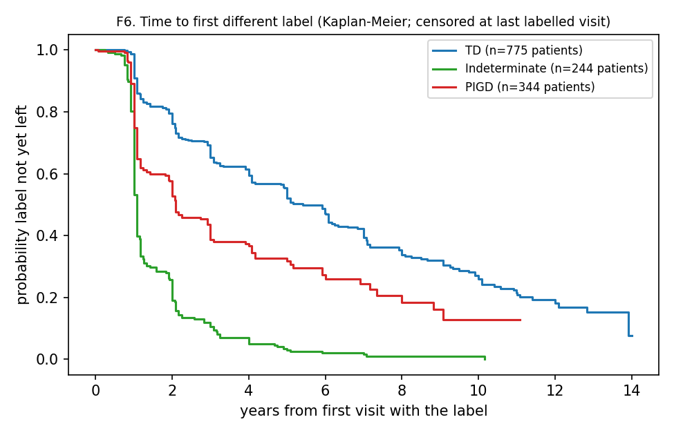

**Figure 12.** Kaplan-Meier time to leave the Indeterminate label, by destination. *(Source: `experiments/20261015T221426Z_partC_indeterminate/figures/F6_time_to_exit.png`.)*

An entry into Indeterminate reverts at the next visit at 0.543 (0.471 to 0.615) against 0.349 (0.298 to 0.397) for a direct TD-PIGD change, a contrast of +0.194 (+0.108 to +0.281); only 17.6% of entries are sustained at the next visit and 3 of 135 entries with two later visits are still Indeterminate at both. The observed-to-expected within-patient clustering ratio for Indeterminate is 1.18 (0.99 to 1.39), which includes one, so by the pre-registered rule the reading is inconclusive: the entry-reversion contrast is consistent with transient boundary crossing, but the clustering test does not confirm that Indeterminate visits cluster within patients beyond what their frequency implies. The Kaplan-Meier median time to leave the Indeterminate label is 1.08 years, against 2.08 years for PIGD and 5.41 years for TD.

**Results: threshold sensitivity.** **Table 12.** Threshold sensitivity (O-4): relabelling the frozen panel with the perturbed rule TD > 1.13, PIGD < 0.91 (inner boundaries) instead of TD >= 1.15, PIGD <= 0.90. Deterministic recount; no confidence interval applies.

| quantity | value |
|---|---|
| labelled_visits | 4441.0 |
| visits_relabelled | 298.0 |
| share_relabelled | 0.0671 |
| patients_total | 1080.0 |
| patients_with_any_relabelled | 235.0 |
| share_patients_affected | 0.2176 |
| indeterminate_before | 441.0 |
| indeterminate_after | 143.0 |
| agreement_2class_baseline | 1.0 |
| agreement_2class_narrow | 0.9774 |
| agreement_3class_baseline | 0.9987 |
| agreement_3class_narrow | 0.9286 |

*Machine-readable copy: `tables/table012_threshold_sensitivity_summary.csv`. Source: `experiments/20261104T002308Z_o4_threshold_sensitivity/summary.csv`.*

**Table 13.** Threshold sensitivity (O-4): movement of labelled visits between classes under the perturbed rule. Agreement with PPMI's own derived labels: baseline (1.15 / 0.90, outer): two-class 1.0000 (n=4431), three-class 0.9987 (n=1597); narrow (1.13 / 0.91, inner): two-class 0.9774 (n=4431), three-class 0.9286 (n=1597).

| class | n_before | n_after | delta | pct_change | n_leaving | share_of_class_leaving |
|---|---|---|---|---|---|---|
| TD | 2891 | 2991 | 100 | 0.0346 | 0 | 0.0 |
| Indeterminate | 441 | 143 | -298 | -0.6757 | 298 | 0.6757 |
| PIGD | 1109 | 1307 | 198 | 0.1785 | 0 | 0.0 |

*Machine-readable copy: `tables/table013_threshold_sensitivity_movement.csv`. Source: `experiments/20261104T002308Z_o4_threshold_sensitivity/per_class_movement.csv; experiments/20261104T002308Z_o4_threshold_sensitivity/agreement_vs_ppmi.csv`.*

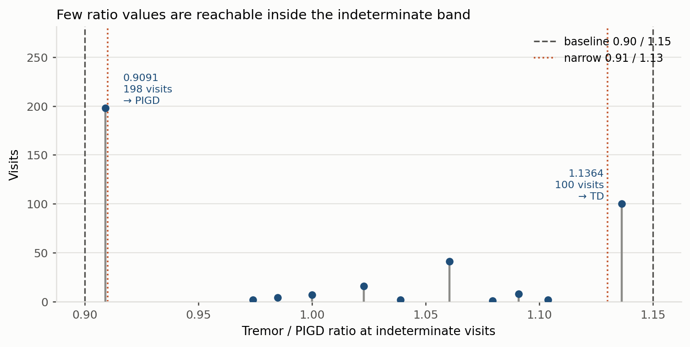

**Figure 13.** Attainable ratio values inside the Indeterminate band and the effect of narrowing the thresholds to 1.13 / 0.91. *(Source: `experiments/20261104T002308Z_o4_threshold_sensitivity/fig_attainable_ratios.png`.)*

Narrowing the band to (0.91, 1.13) relabels 298 of 4,441 labelled visits (6.71%), every one of them Indeterminate (100 to TD, 198 to PIGD; the Indeterminate count falls from 441 to 143, −67.6%), in 235 of 1,080 participants (21.76%). Agreement with PPMI's own derived labels falls from 1.000 to 0.977 (two-class) and from 0.999 to 0.929 (three-class). The reason is the lattice: inside the band only eleven ratio values occur, and the two that dominate, 0.9091 (198 visits) and 1.1364 (100 visits), sit 0.009 and 0.014 from the boundaries, so a shift of 0.02 moves all of them. The recount is deterministic; the baseline panel was not touched.

**Results: lag-1 residual autocorrelation.** **Table 14.** Lag-1 autocorrelation of within-patient residual ratio changes (E-1): observed value, the value an independent-noise null with the same visit pattern implies, and their difference. 2,050 consecutive-change pairs from 397 patients.

| quantity | estimate | ci_low | ci_high | interval |
|---|---|---|---|---|
| observed lag-1 correlation | -0.2195 | -0.2731 | -0.1621 | patient bootstrap |
| iid null, same visit pattern | -0.3328 | -0.3689 | -0.2951 | Monte Carlo |
| observed minus null | 0.1133 | 0.0457 | 0.1785 | combined resample |

*Machine-readable copy: `tables/table014_lag1_residual_autocorrelation.csv`. Source: `experiments/20261103T191408Z_e1_lag1_residual_resolution/lag1_statistic.csv`.*

Consecutive residual changes from a patient's own linear trend are negatively correlated at lag 1 (−0.219, patient-bootstrap 95% CI −0.273 to −0.162), but less negatively than independent noise with the same visit pattern implies (−0.333, Monte Carlo 95% range −0.369 to −0.295): the difference is +0.113 (+0.046 to +0.179, one-sided Monte Carlo *p* = 5 × 10<sup>−4</sup>). This run also resolved a contradiction in the working record: an earlier exploration report had stated that nothing in the residual structure argued for a state-space specification, and that sentence was found to be stale against the committed code.

**Interpretation.** Taken together these audits show where the label's unreliability comes from. The examination state alone moves a quarter of same-visit labels. The Indeterminate band is a thin strip of the integer lattice whose occupants are one point from another label and whose two dominant values are within 0.02 of the thresholds; the label is therefore unusually sensitive to the rule's exact placement and the Indeterminate class behaves as a transient. The residual autocorrelation is less negative than pure measurement noise would make it, so part of a patient's deviation from their trend persists to the next visit: a state-space form, in which an unobserved level accumulates process noise and is read with error, is indicated over an independent-noise growth form, which is the family the CT-HMM and the clinical profile belong to.

**Limitations.** The OFF/ON comparison confounds medication with everything else that differs between the two examinations. The Indeterminate audit's reading rule was pre-registered but its clustering statistic has low power at 441 visits. E-1 uses only patients with at least four finite-ratio visits and one year of span, a subset selected on follow-up.

**Contribution.** Mechanistic grounding for the paper's title: the label's unreliability is a property of its construction, and the two most consequential constructions, the thin Indeterminate band on an integer lattice and the dependence on the examination state, are not things a better predictive model can remove.

### 9.3 Does a generative model of the ratio reproduce the label dynamics? The D-1 posterior-predictive check and its Stage 1 diagnostics (E08, E09)

**Question.** If the ratio follows a hierarchical growth model with Student-t slopes and residuals, do label sequences simulated from that model, conditional on each patient's own data, reproduce the observed Indeterminate share, reversion rates and clustering?

**Setup and cohort.** The 821 patients and 3,528 ratio-defined visits (PIGD score greater than zero), five whole-patient folds, 500 patient-conditional replicates per patient, five pre-registered statistics, a pre-registered threshold *c* from 500 synthetic null cohorts, and four positive-control scenarios (Section 6.8). The run is frozen: its protocol, code hashes, seeds and panel checksum are recorded, and nothing in it was re-evaluated.

**Results.** **Table 15.** D-1 posterior-predictive label check on 821 patients and 3,528 ratio-defined visits: observed label statistics against patient-conditional replicates from the Student-t growth model. T_obs = 3.0908 against the pre-registered threshold c = 2.5765; verdict NOT REPRODUCED. Positive controls detected per 100 cohorts: PC1 6, PC2 7, PC3 5, PC4 100 (lower 95% bound 0.964); PC4v (descriptive) 3.

| statistic | observed | replicate mean | z (capped at 3.09) | p |
|---|---|---|---|---|
| S1 Indeterminate share | 0.1029 | 0.0648 | -3.091 | 0.001 |
| S2 reversion after entry (R_E) | 0.5796 | 0.5555 | -0.495 | 0.3104 |
| S3 direct reversion (R_D) | 0.3115 | 0.4356 | 3.091 | 0.999 |
| S4 R_E - R_D | 0.2681 | 0.12 | -3.091 | 0.001 |
| S5 O/E Indeterminate clustering | 1.0334 | 1.077 | 0.207 | 0.5818 |

*Machine-readable copy: `tables/table015_d1_posterior_predictive_check.csv`. Source: `experiments/20261016T070746Z_d1_full/results/05_observed.json; experiments/20261016T070746Z_d1_full/results/02_power.json; experiments/20261016T070746Z_d1_full/results/03_pc4v.json`.*

The observed Indeterminate share is 0.103 against a replicate mean of 0.065 (*z* at the cap, *p* = 0.001); the direct-reversion rate is 0.311 against 0.436 (*z* at the cap, *p* = 0.999); their difference statistic S4 is 0.268 against 0.120 (*z* at the cap). The reversion after entry (0.580 against 0.556) and the clustering ratio (1.033 against 1.077) are reproduced. *T*<sub>obs</sub> = 3.091 exceeds the threshold *c* = 2.577, so the pre-registered verdict is **not reproduced**. The check has power: the strong positive control PC4 was detected in 100 of 100 cohorts (lower 95% bound on the detection rate 0.964), the weak controls PC1 to PC3 in 6, 7 and 5 of 100 (consistent with their null-like design), and the descriptive variant PC4v in 3 of 100.

**Table 16.** D-1 Stage 1, check 1: Indeterminate share by PIGD item sum at the visit, against the covariate-blind expectation under the frozen generator. De-latticed total (observed count divided by the lattice inflation factor, summed over strata): 240.2 of 3528 visits (share 0.068) against 363 observed.

| stratum | visits | Indeterminate visits | share | patient-bootstrap 95% CI | generator expected | predictive 95% interval | excess | share of total excess |
|---|---|---|---|---|---|---|---|---|
| 1 | 1413 | 70 | 0.0495 | [0.038, 0.063] | 71.8 | [54.6, 89.0] | -1.8 | -0.01 |
| 2 | 1061 | 146 | 0.1376 | [0.116, 0.160] | 54.1 | [39.4, 68.9] | 91.9 | 0.502 |
| 3 | 441 | 67 | 0.1519 | [0.117, 0.189] | 22.5 | [13.2, 31.9] | 44.5 | 0.243 |
| 4-5 | 321 | 57 | 0.1776 | [0.138, 0.218] | 16.4 | [8.5, 24.3] | 40.6 | 0.222 |
| 6+ | 292 | 23 | 0.0788 | [0.047, 0.112] | 15.0 | [7.2, 22.7] | 8.0 | 0.044 |
| all | 3528 | 363 | 0.1029 | [0.092, 0.115] | 179.8 | [150.7, 209.0] | 183.2 | 1.0 |

*Machine-readable copy: `tables/table016_d1_stage1_indeterminate_by_pigd_sum.csv`. Source: `experiments/20261016T133134Z_d1_stage1_checks/check1_ind_by_pigd_stratum.csv; experiments/20261016T133134Z_d1_stage1_checks/check1_delatticed.csv`.*

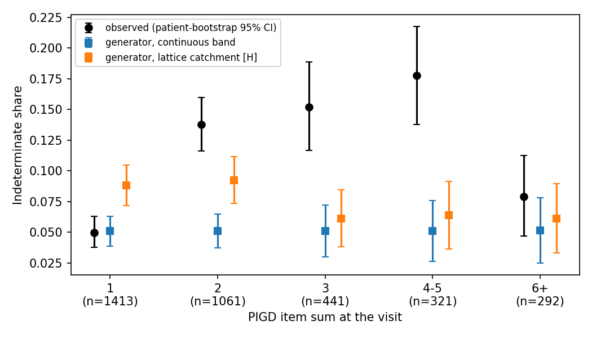

**Figure 14.** Indeterminate share by PIGD item sum: observed against the expectation under the fitted continuous-ratio generator. *(Source: `experiments/20261016T133134Z_d1_stage1_checks/figures/F1_ind_by_pigd_sum.png`.)*

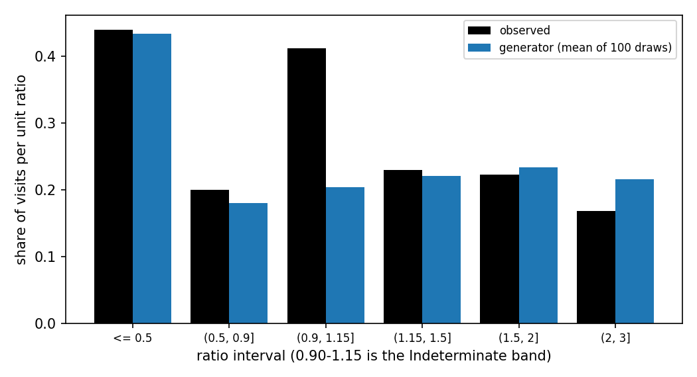

**Figure 15.** Observed ratio density by interval against the generator. *(Source: `experiments/20261016T133134Z_d1_stage1_checks/figures/F1b_ratio_density_by_interval.png`.)*

The Stage 1 diagnostics localise the misfit without attaching a verdict. The excess of Indeterminate visits over the generator's expectation (183 visits) is not uniform across PIGD item sums: it sits at sums 2 (50% of the excess), 3 (24%) and 4 to 5 (22%), and at sum 1 the observed and expected counts agree (70 against 71.8). Within each stratum the Indeterminate cells of the lattice hold about as many visits as their neighbouring cells, so the Indeterminate visits are ordinary lattice points, not a local concentration; the band of nominal width 0.25 captures 1.82 times its width in lattice points at sums 1 and 2, and if it captured only its nominal width the share would be about 0.068, two thirds of the way from the observed 0.103 to the generator's 0.051. The whole gap in the ratio distribution opens inside (0.90, 1.15] (observed cumulative share 0.403 against 0.340 at 1.15) and closes again above 2.

**Table 17.** D-1 Stage 1, check 2: outcome of direct TD<->PIGD changes by direction, observed against the generator expectation. R_D = revert / (revert + stay + to_Ind).

| direction | revert | stay | to_Ind | unobserved | R_D | R_D patient-bootstrap 95% CI | generator R_D (theta range) |
|---|---|---|---|---|---|---|---|
| TD->PIGD | 37 | 86 | 23 | 76 | 0.2534 | (0.18709561383151543, 0.32517671379034396) | (0.46872789049482555, 0.4412246077959002, 0.4887470421418221) |
| PIGD->TD | 39 | 49 | 10 | 26 | 0.398 | (0.30864197530864196, 0.49000961538461535) | (0.3963252165783299, 0.37968720834241954, 0.41289688311853606) |
| both | 76 | 135 | 33 | 102 | 0.3115 |  | (0.4370440030754141, 0.42763969414707775, 0.4434691420964216) |

*Machine-readable copy: `tables/table017_d1_stage1_direct_reversion_direction.csv`. Source: `experiments/20261016T133134Z_d1_stage1_checks/check2_direction_outcome.csv`.*

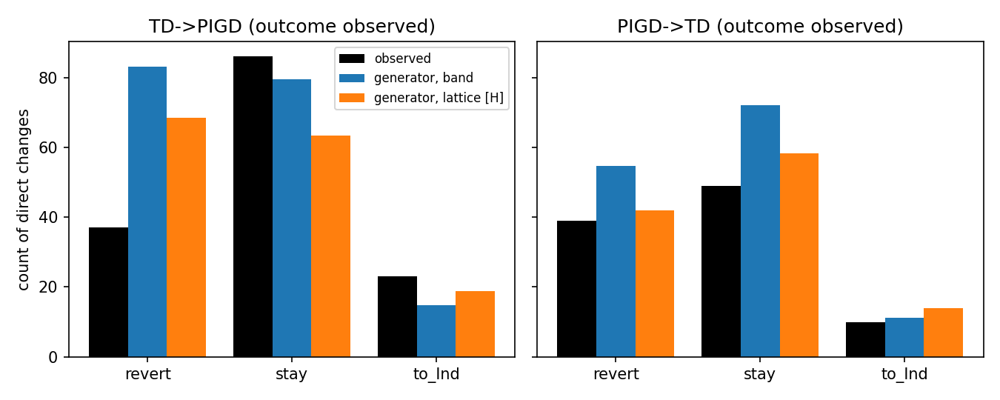

**Figure 16.** Outcome of direct TD-PIGD changes by direction: observed against generator expectation. *(Source: `experiments/20261016T133134Z_d1_stage1_checks/figures/F2_direct_change_direction_outcome.png`.)*

The direct-reversion deficit is entirely direction-specific. TD to PIGD changes revert at 0.253 (0.187 to 0.325) against a generator expectation of 0.469 (37 against 83 expected reversions), whereas PIGD to TD changes revert at 0.398 against 0.396. There are also fewer direct changes than the generator implies (244 against 315 with an observed outcome). A residual-skew proxy is right-skewed in the tails and strongly denominator-dependent (interquartile range 1.20 at PIGD sums 1 to 2 against 0.31 at 8 and above), but a valid Student-t residual diagnostic was not possible from the saved outputs because the fold posteriors of the random effects were not retained. The misfit is present, and larger, in the 585 patients with no excluded PIGD-zero visit, so the exclusion is weakened as its driver.

**Interpretation.** A continuous-ratio growth model with heavy tails cannot reproduce two features of the label record: the Indeterminate share, which the integer lattice inflates inside the band, and the persistence of TD to PIGD changes, which a symmetric-noise model under-predicts. Both are features of how the label is constructed from integer item sums. The Stage 1 recommendation was that a measurement-faithful integer-score model, with no intermediate state, was the next test; that model was specified but never run on the real data (Supplementary Section S3), so the question of whether such a model would reproduce the record remains open. Nothing here is evidence for or against a biological intermediate subtype.

**Limitations.** The D-1 scope is the ratio-defined visits only, so it bears on nothing involving the 16.3% of visits at which the ratio is undefined. The Stage 1 reference is the covariate-blind generator, not the patient-conditional replicate distribution D-1 used, because the replicate labels were not saved; a protocol-compliant re-execution that would save them (M1) was specified and reviewed but not run.

**Contribution.** A pre-registered, powered negative result against the natural continuous generative model of the label, and a descriptive localisation of the misfit to the lattice and to one transition direction, which together explain why the models of Sections 9.6 to 9.11 that work on the ratio or the subscores cannot be expected to beat a model that reads the label as a noisy categorical observation.

### 9.4 Chains in the recorded label against the CT-HMM on the first split (E10)

**Question.** Does a latent state read through a misclassification matrix predict the next recorded label better than a chain in the label itself, and does continuous time help?

**Setup and cohort.** A single stratified 70/30 patient split (seed 42); 1,002 held-out consecutive pairs. Models: the discrete-time chain, the continuous-time chain, the three-state CT-HMM with emission floor 0.5, and the marginal null. Ten further random splits repeat the HMM-against-DTMC comparison. The primary metric is the held-out log-likelihood per pair; accuracy and the three-class Brier score are secondary.

**Results.** **Table 18.** Held-out performance on the 70/30 patient-stratified split (1,002 consecutive pairs). Across ten further random splits the HMM minus discrete-Markov difference in held-out log-likelihood per pair had mean +0.0284 (SD 0.0094) and was positive in 10 of 10 splits.

| model | n_pairs | loglik | loglik_per_pair | accuracy | brier |
|---|---|---|---|---|---|
| HMM (latent + misclassification) | 1002 | -639.6317 | -0.6384 | 0.7695 | 0.3458 |
| Discrete Markov (per-visit) | 1002 | -666.641 | -0.6653 | 0.7675 | 0.3625 |
| CTMC (interval-aware) | 1002 | -676.5533 | -0.6752 | 0.7655 | 0.367 |
| Marginal (null) | 1002 | -864.9853 | -0.8633 | 0.6248 | 0.5185 |

*Machine-readable copy: `tables/table018_early_split_heldout.csv`. Source: `outputs/model/heldout_performance.csv; outputs/model/robustness_across_splits.csv`.*

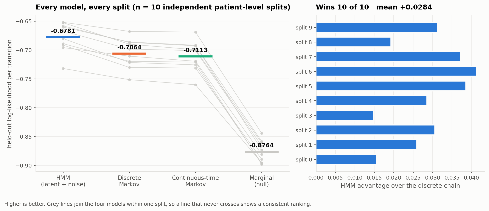

**Figure 17.** Held-out comparison of the discrete-time chain, the continuous-time chain and the CT-HMM on the 70/30 split. *(Source: `outputs/model/figures/model_comparison.png`.)*

On the main split the CT-HMM reaches −0.638 log-likelihood per pair against −0.665 for the discrete chain, −0.675 for the continuous chain and −0.863 for the null; accuracies are 0.769, 0.767, 0.765 and 0.625, and Brier scores 0.346, 0.363, 0.367 and 0.518. Across the ten further splits the CT-HMM beat the discrete chain on every one, by +0.028 log-likelihood per pair on average (SD 0.009). The continuous-time chain, which the interval dependence of Section 9.1 motivated, loses to the discrete chain at every interval stratum on this split (by 0.005 per pair at intervals up to 1.5 years, 0.024 at 1.5 to 2.5 years, and 0.099 beyond), because the discrete chain's "next visit" absorbs the attendance schedule that the continuous chain has to model with six rates.

**Table 19.** Fitted misclassification (emission) matrix E of the three-state CT-HMM on the training split: rows are latent states, columns the probability of each recorded label. The Indeterminate row sits exactly at the emission floor of 0.5.

| latent state | TD | Indeterminate | PIGD |
|---|---|---|---|
| TD | 0.9412 | 0.0383 | 0.0205 |
| Indeterminate | 0.25 | 0.5 | 0.25 |
| PIGD | 0.1056 | 0.052 | 0.8424 |

*Machine-readable copy: `tables/table019_cthmm_emission_matrix.csv`. Source: `outputs/model/hmm_emission.csv`.*

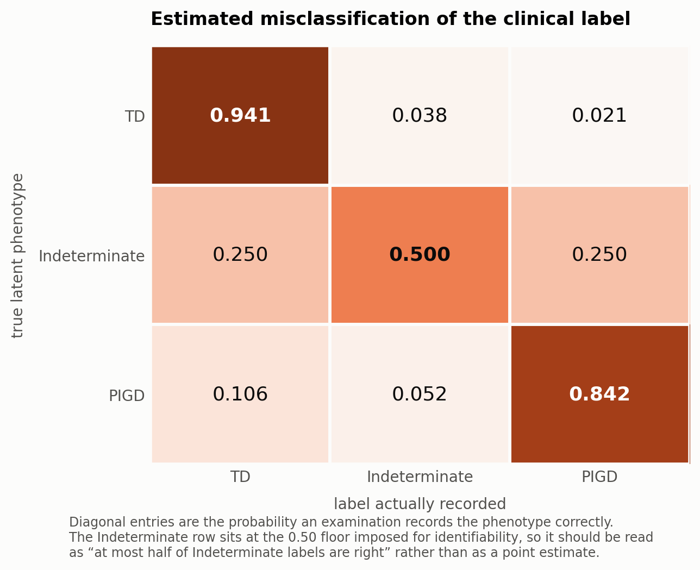

**Figure 18.** Fitted misclassification (emission) matrix of the three-state CT-HMM. *(Source: `outputs/model/figures/misclassification.png`.)*

**Table 20.** Off-diagonal generator rates and mean sojourn times for the continuous-time chain in the observed label and for the latent chain of the CT-HMM (training split). The latent quantities describe the unobserved state, not the recorded label.

| quantity | CTMC (observed label) | CT-HMM (latent state) |
|---|---|---|
| rate TD -> Indeterminate (per year) | 0.2348 | 0.0937 |
| rate TD -> PIGD (per year) | 0.0583 | 0.0057 |
| rate Indeterminate -> TD (per year) | 1.2212 | 0.1156 |
| rate Indeterminate -> PIGD (per year) | 1.0689 | 0.3557 |
| rate PIGD -> TD (per year) | 0.088 | 0.0 |
| rate PIGD -> Indeterminate (per year) | 0.3499 | 0.0605 |
| mean sojourn in TD (years) | 3.41 | 10.06 |
| mean sojourn in Indeterminate (years) | 0.44 | 2.12 |
| mean sojourn in PIGD (years) | 2.28 | 16.52 |

*Machine-readable copy: `tables/table020_generators_and_sojourn.csv`. Source: `outputs/model/ctmc_generator.csv; outputs/model/hmm_latent_generator.csv; outputs/model/mean_sojourn.csv`.*

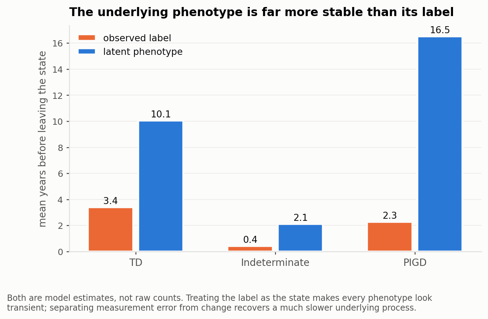

**Figure 19.** Mean sojourn times in the observed-label chain and in the latent chain. *(Source: `outputs/model/figures/sojourn_comparison.png`.)*

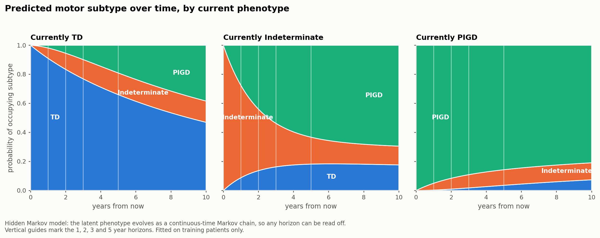

**Figure 20.** Model-implied state occupancy over horizon. *(Source: `outputs/model/figures/progression_curves.png`.)*

The fitted misclassification matrix (Table 19) records a latent TD state correctly at 0.941 and a latent PIGD state at 0.842, while the latent Indeterminate row sits exactly at the floor (0.25, 0.50, 0.25): the data do not identify an Indeterminate state that is recorded as Indeterminate more than half the time, so the constraint is active. The latent generator differs sharply from the observed-label generator (Table 20): the latent TD state leaves for PIGD directly at 0.006 per year and for Indeterminate at 0.094 per year, the latent Indeterminate state leaves for PIGD at 0.356 per year, and the latent PIGD state's exit rate to TD is at the lower bound. The implied mean sojourns are 10.1, 2.1 and 16.5 years in the latent states against 3.4, 0.4 and 2.3 years in the recorded label. Horizon probabilities computed from the latent generator (Table 21) are latent-to-latent and must not be read as probabilities of the recorded label: the latent five-year probability of PIGD given TD is 0.191, whereas the recorded-label chain gives 0.296.

**Table 21.** Model-implied probability of being in each state after 1, 3 and 5 years, by current state. The CTMC rows are recorded-label to recorded-label probabilities; the CT-HMM rows are latent-state to latent-state probabilities and are not probabilities of the recorded label.

| current_state | horizon_years | TD | Indeterminate | PIGD | model |
|---|---|---|---|---|---|
| TD | 1.0 | 0.8153 | 0.0883 | 0.0964 | CTMC (recorded to recorded) |
| TD | 3.0 | 0.6605 | 0.1028 | 0.2367 | CTMC (recorded to recorded) |
| TD | 5.0 | 0.5977 | 0.1061 | 0.2962 | CTMC (recorded to recorded) |
| Indeterminate | 1.0 | 0.4565 | 0.1788 | 0.3647 | CTMC (recorded to recorded) |
| Indeterminate | 3.0 | 0.5273 | 0.1102 | 0.3625 | CTMC (recorded to recorded) |
| Indeterminate | 5.0 | 0.5426 | 0.109 | 0.3484 | CTMC (recorded to recorded) |
| PIGD | 1.0 | 0.1558 | 0.1188 | 0.7254 | CTMC (recorded to recorded) |
| PIGD | 3.0 | 0.3863 | 0.1171 | 0.4966 | CTMC (recorded to recorded) |
| PIGD | 5.0 | 0.4841 | 0.112 | 0.4039 | CTMC (recorded to recorded) |
| TD | 1.0 | 0.9097 | 0.0714 | 0.0189 | CT-HMM (latent to latent) |
| TD | 3.0 | 0.7685 | 0.1328 | 0.0987 | CT-HMM (latent to latent) |
| TD | 5.0 | 0.6599 | 0.1491 | 0.191 | CT-HMM (latent to latent) |
| Indeterminate | 1.0 | 0.0879 | 0.6358 | 0.2763 | CT-HMM (latent to latent) |
| Indeterminate | 3.0 | 0.1627 | 0.2997 | 0.5376 | CT-HMM (latent to latent) |
| Indeterminate | 5.0 | 0.1817 | 0.1852 | 0.6331 | CT-HMM (latent to latent) |
| PIGD | 1.0 | 0.0029 | 0.047 | 0.9502 | CT-HMM (latent to latent) |
| PIGD | 3.0 | 0.0178 | 0.0912 | 0.891 | CT-HMM (latent to latent) |
| PIGD | 5.0 | 0.0357 | 0.1072 | 0.8571 | CT-HMM (latent to latent) |

*Machine-readable copy: `tables/table021_horizon_probabilities.csv`. Source: `outputs/model/clinical_table_ctmc.csv; outputs/model/clinical_table_hmm.csv`.*

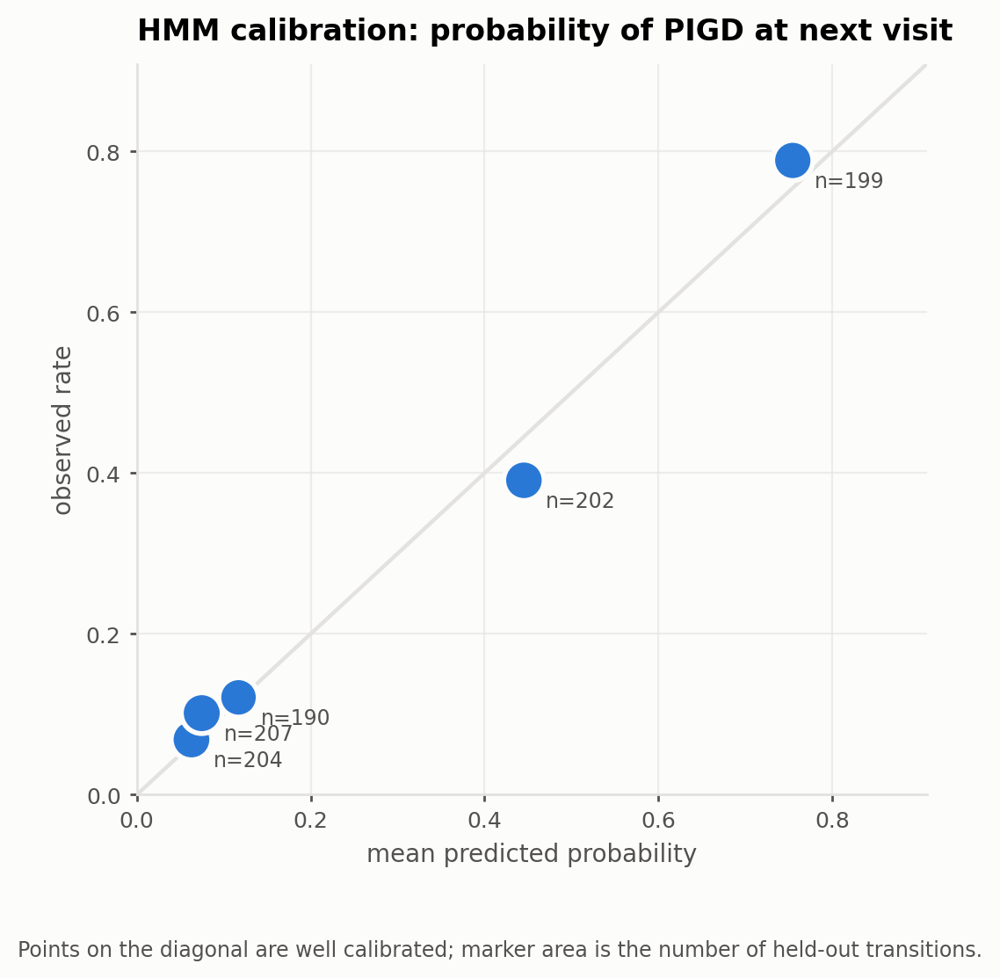

**Figure 21.** Calibration of the CT-HMM on the held-out split. *(Source: `outputs/model/figures/calibration_hmm.png`.)*

**Interpretation.** The latent layer earns its place on the proper score and does so consistently across splits, while accuracy barely moves. Everything the CT-HMM adds is in the probabilities: it is less sure after an isolated label that contradicts the history, and it is right to be. The continuous-time chain without a latent layer is a worse model of the record than the discrete chain, which is a reminder that the interval dependence of Section 9.1 is partly an artefact of how the label is sampled.

**Limitations.** One split and ten resamples of it; the leave-one-patient-out design of the next section supersedes this one for inference. The emission floor is active for Indeterminate, so the latent Indeterminate state is a constrained object.

**Contribution.** The first positive result for the latent-state hypothesis, on the proper score, and the first sign that accuracy will not follow.

### 9.5 Leave-one-patient-out three-class prediction, the stability of the optimum and the five-state model (E11 to E13)

**Question.** Under the strictest patient-level validation, how well does the CT-HMM predict the next recorded label, how does it compare with the chains and with persistence, is its fitted optimum unique, and do more latent states help?

**Setup and cohort.** Leave-one-patient-out over the 934 patients (3,361 predictions); the model is refitted on the other 933 patients in every fold from the same seed with four restarts, and the held-out patient's labels are predicted one visit at a time by filtering. Ten consistency checks passed in every fold. The Stage 4 stability study refitted the full cohort from 40 random starts per configuration and ran a nested cross-validation (ten outer folds, five inner) that selects the configuration by inner-fold log-likelihood or BIC. The five-state model's LOPO run is read from its saved predictions.

**Results.** **Table 22.** Leave-one-patient-out three-class next-label prediction (934 folds, 3,361 predictions). Persistence is a one-hot rule, so its log-likelihood and Brier score are degenerate.

| model | n_predictions | accuracy | patient-bootstrap 95% CI | mean per-patient accuracy | log-likelihood per prediction | Brier (3-class) |
|---|---|---|---|---|---|---|
| HMM | 3361 | 0.7539 | [0.7348, 0.7731] | 0.7538 | -0.6726 | 0.3688 |
| Markov (discrete) | 3361 | 0.7474 | [0.7272, 0.7670] | 0.7513 | -0.7066 | 0.3896 |
| CTMC (interval-aware) | 3361 | 0.7453 | [0.7250, 0.7646] | 0.7481 | -0.7105 | 0.3925 |
| Persistence (stay) | 3361 | 0.7227 | [0.7009, 0.7437] | 0.7213 | -7.662 | 0.5546 |
| Marginal (null) | 3361 | 0.6293 | [0.6011, 0.6565] | 0.6404 | -0.8756 | 0.5211 |

*Machine-readable copy: `tables/table022_lopo_three_class_comparison.csv`. Source: `outputs/loo/loo_model_comparison.csv`.*

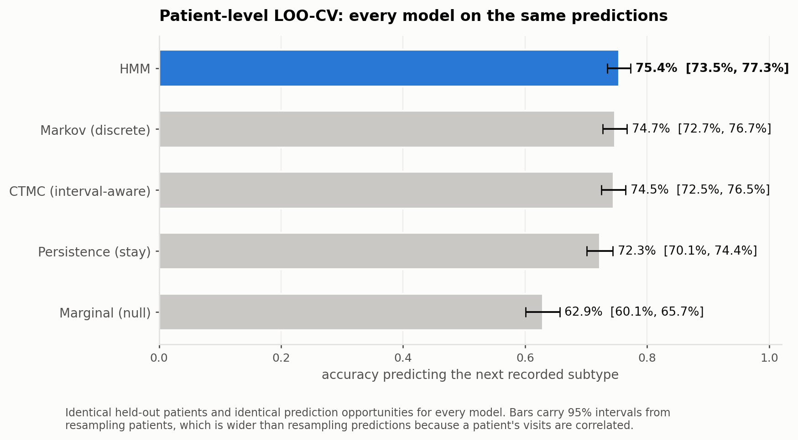

**Figure 22.** Leave-one-patient-out three-class comparison of the CT-HMM, the two observed-label chains, persistence and the marginal null. *(Source: `outputs/loo/figures/loo_model_comparison.png`.)*

The CT-HMM predicts 2,534 of 3,361 next labels correctly: accuracy 0.754 (patient-bootstrap 95% CI 0.735 to 0.773; Wilson interval 0.739 to 0.768), mean per-patient accuracy 0.754 with a median of 1.0, log-likelihood per prediction −0.673 and three-class Brier score 0.369. The discrete chain reaches 0.747, the continuous chain 0.745, recorded-label persistence 0.723 and the marginal null 0.629. The CT-HMM's margin over persistence is 3.1 points; its margin over the discrete chain is 0.7 points.

**Table 23.** Per-class precision, recall and F1 of the CT-HMM under leave-one-patient-out.

| state | support | n_predicted | precision | recall | f1 |
|---|---|---|---|---|---|
| TD | 2115 | 2450 | 0.7857 | 0.9102 | 0.8434 |
| Indeterminate | 332 | 1 | 0.0 | 0.0 |  |
| PIGD | 914 | 910 | 0.6692 | 0.6663 | 0.6678 |

*Machine-readable copy: `tables/table023_lopo_per_class.csv`. Source: `outputs/loo/loo_per_class_metrics.csv`.*

**Table 24.** CT-HMM leave-one-patient-out accuracy by number of prior labelled visits and by the current label.

| stratum | level | accuracy | n |
|---|---|---|---|
| prior labelled visits | 1 | 0.7473 | 934 |
| prior labelled visits | 2 | 0.79 | 762 |
| prior labelled visits | 3 | 0.751 | 502 |
| prior labelled visits | 4 | 0.7387 | 333 |
| prior labelled visits | 5 | 0.7361 | 830 |
| current label | Indeterminate | 0.488 | 334 |
| current label | PIGD | 0.7023 | 766 |
| current label | TD | 0.8107 | 2261 |

*Machine-readable copy: `tables/table024_lopo_accuracy_by_history_and_label.csv`. Source: `outputs/loo/loo_accuracy_by_history.csv; outputs/loo/loo_accuracy_by_current_state.csv`.*

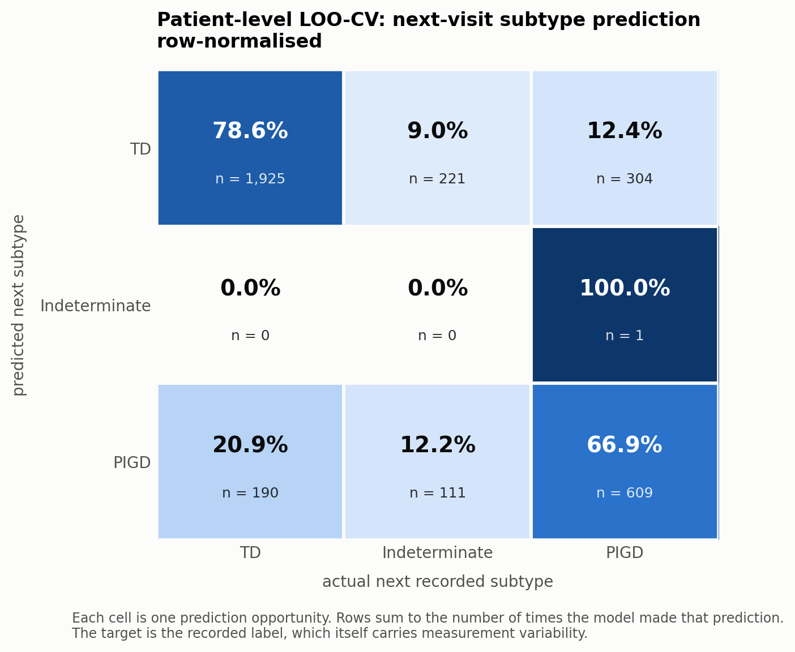

**Figure 23.** Row-normalised confusion matrix of the CT-HMM under leave-one-patient-out. *(Source: `outputs/loo/figures/loo_confusion_matrix_normalized.png`.)*

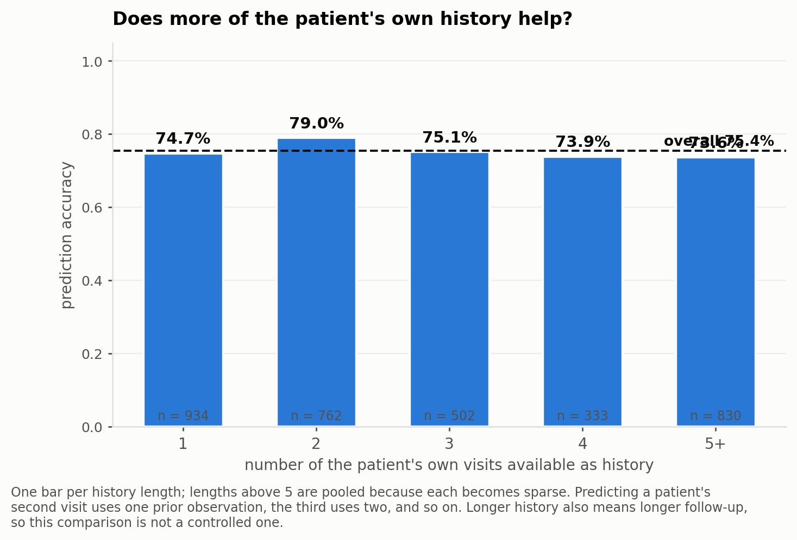

**Figure 25.** Leave-one-patient-out accuracy by the number of prior labelled visits. *(Source: `outputs/loo/figures/loo_accuracy_by_history_length.png`.)*

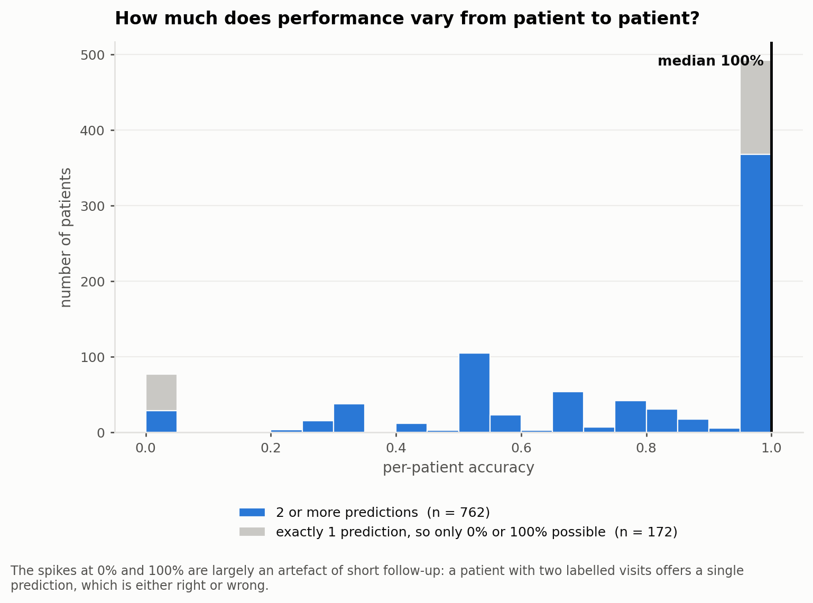

**Figure 26.** Distribution of per-patient accuracy under leave-one-patient-out. *(Source: `outputs/loo/figures/loo_patient_accuracy_distribution.png`.)*

The CT-HMM never predicts Indeterminate: it issues the label once in 3,361 predictions (recall 0.000), because the Indeterminate probability never exceeds the TD or PIGD probability under the argmax rule (its maximum is 0.371). TD is recalled at 0.910 with precision 0.786 and PIGD at 0.666 with precision 0.669. Accuracy by current label is 0.811 (TD), 0.488 (Indeterminate) and 0.702 (PIGD), and by number of prior visits 0.747, 0.790, 0.751, 0.739 and 0.736 for one to five or more. The reliability plot (Figure 24) is close to the diagonal at the confidence levels the model uses.

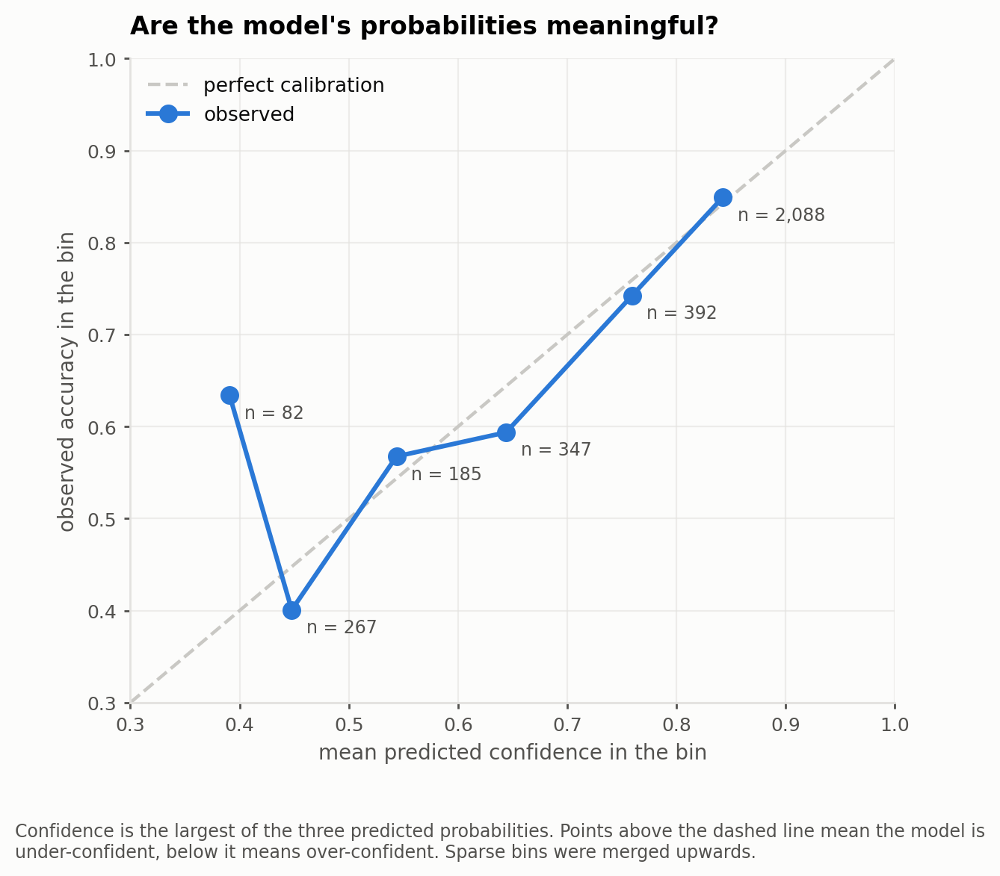

**Figure 24.** Calibration of the CT-HMM's maximum predicted probability under leave-one-patient-out. *(Source: `outputs/loo/figures/loo_calibration.png`.)*

**Table 25.** Stage 4 HMM stability study: held-out leave-one-patient-out metrics for alternative CT-HMM configurations (C3_f50 = three states with emission floor 0.5, the audited model; C3_free, C4_free, C5_free = three, four and five states without the floor) under the argmax rule and under a prior-corrected decision rule that divides each predicted probability by its class prevalence. Persistence is a one-hot rule and its probabilistic scores are degenerate.

| config | rule | accuracy | 95% CI | balanced_accuracy | recall_TD | recall_Indeterminate | recall_PIGD | n_predicted_Indeterminate | log_loss | brier | max_p_Indet |
|---|---|---|---|---|---|---|---|---|---|---|---|
| C3_f50 | argmax | 0.7542 | [0.7351, 0.7734] | 0.5259 | 0.9102 | 0.0 | 0.6674 | 1 | 0.6718 | 0.3684 | 0.3714 |
| C3_f50 | prior_corrected | 0.7123 | [0.6912, 0.7342] | 0.5706 | 0.8132 | 0.253 | 0.6455 | 449 | 0.6718 | 0.3684 | 0.3714 |
| C3_free | argmax | 0.7539 | [0.7341, 0.7733] | 0.5222 | 0.9177 | 0.0 | 0.6488 | 0 | 0.6689 | 0.3668 | 0.2485 |
| C3_free | prior_corrected | 0.6897 | [0.6662, 0.7139] | 0.5709 | 0.7754 | 0.3072 | 0.6302 | 596 | 0.6689 | 0.3668 | 0.2485 |
| C4_free | argmax | 0.7525 | [0.7327, 0.7715] | 0.5222 | 0.9135 | 0.0 | 0.6532 | 0 | 0.6698 | 0.3672 | 0.2539 |
| C4_free | prior_corrected | 0.6807 | [0.6556, 0.7068] | 0.5696 | 0.7579 | 0.3163 | 0.6346 | 637 | 0.6698 | 0.3672 | 0.2539 |
| C5_free | argmax | 0.7542 | [0.7348, 0.7732] | 0.5256 | 0.9106 | 0.0 | 0.6663 | 0 | 0.6691 | 0.3667 | 0.2987 |
| C5_free | prior_corrected | 0.6807 | [0.6558, 0.7065] | 0.5702 | 0.7579 | 0.3193 | 0.6335 | 645 | 0.6691 | 0.3667 | 0.2987 |
| CTMC (interval-aware) | argmax | 0.7456 | [0.7255, 0.7660] | 0.5049 | 0.9338 | 0.0 | 0.581 | 4 | 0.7102 | 0.3923 | 0.6267 |
| CTMC (interval-aware) | prior_corrected | 0.7251 | [0.7046, 0.7461] | 0.5514 | 0.8506 | 0.1657 | 0.6379 | 279 | 0.7102 | 0.3923 | 0.6267 |
| Marginal (null) | argmax | 0.6293 | [0.6022, 0.6583] | 0.3333 | 1.0 | 0.0 | 0.0 | 0 | 0.8754 | 0.5211 | 0.1017 |
| Marginal (null) | prior_corrected | 0.0988 | [0.0869, 0.1106] | 0.3333 | 0.0 | 1.0 | 0.0 | 3361 | 0.8754 | 0.5211 | 0.1017 |
| Markov (discrete) | argmax | 0.7474 | [0.7276, 0.7673] | 0.5073 | 0.9333 | 0.0 | 0.5886 | 0 | 0.7062 | 0.3893 | 0.1993 |
| Markov (discrete) | prior_corrected | 0.7227 | [0.7014, 0.7445] | 0.5484 | 0.8638 | 0.1928 | 0.5886 | 334 | 0.7062 | 0.3893 | 0.1993 |
| Persistence (stay) | argmax | 0.7227 | [0.7014, 0.7445] | 0.5484 | 0.8638 | 0.1928 | 0.5886 | 334 | 7.662 | 0.5546 | 1.0 |
| Persistence (stay) | prior_corrected | 0.7227 | [0.7014, 0.7445] | 0.5484 | 0.8638 | 0.1928 | 0.5886 | 334 | 7.662 | 0.5546 | 1.0 |

*Machine-readable copy: `tables/table025_hmm_stability_configurations.csv`. Source: `experiments/20261014T100057Z_s4_hmm_cv/analysis/cv_config_metrics.csv`.*

**Table 26.** Stage 4 HMM stability study: full-cohort fits from 40 random starts per configuration. share_within_0.01 is the share of starts whose log-likelihood lies within 0.01 of the best; n_loglik_levels_0.01 the number of distinct optima at that resolution; the last two columns the largest difference in any generator or emission entry among the best starts.

| config | n_starts | n_params | best_loglik | worst_loglik | share_within_0.01 | n_loglik_levels_0.01 | max_abs_dQ_among_best | max_abs_dE_among_best |
|---|---|---|---|---|---|---|---|---|
| C3_f50 | 40 | 14 | -2969.0593 | -2969.0596 | 1.0 | 1 | 0.0014 | 0.0003 |
| C3_f60 | 40 | 14 | -2974.7664 | -3657.6873 | 0.975 | 2 | 0.0003 | 0.0002 |
| C3_f70 | 40 | 14 | -2979.098 | -3657.6876 | 0.975 | 2 | 0.0 | 0.0 |
| C3_free | 40 | 14 | -2955.3202 | -2955.448 | 0.95 | 2 | 0.1872 | 0.928 |
| C4_free | 40 | 23 | -2947.3699 | -2954.8253 | 0.6 | 15 | 0.0062 | 0.005 |
| C5_free | 40 | 34 | -2938.8246 | -2953.9221 | 0.025 | 36 | 0.0 | 0.0 |

*Machine-readable copy: `tables/table026_hmm_stability_restarts.csv`. Source: `experiments/20261014T094649Z_s4_hmm_stability/analysis/population_summary.csv`.*

The stability study finds the three-state floor-0.5 fit's optimum unique: all 40 starts reach the same log-likelihood within 0.01, with generator entries agreeing to 0.0014 and emission entries to 0.0003. Without the floor the three-state fit sits on a ridge (38 of 40 starts within 0.01 of the best, but generator entries among the best differing by up to 0.187 and emission entries by up to 0.93), and the five-state fit is multimodal (one of 40 starts within 0.01 of the best; the default start is 7.4 log-likelihood units below it). On held-out prediction every configuration is equivalent: accuracies lie between 0.752 and 0.755 and log-likelihoods between −0.669 and −0.675. The nested selection procedure (which chose the unconstrained three-state model in eight outer folds and the five-state model in two) reaches 0.755 (0.735 to 0.774), the same as the audited model. A prior-corrected decision rule that divides each predicted probability by its class prevalence recovers Indeterminate recall of 0.25 to 0.32 at the cost of accuracy, which falls to 0.68 to 0.71; the probabilities themselves do not change.

The earlier five-state LOPO run, re-scored in the harmonised comparison (Section 9.11), reaches 0.751, below the three-state model, and its fits converged in only 404 of 934 folds, so 59.2% of its predictions come from non-converged fits; it is reported here as a negative result and not used further.

**Interpretation.** Under LOPO the CT-HMM's advantage over the discrete chain survives on the proper score and shrinks to under one accuracy point; its advantage over persistence is three points and, as Section 9.11 shows, almost entirely from the Indeterminate stratum. The fitted optimum is unique only because the floor makes it so; the unconstrained and larger models fit the training data slightly better and predict held-out data no better. The model cannot predict Indeterminate under the argmax rule, which is the correct consequence of the label's own dynamics: an Indeterminate visit is followed by Indeterminate only 19% of the time.

**Limitations.** The three-class task scores the next recorded label, so the 9.9% of Indeterminate outcomes are counted as errors for every model that never predicts them. The stability study's held-out table is a sensitivity table, not a model selection.

**Contribution.** The reference three-class result, with its uncertainty, against which every later three-class model is measured, and the demonstration that neither more latent states nor fewer constraints change it.

### 9.6 The hierarchical Bayesian growth model of the ratio and its Student-t variants (E14, E15)

**Question.** Does a continuous model of the ratio, with a patient-specific baseline and slope, predict the next recorded label as well as the CT-HMM, and are its residuals or its slopes heavy-tailed?

**Setup and cohort.** The 821 patients with at least two ratio-defined visits (3,603 visits in the analysable cohort). The growth model is compared with the CT-HMM on the 825 held-out pairs of the main split that both can score, and on six further splits; its longitudinal cross-validation estimates each held-out patient's trajectory from their first one, two or three visits. The Student-t variants are compared over seven patient splits.

**Results.** **Table 27.** Hierarchical Bayesian growth model of the ratio (Gibbs sampler, single chain): posterior mean, SD and quantiles of the population parameters. No R-hat or effective sample size was computed, so the summaries are descriptive.

| parameter | mean | sd | q2.5 | q50 | q97.5 |
|---|---|---|---|---|---|
| beta0 (population baseline ratio) | 2.292 | 0.0669 | 2.1577 | 2.2915 | 2.4272 |
| beta1 (population progression, /yr) | -0.0927 | 0.0121 | -0.1159 | -0.0928 | -0.0682 |
| sigma (total residual SD) | 1.138 | 0.0203 | 1.0993 | 1.1373 | 1.1778 |
| tau0 (SD of patient baselines) | 1.3408 | 0.0499 | 1.2466 | 1.3403 | 1.4421 |
| tau1 (SD of patient slopes, /yr) | 0.1033 | 0.0137 | 0.078 | 0.1031 | 0.1315 |

*Machine-readable copy: `tables/table027_growth_model_posterior.csv`. Source: `outputs/hbayes/posterior_summary.csv`.*

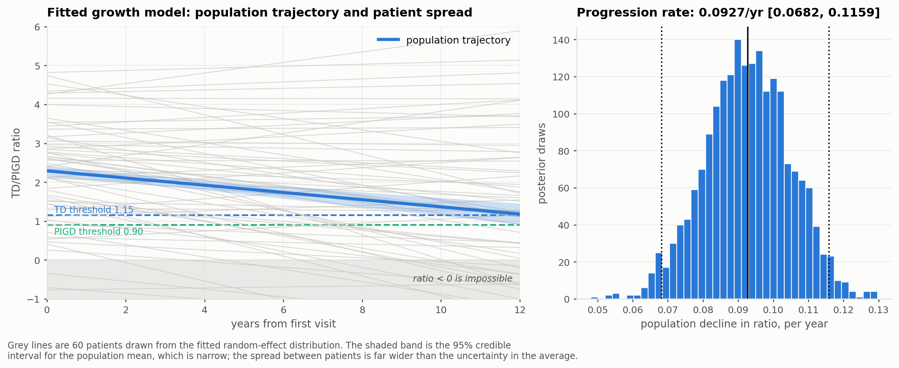

**Figure 27.** Hierarchical Bayesian growth model: fitted patient trajectories of the ratio. *(Source: `outputs/hbayes/figures/growth_trajectories.png`.)*

The population ratio starts at 2.29 (95% posterior interval 2.16 to 2.43) and falls by 0.093 per year (0.116 to 0.068 per year of decline); the patient baseline SD is 1.34, the patient slope SD 0.103 per year, and the total residual SD 1.14, which is 4.6 times the width of the Indeterminate band. The ratio's variance is 54% between patients and 46% within (Table 31), with a within-patient SD of 1.22.

**Table 28.** Head-to-head held-out comparison of the growth model and the CT-HMM on the 825 pairs both can score. Across six further splits the CT-HMM minus growth-model difference in log-likelihood per pair was +0.0579 on average (SD 0.0188) and positive in 6 of 6 splits.

| model | n | loglik_per_pair | accuracy | brier |
|---|---|---|---|---|
| HMM (latent states) | 825 | -0.6559 | 0.7612 | 0.3573 |
| Hierarchical Bayesian growth | 825 | -0.6814 | 0.737 | 0.3786 |

*Machine-readable copy: `tables/table028_growth_vs_cthmm_head_to_head.csv`. Source: `outputs/hbayes/head_to_head.csv; outputs/hbayes/robustness.csv`.*

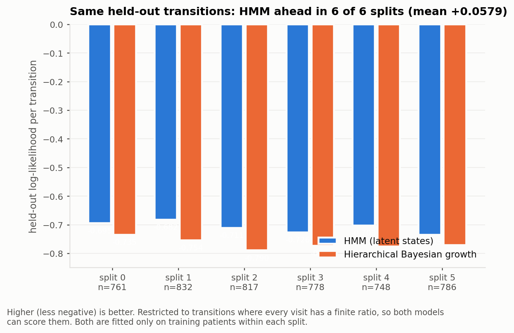

**Figure 28.** Head-to-head held-out comparison of the growth model and the CT-HMM. *(Source: `outputs/hbayes/figures/hb_vs_hmm.png`.)*

**Table 29.** Longitudinal cross-validation of the growth model: the first one, two or three visits of each held-out patient are used to estimate that patient's trajectory and all later visits are predicted.

| train_visits | n_future_visits | loglik_per_visit | accuracy | rmse_ratio | coverage_95 |
|---|---|---|---|---|---|
| 1 | 2707 | -1.0341 | 0.5755 | 2.1919 | 0.9738 |
| 2 | 1886 | -0.8917 | 0.6469 | 1.6216 | 0.929 |
| 3 | 1256 | -0.9398 | 0.6664 | 1.8082 | 0.9045 |

*Machine-readable copy: `tables/table029_growth_longitudinal_cv.csv`. Source: `outputs/validation/longitudinal_cv.csv`.*

**Table 30.** Calibration of the growth model's predicted probability of a PIGD label.

| bin | n | mean_predicted | observed_rate |
|---|---|---|---|
| (-0.001, 0.05] | 385 | 0.0176 | 0.0779 |
| (0.05, 0.167] | 378 | 0.1068 | 0.1587 |
| (0.167, 0.297] | 374 | 0.2316 | 0.3048 |
| (0.297, 0.437] | 376 | 0.3639 | 0.508 |
| (0.437, 0.74] | 373 | 0.5347 | 0.7292 |

*Machine-readable copy: `tables/table030_growth_calibration.csv`. Source: `outputs/validation/calibration_growth_model.csv`.*

Head to head, the CT-HMM reaches −0.656 log-likelihood per pair, 0.761 accuracy and 0.357 Brier against the growth model's −0.681, 0.737 and 0.379 on the same 825 pairs, and it is ahead on all six further splits (mean +0.058 per pair, SD 0.019). In longitudinal cross-validation the growth model's accuracy rises from 0.576 with one conditioning visit to 0.647 with two and 0.666 with three, while its 95% interval coverage falls from 0.974 to 0.904; its predicted probability of PIGD is below the observed rate in every reliability bin, with a mean gap of 0.105.

**Table 31.** Decomposition of the variance of the ratio into between-patient and within-patient components.

| component | variance | sd | share |
|---|---|---|---|
| between patients | 1.7105 | 1.3079 | 0.5363 |
| within patients | 1.4792 | 1.2162 | 0.4637 |

*Machine-readable copy: `tables/table031_ratio_variance_decomposition.csv`. Source: `outputs/exploration/variance_decomposition.csv`.*

**Table 32.** Share of labelled visits at which the ratio is defined, by study year.

| YEAR | labelled | with_ratio | ratio_share |
|---|---|---|---|
| 0 | 1076 | 799 | 0.7426 |
| 1 | 806 | 653 | 0.8102 |
| 2 | 677 | 569 | 0.8405 |
| 3 | 480 | 400 | 0.8333 |
| 4 | 329 | 289 | 0.8784 |
| 5 | 216 | 194 | 0.8981 |
| 6 | 182 | 166 | 0.9121 |
| 7 | 177 | 164 | 0.9266 |
| 8 | 121 | 118 | 0.9752 |
| 9 | 99 | 93 | 0.9394 |
| 10 | 108 | 104 | 0.963 |
| 11 | 92 | 90 | 0.9783 |
| 12 | 52 | 52 | 1.0 |
| 13 | 24 | 24 | 1.0 |
| 14 | 2 | 1 | 0.5 |

*Machine-readable copy: `tables/table032_ratio_availability_by_year.csv`. Source: `outputs/exploration/ratio_availability_by_year.csv`.*

**Table 56.** Student-t variants of the growth model (GG Gaussian slopes and residuals, GT Gaussian slopes with t residuals, TG t slopes with Gaussian residuals, TT both t): held-out comparisons over seven patient splits with patient-bootstrap intervals, and the pre-registered reassessment of the slope-tail question.

| question | quantity | estimate | 95% interval | splits / status |
|---|---|---|---|---|
| Q1 residual tails | GT-GG: held-out log predictive density per visit | 0.1115 | [0.0606, 0.1676] | 7/7 |
| Q1 residual tails | GT-GG: class-label metric | 0.0382 | [0.0205, 0.0549] | 7/7 |
| Q1 residual tails | TT-TG: held-out log predictive density per visit | 0.106 | [0.0577, 0.1575] | 7/7 |
| Q1 residual tails | TT-TG: class-label metric | 0.0379 | [0.0212, 0.0546] | 7/7 |
| Q3 predictive value vs GG | TG: class-label metric | 0.0034 | [0.0007, 0.0063] | 6/7 |
| Q3 predictive value vs GG | GT: class-label metric | 0.0382 | [0.0205, 0.0549] | 7/7 |
| Q3 predictive value vs GG | TT: class-label metric | 0.0412 | [0.0229, 0.0586] | 7/7 |
| Q2 slope tails, original run | nu_slope sampler, Gamma prior: R-hat / ESS | 1.018 / 248 |  | INCONCLUSIVE (convergence) |
| Q2 reassessment | full-cohort nu_slope posterior median [2.5%, 97.5%], Gamma(2, 0.1) prior | 2.09 | [1.48, 4.11] | R-hat 1.0044, ESS 937 |
| Q2 reassessment | per-split criterion nu_slope q97.5 < 10 met | 1/7 |  | threshold 5/7 |
| Q2 reassessment calibration | scenario C1: flags / cohorts | 0 / 60 | [0.000, 0.060] | null scenario |
| Q2 reassessment calibration | scenario C2: flags / cohorts | 0 / 60 | [0.000, 0.060] | null scenario |
| Q2 reassessment calibration | scenario C3: flags / cohorts | 0 / 60 | [0.000, 0.060] | null scenario |
| Q2 reassessment calibration | scenario P: flags / cohorts | 55 / 60 | [0.816, 0.972] | positive control |
| Q2 reassessment | verdict | NOT SUPPORTED: no evidence of extreme slope tails |  |  |

*Machine-readable copy: `tables/table056_student_t_variants.csv`. Source: `experiments/20261015T190228Z_student_t_four_model_full/results.json; experiments/20261015T203325Z_q2_reassessment/results/results.json`.*

Student-t residuals improve held-out prediction unambiguously: GT against GG gains +0.112 (95% CI +0.061 to +0.168) in log predictive density per visit and +0.038 (+0.020 to +0.055) on the class-label metric, positive in all seven splits, and TT against TG gains +0.106 (+0.058 to +0.158); the residual degrees of freedom are about 2.1 (posterior 1.88 to 2.39 in the frozen generator). Heavy-tailed slopes are not supported: the original run's slope-tail sampler did not converge (R-hat 1.018, effective sample size 248) and the question was declared inconclusive; the pre-registered reassessment with a collapsed slice sampler converged (R-hat 1.004, effective sample size 937) and found a full-cohort posterior median of 2.09 (1.48 to 4.11) for the slope degrees of freedom but met the per-split criterion in only one of seven splits against a threshold of five, with zero false flags in 180 null calibration cohorts and 55 of 60 detections in the positive control; the verdict is not supported.

**Interpretation.** A growth model of the ratio is a worse predictor of the recorded label than a model of the label itself, by a margin that is consistent across splits, and it under-predicts PIGD because a Gaussian on a ratio whose residual SD is four and a half times the band width places too little mass below 0.90. The heavy residual tails are real and are the same phenomenon the lag-1 and D-1 analyses see: occasional large excursions of the ratio that do not persist. The two variance components of the proposal's model are not identified, so the model cannot separate process from observation noise, which is the one thing a label-prediction model would need it to do.

**Limitations.** A single Gibbs chain without convergence diagnostics; the 821-patient ratio cohort is a selected subset (Section 4.4); the head-to-head set of 825 pairs is a subset of the split's 1,002 pairs.

**Contribution.** The first negative result for the continuous-ratio route, and the evidence that residual tails are heavy, which the Student-t D-1 generator then inherited.

### 9.7 The first-visit model (E16)

**Question.** With no history, what predicts the label at a later visit?

**Setup and cohort.** Ten random 70/30 patient splits; the model of Section 6.5 and its nested variants; 1,002 held-out rows on the main split.

**Results.** **Table 33.** New-patient (first-visit) prediction: mean over ten random splits of the held-out log-likelihood per prediction for nested multinomial models. The first-visit model with ratio and covariates on the main split (n = 1002): log-likelihood per prediction -0.7227, accuracy 0.7186, Brier 0.4132.

| model | mean held-out log-likelihood per prediction (10 splits) | SD across splits |
|---|---|---|
| HMM (no history) | -0.7869 | 0.0246 |
| subtype + horizon | -0.7813 | 0.028 |
| + baseline ratio | -0.7735 | 0.0311 |
| + covariates | -0.7625 | 0.0378 |
| + ratio + covariates | -0.755 | 0.0416 |

*Machine-readable copy: `tables/table033_new_patient_models.csv`. Source: `outputs/newpatient/model_comparison.csv; outputs/newpatient/heldout_metrics.csv`.*

**Table 34.** Cost in held-out log-likelihood per prediction of dropping each covariate from the first-visit model.

| covariate | loglik_without | cost_of_dropping |
|---|---|---|
| updrs2_score | -0.738 | 0.0153 |
| MIA_PUTAMEN_BILAT | -0.7277 | 0.005 |
| age | -0.727 | 0.0042 |
| hy | -0.7248 | 0.0021 |
| SEX | -0.723 | 0.0002 |
| moca | -0.7223 | -0.0004 |
| upsit | -0.7219 | -0.0008 |
| duration_yrs | -0.7217 | -0.001 |
| scopa | -0.7214 | -0.0014 |
| rem | -0.7211 | -0.0016 |

*Machine-readable copy: `tables/table034_new_patient_covariate_importance.csv`. Source: `outputs/newpatient/covariate_importance.csv`.*

**Table 35.** First-visit model: held-out log-likelihood and accuracy by prediction horizon.

| horizon | n | loglik | accuracy |
|---|---|---|---|
| <1.5y | 241 | -0.6138 | 0.7759 |
| 1.5-3.5y | 358 | -0.6594 | 0.757 |
| 3.5-6.5y | 218 | -0.7899 | 0.6789 |
| >6.5y | 185 | -0.9082 | 0.6162 |

*Machine-readable copy: `tables/table035_new_patient_by_horizon.csv`. Source: `outputs/newpatient/by_horizon.csv`.*

Averaged over ten splits, a lookup of the current label and the horizon gives −0.781 log-likelihood per prediction, adding the baseline ratio −0.773, adding the ten baseline measures −0.763, and both −0.755, against −0.787 for the CT-HMM given no history (a gain of 0.032 per prediction). On the main split the full first-visit model reaches 0.719 accuracy and 0.413 Brier. The MDS-UPDRS Part II total is the only covariate whose removal costs more than 0.01 per prediction (0.015); the DaT-scan putamen binding, age and Hoehn and Yahr stage cost 0.005, 0.004 and 0.002; the cognitive, olfactory, autonomic and sleep measures cost nothing or less than nothing. Accuracy falls with horizon from 0.776 within 1.5 years to 0.616 beyond 6.5 years.

**Interpretation.** At a first visit the baseline clinical picture, chiefly motor disability, adds a little to the label and the horizon, and none of the diffuse-synucleinopathy markers help. The result bounds what any model can do without history and is consistent with the ceiling the longitudinal models reach with it.

**Limitations.** Covariates are mean-imputed within the training split; the model is not compared under LOPO.

**Contribution.** A no-history reference, and evidence that non-motor baseline markers do not predict the motor label.

### 9.8 Gaussian-process regression of the ratio: kernels, mean function and multi-step forecasts (E17)

**Question.** Does a flexible trajectory model of the ratio predict the next ratio better than a linear trend, does a fitted mean matter, and does the advantage change with forecast horizon?

**Setup and cohort.** One-step-ahead leave-one-patient-out over 821 patients and 2,707 points, on the unfiltered cohort and three extreme-patient-filtered cohorts (A4, D1, E2); kernels K0 to K3 and the growth model, against persistence, the patient mean, a per-patient OLS line and the population mean; patient-cluster bootstrap with 4,000 replicates. All 11,444 kernel fits across the four cohorts converged. A zero-mean K2 arm was fitted inside the same 821 folds; multi-step forecasts condition on the first half of each patient's visits.

**Results.** **Table 36.** Gaussian-process regression of the ratio, one-step-ahead leave-one-patient-out on the unfiltered cohort (821 patients, 2,707 points): kernels K0 (constant + linear), K1 (constant + RBF), K2 (constant + linear + RBF), K3 (constant + linear + Matern-3/2), the hierarchical Bayesian growth model and rule baselines. negative_mass is the mean predictive mass below zero; accuracy is the three-class accuracy of the derived label.

| model | n_patients | n_points | MAE_pooled | MAE_patient | RMSE | CRPS | coverage95 | negative_mass | accuracy |
|---|---|---|---|---|---|---|---|---|---|
| K0 | 821 | 2707 | 1.0053 | 1.0204 | 1.387 | 0.7472 | 0.9387 | 0.1386 | 0.7141 |
| K1 | 821 | 2707 | 0.972 | 1.0012 | 1.3566 | 0.7249 | 0.9409 | 0.1295 | 0.7237 |
| K2 | 821 | 2707 | 0.972 | 1.0012 | 1.3566 | 0.7249 | 0.9409 | 0.1295 | 0.7237 |
| K3 | 821 | 2707 | 0.9715 | 1.0006 | 1.3565 | 0.7247 | 0.9409 | 0.1294 | 0.727 |
| hbayes | 821 | 2707 | 1.0062 | 1.0176 | 1.391 | 0.748 | 0.9302 | 0.1341 | 0.7115 |
| patient_mean | 821 | 2707 | 1.0627 | 1.0649 | 1.4714 | 0.8003 | 0.9409 | 0.1509 | 0.71 |
| patient_ols | 821 | 2707 | 1.3357 | 1.3292 | 1.9876 | 1.0409 | 0.9387 | 0.2439 | 0.7126 |
| persistence | 821 | 2707 | 1.0427 | 1.0597 | 1.5396 | 0.8182 | 0.9357 | 0.1844 | 0.7329 |
| population | 821 | 2707 | 1.3949 | 1.413 | 1.8008 | 0.9836 | 0.9483 | 0.1379 | 0.5755 |

*Machine-readable copy: `tables/table036_gpr_ratio_metrics.csv`. Source: `outputs/step3_gpr/reconciled_metrics.csv`.*

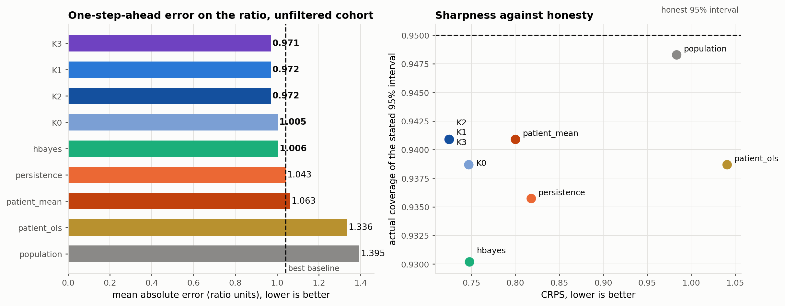

**Figure 29.** Gaussian-process regression on the ratio: one-step held-out comparison of kernels and baselines. *(Source: `outputs/step3_gpr/figures/model_comparison.png`.)*

**Table 37.** GPR of the ratio: pre-specified paired MAE differences (model a minus model b; negative favours a) with patient-cluster bootstrap intervals (4,000 replicates, seed 42), pooled over points and averaged within patients.

| model_a | model_b | question | diff_pooled | pooled 95% CI | diff_patient | patient-level 95% CI |
|---|---|---|---|---|---|---|
| K1 | K0 | does a flexible kernel beat the linear one | -0.0333 | [-0.0467, -0.0205] | -0.0192 | [-0.0279, -0.0106] |
| K2 | K1 | does the linear kernel term add anything beside an RBF | 0.0 | [0.0000, 0.0000] | 0.0 | [0.0000, 0.0000] |
| K3 | K1 | does Matern beat the squared exponential | -0.0005 | [-0.0015, 0.0005] | -0.0006 | [-0.0013, 0.0002] |
| K0 | hbayes | does the GP reproduce the growth model | -0.0009 | [-0.0033, 0.0014] | 0.0028 | [0.0002, 0.0053] |
| K1 | persistence | does the GP beat the trivial rule | -0.0707 | [-0.0979, -0.0451] | -0.0585 | [-0.0906, -0.0272] |
| K1 | patient_mean | does the GP beat the patient's own average | -0.0908 | [-0.1200, -0.0631] | -0.0637 | [-0.0956, -0.0335] |

*Machine-readable copy: `tables/table037_gpr_ratio_paired.csv`. Source: `outputs/step3_gpr/paired_comparisons.csv`.*

On the unfiltered cohort the RBF kernels reach a pooled MAE of 0.972 (K1, K2) and 0.971 (K3) against 1.005 for the linear K0, 1.006 for the growth model, 1.043 for persistence, 1.063 for the patient mean, 1.336 for the patient OLS line and 1.395 for the population mean. The paired differences are K1 minus K0 −0.033 (−0.047 to −0.021) pooled and −0.019 (−0.028 to −0.011) per patient, K1 minus persistence −0.071 (−0.098 to −0.045), and K3 minus K1 and K0 minus the growth model both include zero; the linear kernel term adds nothing beside an RBF (K2 minus K1 at 10<sup>−6</sup>), and its variance was pinned at its lower bound in every fold. Coverage of the 95% intervals is 0.941 and 12.9% to 13.9% of each predictive distribution lies below zero. The derived three-class label from K1 reaches 0.724 accuracy, below the 0.733 of ratio persistence, and never predicts Indeterminate. The model ordering is identical in all four cohorts (Figure 30, Table 38).

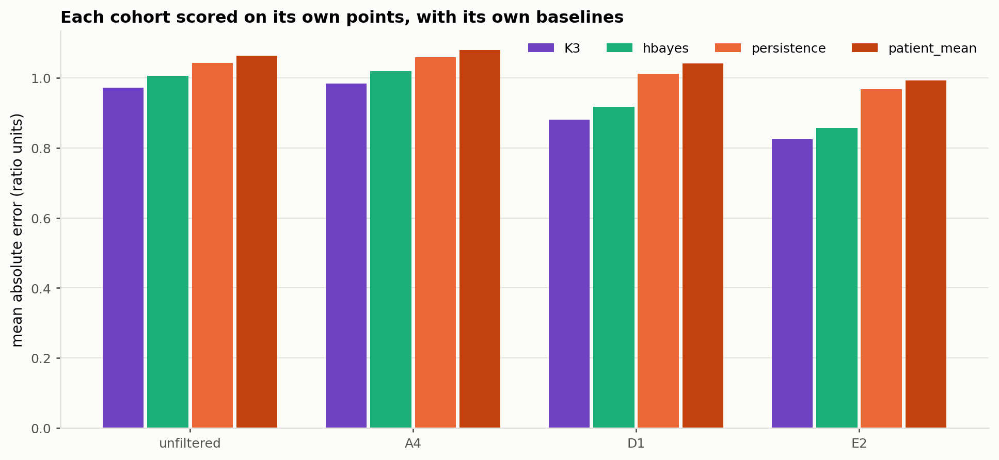

**Figure 30.** GPR results across the four extreme-patient filtering cohorts. *(Source: `outputs/step3_gpr/figures/cohort_comparison.png`.)*

**Table 38.** GPR of the ratio across the four extreme-patient filtering cohorts (unfiltered, A4, D1, E2).

| cohort | criterion | patients | labelled_visits | finite_visits | prediction_points | patients_removed | never_changed | ever_changed | median_finite_visits | median_span_years |
|---|---|---|---|---|---|---|---|---|---|---|
| unfiltered | none | 821 | 3951 | 3528 | 2707 | 0 | 392 | 429 | 3.0 | 3.0856 |
| A4-filtered | A4 | 803 | 3853 | 3457 | 2654 | 65 | 383 | 420 | 3.0 | 3.0856 |
| D1-filtered | D1 | 641 | 3139 | 2860 | 2219 | 256 | 224 | 417 | 4.0 | 3.1677 |
| E2-filtered | E2 | 596 | 2743 | 2538 | 1942 | 274 | 214 | 382 | 3.0 | 3.0828 |

*Machine-readable copy: `tables/table038_gpr_cohort_comparison.csv`. Source: `outputs/step3_gpr/cohort_comparison.csv`.*

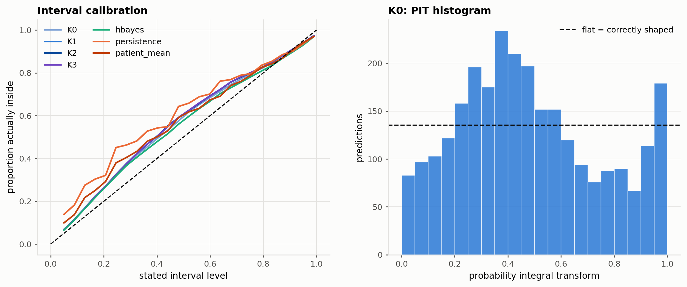

**Figure 31.** Predictive-interval calibration of the GPR. *(Source: `outputs/step3_gpr/figures/calibration.png`.)*

**Table 39.** Held-out comparison of the K2 kernel with a fitted linear mean against the same kernel with a zero mean (unfiltered cohort, 821 folds).

| model | n_points | n_patients | MAE_pooled | MAE_patient | RMSE | CRPS | coverage95 | negative_mass | diff_pooled | pooled 95% CI (zero-mean minus fitted-mean MAE) |
|---|---|---|---|---|---|---|---|---|---|---|
| K2 | 2707 | 821 | 0.972 | 1.0012 | 1.3566 | 0.7249 | 0.9409 | 0.1295 |  |  |
| K2_zeromean | 2707 | 821 | 0.9649 | 0.9884 | 1.3918 | 0.7437 | 0.9387 | 0.1702 | -0.0071 | [-0.0193, 0.0056] |

*Machine-readable copy: `tables/table039_gpr_mean_function_holdout.csv`. Source: `outputs/step3_gpr/mean_function_holdout_summary.csv`.*

The fitted linear mean does not change MAE (zero-mean minus fitted-mean −0.007, −0.019 to +0.006) but it improves CRPS (+0.019, +0.013 to +0.025 in favour of the fitted mean), mean squared error (+0.097, +0.063 to +0.131) and the mass below zero (0.130 against 0.170): the zero-mean arm makes occasional large errors when a patient's history runs out, which MAE barely registers.

**Table 40.** Multi-step GPR forecasts (unfiltered cohort): MAE by forecast-horizon bin when the first half of each patient's visits conditions the forecast of every later visit.

| model | (0.0, 1.05] | (1.05, 2.05] | (2.05, 3.05] | (3.05, 5.05] | (5.05, 30.0] |
|---|---|---|---|---|---|
| K0 | 0.9502 | 1.008 | 1.1021 | 1.0887 | 1.2327 |
| K1 | 0.921 | 0.9916 | 1.0666 | 1.0001 | 0.9756 |
| K2 | 0.921 | 0.9916 | 1.0666 | 1.0001 | 0.9756 |
| K3 | 0.9195 | 0.9929 | 1.0661 | 0.9997 | 0.9786 |
| patient_mean | 0.9713 | 1.0466 | 1.2276 | 1.2823 | 1.4985 |
| persistence | 0.9411 | 1.0586 | 1.1968 | 1.249 | 1.6045 |

*Machine-readable copy: `tables/table040_gpr_multistep_mae_by_horizon.csv`. Source: `outputs/step3_gpr/multistep_by_horizon.csv`.*

**Table 41.** Multi-step GPR forecasts: paired MAE differences over all forecast points (unfiltered cohort).

| model_a | model_b | n_points | diff | 95% CI | excludes zero |
|---|---|---|---|---|---|
| K1 | K0 | 1389 | -0.062 | [-0.0953, -0.0312] | True |
| K3 | K1 | 1389 | 0.0002 | [-0.0022, 0.0025] | False |
| K1 | persistence | 1389 | -0.1576 | [-0.2328, -0.0861] | True |
| K1 | patient_mean | 1389 | -0.1611 | [-0.2124, -0.1137] | True |

*Machine-readable copy: `tables/table041_gpr_multistep_paired.csv`. Source: `outputs/step3_gpr/multistep_paired.csv`.*

**Table 42.** Multi-step GPR forecasts: within-patient change in MAE between adjacent horizon bins (positive = worse), restricted to patients present in both bins.

| model | from_bin | to_bin | n_patients | delta_MAE | 95% CI |
|---|---|---|---|---|---|
| K1 | 0-1y | 1-2y | 165 | 0.2302 | [0.0508, 0.4020] |
| K1 | 1-2y | 2-3y | 128 | -0.0578 | [-0.2440, 0.1258] |
| K1 | 2-3y | 3-5y | 95 | -0.0846 | [-0.2762, 0.0988] |
| K1 | 3-5y | 5y+ | 68 | -0.2043 | [-0.4572, 0.0624] |
| persistence | 0-1y | 1-2y | 165 | 0.3009 | [0.1382, 0.4664] |
| persistence | 1-2y | 2-3y | 128 | -0.0666 | [-0.2563, 0.1158] |
| persistence | 2-3y | 3-5y | 95 | 0.0271 | [-0.1721, 0.2117] |
| persistence | 3-5y | 5y+ | 68 | 0.3717 | [0.0534, 0.7117] |

*Machine-readable copy: `tables/table042_gpr_multistep_within_patient.csv`. Source: `outputs/step3_gpr/multistep_audit_within_patient.csv`.*

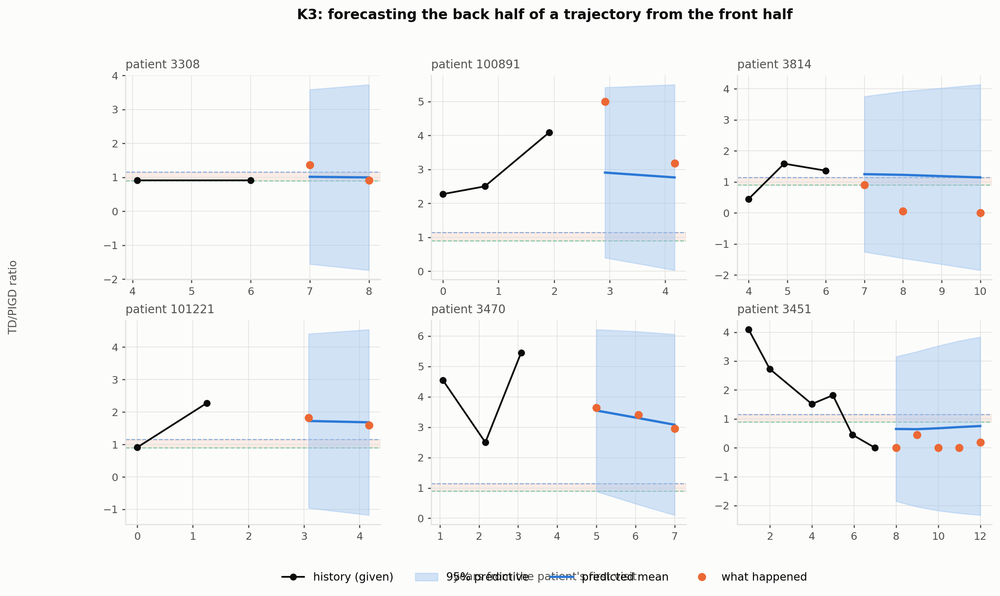

**Figure 32.** Example multi-step GPR forecast for one patient. *(Source: `outputs/step3_gpr/figures/example_forecast.png`.)*

Multi-step, the RBF kernels' advantage over the linear kernel doubles (K1 minus K0 −0.062, −0.095 to −0.031 over 1,389 forecast points) and the advantage over persistence grows to −0.158 (−0.233 to −0.086): persistence anchors on one noisy observation that ages badly, whereas the GP reverts towards the population trend. Within patients, the first step from the 0 to 1 year bin to the 1 to 2 year bin worsens K1's MAE by +0.230 (+0.051 to +0.402) and persistence's by about +0.28, so both degrade in step; the difference-in-differences against persistence excludes zero only beyond five years (−0.371, −0.655 to −0.104 in the unfiltered cohort) and only in three of four cohorts.

**Interpretation.** The kernel choice is worth about 0.03 ratio units against about 0.4 for knowing which patient it is (population-only 1.39 against patient-aware about 1.0) and 1.22 for the within-patient SD. Flexibility refines the trajectory at a tenth of the individualisation effect and a fortieth of the noise, and the derived label does not improve on ratio persistence. The GP's widening advantage at long range is real but describes forecasting the ratio, not the label.

**Limitations.** Gaussian likelihood on a non-negative ratio (12% to 17% of predictive mass below zero); the mean-function hold-out was run on the unfiltered cohort only; the multi-step comparison omits the growth model and fitted baselines; long horizons are reached only by patients with long follow-up.

**Contribution.** A careful negative result for kernel refinement on the ratio and the reason the programme moved to the subscores.

### 9.9 Modelling the two subscores: independent GPs, the joint mixed model, multi-output GPs and the Stage 3 held-out comparison (E18 to E21)

**Question.** Does predicting the tremor and PIGD subscores, and deriving the label afterwards, improve on the ratio and on persistence, and does a cross-output covariance or a more flexible kernel help?

**Setup and cohort.** Leave-one-patient-out over all 934 patients and 3,361 one-step points, which recovers 654 points and 113 patients the ratio model cannot score (the recovered patients have a mean PIGD subscore of 0.073 against 0.414 cohort-wide and are 308 TD, 23 Indeterminate and 13 PIGD visits). Models: independent K1 GPs; the joint LMM; multi-output GPs with K0 to K3 components, full or diagonal coregionalisation; persistence, patient mean and the LMM as baselines. The Stage 3 run scores fifteen arms on identical points with CRPS, log predictive score and coverage, 4,000 patient-bootstrap replicates, and pairs each derived label with the CT-HMM's LOPO predictions on the same 3,361 points.

**Results.** **Table 43.** Independent K1 GPs on the tremor and PIGD subscores (leave-one-patient-out, 934 folds): MAE on the expanded set (all 3,361 points) and on the restricted set the ratio model can score.

| subscore | model | cohort | n | n_patients | MAE | 95% CI | negative_mass |
|---|---|---|---|---|---|---|---|
| tremor | K1 | expanded | 3361 | 934 | 0.2395 | [0.2317, 0.2475] | 0.0535 |
| tremor | K1 | restricted | 2707 | 821 | 0.238 | [0.2298, 0.2469] | 0.054 |
| tremor | K1 | recovered | 654 | 349 | 0.2459 | [0.2288, 0.2635] | 0.0512 |
| tremor | persistence | expanded | 3361 | 934 | 0.2426 | [0.2329, 0.2520] | 0.114 |
| tremor | persistence | restricted | 2707 | 821 | 0.2398 | [0.2294, 0.2512] | 0.1144 |
| tremor | persistence | recovered | 654 | 349 | 0.2544 | [0.2333, 0.2749] | 0.1123 |
| tremor | patient_mean | expanded | 3361 | 934 | 0.2498 | [0.2391, 0.2608] | 0.1057 |
| tremor | patient_mean | restricted | 2707 | 821 | 0.2475 | [0.2363, 0.2595] | 0.1066 |
| tremor | patient_mean | recovered | 654 | 349 | 0.2595 | [0.2375, 0.2833] | 0.1019 |
| pigd | K1 | expanded | 3361 | 934 | 0.2175 | [0.2073, 0.2277] | 0.1066 |
| pigd | K1 | restricted | 2707 | 821 | 0.2174 | [0.2063, 0.2291] | 0.0931 |
| pigd | K1 | recovered | 654 | 349 | 0.2178 | [0.2007, 0.2376] | 0.1625 |
| pigd | persistence | expanded | 3361 | 934 | 0.204 | [0.1921, 0.2162] | 0.224 |
| pigd | persistence | restricted | 2707 | 821 | 0.2065 | [0.1935, 0.2196] | 0.1968 |
| pigd | persistence | recovered | 654 | 349 | 0.1939 | [0.1704, 0.2203] | 0.3367 |
| pigd | patient_mean | expanded | 3361 | 934 | 0.24 | [0.2243, 0.2557] | 0.2694 |
| pigd | patient_mean | restricted | 2707 | 821 | 0.2425 | [0.2257, 0.2603] | 0.2395 |
| pigd | patient_mean | recovered | 654 | 349 | 0.2294 | [0.2010, 0.2594] | 0.3931 |

*Machine-readable copy: `tables/table043_subscore_gp_summary.csv`. Source: `outputs/step3_gpr/subscore_summary.csv`.*

**Table 44.** Subscore GPs: paired MAE differences against persistence and between the independent and multi-output specifications (3,361 points).

| outcome | comparison | delta_MAE | 95% CI | excludes zero | n |
|---|---|---|---|---|---|
| tremor | gp_indep_K1 - persistence | -0.0031 | [-0.0084, 0.0022] | False | 3361 |
| tremor | gp_joint_K0_full - persistence | -0.0046 | [-0.0101, 0.0009] | False | 3361 |
| tremor | gp_joint_K1_diag - persistence | -0.0032 | [-0.0085, 0.0021] | False | 3361 |
| tremor | gp_joint_K1_full - persistence | -0.0035 | [-0.0087, 0.0018] | False | 3361 |
| tremor | patient_mean - persistence | 0.0072 | [-0.0003, 0.0153] | False | 3361 |
| pigd | gp_indep_K1 - persistence | 0.0134 | [0.0083, 0.0187] | True | 3361 |
| pigd | gp_joint_K0_full - persistence | 0.0114 | [0.0059, 0.0170] | True | 3361 |
| pigd | gp_joint_K1_diag - persistence | 0.0134 | [0.0083, 0.0187] | True | 3361 |
| pigd | gp_joint_K1_full - persistence | 0.0133 | [0.0082, 0.0187] | True | 3361 |
| pigd | patient_mean - persistence | 0.0359 | [0.0272, 0.0446] | True | 3361 |
| tremor | gp_joint_K1_full - gp_joint_K1_diag | -0.0003 | [-0.0006, 0.0000] | False | 3361 |
| pigd | gp_joint_K1_full - gp_joint_K1_diag | -0.0001 | [-0.0005, 0.0003] | False | 3361 |

*Machine-readable copy: `tables/table044_subscore_gp_paired.csv`. Source: `outputs/joint_subscore_gp/paired.csv`.*

The subscores are far better behaved than the ratio (median within-patient SD 0.19 for tremor and 0.14 for PIGD against 0.76 for the ratio; predictive mass below zero 0.053 for tremor against 0.130 for the ratio), but the GP's advantage over persistence does not survive the change of target: K1 minus persistence is −0.003 (−0.008 to +0.002) on the tremor score and +0.013 (+0.008 to +0.019) on the PIGD score, where persistence wins. The reason is the point mass at zero: at the 446 visits where the PIGD score is zero, persistence predicts below 0.1 at 62% of them and the GP never does (its mean prediction there is 0.242).

**Table 48.** Joint bivariate linear mixed model of the tremor and PIGD subscores (REML, random intercepts, 934 patients, 8,590 observations): fixed effects, random-intercept and residual correlations, and intraclass correlations.

| parameter | estimate | std_error | 95% CI |
|---|---|---|---|
| alpha_tremor | 0.5841 | 0.0126 | [0.5594, 0.6089] |
| beta_tremor | 0.0233 | 0.0016 | [0.0202, 0.0265] |
| alpha_pigd | 0.2301 | 0.011 | [0.2085, 0.2517] |
| beta_pigd | 0.0655 | 0.0017 | [0.0621, 0.0689] |
| random-intercept correlation | -0.0153 |  |  |
| residual correlation | 0.0186 |  |  |
| ICC tremor | 0.6067 |  |  |
| ICC PIGD | 0.4527 |  |  |

*Machine-readable copy: `tables/table048_joint_lmm_parameters.csv`. Source: `outputs/joint_subscore/model_summary.txt`.*

The joint LMM estimates population slopes of +0.023 per year (0.020 to 0.026) for tremor and +0.066 per year (0.062 to 0.069) for PIGD, with a random-intercept correlation of −0.015 and a residual correlation of +0.019 between the two subscores, and intraclass correlations of 0.61 and 0.45. Its held-out MAE (0.255 for tremor, 0.239 for PIGD) is worse than persistence (+0.012, +0.004 to +0.020; +0.035, +0.027 to +0.044).

**Table 45.** Stage 3 held-out subscore comparison (934 folds, 3,361 points per arm): MAE, CRPS, log predictive score and 95% interval coverage for the independent GPs, the full-coregionalisation multi-output GPs, the random-intercept LMM and the rule baselines.

| outcome | model | MAE | MAE 95% CI | CRPS | log score | coverage 95% | negative mass |
|---|---|---|---|---|---|---|---|
| joint | gp_indep_K0 |  |  |  | -0.5329 |  |  |
| joint | gp_indep_K1 |  |  |  | -0.504 |  |  |
| joint | gp_indep_K2 |  |  |  | -0.4603 |  |  |
| joint | gp_indep_K3 |  |  |  | -0.4596 |  |  |
| joint | gp_joint_K1_full |  |  |  | -0.5015 |  |  |
| joint | gp_joint_K3_full |  |  |  | -0.4583 |  |  |
| joint | lmm_ri |  |  |  | -0.7384 |  |  |
| joint | patient_mean |  |  |  | -0.8376 |  |  |
| joint | persistence |  |  |  | -0.6477 |  |  |
| pigd | gp_indep_K0 | 0.2156 | [0.2051, 0.2262] | 0.1634 | -0.2848 | 0.9438 | 0.1265 |
| pigd | gp_indep_K1 | 0.2175 | [0.2074, 0.2276] | 0.1618 | -0.2648 | 0.9334 | 0.1066 |
| pigd | gp_indep_K2 | 0.2132 | [0.2031, 0.2233] | 0.1601 | -0.2339 | 0.939 | 0.12 |
| pigd | gp_indep_K3 | 0.2129 | [0.2027, 0.2229] | 0.1599 | -0.2334 | 0.9387 | 0.1196 |
| pigd | gp_joint_K1_full | 0.2173 | [0.2073, 0.2274] | 0.1617 | -0.2644 | 0.9331 | 0.1067 |
| pigd | gp_joint_K3_full | 0.2127 | [0.2023, 0.2228] | 0.16 | -0.2338 | 0.9384 | 0.1205 |
| pigd | lmm_ri | 0.2391 | [0.2266, 0.2514] | 0.1809 | -0.4225 | 0.9402 | 0.1188 |
| pigd | patient_mean | 0.24 | [0.2243, 0.2556] | 0.1985 | -0.5281 | 0.9316 | 0.255 |
| pigd | persistence | 0.204 | [0.1921, 0.2158] | 0.1724 | -0.3486 | 0.9512 | 0.2188 |
| tremor | gp_indep_K0 | 0.2385 | [0.2301, 0.2468] | 0.1716 | -0.2482 | 0.939 | 0.0633 |
| tremor | gp_indep_K1 | 0.2395 | [0.2314, 0.2474] | 0.1708 | -0.2392 | 0.9363 | 0.0535 |
| tremor | gp_indep_K2 | 0.2358 | [0.2277, 0.2437] | 0.1689 | -0.2264 | 0.9369 | 0.0592 |
| tremor | gp_indep_K3 | 0.2359 | [0.2279, 0.2439] | 0.169 | -0.2262 | 0.9369 | 0.059 |
| tremor | gp_joint_K1_full | 0.2391 | [0.2311, 0.2470] | 0.1706 | -0.2378 | 0.9363 | 0.0535 |
| tremor | gp_joint_K3_full | 0.2357 | [0.2277, 0.2436] | 0.1688 | -0.2252 | 0.9375 | 0.0586 |
| tremor | lmm_ri | 0.2546 | [0.2454, 0.2637] | 0.1817 | -0.3151 | 0.9354 | 0.0544 |
| tremor | patient_mean | 0.2498 | [0.2394, 0.2606] | 0.183 | -0.3158 | 0.9262 | 0.1024 |
| tremor | persistence | 0.2426 | [0.2329, 0.2526] | 0.1797 | -0.3024 | 0.953 | 0.1135 |

*Machine-readable copy: `tables/table045_stage3_subscore_heldout.csv`. Source: `experiments/20261014T094751Z_s3_subscore_heldout/analysis/continuous_metrics.csv`.*

**Table 46.** Stage 3 pre-specified paired comparisons (model minus reference; negative CRPS and positive log score favour the model): the cross-output coregionalisation block against its diagonal counterpart, and the independent kernels against persistence and against each other.

| family | model | reference | outcome | metric | difference | 95% CI | better |
|---|---|---|---|---|---|---|---|
| 1_nested_cross_output | gp_joint_K1_full | gp_joint_K1_diag | tremor | crps | -0.0002 | [-0.00032, 0.00002] | neither |
| 1_nested_cross_output | gp_joint_K1_full | gp_joint_K1_diag | tremor | log_score | 0.0006 | [-0.00044, 0.00168] | neither |
| 1_nested_cross_output | gp_joint_K1_full | gp_joint_K1_diag | pigd | crps | -0.0 | [-0.00025, 0.00018] | neither |
| 1_nested_cross_output | gp_joint_K1_full | gp_joint_K1_diag | pigd | log_score | 0.0003 | [-0.00127, 0.00193] | neither |
| 1_nested_cross_output | gp_joint_K1_full | gp_joint_K1_diag | joint | log_score | 0.0017 | [-0.00115, 0.00451] | neither |
| 1_nested_cross_output | gp_joint_K3_full | gp_joint_K3_diag | tremor | crps | -0.0002 | [-0.00046, 0.00001] | neither |
| 1_nested_cross_output | gp_joint_K3_full | gp_joint_K3_diag | tremor | log_score | 0.001 | [-0.00046, 0.00238] | neither |
| 1_nested_cross_output | gp_joint_K3_full | gp_joint_K3_diag | pigd | crps | -0.0 | [-0.00030, 0.00021] | neither |
| 1_nested_cross_output | gp_joint_K3_full | gp_joint_K3_diag | pigd | log_score | -0.0001 | [-0.00178, 0.00164] | neither |
| 1_nested_cross_output | gp_joint_K3_full | gp_joint_K3_diag | joint | log_score | 0.0016 | [-0.00148, 0.00490] | neither |
| 4_temporal_flexibility | gp_indep_K1 | gp_indep_K0 | tremor | crps | -0.0008 | [-0.00289, 0.00116] | neither |
| 4_temporal_flexibility | gp_indep_K1 | gp_indep_K0 | tremor | log_score | 0.0089 | [-0.00539, 0.02403] | neither |
| 4_temporal_flexibility | gp_indep_K1 | gp_indep_K0 | pigd | crps | -0.0016 | [-0.00445, 0.00119] | neither |
| 4_temporal_flexibility | gp_indep_K1 | gp_indep_K0 | pigd | log_score | 0.02 | [-0.00689, 0.04699] | neither |
| 4_temporal_flexibility | gp_indep_K1 | gp_indep_K0 | joint | log_score | 0.0289 | [-0.00031, 0.05838] | neither |
| 4_temporal_flexibility | gp_indep_K2 | gp_indep_K0 | tremor | crps | -0.0027 | [-0.00408, -0.00141] | model |
| 4_temporal_flexibility | gp_indep_K2 | gp_indep_K0 | tremor | log_score | 0.0217 | [0.01218, 0.03228] | model |
| 4_temporal_flexibility | gp_indep_K2 | gp_indep_K0 | pigd | crps | -0.0032 | [-0.00511, -0.00146] | model |
| 4_temporal_flexibility | gp_indep_K2 | gp_indep_K0 | pigd | log_score | 0.0509 | [0.03149, 0.07131] | model |
| 4_temporal_flexibility | gp_indep_K2 | gp_indep_K0 | joint | log_score | 0.0726 | [0.05111, 0.09572] | model |
| 4_temporal_flexibility | gp_indep_K3 | gp_indep_K0 | tremor | crps | -0.0027 | [-0.00406, -0.00139] | model |
| 4_temporal_flexibility | gp_indep_K3 | gp_indep_K0 | tremor | log_score | 0.022 | [0.01234, 0.03258] | model |
| 4_temporal_flexibility | gp_indep_K3 | gp_indep_K0 | pigd | crps | -0.0035 | [-0.00530, -0.00179] | model |
| 4_temporal_flexibility | gp_indep_K3 | gp_indep_K0 | pigd | log_score | 0.0514 | [0.03273, 0.07110] | model |
| 4_temporal_flexibility | gp_indep_K3 | gp_indep_K0 | joint | log_score | 0.0734 | [0.05234, 0.09556] | model |
| 5_vs_persistence | gp_indep_K1 | persistence | tremor | crps | -0.0089 | [-0.01189, -0.00587] | model |
| 5_vs_persistence | gp_indep_K1 | persistence | tremor | log_score | 0.0631 | [0.04453, 0.08206] | model |
| 5_vs_persistence | gp_indep_K1 | persistence | pigd | crps | -0.0107 | [-0.01371, -0.00775] | model |
| 5_vs_persistence | gp_indep_K1 | persistence | pigd | log_score | 0.0838 | [0.04871, 0.12001] | model |
| 5_vs_persistence | gp_indep_K1 | persistence | joint | log_score | 0.1437 | [0.10198, 0.18601] | model |
| 5_vs_persistence | gp_indep_K2 | persistence | tremor | crps | -0.0107 | [-0.01329, -0.00825] | model |
| 5_vs_persistence | gp_indep_K2 | persistence | tremor | log_score | 0.0759 | [0.06053, 0.09234] | model |
| 5_vs_persistence | gp_indep_K2 | persistence | pigd | crps | -0.0123 | [-0.01471, -0.01004] | model |
| 5_vs_persistence | gp_indep_K2 | persistence | pigd | log_score | 0.1147 | [0.08287, 0.14906] | model |
| 5_vs_persistence | gp_indep_K2 | persistence | joint | log_score | 0.1874 | [0.15012, 0.22847] | model |
| 5_vs_persistence | gp_indep_K3 | persistence | tremor | crps | -0.0107 | [-0.01330, -0.00823] | model |
| 5_vs_persistence | gp_indep_K3 | persistence | tremor | log_score | 0.0762 | [0.06055, 0.09241] | model |
| 5_vs_persistence | gp_indep_K3 | persistence | pigd | crps | -0.0126 | [-0.01490, -0.01036] | model |
| 5_vs_persistence | gp_indep_K3 | persistence | pigd | log_score | 0.1152 | [0.08411, 0.14928] | model |
| 5_vs_persistence | gp_indep_K3 | persistence | joint | log_score | 0.1881 | [0.15145, 0.22890] | model |

*Machine-readable copy: `tables/table046_stage3_paired_families.csv`. Source: `experiments/20261014T094751Z_s3_subscore_heldout/analysis/paired.csv`.*

In the Stage 3 comparison the full-coregionalisation multi-output GPs are indistinguishable from their diagonal counterparts and from the independent GPs on every metric (the cross-output block changes tremor CRPS by −0.0002 at most), the kernels with a linear term and an RBF or Matérn component (K2, K3) beat K1 and K0 on CRPS and log score for both outcomes (K2 minus K0 joint log score +0.073, +0.051 to +0.096), and every GP beats persistence on CRPS and log score (K1 minus persistence joint log score +0.144, +0.102 to +0.186) while losing to it on PIGD absolute error. All 3,736 MOGP fits converged.

**Table 47.** Stage 3: derived three-class label from each subscore model against the CT-HMM's leave-one-patient-out predictions on the same 3,361 points (difference = model minus CT-HMM; lower log loss and higher accuracy favour the model).

| model | metric | difference | 95% CI | excludes zero |
|---|---|---|---|---|
| persistence | log_loss | -0.002 | [-0.0222, 0.0219] | False |
| persistence | accuracy_prob_argmax | -0.0074 | [-0.0154, 0.0003] | False |
| patient_mean | log_loss | 0.006 | [-0.0091, 0.0221] | False |
| patient_mean | accuracy_prob_argmax | -0.0116 | [-0.0229, -0.0006] | True |
| lmm_ri | log_loss | 0.0177 | [0.0035, 0.0324] | True |
| lmm_ri | accuracy_prob_argmax | -0.0036 | [-0.0128, 0.0054] | False |
| gp_indep_K1 | log_loss | -0.0196 | [-0.0317, -0.0073] | True |
| gp_indep_K1 | accuracy_prob_argmax | 0.0024 | [-0.0045, 0.0092] | False |
| gp_indep_K3 | log_loss | -0.0146 | [-0.0272, -0.0019] | True |
| gp_indep_K3 | accuracy_prob_argmax | 0.0021 | [-0.0048, 0.0088] | False |
| gp_joint_K1_full | log_loss | -0.0211 | [-0.0335, -0.0086] | True |
| gp_joint_K1_full | accuracy_prob_argmax | 0.0045 | [-0.0026, 0.0117] | False |

*Machine-readable copy: `tables/table047_stage3_subtype_vs_cthmm.csv`. Source: `experiments/20261014T094751Z_s3_subscore_heldout/analysis/subtype_paired_vs_hmm.csv`.*

**Table 49.** Three-class accuracy of the label derived from each subscore model's point prediction through the unchanged classification rule (3,361 points). These point-rule accuracies differ from the probability-argmax accuracies of the harmonised comparison (Table 56).

| source | model | n | accuracy | balanced_accuracy | recall_TD | recall_Indeterminate | recall_PIGD | 95% CI |
|---|---|---|---|---|---|---|---|---|
| joint LMM run | joint_lmm | 3361 | 0.7087 | 0.527 | 0.8648 | 0.1747 | 0.5416 | [0.6865, 0.7306] |
| joint LMM run | patient_mean | 3361 | 0.7185 | 0.5221 | 0.9021 | 0.1717 | 0.4923 | [0.6972, 0.7405] |
| joint LMM run | persistence | 3361 | 0.7227 | 0.5484 | 0.8638 | 0.1928 | 0.5886 | [0.7010, 0.7440] |
| joint LMM run | population | 3361 | 0.573 | 0.376 | 0.8416 | 0.1988 | 0.0875 | [0.5503, 0.5962] |
| multi-output GP run | gp_indep_K1 | 3361 | 0.7298 | 0.5516 | 0.8662 | 0.1717 | 0.6171 | [0.7087, 0.7506] |
| multi-output GP run | gp_joint_K0_full | 3361 | 0.7266 | 0.5376 | 0.8832 | 0.1596 | 0.57 | [0.7060, 0.7468] |
| multi-output GP run | gp_joint_K1_diag | 3361 | 0.7301 | 0.552 | 0.8662 | 0.1717 | 0.6182 | [0.7089, 0.7509] |
| multi-output GP run | gp_joint_K1_full | 3361 | 0.7301 | 0.5543 | 0.8624 | 0.1747 | 0.6258 | [0.7088, 0.7504] |
| multi-output GP run | patient_mean | 3361 | 0.7185 | 0.5221 | 0.9021 | 0.1717 | 0.4923 | [0.6972, 0.7405] |
| multi-output GP run | persistence | 3361 | 0.7227 | 0.5484 | 0.8638 | 0.1928 | 0.5886 | [0.7010, 0.7440] |
| multi-output GP run | gp_indep_K1 | 3361 | 0.7566 | 0.5296 | 0.9083 | 0.0 | 0.6805 | [0.7375, 0.7763] |
| multi-output GP run | gp_joint_K0_full | 3361 | 0.7557 | 0.5192 | 0.9296 | 0.0 | 0.628 | [0.7367, 0.7743] |
| multi-output GP run | gp_joint_K1_diag | 3361 | 0.7587 | 0.5317 | 0.9092 | 0.0 | 0.686 | [0.7396, 0.7782] |
| multi-output GP run | gp_joint_K1_full | 3361 | 0.7566 | 0.531 | 0.905 | 0.0 | 0.6882 | [0.7372, 0.7761] |
| multi-output GP run | patient_mean | 3361 | 0.7426 | 0.5025 | 0.9324 | 0.003 | 0.5722 | [0.7225, 0.7632] |
| multi-output GP run | persistence | 3361 | 0.7432 | 0.5155 | 0.9031 | 0.0 | 0.6433 | [0.7221, 0.7637] |
| time-varying LMM run | lmm_constant | 3361 | 0.7087 | 0.527 | 0.8648 | 0.1747 | 0.5416 | [0.6865, 0.7306] |
| time-varying LMM run | lmm_spline_2_5 | 3361 | 0.7093 | 0.5211 | 0.8799 | 0.1747 | 0.5088 | [0.6878, 0.7310] |
| time-varying LMM run | patient_mean | 3361 | 0.7185 | 0.5221 | 0.9021 | 0.1717 | 0.4923 | [0.6972, 0.7405] |
| time-varying LMM run | persistence | 3361 | 0.7227 | 0.5484 | 0.8638 | 0.1928 | 0.5886 | [0.7010, 0.7440] |

*Machine-readable copy: `tables/table049_subscore_models_derived_subtype.csv`. Source: `outputs/joint_subscore/subtype_metrics.csv; outputs/joint_subscore_gp/subtype_metrics.csv; outputs/time_varying/subtype_metrics.csv`.*

Derived through the classification rule by Monte Carlo, the subscore GPs reach 0.756 (independent K1) and 0.758 (joint K1, full) three-class accuracy under the argmax rule, against the CT-HMM's 0.754 on the same 3,361 points; the paired difference is +0.0024 (−0.0045 to +0.0092) for the independent K1 and +0.0045 (−0.0026 to +0.0117) for the joint K1, and no argmax accuracy contrast against the CT-HMM excludes zero for any of the fifteen arms. On log loss the K1 GPs are better than the CT-HMM (−0.020, −0.032 to −0.007) and the LMM is worse (+0.018, +0.004 to +0.032). Under the point rule, which classifies the point prediction, the GPs reach 0.730 and predict Indeterminate with recall 0.17.

**Interpretation.** The subscore target recovers the excluded tremor-dominant patients, halves the Gaussian misspecification and makes the continuous models comparable with the CT-HMM for the first time; the answer to that comparison is that they are indistinguishable on accuracy. The cross-output dependence is negligible because the two subscores are nearly uncorrelated, and the gain from temporal flexibility is confined to the proper scores. Nothing on the subscores beats carrying the last PIGD score forward on absolute error, because the PIGD score is zero at 16% of visits and persistence respects that.

**Limitations.** Raw-scale Gaussian likelihoods on bounded, zero-inflated scores; the derived label uses Monte Carlo through a ratio of two Gaussians clipped at zero; the subscore models train on 934 patients and the ratio model on 821, so their MAEs are not comparable with each other.

**Contribution.** The like-for-like comparison of the continuous route with the categorical route, and its answer: equal accuracy, better proper scores, no Indeterminate predictions under argmax.

### 9.10 Does the population progression rate change over follow-up? The time-varying spline model and the Stage 5 temporal audit (E22, E23)

**Question.** Is the rate of change of the subscores constant over follow-up, is any change identifiable, and are the model's intervals honest given patient clustering and attrition?

**Setup and cohort.** The joint LMM of Section 9.9 with a linear-spline population mean (knots at 2 and 5 years), on 934 patients (1,924 visits in years 0 to 2, 1,415 in years 2 to 5 from 725 patients, 956 after year 5 from 273 patients); random-slope variants; alternative knot sets; and the Stage 5 audit (alternative bases under ML, supremum likelihood-ratio test with 200 parametric-bootstrap null cohorts, patient-bootstrap refits with 1,000 replicates, an attrition model, completer-only slopes, and a disease-duration time axis).

**Results.** **Table 50.** Time-varying linear-spline mixed model (knots at 2 and 5 years, random intercepts): period-specific population slopes of the subscores per year, with Wald intervals.

| outcome | period | slope | std_error | Wald 95% CI |
|---|---|---|---|---|
| tremor | 0-2y | 0.0327 | 0.0067 | [0.0196, 0.0458] |
| tremor | 2-5y | 0.0325 | 0.0058 | [0.0212, 0.0439] |
| tremor | 5y+ | 0.0126 | 0.0036 | [0.0056, 0.0197] |
| pigd | 0-2y | 0.045 | 0.0072 | [0.0309, 0.0592] |
| pigd | 2-5y | 0.0574 | 0.0062 | [0.0453, 0.0695] |
| pigd | 5y+ | 0.08 | 0.0039 | [0.0724, 0.0875] |

*Machine-readable copy: `tables/table050_time_varying_period_slopes.csv`. Source: `outputs/time_varying/period_slopes.csv`.*

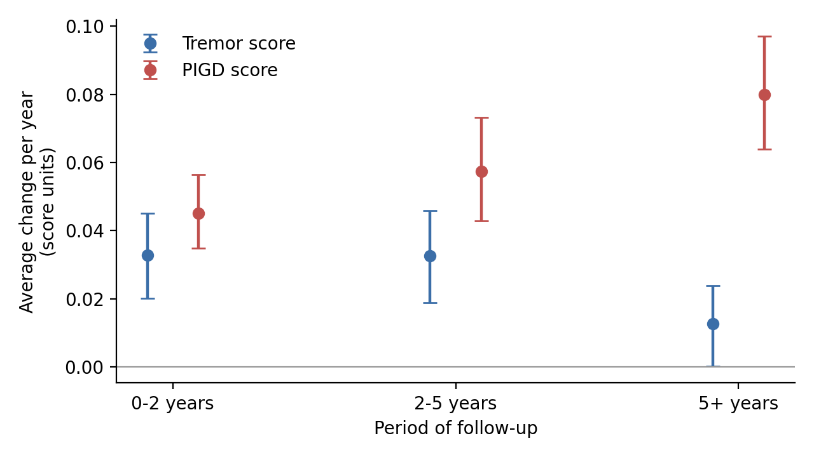

**Figure 33.** Time-varying linear-spline mixed model: period-specific slopes of the tremor and PIGD subscores. *(Source: `report/figures/period_slopes.png`.)*

**Table 51.** Time-varying model: contrasts between period slopes (Wald).

| outcome | contrast | difference | std_error | Wald 95% CI | excludes zero |
|---|---|---|---|---|---|
| tremor | 2-5y - 0-2y | -0.0002 | 0.0109 | [-0.0215, 0.0211] | False |
| tremor | 5y+ - 0-2y | -0.0201 | 0.0072 | [-0.0343, -0.0059] | True |
| tremor | 5y+ - 2-5y | -0.0199 | 0.0083 | [-0.0361, -0.0037] | True |
| pigd | 2-5y - 0-2y | 0.0124 | 0.0117 | [-0.0107, 0.0354] | False |
| pigd | 5y+ - 0-2y | 0.0349 | 0.0078 | [0.0196, 0.0502] | True |
| pigd | 5y+ - 2-5y | 0.0226 | 0.0089 | [0.0052, 0.0400] | True |

*Machine-readable copy: `tables/table051_time_varying_slope_contrasts.csv`. Source: `outputs/time_varying/slope_contrasts.csv`.*

**Table 52.** Time-varying model: within-patient change in rate between periods, restricted to patients observed in both periods.

| outcome | from_period | to_period | n_patients | delta_rate | 95% CI | excludes zero |
|---|---|---|---|---|---|---|
| pigd | 0-2y | 2-5y | 533 | 0.0251 | [0.0036, 0.0466] | True |
| tremor | 0-2y | 2-5y | 533 | -0.0059 | [-0.0309, 0.0202] | False |
| pigd | 0-2y | 5y+ | 226 | 0.0727 | [0.0425, 0.1014] | True |
| tremor | 0-2y | 5y+ | 226 | -0.0396 | [-0.0731, -0.0079] | True |
| pigd | 2-5y | 5y+ | 242 | 0.079 | [0.0500, 0.1108] | True |
| tremor | 2-5y | 5y+ | 242 | -0.0353 | [-0.0666, -0.0037] | True |

*Machine-readable copy: `tables/table052_time_varying_within_patient.csv`. Source: `outputs/time_varying/within_patient_rate_change.csv`.*

The PIGD slope rises across periods (0.045, 0.057 and 0.080 per year in years 0 to 2, 2 to 5 and after 5) and the tremor slope falls (0.033, 0.033 and 0.013 per year); the contrasts between the last and the first period are +0.035 (+0.020 to +0.050) for PIGD and −0.020 (−0.034 to −0.006) for tremor under Wald intervals, and within the 226 patients observed in both periods the PIGD rate rises by +0.073 (+0.043 to +0.101) and the tremor rate falls by −0.040 (−0.073 to −0.008). On held-out prediction the spline improves PIGD MAE over the constant-rate model by −0.0034 (−0.0044 to −0.0023) and tremor MAE not at all, and both lose to persistence; the derived label is 0.709 under either.

**Table 53.** Stage 5 temporal audit: supremum likelihood-ratio test of a single slope change against a linear trend, with the null distribution from 200 parametric-bootstrap cohorts under random-intercept (RI) and random-slope (RS) nulls.

| null | real_sup_lr | real_argmax_knot | n_null | null_median | null_q95 | p_value |
|---|---|---|---|---|---|---|
| RI | 39.1287 | 4.75 | 200 | 3.205 | 7.6772 | 0.005 |
| RS | 39.1287 | 4.75 | 200 | 5.982 | 20.3905 | 0.005 |

*Machine-readable copy: `tables/table053_stage5_sup_lr.csv`. Source: `experiments/20261014T100107Z_s5_temporal_audit/knots/sup_lr_test.csv`.*

**Table 54.** Stage 5: period slopes of the primary random-intercept spline model with Wald and patient-bootstrap (1,000 replicates) intervals.

| outcome | period | slope | Wald 95% CI | patient-bootstrap 95% CI | SE ratio bootstrap/Wald |
|---|---|---|---|---|---|
| pigd | 0-2y | 0.045 | [0.0309, 0.0592] | [0.0348, 0.0564] | 0.78 |
| pigd | 2-5y | 0.0574 | [0.0453, 0.0695] | [0.0429, 0.0733] | 1.24 |
| pigd | 5-10y | 0.08 | [0.0724, 0.0875] | [0.0640, 0.0971] | 2.23 |
| tremor | 0-2y | 0.0327 | [0.0196, 0.0458] | [0.0201, 0.0450] | 0.95 |
| tremor | 2-5y | 0.0325 | [0.0212, 0.0439] | [0.0189, 0.0458] | 1.24 |
| tremor | 5-10y | 0.0126 | [0.0056, 0.0197] | [0.0001, 0.0238] | 1.72 |

*Machine-readable copy: `tables/table054_stage5_boot_vs_wald.csv`. Source: `experiments/20261014T100107Z_s5_temporal_audit/bootstrap/period_slopes_boot_vs_wald.csv`.*

**Table 55.** Stage 5: logistic model of loss to follow-up after a visit on the subscores at that visit and time from baseline.

| term | log_odds | bootstrap 95% CI |
|---|---|---|
| intercept | -2.0123 | [-2.1506, -1.8642] |
| years_from_baseline | 0.1386 | [0.1221, 0.1576] |
| tremor_score | 0.0024 | [-0.1535, 0.1521] |
| pigd_score | 0.5206 | [0.3598, 0.7137] |

*Machine-readable copy: `tables/table055_stage5_attrition.csv`. Source: `experiments/20261014T100107Z_s5_temporal_audit/attrition/loss_of_followup_logit.csv`.*

The Stage 5 audit confirms a departure from linearity (supremum likelihood ratio 39.1 against a bootstrap 95th percentile of 7.7 under the random-intercept null and 20.4 under the random-slope null, *p* = 0.005 under both) but finds no identifiable knot: the best single knot is at 4.75 years and its patient-bootstrap distribution over 200 refits has a median of 5.0 years, an interquartile range of 4.25 to 9.25 years and a 2.5th to 97.5th percentile range of 2.5 to 10 years, a quadratic mean is preferred by AIC (37.8 units better than linear), and the cross-validated gains of every non-linear basis over the linear one are confined to PIGD and are tiny (absolute error −0.003, CRPS −0.001). The Wald intervals of the late-period slopes are too narrow by a factor of 1.7 (tremor) and 2.2 (PIGD) against the patient bootstrap. Attrition is informative: the log-odds of loss to follow-up after a visit rise by +0.52 (+0.36 to +0.71) per point of PIGD score and by +0.14 per year. Completers followed at least six years (247 patients) show the same pattern (PIGD late minus early +0.044, +0.017 to +0.072; tremor −0.046, −0.073 to −0.020). On a disease-duration axis, adding duration to the model improves AIC and the slope changes at five years no longer exclude zero (tremor −0.054, −0.115 to +0.018; PIGD −0.022, −0.098 to +0.064); the treated share rises from 0.10 at baseline to 0.95 by year five.

**Interpretation.** The PIGD score accelerates and the tremor score decelerates over follow-up, within patients as well as between them, but the acceleration has no identifiable timing, is confounded with disease duration and treatment, is estimated with Wald intervals that are too narrow, and is worth almost nothing for prediction. It is a population description, not a predictive feature.

**Limitations.** Knots were fixed in advance; the attrition model is descriptive; the duration axis analysis is in-sample.

**Contribution.** A documented population finding with its identifiability and interval limitations, and the reason no time-varying structure enters the prediction models.

### 9.11 The harmonised comparison across families (E24)

**Question.** When every model is scored on the same 3,361 transitions with the same decision rule, how do the families compare, and where does each model's margin over persistence come from?

**Setup and cohort.** The saved leave-one-patient-out predictions of fourteen specifications from five families (Section 6.14), re-scored as the argmax of a three-label probability vector; subscore models propagated through the classification rule by 10,000 common-random-number Monte Carlo draws (half-draw check: maximum accuracy difference 0.0015); paired contrasts against recorded-label persistence with 2,000 patient-bootstrap resamples; and a decomposition of each model's gain by the label recorded at the prediction point.

**Results.** **Table 57.** Harmonised three-class comparison (E-8): fourteen specifications re-scored on the same 3,361 transitions with one decision rule (argmax of a three-label probability vector). Subscore models are propagated through the unmodified classification rule by Monte Carlo (10,000 draws, common random numbers). The log loss of recorded-label persistence is clipped.

| model | family | accuracy | brier_multiclass | log_loss | recall_TD | n_predicted_TD | recall_Indeterminate | n_predicted_Indeterminate | recall_PIGD | n_predicted_PIGD | macro_f1 |
|---|---|---|---|---|---|---|---|---|---|---|---|
| Subscore GP, independent | subscore GP | 0.7575 | 0.3602 | 0.6537 | 0.9069 | 2416.0 | 0.0 | 0.0 | 0.6871 | 945.0 | 0.5074 |
| Subscore GP, joint | subscore GP | 0.7563 | 0.3594 | 0.6518 | 0.9021 | 2398.0 | 0.0 | 0.0 | 0.6937 | 963.0 | 0.507 |
| CT-HMM, 3 latent states | latent-state HMM | 0.7539 | 0.3688 | 0.6726 | 0.9102 | 2450.0 | 0.0 | 1.0 | 0.6663 | 910.0 | 0.5037 |
| CT-HMM, 5 latent states | latent-state HMM | 0.7513 | 0.37 | 0.6746 | 0.9106 | 2467.0 | 0.0 | 0.0 | 0.6554 | 894.0 | 0.5011 |
| Time-varying LMM, constant | time-varying LMM | 0.7495 | 0.3826 | 0.6919 | 0.9149 | 2481.0 | 0.0 | 0.0 | 0.6389 | 880.0 | 0.4977 |
| Joint subscore LMM | subscore LMM | 0.7495 | 0.3826 | 0.6919 | 0.9149 | 2481.0 | 0.0 | 0.0 | 0.6389 | 880.0 | 0.4977 |
| Markov chain, discrete | observed-label chain | 0.7474 | 0.3896 | 0.7066 | 0.9333 | 2595.0 | 0.0 | 0.0 | 0.5886 | 766.0 | 0.4929 |
| Time-varying LMM, spline | time-varying LMM | 0.7462 | 0.3794 | 0.686 | 0.9206 | 2529.0 | 0.0 | 0.0 | 0.6138 | 832.0 | 0.4937 |
| CTMC, interval-aware | observed-label chain | 0.7453 | 0.3925 | 0.7105 | 0.9338 | 2603.0 | 0.0 | 4.0 | 0.5799 | 754.0 | 0.4909 |
| Persistence (subscore LOCF) | baseline | 0.7453 | 0.3723 | 0.7556 | 0.8969 | 2412.0 | 0.0 | 1.0 | 0.6652 | 948.0 | 0.497 |
| Patient mean subscore | baseline | 0.7423 | 0.3802 | 0.7594 | 0.9267 | 2574.0 | 0.003 | 3.0 | 0.5842 | 784.0 | 0.4903 |
| Persistence (recorded label) | baseline | 0.7227 | 0.5546 | 7.662 | 0.8638 | 2261.0 | 0.1928 | 334.0 | 0.5886 | 766.0 | 0.5559 |
| Marginal null | baseline | 0.6293 | 0.5211 | 0.8756 | 1.0 | 3361.0 | 0.0 | 0.0 | 0.0 | 0.0 | 0.2575 |
| Population mean subscore | baseline | 0.6254 | 0.5174 | 0.8716 | 0.905 | 2926.0 | 0.0 | 0.0 | 0.2057 | 435.0 | 0.346 |

*Machine-readable copy: `tables/table057_harmonised_three_class_metrics.csv`. Source: `experiments/20261103T202632Z_e8_harmonised_family_comparison/harmonised_metrics.csv`.*

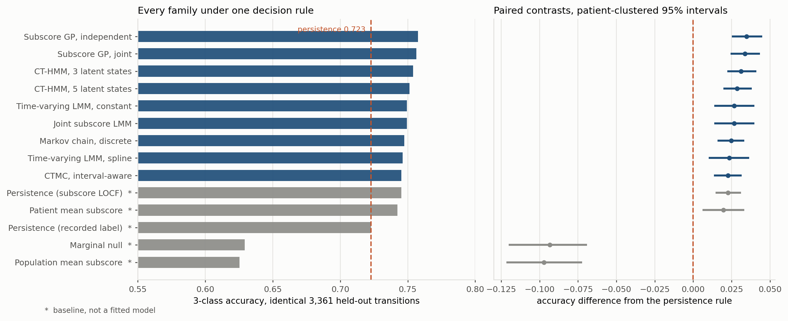

**Figure 34.** Harmonised three-class comparison across model families on the same 3,361 transitions. *(Source: `experiments/20261103T202632Z_e8_harmonised_family_comparison/fig1_harmonised_family_comparison.png`.)*

**Table 58.** Harmonised comparison: paired accuracy difference of each specification against recorded-label persistence on identical cases.

| model | family | delta_accuracy | patient-bootstrap 95% CI | excludes zero | n_better | n_worse |
|---|---|---|---|---|---|---|
| Subscore GP, independent | subscore GP | 0.0348 | [0.0252, 0.0450] | True | 209 | 92 |
| Subscore GP, joint | subscore GP | 0.0336 | [0.0243, 0.0436] | True | 201 | 88 |
| CT-HMM, 3 latent states | latent-state HMM | 0.0312 | [0.0223, 0.0411] | True | 192 | 87 |
| CT-HMM, 5 latent states | latent-state HMM | 0.0286 | [0.0196, 0.0381] | True | 175 | 79 |
| Joint subscore LMM | subscore LMM | 0.0268 | [0.0136, 0.0398] | True | 284 | 194 |
| Time-varying LMM, constant | time-varying LMM | 0.0268 | [0.0136, 0.0398] | True | 284 | 194 |
| Markov chain, discrete | observed-label chain | 0.0247 | [0.0159, 0.0334] | True | 147 | 64 |
| Time-varying LMM, spline | time-varying LMM | 0.0235 | [0.0102, 0.0364] | True | 285 | 206 |
| CTMC, interval-aware | observed-label chain | 0.0226 | [0.0135, 0.0316] | True | 148 | 72 |
| Persistence (subscore LOCF) | baseline | 0.0226 | [0.0146, 0.0311] | True | 140 | 64 |
| Patient mean subscore | baseline | 0.0196 | [0.0061, 0.0332] | True | 245 | 179 |
| Marginal null | baseline | -0.0934 | [-0.1202, -0.0691] | True | 288 | 602 |
| Population mean subscore | baseline | -0.0973 | [-0.1215, -0.0723] | True | 323 | 650 |

*Machine-readable copy: `tables/table058_harmonised_contrasts_vs_persistence.csv`. Source: `experiments/20261103T202632Z_e8_harmonised_family_comparison/paired_contrasts.csv`.*

Every fitted specification lies between 0.745 and 0.758: the independent subscore GP 0.758, the joint subscore GP 0.756, the three-state CT-HMM 0.754, the five-state CT-HMM 0.751, the constant-rate and spline LMMs 0.749 and 0.746, the joint LMM 0.749, the discrete chain 0.747 and the continuous chain 0.745. Subscore LOCF persistence reaches 0.745 and the patient-mean subscore 0.742; recorded-label persistence 0.723, the marginal null 0.629 and the population mean subscore 0.625. The paired margins over recorded-label persistence are +0.035 (+0.025 to +0.045) for the independent GP, +0.034 for the joint GP, +0.031 (+0.022 to +0.041) for the CT-HMM, +0.029 for the five-state model, +0.027 (+0.014 to +0.040) for the two constant-rate LMMs, +0.025 for the discrete chain, +0.024 (+0.010 to +0.036) for the spline LMM and +0.023 (+0.014 to +0.032) for the continuous chain; every one excludes zero and the whole range spans 1.2 points. On the proper scores the GPs lead (Brier 0.360, log loss 0.654) and the CT-HMM follows (0.369, 0.673). Not one fitted model issues an Indeterminate prediction under the argmax rule (recall 0.000); recorded-label persistence issues 334 and recalls 0.193 of them, which is why its macro-F1 (0.556) is the highest in the table.

**Table 59.** Harmonised comparison: each model's accuracy and gain over recorded-label persistence by the label recorded at the prediction point, and the share of predictions identical to persistence.

| model | current_label | n | share_of_cases | model_accuracy | baseline_accuracy | cases_gained | identical_predictions | share_of_total_gain |
|---|---|---|---|---|---|---|---|---|
| CT-HMM, 3 latent states | TD | 2261 | 0.6727 | 0.8107 | 0.808 | 6 | 0.9836 | 0.0571 |
| CT-HMM, 3 latent states | Indeterminate | 334 | 0.0994 | 0.488 | 0.1916 | 99 | 0.003 | 0.9429 |
| CT-HMM, 3 latent states | PIGD | 766 | 0.2279 | 0.7023 | 0.7023 | 0 | 0.9687 | 0.0 |
| Subscore GP, independent | TD | 2261 | 0.6727 | 0.812 | 0.808 | 9 | 0.9717 | 0.0769 |
| Subscore GP, independent | Indeterminate | 334 | 0.0994 | 0.491 | 0.1916 | 100 | 0.0 | 0.8547 |
| Subscore GP, independent | PIGD | 766 | 0.2279 | 0.7128 | 0.7023 | 8 | 0.9739 | 0.0684 |
| Markov chain, discrete | TD | 2261 | 0.6727 | 0.808 | 0.808 | 0 | 1.0 | 0.0 |
| Markov chain, discrete | Indeterminate | 334 | 0.0994 | 0.4401 | 0.1916 | 83 | 0.0 | 1.0 |
| Markov chain, discrete | PIGD | 766 | 0.2279 | 0.7023 | 0.7023 | 0 | 1.0 | 0.0 |

*Machine-readable copy: `tables/table059_harmonised_margin_decomposition.csv`. Source: `experiments/20261103T202632Z_e8_harmonised_family_comparison/margin_decomposition.csv`.*

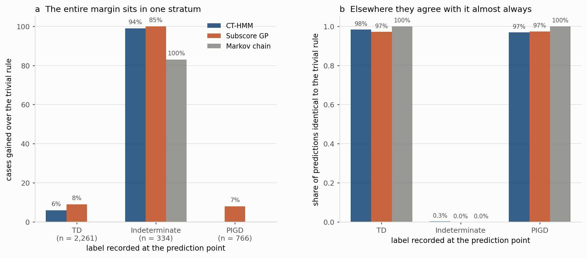

**Figure 35.** Where each model's margin over recorded-label persistence comes from, by the label recorded at the prediction point. *(Source: `manuscript/npj/fig4_margin_decomposition.png`.)*

The decomposition shows where the margins come from. Of the CT-HMM's 105 net cases gained over persistence, 99 (94.3%) come from the 334 transitions that start from an Indeterminate label, where persistence is right 19.2% of the time and the CT-HMM 48.8%; on the 2,261 transitions from TD the two models make identical predictions 98.4% of the time and the CT-HMM gains 6 cases, and on the 766 transitions from PIGD they are identical 96.9% of the time and the gain is zero. The independent GP gains 9, 100 and 8 cases in the three strata (85.5% from Indeterminate), and the discrete chain 0, 83 and 0 (100%).

**Interpretation.** This is the paper's central result. Five families of models, spanning six to several dozen parameters, categorical and continuous observations, discrete and continuous time, memoryless and latent-state dynamics, all reproduce the next recorded label at between 0.745 and 0.758, and all of them beat recorded-label persistence by the same mechanism: at an Indeterminate visit they decline to predict Indeterminate and predict the extreme label the history favours instead. On the other 90% of transitions they are persistence with small corrections. The accuracy ceiling is not a property of any model; it is set by how often the next label contradicts the history, and that is a property of the label.

**Limitations.** Re-scoring saved predictions cannot reproduce the original runs' decision rules bit for bit; the Monte Carlo propagation is a fresh draw. The five-state model's predictions are included although 59% come from non-converged fits.

**Contribution.** The harmonised evidence for the title.

### 9.12 Next-visit TD-against-PIGD prediction: latent state and elapsed time (E25)

**Question.** Restricting the target to the two extreme labels, which of a latent state and an interval-aware observed process matters for predicting the next label, and how do generative and discriminative models compare?

**Setup and cohort.** The 3,029 eligible transitions of 899 patients (the 332 Indeterminate outcomes excluded from scoring and reported separately), leave-one-patient-out, seven models on identical cases (Section 6.10), pre-specified paired contrasts with 2,000 patient-bootstrap resamples. Every fold of every model converged (934 of 934; worst projected gradient 0.025 for the CT-HMM).

**Results.** **Table 60.** Next-visit TD-against-PIGD prediction on the 3,029 eligible transitions of 899 patients (332 Indeterminate-outcome transitions excluded from scoring), leave-one-patient-out. Observed PIGD rate 0.3017.

| model | n_patients | n_cases_total | n_eligible | n_correct | accuracy | patient-bootstrap 95% CI | mean_per_patient_accuracy | brier_two_class | log_loss | log_loss_clipped | mean_P_PIGD |
|---|---|---|---|---|---|---|---|---|---|---|---|
| CT-HMM (latent, interval-aware) | 899 | 3361 | 3029 | 2535 | 0.8369 | [0.8204, 0.8541] | 0.8335 | 0.1214 | 0.3961 | False | 0.3047 |
| Direct logistic (history + interval) | 899 | 3361 | 3029 | 2532 | 0.8359 | [0.8195, 0.8529] | 0.8303 | 0.1225 | 0.4003 | False | 0.3018 |
| Persistence (last non-Indeterminate) | 899 | 3361 | 3029 | 2525 | 0.8336 | [0.8173, 0.8510] | 0.8307 | 0.1598 | 4.1929 | True | 0.2496 |
| Markov (observed, discrete) | 899 | 3361 | 3029 | 2512 | 0.8293 | [0.8129, 0.8468] | 0.8274 | 0.1328 | 0.4314 | False | 0.3018 |
| CTMC (observed, interval-aware) | 899 | 3361 | 3029 | 2507 | 0.8277 | [0.8114, 0.8451] | 0.8243 | 0.1343 | 0.4346 | False | 0.3038 |
| Direct logistic (history only) | 899 | 3361 | 3029 | 2482 | 0.8194 | [0.8019, 0.8372] | 0.8027 | 0.1244 | 0.4055 | False | 0.3019 |
| Marginal (two-class prior) | 899 | 3361 | 3029 | 2115 | 0.6983 | [0.6703, 0.7278] | 0.7074 | 0.2111 | 0.6134 | False | 0.3018 |

*Machine-readable copy: `tables/table060_next_visit_two_class_models.csv`. Source: `experiments/20261020T104756Z_next_visit_td_pigd_prediction/model_comparison.csv`.*

**Table 61.** Next-visit two-class prediction: pre-specified paired contrasts (model a minus model b) on identical cases.

| contrast | model_a | model_b | accuracy_a | accuracy_b | accuracy_delta | patient-bootstrap 95% CI | a right, b wrong | b right, a wrong | Brier delta |
|---|---|---|---|---|---|---|---|---|---|
| latent state, holding the observed process interval-aware | CT-HMM (latent, interval-aware) | CTMC (observed, interval-aware) | 0.8369 | 0.8277 | 0.0092 | [0.0003, 0.0179] | 98 | 70 | -0.0129 |
| elapsed time, holding the observed-label chain fixed | CTMC (observed, interval-aware) | Markov (observed, discrete) | 0.8277 | 0.8293 | -0.0017 | [-0.0039, 0.0003] | 3 | 8 | 0.0015 |
| elapsed time, in the discriminative family | Direct logistic (history + interval) | Direct logistic (history only) | 0.8359 | 0.8194 | 0.0165 | [0.0112, 0.0217] | 61 | 11 | -0.0019 |
| latent generative against the discriminative model | CT-HMM (latent, interval-aware) | Direct logistic (history + interval) | 0.8369 | 0.8359 | 0.001 | [-0.0054, 0.0075] | 53 | 50 | -0.0011 |
| any fitted model over the persistence rule | CT-HMM (latent, interval-aware) | Persistence (last non-Indeterminate) | 0.8369 | 0.8336 | 0.0033 | [-0.0037, 0.0100] | 59 | 49 | -0.0384 |
| any fitted model over the null | CT-HMM (latent, interval-aware) | Marginal (two-class prior) | 0.8369 | 0.6983 | 0.1387 | [0.1107, 0.1665] | 610 | 190 | -0.0897 |

*Machine-readable copy: `tables/table061_next_visit_two_class_contrasts.csv`. Source: `experiments/20261020T104756Z_next_visit_td_pigd_prediction/contrasts.csv`.*

The CT-HMM reaches 0.837 (patient-bootstrap 95% CI 0.820 to 0.854; 2,535 of 3,029 correct), two-class Brier 0.121 and log loss 0.396; the direct logistic model with the interval 0.836, persistence of the last non-Indeterminate label 0.834 (Brier 0.160; its log loss is undefined and is 4.19 when clipped), the discrete chain 0.829, the continuous chain 0.828, the direct model without the interval 0.819 and the two-class prior 0.698. The pre-specified contrasts are: latent state, holding the observed process interval-aware (CT-HMM minus CTMC), +0.009 (+0.000 to +0.018), with the CT-HMM right and the CTMC wrong on 98 cases against 70 the other way; elapsed time in the observed-label chain (CTMC minus discrete chain), −0.002 (−0.004 to +0.000); elapsed time in the discriminative family, +0.017 (+0.011 to +0.022); CT-HMM minus direct logistic +0.001 (−0.005 to +0.008); CT-HMM minus persistence +0.003 (−0.004 to +0.010); and CT-HMM minus the prior +0.139 (+0.111 to +0.167).

**Table 62.** Next-visit two-class accuracy by current label, by elapsed interval and by number of prior visits.

| stratum | model | level | n | accuracy | brier_two_class |
|---|---|---|---|---|---|
| current label | CT-HMM (latent, interval-aware) | TD | 2080 | 0.8812 |  |
| current label | CT-HMM (latent, interval-aware) | Indeterminate | 270 | 0.6074 |  |
| current label | CT-HMM (latent, interval-aware) | PIGD | 679 | 0.7923 |  |
| current label | CTMC (observed, interval-aware) | TD | 2080 | 0.8784 |  |
| current label | CTMC (observed, interval-aware) | Indeterminate | 270 | 0.5444 |  |
| current label | CTMC (observed, interval-aware) | PIGD | 679 | 0.785 |  |
| current label | Direct logistic (history + interval) | TD | 2080 | 0.8817 |  |
| current label | Direct logistic (history + interval) | Indeterminate | 270 | 0.5889 |  |
| current label | Direct logistic (history + interval) | PIGD | 679 | 0.7938 |  |
| current label | Markov (observed, discrete) | TD | 2080 | 0.8784 |  |
| current label | Markov (observed, discrete) | Indeterminate | 270 | 0.5444 |  |
| current label | Markov (observed, discrete) | PIGD | 679 | 0.7923 |  |
| current label | Persistence (last non-Indeterminate) | TD | 2080 | 0.8784 |  |
| current label | Persistence (last non-Indeterminate) | Indeterminate | 270 | 0.5926 |  |
| current label | Persistence (last non-Indeterminate) | PIGD | 679 | 0.7923 |  |
| interval | CT-HMM (latent, interval-aware) | <= 1.5y | 2597 | 0.8417 | 0.1174 |
| interval | CT-HMM (latent, interval-aware) | > 1.5y | 432 | 0.8079 | 0.1458 |
| interval | CTMC (observed, interval-aware) | <= 1.5y | 2597 | 0.841 | 0.1272 |
| interval | CTMC (observed, interval-aware) | > 1.5y | 432 | 0.7477 | 0.1771 |
| interval | Direct logistic (history + interval) | <= 1.5y | 2597 | 0.8398 | 0.1187 |
| interval | Direct logistic (history + interval) | > 1.5y | 432 | 0.8125 | 0.1455 |
| interval | Markov (observed, discrete) | <= 1.5y | 2597 | 0.841 | 0.1267 |
| interval | Markov (observed, discrete) | > 1.5y | 432 | 0.7593 | 0.1691 |
| interval | Persistence (last non-Indeterminate) | <= 1.5y | 2597 | 0.8417 | 0.1524 |
| interval | Persistence (last non-Indeterminate) | > 1.5y | 432 | 0.7847 | 0.2043 |
| prior visits | CT-HMM (latent, interval-aware) | 1 | 837 | 0.8339 |  |
| prior visits | CT-HMM (latent, interval-aware) | 2 | 697 | 0.8637 |  |
| prior visits | CT-HMM (latent, interval-aware) | 3 | 456 | 0.8268 |  |
| prior visits | CT-HMM (latent, interval-aware) | 4 | 305 | 0.8098 |  |
| prior visits | CT-HMM (latent, interval-aware) | 5+ | 734 | 0.8324 |  |
| prior visits | CTMC (observed, interval-aware) | 1 | 837 | 0.8315 |  |
| prior visits | CTMC (observed, interval-aware) | 2 | 697 | 0.8637 |  |
| prior visits | CTMC (observed, interval-aware) | 3 | 456 | 0.8224 |  |
| prior visits | CTMC (observed, interval-aware) | 4 | 305 | 0.8033 |  |
| prior visits | CTMC (observed, interval-aware) | 5+ | 734 | 0.8025 |  |
| prior visits | Direct logistic (history + interval) | 1 | 837 | 0.8303 |  |
| prior visits | Direct logistic (history + interval) | 2 | 697 | 0.8637 |  |
| prior visits | Direct logistic (history + interval) | 3 | 456 | 0.8114 |  |
| prior visits | Direct logistic (history + interval) | 4 | 305 | 0.8131 |  |
| prior visits | Direct logistic (history + interval) | 5+ | 734 | 0.8406 |  |
| prior visits | Markov (observed, discrete) | 1 | 837 | 0.8315 |  |
| prior visits | Markov (observed, discrete) | 2 | 697 | 0.8637 |  |
| prior visits | Markov (observed, discrete) | 3 | 456 | 0.8268 |  |
| prior visits | Markov (observed, discrete) | 4 | 305 | 0.8033 |  |
| prior visits | Markov (observed, discrete) | 5+ | 734 | 0.8065 |  |
| prior visits | Persistence (last non-Indeterminate) | 1 | 837 | 0.8315 |  |
| prior visits | Persistence (last non-Indeterminate) | 2 | 697 | 0.8594 |  |
| prior visits | Persistence (last non-Indeterminate) | 3 | 456 | 0.8289 |  |
| prior visits | Persistence (last non-Indeterminate) | 4 | 305 | 0.8033 |  |
| prior visits | Persistence (last non-Indeterminate) | 5+ | 734 | 0.827 |  |

*Machine-readable copy: `tables/table062_next_visit_two_class_strata.csv`. Source: `experiments/20261020T104756Z_next_visit_td_pigd_prediction/accuracy_by_current_label.csv; experiments/20261020T104756Z_next_visit_td_pigd_prediction/accuracy_by_interval.csv; experiments/20261020T104756Z_next_visit_td_pigd_prediction/accuracy_by_history_length.csv`.*

**Table 63.** The 332 transitions whose next recorded label was Indeterminate: never scored; what each model would have said.

| model | n | share_of_all_cases | mean_P_PIGD | mean_p_Indeterminate_raw | would_have_said_PIGD | would_have_said_TD | n_undefined |
|---|---|---|---|---|---|---|---|
| CT-HMM (latent, interval-aware) | 332 | 0.0988 | 0.3714 | 0.1235 | 111 | 221 | 0 |
| CTMC (observed, interval-aware) | 332 | 0.0988 | 0.365 | 0.1079 | 86 | 246 | 0 |
| Direct logistic (history + interval) | 332 | 0.0988 | 0.3739 | 0.0 | 111 | 221 | 0 |
| Direct logistic (history only) | 332 | 0.0988 | 0.3725 | 0.0 | 121 | 211 | 0 |
| Marginal (two-class prior) | 332 | 0.0988 | 0.3017 | 0.0 | 0 | 332 | 0 |
| Markov (observed, discrete) | 332 | 0.0988 | 0.3616 | 0.1095 | 87 | 245 | 0 |
| Persistence (last non-Indeterminate) | 332 | 0.0988 | 0.3197 | 0.0 | 98 | 234 | 0 |

*Machine-readable copy: `tables/table063_next_visit_indeterminate_targets.csv`. Source: `experiments/20261020T104756Z_next_visit_td_pigd_prediction/indeterminate_report.csv`.*

**Table 64.** CT-HMM next-visit two-class prediction: per-class metrics. Confusion matrix (rows predicted, columns actual): predicted TD: TD 1925, PIGD 304; predicted PIGD: TD 190, PIGD 610.

| state | support | n_predicted | precision | recall | f1 |
|---|---|---|---|---|---|
| TD | 2115 | 2229 | 0.8636 | 0.9102 | 0.8863 |
| PIGD | 914 | 800 | 0.7625 | 0.6674 | 0.7118 |

*Machine-readable copy: `tables/table064_next_visit_cthmm_per_class.csv`. Source: `experiments/20261020T104756Z_next_visit_td_pigd_prediction/per_class_ct_hmm_latent_interval_aware.csv; experiments/20261020T104756Z_next_visit_td_pigd_prediction/confusion_ct_hmm_latent_interval_aware.csv`.*

The CT-HMM's accuracy is 0.881 when the current label is TD, 0.607 when it is Indeterminate (the chains reach 0.544 there) and 0.792 when it is PIGD; 0.842 at intervals up to 1.5 years and 0.808 beyond (the CTMC falls to 0.748 beyond 1.5 years); and 0.834, 0.864 and 0.827 with one, two and three prior visits. Its PIGD recall is 0.667 at precision 0.763 (confusion: 1,925 TD and 610 PIGD correct, 304 PIGD called TD, 190 TD called PIGD), and its calibration gap is 0.0065. On the 332 Indeterminate outcomes the CT-HMM's mean conditional probability of PIGD was 0.371 and its mean raw Indeterminate mass 0.124; it would have called 111 of them PIGD and 221 TD.

**Interpretation.** Changing the task from three classes to two raises accuracy from 0.754 to 0.837 because the hardest 10% of outcomes are set aside, not because any model improved. On the two-class task the latent layer is worth under one point, elapsed time is worth nothing in the observed chain and 1.7 points in the discriminative model, and a ridge-penalised logistic regression on ten summary features of the label history matches the generative model exactly. The models separate only at Indeterminate visits and at long intervals, and even there by a few points.

**Limitations.** The 0.837 describes 90.1% of prediction opportunities; the 9.9% of Indeterminate outcomes are not scored. The interval is an input, so the model is told when the next examination happens.

**Contribution.** The two-class reference, its contrasts, and the discriminative equivalence that shows the generative structure is not what the accuracy depends on.

### 9.13 A discrete latent clinical state over ten measurements (E26)

**Question.** Does representing the patient by a latent clinical state inferred from ten clinical measurements predict the next label better than the subtype history alone?

**Setup and cohort.** State count selected on a 280-patient development set by held-out next-visit log-density; six states by the one-standard-error rule and eight by the maximum (and by BIC); leave-one-patient-out on the 654 evaluation patients, 2,091 scored two-class cases (627 patients with cases); comparators are the subtype-history CT-HMM, persistence, and direct logistic models on the same ten measurements and on the tremor and PIGD scores only.

**Results.** **Table 65.** Latent clinical-state CT-HMM (Gaussian emission over ten standardised measurements): state-count selection by held-out next-visit log-density on the 280-patient development set (four cells). max_start_spread is the spread of the training log-likelihood across random starts.

| n_states | n_cells | mean_heldout_loglik | sd_heldout_loglik | mean_heldout_loglik_per_feature | mean_train_bic | mean_n_iter | all_converged | max_start_spread | n_params | se_heldout_loglik |
|---|---|---|---|---|---|---|---|---|---|---|
| 2 | 4 | -12.6675 | 0.4284 | -1.2682 | 24838.2291 | 7.25 | True | 0.1084 | 43 | 0.2142 |
| 3 | 4 | -12.2518 | 0.5789 | -1.2266 | 23840.4796 | 18.25 | True | 7.8489 | 68 | 0.2894 |
| 4 | 4 | -11.4553 | 0.9625 | -1.1469 | 21581.8577 | 55.25 | True | 1294.6147 | 95 | 0.4813 |
| 5 | 4 | -11.1784 | 0.6178 | -1.1191 | 20729.1532 | 60.5 | True | 1391.7977 | 124 | 0.3089 |
| 6 | 4 | -10.9879 | 0.4281 | -1.1001 | 20327.1591 | 39.0 | True | 1419.4146 | 155 | 0.214 |
| 8 | 4 | -10.7236 | 0.5718 | -1.0736 | 20204.2544 | 52.25 | True | 1259.508 | 223 | 0.2859 |

*Machine-readable copy: `tables/table065_clinical_state_count_selection.csv`. Source: `experiments/20261020T142040Z_clinical_state_selection/state_count_summary.csv`.*

**Table 66.** Latent clinical-state CT-HMM against the subtype-history CT-HMM and persistence on the 654-patient evaluation set (leave-one-patient-out; 2,091 scored two-class cases, 627 patients with cases), for six and eight states.

| states | model | n_patients (or n_paired) | n_scored | accuracy (or delta) | patient-bootstrap 95% CI | Brier (or delta) | log loss | accuracy \| current TD | accuracy \| current Indeterminate | accuracy \| current PIGD |
|---|---|---|---|---|---|---|---|---|---|---|
| K = 6 | Subtype-history CT-HMM (labels only) | 627 | 2091 | 0.8384 | [0.8183, 0.8568] | 0.1211 | 0.3953 | 0.8809 | 0.6136 | 0.787 |
| K = 6 | Persistence (last non-Indeterminate) | 627 | 2091 | 0.835 | [0.8147, 0.8541] | 0.159 | 4.1729 | 0.8788 | 0.608 | 0.7803 |
| K = 6 | Clinical-state CT-HMM (10 measurements) | 627 | 2091 | 0.7255 | [0.6960, 0.7534] | 0.1831 | 0.5493 | 0.8441 | 0.5682 | 0.3969 |
| K = 6 | contrast: clinical-state minus subtype-history CT-HMM | 2089 | 2089 | -0.113 | [-0.1438, -0.0807] | 0.062 |  |  |  |  |
| K = 8 | Subtype-history CT-HMM (labels only) | 627 | 2091 | 0.8384 | [0.8183, 0.8568] | 0.1211 | 0.3953 | 0.8809 | 0.6136 | 0.787 |
| K = 8 | Persistence (last non-Indeterminate) | 627 | 2091 | 0.835 | [0.8147, 0.8541] | 0.159 | 4.1729 | 0.8788 | 0.608 | 0.7803 |
| K = 8 | Clinical-state CT-HMM (10 measurements) | 627 | 2091 | 0.7336 | [0.7062, 0.7607] | 0.1817 | 0.5444 | 0.8421 | 0.5795 | 0.4372 |
| K = 8 | contrast: clinical-state minus subtype-history CT-HMM | 2089 | 2089 | -0.1048 | [-0.1357, -0.0757] | 0.0606 |  |  |  |  |

*Machine-readable copy: `tables/table066_clinical_state_lopo.csv`. Source: `experiments/20261020T142446Z_clinical_state_lopo_k6/model_comparison.csv; experiments/20261020T142446Z_clinical_state_lopo_k6/contrasts.csv; experiments/20261020T142446Z_clinical_state_lopo_k6/accuracy_by_current_label.csv; experiments/20261020T145228Z_clinical_state_lopo_k8/model_comparison.csv; experiments/20261020T145228Z_clinical_state_lopo_k8/contrasts.csv; experiments/20261020T145228Z_clinical_state_lopo_k8/accuracy_by_current_label.csv`.*

**Table 104.** Direct L2-penalised logistic models on the ten standardised clinical measurements, and on the tremor and PIGD scores only, against the subtype-history CT-HMM, persistence and the six-state clinical-state CT-HMM on the identical 2,091 cases of the 654-patient evaluation set. Paired contrasts: same measurements, no latent bottleneck: +0.1052 [+0.0756, +0.1338], Brier -0.0675; the ten measurements against the subtype-history baseline: -0.0077 [-0.0204, +0.0046], Brier -0.0055; only the two label-defining scores, against all ten: -0.0010 [-0.0114, +0.0091], Brier +0.0046; only the two label-defining scores, against the baseline: -0.0086 [-0.0194, +0.0019], Brier -0.0009.

| model | n_patients | n_scored | n_correct | accuracy | patient-bootstrap 95% CI | brier_two_class | log_loss |
|---|---|---|---|---|---|---|---|
| Subtype-history CT-HMM (labels only) | 627 | 2091 | 1753 | 0.8384 | [0.8183, 0.8568] | 0.1211 | 0.3953 |
| Persistence (last non-Indeterminate) | 627 | 2091 | 1746 | 0.835 | [0.8147, 0.8541] | 0.159 | 4.1729 |
| Direct logistic on the 10 clinical measurements | 627 | 2091 | 1737 | 0.8307 | [0.8086, 0.8515] | 0.1156 | 0.3646 |
| Direct logistic on tremor and PIGD scores only | 627 | 2091 | 1735 | 0.8297 | [0.8080, 0.8495] | 0.1202 | 0.3819 |
| Clinical-state CT-HMM (10 measurements) | 627 | 2091 | 1517 | 0.7255 | [0.6960, 0.7534] | 0.1831 | 0.5493 |

*Machine-readable copy: `tables/table104_clinical_measurements_direct_logistic.csv`. Source: `experiments/20261020T145500Z_clinical_features_direct/model_comparison.csv; experiments/20261020T145500Z_clinical_features_direct/contrasts.csv`.*

Held-out log-density improves monotonically from two to eight states, but the fits are multimodal from four states upward (the spread of the training log-likelihood across starts exceeds 1,000 nats). The six-state model reaches 0.726 accuracy (0.696 to 0.753) and the eight-state model 0.734 (0.706 to 0.761) against 0.838 (0.818 to 0.857) for the subtype-history CT-HMM and 0.835 for persistence on identical cases: paired differences of −0.113 (−0.144 to −0.081) and −0.105 (−0.136 to −0.076). The loss is concentrated where the current label is PIGD (accuracy 0.397 and 0.437 against 0.787) and in PIGD recall (0.218 and 0.233 against 0.659). A direct logistic model on the same ten measurements and the interval reaches 0.831 (0.809 to 0.852) with the best Brier (0.116) and log loss (0.365) of any model: +0.105 (+0.076 to +0.134) over the latent model and −0.008 (−0.020 to +0.005) against the subtype-history CT-HMM; restricting it to the tremor and PIGD scores changes nothing (−0.001, −0.011 to +0.009).

**Interpretation.** The discrete bottleneck destroys information: the states order patients by overall severity and discard the within-patient variation (33% of the variance in these measurements, 52% for PIGD) that the prediction needs. The same measurements without the bottleneck match the subtype history exactly, and two of the ten measurements carry everything the other eight add. This experiment is the reason the programme replaced the discrete state by a continuous per-domain profile.

**Limitations.** The evaluation set is a 654-patient subset, so the absolute numbers differ from the 899-patient runs; the EM fits are multimodal.

**Contribution.** A clear negative result for discrete latent clinical states, and the finding that the ten-measurement direct model does not beat the two-measurement one.

### 9.14 The rich clinical profile: predicting the clinical record, deriving the label, and what the representation carries (E27, E28)

**Question.** Does a continuous level-and-rate profile over nine clinical domains, with medication as an input, predict the next visit's clinical record better than assuming no change; does its derived label beat the CT-HMM; and do its coordinates carry information about later clinical outcomes that the label does not?

**Setup and cohort.** The 934 patients, 3,353 predictions and 30,099 domain observations under 5-fold patient cross-validation repeated four times; the full profile, a level-only random-walk variant and a no-medication variant against LOCF and the population mean trajectory on held-out log-density per domain observation; the derived two-class label paired with the subtype-history CT-HMM's LOPO predictions on 3,020 common cases (898 patients; the A-3 run with the committed code); outcome associations on outcomes never used in fitting, with the best coordinate selected on the same data and the optimism stated.

**Results.** **Table 67.** Rich clinical profile (per-domain local linear trend with LEDD as input; 5-fold patient cross-validation repeated four times, 934 patients, 3,353 predictions, 30,099 domain observations): held-out log-density per domain observation and standardised errors.

| model | n_predictions | n_patients | n_domain_observations | loglik_per_domain_observation | patient-bootstrap 95% CI | rmse_standardised | mae_standardised | coverage_95 |
|---|---|---|---|---|---|---|---|---|
| Profile: level + rate + medication | 3353 | 934 | 30099 | -1.0453 | [-1.0706, -1.0215] | 0.7007 | 0.5011 | 0.9406 |
| Profile: level only (random walk) | 3353 | 934 | 30099 | -1.0492 | [-1.0744, -1.0260] | 0.7025 | 0.5012 | 0.9407 |
| Profile: level + rate, no medication | 3353 | 934 | 30099 | -1.0511 | [-1.0765, -1.0270] | 0.7055 | 0.5018 | 0.94 |
| Last observation carried forward | 3353 | 934 | 30099 | -1.1187 | [-1.1434, -1.0946] | 0.7426 | 0.5212 | 0.9444 |
| Population mean trajectory | 3353 | 934 | 30099 | -1.4342 | [-1.4693, -1.4021] | 1.0129 | 0.7749 | 0.9451 |

*Machine-readable copy: `tables/table067_profile_log_density.csv`. Source: `experiments/20261103T220147Z_a2p_outcome_table_fullprec/model_comparison.csv`.*

**Table 68.** Rich clinical profile: paired log-density contrasts (model a minus model b, per prediction).

| contrast | model_a | model_b | n_paired | n_patients | loglik_delta | patient-bootstrap 95% CI | share a better |
|---|---|---|---|---|---|---|---|
| rich profile against assume-no-change | Profile: level + rate + medication | Last observation carried forward | 3353 | 934 | 0.0733 | [0.0657, 0.0813] | 0.7513 |
| rich profile against the population average | Profile: level + rate + medication | Population mean trajectory | 3353 | 934 | 0.3889 | [0.3628, 0.4167] | 0.8655 |
| modelling the rate of change | Profile: level + rate + medication | Profile: level only (random walk) | 3353 | 934 | 0.004 | [0.0019, 0.0062] | 0.6523 |
| medication as an input | Profile: level + rate + medication | Profile: level + rate, no medication | 3353 | 934 | 0.0058 | [0.0041, 0.0075] | 0.6242 |

*Machine-readable copy: `tables/table068_profile_contrasts.csv`. Source: `experiments/20261103T220147Z_a2p_outcome_table_fullprec/contrasts.csv`.*

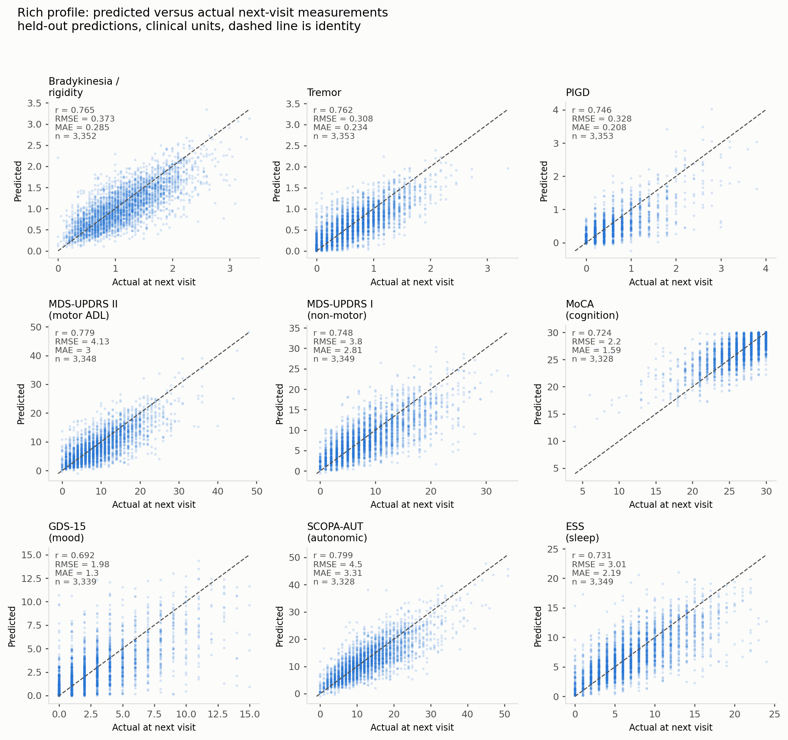

**Figure 68.** Rich clinical profile: predicted against observed next-visit domain values. *(Source: `manuscript/figures/fig06_profile_actual_vs_predicted.png`.)*

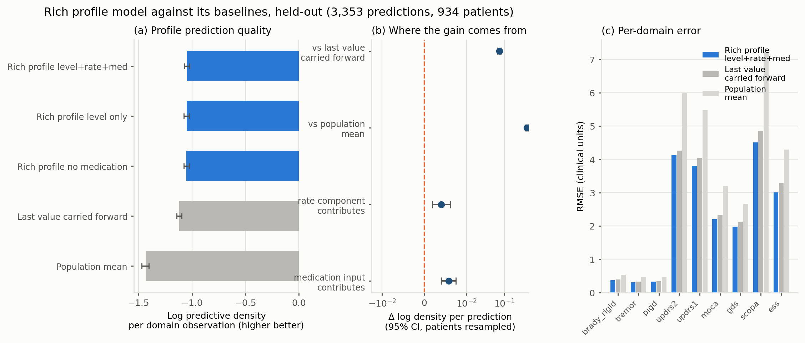

**Figure 69.** Rich clinical profile against its baselines on held-out log-density. *(Source: `manuscript/figures/fig07_profile_vs_baselines.png`.)*

The full profile reaches −1.045 log-density per domain observation (−1.071 to −1.022) against −1.049 for the level-only variant, −1.051 without medication, −1.119 for LOCF and −1.434 for the population trajectory. The paired contrasts are +0.073 (+0.066 to +0.081) over LOCF, better in 75.1% of predictions; +0.389 (+0.363 to +0.417) over the population trajectory; +0.004 (+0.002 to +0.006) for modelling the rate; and +0.006 (+0.004 to +0.008) for medication as an input. Standardised RMSE is 0.70 and 95% coverage 0.941. The fitted medication coefficient is positive in eight of nine domains (Table 72 and the fold coefficients), which is confounding by indication: patients who start levodopa are those who are worsening. The fitted tremor rate variance is zero in every fit, so the tremor rate is not estimated; the PIGD rate has a standard deviation of 0.090 per year and the Part II rate 0.375 per year across patients. Of the twenty fits of the full model, sixteen terminated at the 600-iteration limit with a projected gradient of up to 1.75 (by the run's own relative criterion all twenty are recorded as converged), whereas the level-only and no-medication variants converged by scipy's criterion in every fit; the parameters are stable across the four repeats (standard deviations of the per-domain variances below 0.02) and the per-repeat log-densities agree to 0.001.

**Table 69.** Two-class next-visit label derived from the rich clinical profile against the subtype-history models on the same 3,020 eligible transitions (898 patients; A-3 run with the committed code). Contrasts: Profile: level + rate + medication vs subtype-history CT-HMM: +0.0033 [-0.0050, +0.0112]; Profile: level only (random walk) vs subtype-history CT-HMM: +0.0070 [-0.0010, +0.0149].

| model | n_patients | n_eligible | n_correct | accuracy | patient-bootstrap 95% CI | brier_two_class | log_loss | log_loss_clipped |
|---|---|---|---|---|---|---|---|---|
| Profile: level only (random walk) | 898 | 3020 | 2549 | 0.844 | [0.8285, 0.8598] | 0.1195 | 0.3814 | False |
| Profile: level + rate + medication | 898 | 3020 | 2538 | 0.8404 | [0.8248, 0.8566] | 0.1177 | 0.3766 | False |
| Profile: level + rate, no medication | 898 | 3020 | 2538 | 0.8404 | [0.8249, 0.8563] | 0.1175 | 0.3759 | False |
| Subtype-history: CT-HMM (latent, interval-aware) | 898 | 3020 | 2528 | 0.8371 | [0.8202, 0.8540] | 0.1215 | 0.3963 | False |
| Subtype-history: Persistence (last non-Indeterminate) | 898 | 3020 | 2518 | 0.8338 | [0.8167, 0.8509] | 0.1598 | 4.1959 | True |
| Subtype-history: Markov (observed, discrete) | 898 | 3020 | 2506 | 0.8298 | [0.8130, 0.8471] | 0.1327 | 0.4311 | False |
| Last observation carried forward | 898 | 3020 | 2492 | 0.8252 | [0.8083, 0.8425] | 0.1235 | 0.3941 | False |
| Population mean trajectory | 898 | 3020 | 2088 | 0.6914 | [0.6677, 0.7153] | 0.2083 | 0.6067 | False |

*Machine-readable copy: `tables/table069_profile_derived_label.csv`. Source: `experiments/20261104T085320Z_a3_profile_cv_with_baseline/derived_label_vs_subtype_history.csv; experiments/20261104T085320Z_a3_profile_cv_with_baseline/derived_label_contrasts.csv`.*

The derived two-class label from the full profile reaches 0.840 (0.825 to 0.857; Brier 0.118, log loss 0.377), the level-only profile 0.844 (0.829 to 0.860), the no-medication profile 0.840, the CT-HMM 0.837 (0.820 to 0.854), persistence 0.834, the discrete chain 0.830, LOCF 0.825 and the population trajectory 0.691, on the same 3,020 cases. The paired differences against the CT-HMM are +0.003 (−0.005 to +0.011) for the full profile and +0.007 (−0.001 to +0.015) for the level-only profile; the profile is right and the CT-HMM wrong on 81 cases against 71 the other way.

**Table 70.** Discrimination of subsequently recorded outcomes (never used in fitting) by the best single level or rate coordinate of the profile against the subtype label. The best coordinate was selected on the same data, so each difference is an upper bound. The cognitive diagnosis outcome is not fully independent of the inputs.

| outcome | kind | best_component | n | n_positive | AUC best component | AUC subtype label | delta | patient-bootstrap 95% CI |
|---|---|---|---|---|---|---|---|---|
| hy_ge_3 | rate | rate_updrs2 | 761 | 127 | 0.6325 | 0.5794 | 0.0532 | [-0.0133, 0.1186] |
| hy_ge_3 | level | level_updrs2 | 761 | 127 | 0.6845 | 0.5794 | 0.1052 | [0.0540, 0.1557] |
| mci | rate | rate_moca | 818 | 298 | 0.5942 | 0.5494 | 0.0448 | [-0.0054, 0.0957] |
| mci | level | level_moca | 818 | 298 | 0.7098 | 0.5494 | 0.1605 | [0.1093, 0.2132] |
| motor_complications | rate | rate_updrs1 | 736 | 470 | 0.537 | 0.5037 | 0.0333 | [-0.0255, 0.0902] |
| motor_complications | level | level_brady_rigid | 736 | 470 | 0.5309 | 0.5037 | 0.0272 | [-0.0394, 0.0941] |
| cognitive_dx | rate | rate_updrs2 | 816 | 327 | 0.5937 | 0.5582 | 0.0355 | [-0.0133, 0.0849] |
| cognitive_dx | level | level_moca | 816 | 327 | 0.6776 | 0.5582 | 0.1194 | [0.0690, 0.1687] |

*Machine-readable copy: `tables/table070_profile_outcome_discrimination.csv`. Source: `experiments/20261103T220147Z_a2p_outcome_table_fullprec/h3_component_vs_subtype.csv`.*

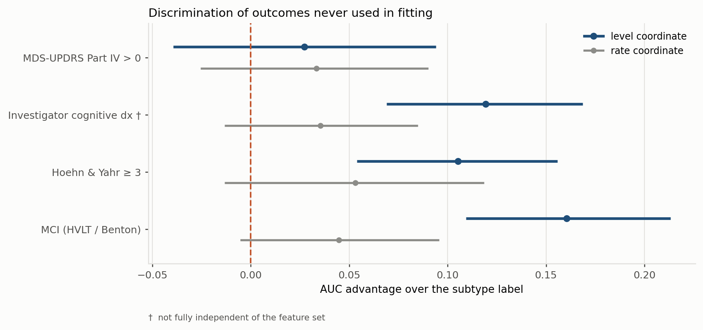

**Figure 67.** Discrimination of subsequently recorded clinical outcomes by the best single profile coordinate against the subtype label. *(Source: `manuscript/npj/fig5b_outcome_discrimination.png`.)*

**Table 71.** Dimensionality of the profile's level and rate coordinates across the 934 patients: principal-component variance shares and participation-ratio effective rank.

| which | n_patients | n_domains | pc1_share | pc2_share | cumulative_3 | n_components_for_90pct | effective_rank_participation |
|---|---|---|---|---|---|---|---|
| level | 934 | 9 | 0.4224 | 0.1362 | 0.6629 | 7 | 4.3407 |
| rate | 934 | 9 | 0.3723 | 0.1235 | 0.6019 | 7 | 5.1077 |

*Machine-readable copy: `tables/table071_profile_representation_dimensionality.csv`. Source: `experiments/20261103T220147Z_a2p_outcome_table_fullprec/representation_dimensionality.csv`.*

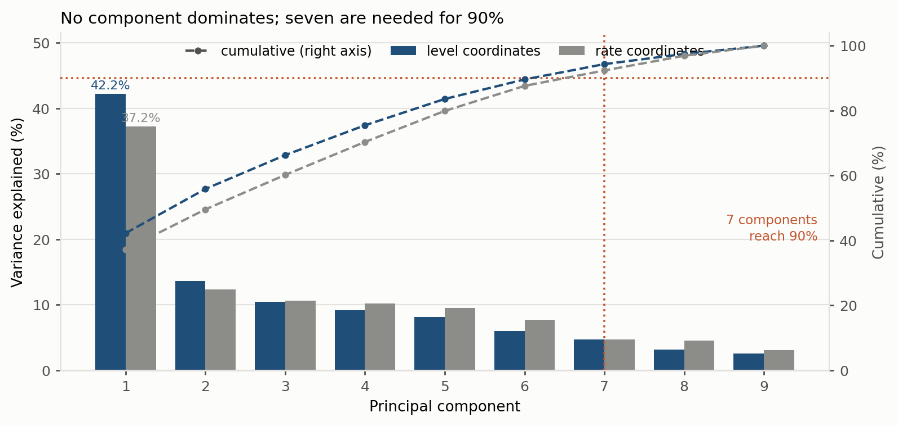

**Figure 66.** Share of across-participant variance explained by successive principal components of the profile's level and rate coordinates. *(Source: `manuscript/npj/fig5a_representation_dimensionality.png`.)*

**Table 72.** Spread of the filtered per-patient rates by domain (per year).

| domain | n_patients | mean_rate_per_year | sd_rate_per_year | p10 | p90 | share_worsening |
|---|---|---|---|---|---|---|
| brady_rigid | 934 | 0.0127 | 0.0262 | -0.0131 | 0.0485 | 0.6681 |
| tremor | 934 | 0.0 | 0.0002 | -0.0001 | 0.0002 | 0.5364 |
| pigd | 934 | 0.0397 | 0.0901 | -0.0201 | 0.1388 | 0.6221 |
| updrs2 | 934 | 0.2018 | 0.375 | -0.1296 | 0.6977 | 0.6959 |
| updrs1 | 934 | 0.0817 | 0.2164 | -0.0532 | 0.3712 | 0.6028 |
| moca | 934 | -0.0031 | 0.0359 | -0.0237 | 0.0206 | 0.5557 |
| gds | 934 | 0.0067 | 0.0421 | -0.0094 | 0.0266 | 0.4754 |
| scopa | 934 | 0.0221 | 0.0689 | -0.014 | 0.0909 | 0.606 |
| ess | 934 | 0.0052 | 0.039 | -0.0103 | 0.0235 | 0.5 |

*Machine-readable copy: `tables/table072_profile_rate_spread.csv`. Source: `experiments/20261103T220147Z_a2p_outcome_table_fullprec/rate_spread.csv`.*

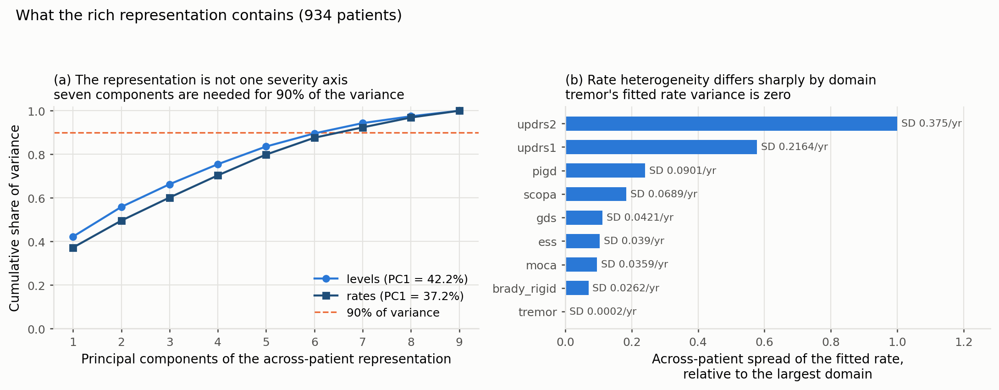

**Figure 70.** The level-and-rate representation across domains. *(Source: `manuscript/figures/fig09_representation.png`.)*

Against outcomes never used in fitting, the best single level coordinate discriminates a later Hoehn and Yahr stage of 3 or worse at AUC 0.685 (Part II level) against 0.579 for the subtype label (+0.105, +0.054 to +0.156, 761 patients, 127 events), and mild cognitive impairment at 0.710 (MoCA level) against 0.549 (+0.160, +0.109 to +0.213; 818 patients, 298 events); motor complications are not discriminated by either (0.531 against 0.504, +0.027, −0.039 to +0.094), and the investigator's cognitive diagnosis, which is not independent of the inputs, is discriminated at 0.678 against 0.558. No rate coordinate beats the label by an interval that excludes zero. The representation is genuinely multi-dimensional: seven components are needed for 90% of the across-patient variance of either the level or the rate coordinates, with the first component carrying 42% (levels) and 37% (rates) and participation-ratio effective ranks of 4.3 and 5.1.

**Interpretation.** The profile is a better model of the clinical record than assuming no change, and medication and rates each add a small, interval-excluding amount, but on the next-label task it is indistinguishable from the CT-HMM, and its simplest variant, a random walk on the levels, is as good as its richest. Where the profile differs from the label is in what it carries: its level coordinates predict staging and cognitive outcomes that the subtype label does not. That is the positive result of the programme, and it is a result about the representation, not about label prediction.

**Limitations.** The outcome associations select the best coordinate on the evaluation data, so every difference is an upper bound; the cognitive-diagnosis outcome shares inputs with the profile; the medication coefficient is confounded; sixteen of twenty full-profile fits stopped at the iteration limit; the derived-label comparison pairs five-fold and leave-one-patient-out predictions.

**Contribution.** Evidence that richer observations do not raise next-label accuracy, and that a continuous representation nonetheless carries clinically relevant information the label lacks.

### 9.15 Information criteria and threshold-free discrimination (E29, E30)

**Question.** Within each likelihood family, which model do AIC and BIC prefer, and does the profile rank a PIGD next visit above a TD one better than the CT-HMM?

**Setup and cohort.** AIC and BIC on the full cohort within three groups whose likelihoods are mutually comparable (Section 8.4); AUC-ROC with PIGD positive on the 3,020 matched transitions (898 patients, 910 positives) with a paired patient bootstrap.

**Results.** **Table 73.** Information criteria on the full cohort. Groups are comparable only within themselves: the chains' conditional pair likelihood (B) is not comparable with the joint sequence likelihood (C), and the profile's continuous density (A) with neither.

| group | model | likelihood | loglik | k | n_terms | aic | bic | delta_aic_within_group | delta_bic_within_group |
|---|---|---|---|---|---|---|---|---|---|
| CT-HMM (alone) | CT-HMM (3 latent states) | joint PMF over label sequences | -2969.06 | 14 | 4295 | 5966.12 | 6055.23 | 0.0 | 0.0 |
| B: observed-label chains | CTMC (interval-aware) | conditional PMF over pairs | -2380.5 | 6 | 3361 | 4773.0 | 4809.72 | 25.45 | 25.45 |
| B: observed-label chains | Markov (discrete) | conditional PMF over pairs | -2367.77 | 6 | 3361 | 4747.55 | 4784.27 | 0.0 | 0.0 |
| C: joint likelihood over whole sequences | CTMC + initial state | joint PMF over label sequences | -3099.84 | 8 | 4295 | 6215.68 | 6266.6 | 249.56 | 211.37 |
| C: joint likelihood over whole sequences | Markov + initial state | joint PMF over label sequences | -3087.12 | 8 | 4295 | 6190.23 | 6241.15 | 224.11 | 185.92 |
| C: joint likelihood over whole sequences | CT-HMM (3 latent states) | joint PMF over label sequences | -2969.06 | 14 | 4295 | 5966.12 | 6055.23 | 0.0 | 0.0 |
| A: rich-profile variants | Profile: level + rate + medication | density over 9 continuous domains | -45812.36 | 45 | 38486 | 91714.73 | 92099.84 | 0.0 | 0.0 |
| A: rich-profile variants | Profile: level only (random walk) | density over 9 continuous domains | -45940.77 | 27 | 38486 | 91935.53 | 92166.6 | 220.81 | 66.76 |
| A: rich-profile variants | Profile: level + rate, no medication | density over 9 continuous domains | -45993.34 | 36 | 38486 | 92058.68 | 92366.77 | 343.96 | 266.94 |

*Machine-readable copy: `tables/table073_aic_bic.csv`. Source: `experiments/20261023T194317Z_model_selection_criteria/aic_bic.csv`.*

Among joint sequence likelihoods the CT-HMM (14 parameters, AIC 5,966) is preferred over the discrete chain with an initial distribution by 224 AIC units and 186 BIC units, and over the continuous chain by 250 AIC units; among the chains alone the discrete chain is preferred over the continuous one by 25 units; among the profile variants the full model is preferred over the level-only variant by 221 AIC and 67 BIC units and over the no-medication variant by 344 and 267.

**Table 74.** Threshold-free discrimination of next-visit PIGD against TD (AUC-ROC, PIGD positive) on the 3,020 matched transitions. Contrast rich profile - CT-HMM: +0.0319 [+0.0229, +0.0419]. By current label: TD (n=2074, positives 252): CT-HMM 0.6680, profile 0.7798; Indeterminate (n=268, positives 121): CT-HMM 0.6305, profile 0.6794; PIGD (n=678, positives 537): CT-HMM 0.6649, profile 0.7437.

| model | n | n_patients | n_positive | auc | patient-bootstrap 95% CI |
|---|---|---|---|---|---|
| CT-HMM | 3020 | 898 | 910 | 0.8583 | [0.8411, 0.8755] |
| Rich clinical profile | 3020 | 898 | 910 | 0.8902 | [0.8748, 0.9053] |
| Persistence rule (reference) | 3020 | 898 | 910 | 0.7927 | [0.7725, 0.8127] |

*Machine-readable copy: `tables/table074_auc_next_visit.csv`. Source: `experiments/20261023T202640Z_roc_auc_comparison/auc_metrics.csv; experiments/20261023T202640Z_roc_auc_comparison/auc_contrast.csv; experiments/20261023T202640Z_roc_auc_comparison/auc_by_current_label.csv`.*

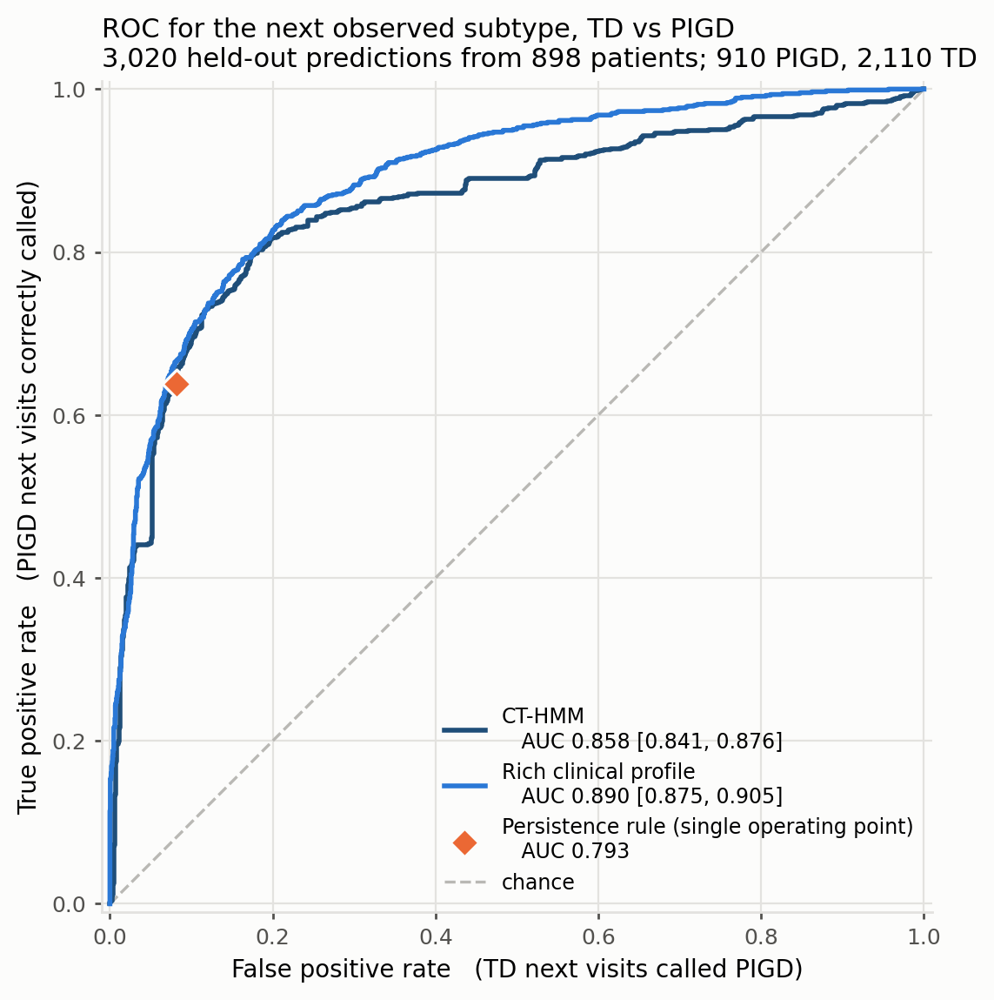

**Figure 36.** ROC curves for next-visit PIGD against TD: CT-HMM, rich clinical profile and persistence. *(Source: `experiments/20261023T202640Z_roc_auc_comparison/roc_td_vs_pigd.png`.)*

The profile's AUC is 0.890 (0.875 to 0.905) against 0.858 (0.841 to 0.876) for the CT-HMM, a paired difference of +0.032 (+0.023 to +0.042); persistence, a one-hot rule, scores 0.793. By current label the profile ranks better in every stratum (TD 0.780 against 0.668, Indeterminate 0.679 against 0.631, PIGD 0.744 against 0.665).

**Interpretation.** In-sample, both the latent layer and the profile's extra structure earn their parameters; held out, the profile ranks PIGD visits above TD visits clearly better than the CT-HMM while calling them no more accurately at the 0.5 threshold. The ranking gain lives in the ordering of cases on either side of the decision boundary, which accuracy cannot see.

**Limitations.** AIC and BIC are in-sample; the AUC uses the conditional two-class probability.

**Contribution.** The first instance of the pattern that recurs in Sections 9.22 and 9.23: richer observations improve ranking, not accuracy.

### 9.16 What the models say at Indeterminate visits (E31)

**Question.** At an Indeterminate visit whose ratio is defined, do the models call the side of the band the ratio sits nearer, and do their calls at the two dominant lattice ratios differ?

**Setup and cohort.** The 287 Indeterminate visits with a defined ratio from 220 patients (a sensitivity set of 213 closest to a boundary); the two focal ratios 0.9091 (144 visits, nearer PIGD) and 1.1364 (67 visits, nearer TD); agreement with the nearer boundary against the value expected under independence; patient-clustered intervals from 4,000 draws.

**Results.** **Table 75.** At Indeterminate visits with a defined ratio (287 visits, 220 patients), does the two-class call agree with the nearer band boundary more often than independence implies? Sensitivity on the 213 visits closest to a boundary: CT-HMM excess +0.0378 [-0.0285, +0.1029]; Rich clinical profile excess +0.0624 [-0.0017, +0.1268].

| model | n | n_patients | predicted_PIGD | predicted_TD | agreement_with_nearer_boundary | agreement 95% CI | expected under independence | excess over null | excess 95% CI | AUC P_PIGD for nearer-PIGD | AUC 95% CI |
|---|---|---|---|---|---|---|---|---|---|---|---|
| CT-HMM | 287 | 220 | 89 | 198 | 0.4878 | [0.4336, 0.5398] | 0.4623 | 0.0255 | [-0.0287, 0.0775] | 0.5843 | [0.5162, 0.6534] |
| Rich clinical profile | 287 | 220 | 101 | 186 | 0.5017 | [0.4483, 0.5588] | 0.4706 | 0.0312 | [-0.0223, 0.0882] | 0.5748 | [0.5054, 0.6403] |

*Machine-readable copy: `tables/table075_indeterminate_boundary_agreement.csv`. Source: `experiments/20261023T203431Z_indeterminate_boundary/boundary_agreement.csv; experiments/20261023T203431Z_indeterminate_boundary/sensitivity_close_to_boundary.csv`.*

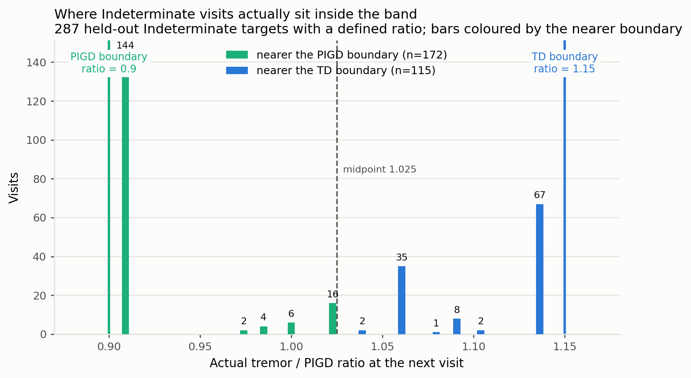

**Figure 37.** Distribution of the ratio among Indeterminate visits. *(Source: `docs/model_comparison/figures/fig2_indeterminate_ratio_distribution.png`.)*

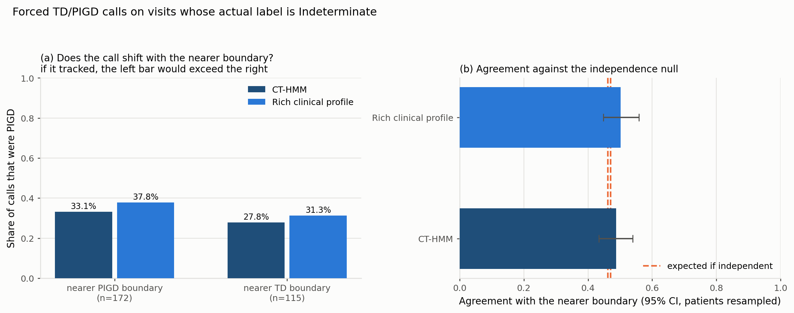

**Figure 38.** Agreement of the two-class prediction with the nearer band boundary at Indeterminate visits. *(Source: `docs/model_comparison/figures/fig3_indeterminate_boundary_agreement.png`.)*

**Table 76.** Calls at the two focal lattice ratios inside the Indeterminate band (0.9091, nearer PIGD; 1.1364, nearer TD): probabilities and label contrasts with patient-clustered intervals.

| quantity | model | estimate | patient-bootstrap 95% CI | n_visits | n_patients | excludes zero |
|---|---|---|---|---|---|---|
| P(predict PIGD \| ratio 0.9091) | CT-HMM | 0.3472 | [0.2703, 0.4266] | 144 | 127 |  |
| P(predict PIGD \| ratio 0.9091) | Rich clinical profile | 0.3889 | [0.3087, 0.4685] | 144 | 127 |  |
| P(predict TD \| ratio 1.1364) | CT-HMM | 0.7313 | [0.6154, 0.8382] | 67 | 63 |  |
| P(predict TD \| ratio 1.1364) | Rich clinical profile | 0.7463 | [0.6338, 0.8507] | 67 | 63 |  |
| P(PIGD \| 0.9091) - P(PIGD \| 1.1364)   [labels] | CT-HMM | 0.0786 | [-0.0499, 0.2046] | 211 | 170 | False |
| mean P_PIGD \| 0.9091 - mean P_PIGD \| 1.1364  [probs] | CT-HMM | 0.0934 | [0.0128, 0.1711] | 211 | 170 | True |
| P(PIGD \| 0.9091) - P(PIGD \| 1.1364)   [labels] | Rich clinical profile | 0.1352 | [0.0053, 0.2601] | 211 | 170 | True |
| mean P_PIGD \| 0.9091 - mean P_PIGD \| 1.1364  [probs] | Rich clinical profile | 0.0802 | [0.0145, 0.1457] | 211 | 170 | True |
| profile - CT-HMM, P(predict PIGD \| ratio 0.9091)  [paired] | difference | 0.0417 | [-0.0072, 0.0929] | 144 | 127 | False |
| profile - CT-HMM, P(predict TD \| ratio 1.1364)  [paired] | difference | 0.0149 | [-0.0312, 0.0725] | 67 | 63 | False |

*Machine-readable copy: `tables/table076_focal_ratio_calls.csv`. Source: `experiments/20261023T211836Z_indeterminate_ratio_scrutiny/patient_clustered_intervals.csv`.*

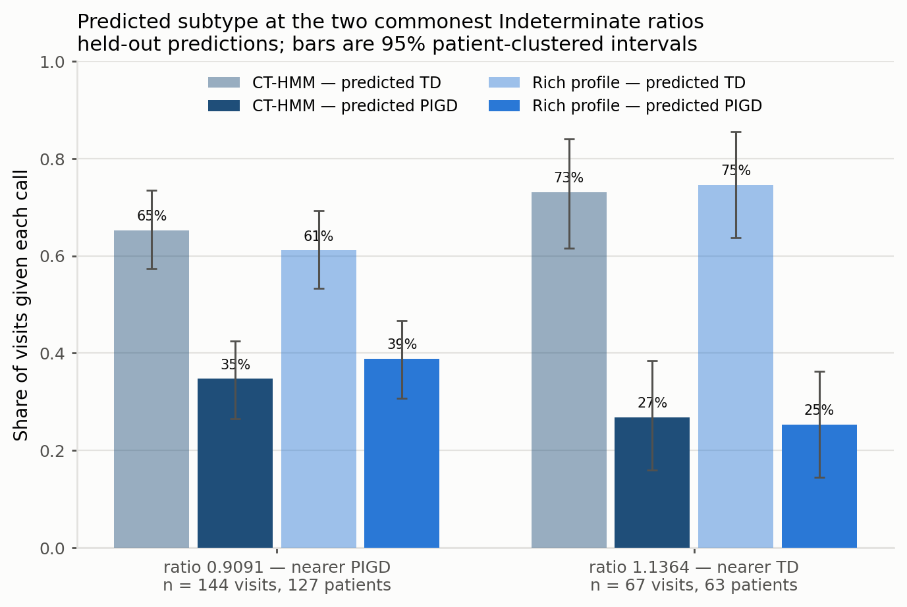

**Figure 39.** Predicted classes at the two focal lattice ratios 0.9091 and 1.1364. *(Source: `docs/model_comparison/figures/fig4_calls_at_focal_ratios.png`.)*

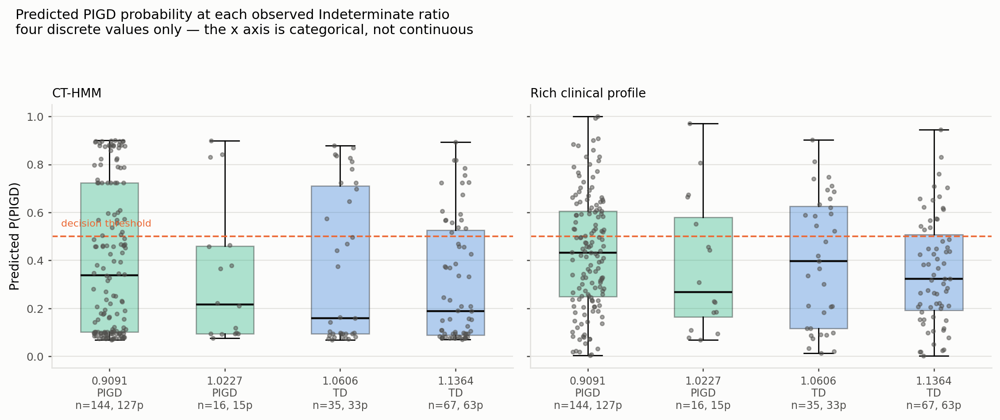

**Figure 40.** Predicted probability of PIGD as a function of the current ratio. *(Source: `docs/model_comparison/figures/fig5_probability_by_ratio.png`.)*

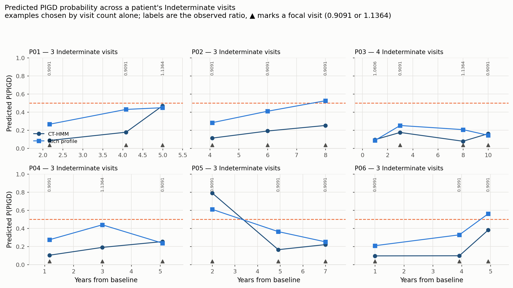

**Figure 41.** Example patient trajectories around the Indeterminate band. *(Source: `docs/model_comparison/figures/fig6_patient_trajectories.png`.)*

The CT-HMM agrees with the nearer boundary at 0.488 of Indeterminate visits against 0.462 expected under independence, an excess of +0.026 (−0.029 to +0.078); the profile at 0.502 against 0.471, +0.031 (−0.022 to +0.088); on the 213 visits closest to a boundary the excesses are +0.038 (−0.029 to +0.103) and +0.062 (−0.002 to +0.127). The AUC of the conditional PIGD probability for being nearer the PIGD boundary is 0.584 (0.516 to 0.653) and 0.575 (0.505 to 0.640). At the focal ratios the CT-HMM calls PIGD at 0.347 of the 0.9091 visits and TD at 0.731 of the 1.1364 visits; the profile at 0.389 and 0.746. The mean conditional PIGD probability is higher at 0.9091 than at 1.1364 by +0.093 (+0.013 to +0.171) for the CT-HMM and +0.080 (+0.015 to +0.146) for the profile, but the difference in PIGD calls is +0.079 (−0.050 to +0.205) for the CT-HMM and +0.135 (+0.005 to +0.260) for the profile.

**Interpretation.** At an Indeterminate visit both models follow the history, not the ratio: their probabilities lean slightly towards the nearer boundary, and their calls barely do. This is the correct behaviour for models whose inputs are the label history (the CT-HMM) or the whole clinical state (the profile), and it is why both score about 0.61 from an Indeterminate visit: the next label from the band is close to a coin toss weighted by the history.

**Limitations.** Small strata; the focal-ratio analysis is exploratory.

**Contribution.** A direct view of the behaviour that produces the Indeterminate-stratum margins of Section 9.11.

### 9.17 Does accuracy change with disease stage? (E32)

**Question.** Does two-class accuracy change as the prediction stage (the number of prior visits) grows, and does the comparison between the CT-HMM and the profile change with it?

**Setup and cohort.** 3,017 targets of 896 patients at stages 1 to 12 (stages 1 to 9 have at least 66 targets and are treated as reliable); per-stage metrics with patient-bootstrap intervals; changes from stage 1 and within-patient late-minus-early changes (225 patients); 24 pre-specified paired tests.

**Results.** **Table 77.** Stage-wise evaluation: two-class metrics at each prediction stage (stage k predicts visit k+1 from visits 1..k), stages 1 to 9 (at least 66 targets each).

| stage | model | n_targets | n_patients | pct_PIGD | accuracy | accuracy 95% CI | balanced_accuracy | balanced 95% CI | sensitivity_PIGD | brier | log_loss |
|---|---|---|---|---|---|---|---|---|---|---|---|
| 1 | CT-HMM | 835 | 835 | 0.2347 | 0.8347 | [0.8104, 0.8604] | 0.7293 | [0.6931, 0.7678] | 0.5306 | 0.1225 | 0.3996 |
| 1 | Rich clinical profile | 835 | 835 | 0.2347 | 0.8455 | [0.8214, 0.8701] | 0.7753 | [0.7381, 0.8119] | 0.6429 | 0.1193 | 0.3827 |
| 1 | Persistence (reference) | 835 | 835 | 0.2347 | 0.8323 | [0.8083, 0.8580] | 0.7171 | [0.6818, 0.7561] | 0.5 | 0.1677 | 4.6327 |
| 2 | CT-HMM | 693 | 693 | 0.2597 | 0.8644 | [0.8379, 0.8897] | 0.811 | [0.7743, 0.8459] | 0.7 | 0.1056 | 0.3535 |
| 2 | Rich clinical profile | 693 | 693 | 0.2597 | 0.8644 | [0.8372, 0.8899] | 0.7984 | [0.7616, 0.8354] | 0.6611 | 0.1077 | 0.3514 |
| 2 | Persistence (reference) | 693 | 693 | 0.2597 | 0.86 | [0.8333, 0.8845] | 0.7919 | [0.7557, 0.8267] | 0.65 | 0.14 | 3.8675 |
| 3 | CT-HMM | 450 | 450 | 0.2933 | 0.8267 | [0.7916, 0.8600] | 0.7799 | [0.7370, 0.8208] | 0.6667 | 0.1342 | 0.4306 |
| 3 | Rich clinical profile | 450 | 450 | 0.2933 | 0.82 | [0.7845, 0.8528] | 0.7641 | [0.7211, 0.8058] | 0.6288 | 0.127 | 0.4009 |
| 3 | Persistence (reference) | 450 | 450 | 0.2933 | 0.8289 | [0.7958, 0.8614] | 0.7682 | [0.7260, 0.8094] | 0.6212 | 0.1711 | 4.728 |
| 4 | CT-HMM | 305 | 305 | 0.318 | 0.8098 | [0.7616, 0.8544] | 0.7698 | [0.7133, 0.8199] | 0.6598 | 0.1352 | 0.429 |
| 4 | Rich clinical profile | 305 | 305 | 0.318 | 0.823 | [0.7774, 0.8667] | 0.7684 | [0.7139, 0.8221] | 0.6186 | 0.1156 | 0.3697 |
| 4 | Persistence (reference) | 305 | 305 | 0.318 | 0.8033 | [0.7570, 0.8467] | 0.743 | [0.6881, 0.7945] | 0.5773 | 0.1967 | 5.4356 |
| 5 | CT-HMM | 200 | 200 | 0.34 | 0.82 | [0.7655, 0.8713] | 0.7888 | [0.7233, 0.8497] | 0.6912 | 0.1268 | 0.4099 |
| 5 | Rich clinical profile | 200 | 200 | 0.34 | 0.835 | [0.7817, 0.8878] | 0.8215 | [0.7624, 0.8833] | 0.7794 | 0.1191 | 0.3829 |
| 5 | Persistence (reference) | 200 | 200 | 0.34 | 0.825 | [0.7720, 0.8750] | 0.789 | [0.7283, 0.8483] | 0.6765 | 0.175 | 4.8354 |
| 6 | CT-HMM | 171 | 171 | 0.4094 | 0.8304 | [0.7742, 0.8869] | 0.8148 | [0.7531, 0.8736] | 0.7286 | 0.1266 | 0.4129 |
| 6 | Rich clinical profile | 171 | 171 | 0.4094 | 0.8129 | [0.7543, 0.8696] | 0.7934 | [0.7315, 0.8541] | 0.6857 | 0.1229 | 0.3754 |
| 6 | Persistence (reference) | 171 | 171 | 0.4094 | 0.8187 | [0.7597, 0.8757] | 0.7917 | [0.7292, 0.8526] | 0.6429 | 0.1813 | 5.0091 |
| 7 | CT-HMM | 125 | 125 | 0.4 | 0.84 | [0.7699, 0.9027] | 0.82 | [0.7442, 0.8877] | 0.72 | 0.1209 | 0.395 |
| 7 | Rich clinical profile | 125 | 125 | 0.4 | 0.824 | [0.7536, 0.8921] | 0.8067 | [0.7318, 0.8777] | 0.72 | 0.1198 | 0.3854 |
| 7 | Persistence (reference) | 125 | 125 | 0.4 | 0.824 | [0.7522, 0.8897] | 0.8 | [0.7213, 0.8683] | 0.68 | 0.176 | 4.8631 |
| 8 | CT-HMM | 93 | 93 | 0.4624 | 0.8495 | [0.7742, 0.9192] | 0.8453 | [0.7679, 0.9129] | 0.7907 | 0.1162 | 0.3859 |
| 8 | Rich clinical profile | 93 | 93 | 0.4624 | 0.8387 | [0.7586, 0.9070] | 0.8353 | [0.7531, 0.9067] | 0.7907 | 0.1192 | 0.359 |
| 8 | Persistence (reference) | 93 | 93 | 0.4624 | 0.8602 | [0.7857, 0.9241] | 0.8537 | [0.7774, 0.9186] | 0.7674 | 0.1398 | 3.8624 |
| 9 | CT-HMM | 66 | 66 | 0.4848 | 0.8485 | [0.7619, 0.9286] | 0.8474 | [0.7602, 0.9302] | 0.8125 | 0.1138 | 0.365 |
| 9 | Rich clinical profile | 66 | 66 | 0.4848 | 0.8485 | [0.7500, 0.9296] | 0.8474 | [0.7517, 0.9286] | 0.8125 | 0.1146 | 0.3669 |
| 9 | Persistence (reference) | 66 | 66 | 0.4848 | 0.8182 | [0.7222, 0.9077] | 0.8162 | [0.7219, 0.9066] | 0.75 | 0.1818 | 5.0238 |

*Machine-readable copy: `tables/table077_stage_wise_metrics.csv`. Source: `experiments/20261023T214819Z_stage_wise_evaluation/stage_metrics.csv`.*

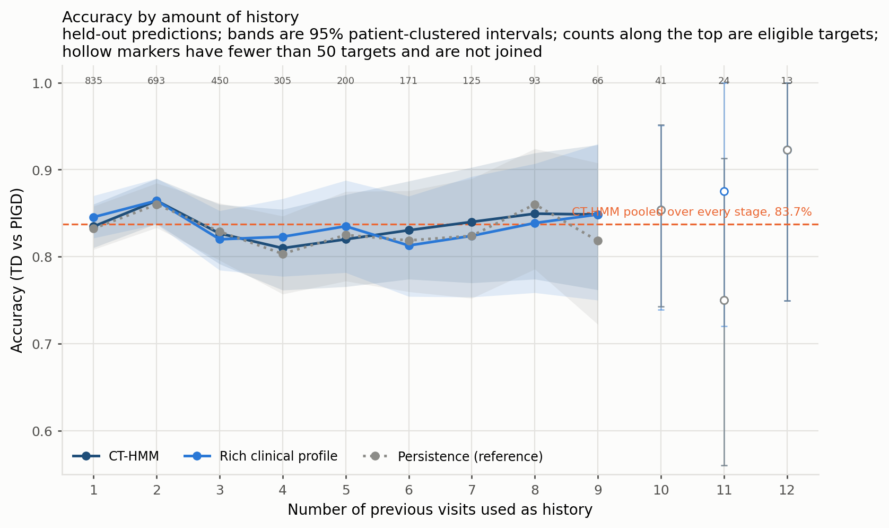

**Figure 42.** Two-class accuracy by prediction stage (number of prior visits). *(Source: `docs/stage_wise_evaluation/figures/fig1_accuracy_by_stage.png`.)*

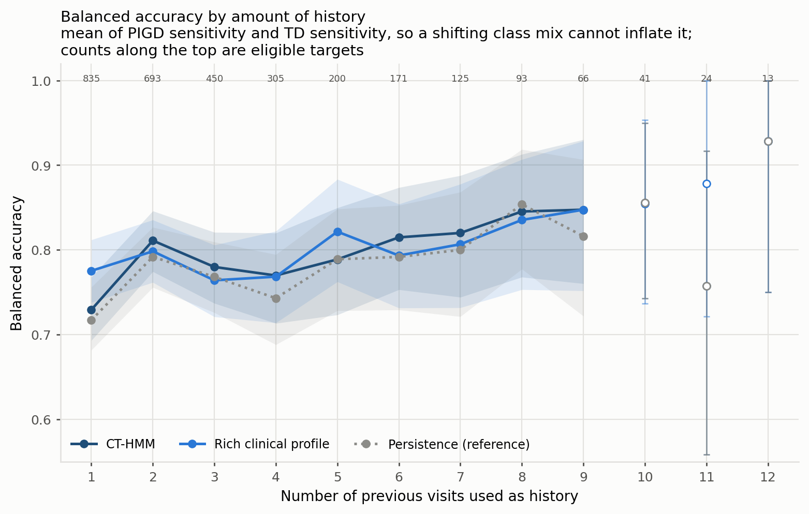

**Figure 43.** Balanced accuracy by prediction stage. *(Source: `docs/stage_wise_evaluation/figures/fig2_balanced_accuracy_by_stage.png`.)*

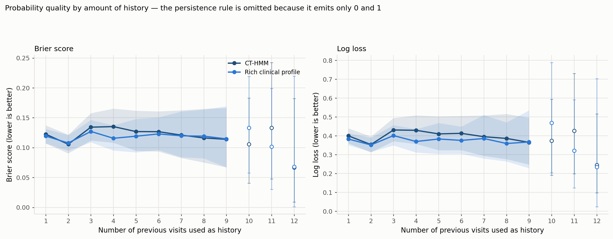

**Figure 44.** Brier score and log loss by prediction stage. *(Source: `docs/stage_wise_evaluation/figures/fig3_probability_quality_by_stage.png`.)*

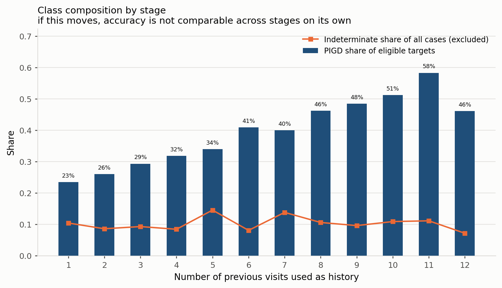

**Figure 45.** Share of PIGD targets by prediction stage. *(Source: `docs/stage_wise_evaluation/figures/fig5_class_mix_by_stage.png`.)*

**Table 78.** Stage-wise evaluation: paired difference, rich clinical profile minus CT-HMM, at each stage. Within-patient late-minus-early change in accuracy (225 patients with both): CT-HMM -0.0243 [-0.0749, +0.0284]; Rich clinical profile -0.0345 [-0.0893, +0.0198].

| stage | metric | n_targets | estimate | 95% CI | excludes zero |
|---|---|---|---|---|---|
| 1 | accuracy | 835 | 0.0108 | [-0.0036, 0.0253] | False |
| 2 | accuracy | 693 | 0.0 | [-0.0141, 0.0143] | False |
| 3 | accuracy | 450 | -0.0067 | [-0.0251, 0.0131] | False |
| 4 | accuracy | 305 | 0.0131 | [-0.0165, 0.0418] | False |
| 5 | accuracy | 200 | 0.015 | [-0.0203, 0.0500] | False |
| 6 | accuracy | 171 | -0.0175 | [-0.0645, 0.0298] | False |
| 7 | accuracy | 125 | -0.016 | [-0.0548, 0.0234] | False |
| 8 | accuracy | 93 | -0.0108 | [-0.0612, 0.0353] | False |
| 9 | accuracy | 66 | 0.0 | [-0.0606, 0.0625] | False |
| 1 | balanced_accuracy | 835 | 0.046 | [0.0229, 0.0695] | True |
| 2 | balanced_accuracy | 693 | -0.0126 | [-0.0343, 0.0077] | False |
| 3 | balanced_accuracy | 450 | -0.0158 | [-0.0378, 0.0062] | False |
| 4 | balanced_accuracy | 305 | -0.0014 | [-0.0362, 0.0301] | False |
| 5 | balanced_accuracy | 200 | 0.0328 | [-0.0094, 0.0738] | False |
| 6 | balanced_accuracy | 171 | -0.0214 | [-0.0737, 0.0307] | False |
| 7 | balanced_accuracy | 125 | -0.0133 | [-0.0561, 0.0310] | False |
| 8 | balanced_accuracy | 93 | -0.01 | [-0.0566, 0.0341] | False |
| 9 | balanced_accuracy | 66 | 0.0 | [-0.0625, 0.0625] | False |

*Machine-readable copy: `tables/table078_stage_wise_paired.csv`. Source: `experiments/20261023T214819Z_stage_wise_evaluation/paired_differences.csv; experiments/20261023T214819Z_stage_wise_evaluation/within_patient_change.csv`.*

At stage 1 (835 targets) the CT-HMM reaches 0.835 (0.810 to 0.860), the profile 0.846 (0.821 to 0.870) and persistence 0.832, with balanced accuracies of 0.729, 0.775 and 0.717; the profile's balanced accuracy is higher than the CT-HMM's by +0.046 (+0.023 to +0.070), the only one of the 24 paired tests whose interval excludes zero. No change in accuracy from stage 1 excludes zero for either model at any reliable stage. Balanced accuracy rises with stage for every model, including persistence (from 0.717 at stage 1 to 0.816 at stage 9), because the share of PIGD targets rises from 23% to 48%; the CT-HMM's balanced-accuracy change from stage 1 excludes zero at stages 2 and 6 to 9. Within patients, the late-minus-early change in accuracy is −0.024 (−0.075 to +0.028) for the CT-HMM and −0.035 (−0.089 to +0.020) for the profile.

**Interpretation.** Accuracy does not change with stage, and the apparent rise in balanced accuracy is composition: late stages hold more PIGD targets, which a persistence rule gets right as often as the models. The one stage-1 advantage of the profile in balanced accuracy is its better PIGD sensitivity when only one visit is known, and it does not persist.

**Limitations.** Late stages are small and selected on follow-up.

**Contribution.** Evidence that the ceiling is not a property of early disease.

### 9.18 How much history does the prediction need? (E33, E34)

**Question.** If the model sees only the last one, two, three or five labelled visits instead of the whole history, how much does the prediction change, for the CT-HMM and for the clinical profile?

**Setup and cohort.** The CT-HMM (full-sequence training, leave-one-patient-out) predicts every eligible transition from truncated windows; paired comparisons are made on the 734 targets of 228 patients that every window can score. The pre-specified primary contrast is "last 2 minus full history". Twenty validation checks passed, and the tamper test found zero spurious change over 934 folds and 11,644 cases. The profile's windows (last 2, last 3, full, and full with the current-visit LEDD substituted for the next-visit LEDD) are compared on 1,489 common targets of 481 patients.

**Results.** **Table 79.** CT-HMM prediction with truncated history windows (last 1, 2, 3, 5 visits) against the full history, on all eligible targets and on the common targets available to every window (734 targets, 228 patients).

| cohort | window | n_targets | n_patients | accuracy | accuracy 95% CI | balanced_accuracy | sensitivity_PIGD | auc | brier | log_loss |
|---|---|---|---|---|---|---|---|---|---|---|
| all eligible | persistence | 3029 | 899 | 0.8336 | [0.8173, 0.8510] | 0.7737 | 0.6225 |  | 0.1598 |  |
| all eligible | last 1 | 3029 | 899 | 0.8323 | [0.8159, 0.8494] | 0.7702 | 0.6138 | 0.7978 | 0.1326 | 0.4303 |
| all eligible | last 2 | 2192 | 742 | 0.8362 | [0.8156, 0.8553] | 0.7977 | 0.6862 | 0.8633 | 0.1227 | 0.3988 |
| all eligible | last 3 | 1495 | 487 | 0.8281 | [0.8043, 0.8507] | 0.803 | 0.7154 | 0.8691 | 0.1276 | 0.4123 |
| all eligible | last 5 | 734 | 228 | 0.8338 | [0.8021, 0.8632] | 0.8208 | 0.7443 | 0.8885 | 0.1211 | 0.3964 |
| all eligible | full history | 3029 | 899 | 0.8369 | [0.8204, 0.8541] | 0.7888 | 0.6674 | 0.8587 | 0.1214 | 0.3961 |
| common targets | persistence | 734 | 228 | 0.827 | [0.7938, 0.8584] | 0.8089 | 0.7016 |  | 0.173 |  |
| common targets | last 1 | 734 | 228 | 0.8106 | [0.7773, 0.8418] | 0.7906 | 0.6721 | 0.8267 | 0.1458 | 0.4685 |
| common targets | last 2 | 734 | 228 | 0.8283 | [0.7941, 0.8597] | 0.8129 | 0.7213 | 0.8839 | 0.1266 | 0.4082 |
| common targets | last 3 | 734 | 228 | 0.8351 | [0.8047, 0.8634] | 0.822 | 0.7443 | 0.8899 | 0.1215 | 0.3967 |
| common targets | last 5 | 734 | 228 | 0.8338 | [0.8021, 0.8632] | 0.8208 | 0.7443 | 0.8885 | 0.1211 | 0.3964 |
| common targets | full history | 734 | 228 | 0.8324 | [0.8008, 0.8615] | 0.8192 | 0.741 | 0.8884 | 0.1214 | 0.397 |

*Machine-readable copy: `tables/table079_cthmm_history_windows.csv`. Source: `experiments/20261024T042417Z_history_window_experiment/window_metrics.csv`.*


**Figure 46.** CT-HMM accuracy by prediction history window. *(Source: `docs/history_window/figures/fig1_ct_hmm_accuracy_by_window.png`.)*


**Figure 47.** CT-HMM probability quality by history window. *(Source: `docs/history_window/figures/fig2_ct_hmm_probability_quality.png`.)*

**Table 80.** CT-HMM history windows: paired differences on the common targets (first-named minus second-named).

| role | comparison | n_targets | accuracy | accuracy 95% CI | balanced_accuracy | balanced 95% CI | auc | auc 95% CI | brier | brier 95% CI | log_loss | log loss 95% CI |
|---|---|---|---|---|---|---|---|---|---|---|---|---|
| PRIMARY (pre-specified) | last 2 - full history | 734 | -0.0041 | [-0.0189, 0.0100] | -0.0063 | [-0.0235, 0.0096] | -0.0045 | [-0.0150, 0.0043] | 0.0051 | [-0.0005, 0.0106] | 0.0112 | [-0.0028, 0.0248] |
| secondary | last 2 - persistence | 734 | 0.0014 | [-0.0085, 0.0108] | 0.004 | [-0.0064, 0.0148] |  |  | -0.0465 | [-0.0635, -0.0307] |  |  |
| secondary | last 3 - persistence | 734 | 0.0082 | [-0.0083, 0.0239] | 0.0132 | [-0.0047, 0.0308] |  |  | -0.0515 | [-0.0698, -0.0346] |  |  |
| secondary | last 1 - persistence | 734 | -0.0163 | [-0.0298, -0.0040] | -0.0183 | [-0.0329, -0.0041] |  |  | -0.0272 | [-0.0441, -0.0116] |  |  |
| secondary | full history - persistence | 734 | 0.0054 | [-0.0109, 0.0222] | 0.0103 | [-0.0079, 0.0291] |  |  | -0.0516 | [-0.0708, -0.0341] |  |  |
| exploratory | last 1 - full history | 734 | -0.0218 | [-0.0423, -0.0014] | -0.0286 | [-0.0509, -0.0068] | -0.0617 | [-0.0858, -0.0385] | 0.0244 | [0.0162, 0.0329] | 0.0715 | [0.0494, 0.0946] |
| exploratory | last 3 - full history | 734 | 0.0027 | [-0.0065, 0.0117] | 0.0028 | [-0.0074, 0.0129] | 0.0014 | [-0.0032, 0.0061] | 0.0001 | [-0.0036, 0.0037] | -0.0003 | [-0.0100, 0.0093] |
| exploratory | last 5 - full history | 734 | 0.0014 | [0.0000, 0.0043] | 0.0016 | [0.0000, 0.0057] | 0.0001 | [-0.0009, 0.0011] | -0.0003 | [-0.0011, 0.0003] | -0.0006 | [-0.0026, 0.0009] |

*Machine-readable copy: `tables/table080_cthmm_history_windows_paired.csv`. Source: `experiments/20261024T042417Z_history_window_experiment/paired_comparisons.csv`.*


**Figure 48.** Paired differences of each CT-HMM window against the full history. *(Source: `docs/history_window/figures/fig3_ct_hmm_paired_vs_full.png`.)*

On the common targets the CT-HMM reaches 0.811 with the last visit only, 0.828 with the last two, 0.835 with the last three, 0.834 with the last five and 0.832 with the full history, against 0.827 for persistence; AUC is 0.827, 0.884, 0.890, 0.889 and 0.888. The primary contrast, last two minus full, is −0.004 (−0.019 to +0.010) in accuracy, −0.006 in balanced accuracy, −0.005 (−0.015 to +0.004) in AUC, +0.005 in Brier and +0.011 in log loss, every interval including zero. Only the single-visit window is worse: −0.022 (−0.042 to −0.001) in accuracy and −0.062 (−0.086 to −0.039) in AUC against the full history, because with one visit the model has no run length to read.

**Table 81.** Rich clinical profile with truncated history windows (last 2, last 3) against the full history, and the full history with the current-visit LEDD substituted for the next-visit LEDD.

| cohort | window | n_targets | n_patients | accuracy | accuracy 95% CI | balanced_accuracy | sensitivity_PIGD | auc | brier | log_loss |
|---|---|---|---|---|---|---|---|---|---|---|
| all eligible | last 2 | 2184 | 740 | 0.8402 | [0.8209, 0.8585] | 0.7981 | 0.6765 | 0.8935 | 0.1177 | 0.38 |
| all eligible | last 3 | 1489 | 481 | 0.8314 | [0.8085, 0.8526] | 0.7988 | 0.6835 | 0.8972 | 0.1209 | 0.3842 |
| all eligible | full history | 3021 | 898 | 0.8414 | [0.8258, 0.8576] | 0.7973 | 0.6861 | 0.891 | 0.1173 | 0.3755 |
| all eligible | full history, current-visit LEDD | 3021 | 898 | 0.8401 | [0.8247, 0.8558] | 0.7942 | 0.6784 | 0.8911 | 0.1173 | 0.3747 |
| common targets | last 2 | 1489 | 481 | 0.8287 | [0.8060, 0.8503] | 0.7947 | 0.6742 | 0.8947 | 0.1219 | 0.3921 |
| common targets | last 3 | 1489 | 481 | 0.8314 | [0.8085, 0.8526] | 0.7988 | 0.6835 | 0.8972 | 0.1209 | 0.3842 |
| common targets | full history | 1489 | 481 | 0.8294 | [0.8062, 0.8510] | 0.8026 | 0.7079 | 0.8972 | 0.1207 | 0.3822 |
| common targets | full history, current-visit LEDD | 1489 | 481 | 0.8281 | [0.8052, 0.8492] | 0.8003 | 0.7022 | 0.8974 | 0.1208 | 0.3819 |

*Machine-readable copy: `tables/table081_profile_history_windows.csv`. Source: `experiments/20261024T042811Z_profile_history_window/profile_window_metrics.csv`.*

**Table 82.** Rich clinical profile history windows: paired differences on the common targets (1,489 targets, 481 patients).

| role | comparison | n_targets | accuracy | accuracy 95% CI | auc | auc 95% CI | log_loss | log loss 95% CI |
|---|---|---|---|---|---|---|---|---|
| PRIMARY (pre-specified) | last 2 - full history | 1489 | -0.0007 | [-0.0102, 0.0085] | -0.0025 | [-0.0069, 0.0016] | 0.0099 | [0.0015, 0.0193] |
| exploratory | last 3 - full history | 1489 | 0.002 | [-0.0062, 0.0096] | 0.0 | [-0.0030, 0.0030] | 0.002 | [-0.0040, 0.0079] |
| LEDD sensitivity | full history, current-visit LEDD - full history | 1489 | -0.0013 | [-0.0056, 0.0026] | 0.0003 | [-0.0008, 0.0014] | -0.0002 | [-0.0022, 0.0017] |

*Machine-readable copy: `tables/table082_profile_history_windows_paired.csv`. Source: `experiments/20261024T042811Z_profile_history_window/profile_paired_comparisons.csv`.*


**Figure 49.** Rich clinical profile by history window. *(Source: `docs/history_window/figures/fig4_profile_windows.png`.)*

The profile behaves the same way: last two minus full is −0.001 (−0.010 to +0.009) in accuracy and −0.003 (−0.007 to +0.002) in AUC, with a small log-loss cost (+0.010, +0.002 to +0.019); substituting the current-visit LEDD for the next-visit LEDD changes accuracy by −0.001 (−0.006 to +0.003).

**Interpretation.** Two visits carry essentially all the information the models use about the next label. The CT-HMM's filtered belief forgets quickly (the latent Indeterminate state's sojourn is two years), and the profile's level is dominated by the most recent observation. The result also disposes of a concern about the profile's medication input: knowing the next visit's LEDD is worth nothing.

**Limitations.** The common cohort for the CT-HMM windows is the 228 patients with at least six visits, a selected group with long follow-up.

**Contribution.** Evidence that the ceiling is not a shortage of history.

### 9.19 Retraining the CT-HMM on two-visit windows (E35)

**Question.** If the model is both trained and used on two-visit windows, does it do better than a model trained on full sequences and truncated at prediction time?

**Setup and cohort.** A two-by-two design crossing training (full sequences; overlapping two-visit windows; disjoint windows as a sensitivity) with prediction history (full; last two), leave-one-patient-out, paired on 2,192 common targets of 742 patients; 24 validation checks passed.

**Results.** **Table 83.** CT-HMM retrained on two-visit windows: training (full sequences, overlapping two-visit windows, disjoint windows) crossed with prediction history (full, last two visits).

| cohort | condition | n_targets | n_patients | accuracy | accuracy 95% CI | balanced_accuracy | sensitivity_PIGD | auc | brier | log_loss |
|---|---|---|---|---|---|---|---|---|---|---|
| all eligible | persistence | 3029 | 899 | 0.8336 | [0.8173, 0.8510] | 0.7737 | 0.6225 |  | 0.1598 |  |
| all eligible | full-trained, full history | 3029 | 899 | 0.8369 | [0.8204, 0.8541] | 0.7888 | 0.6674 | 0.8587 | 0.1214 | 0.3961 |
| all eligible | full-trained, last 2 | 2192 | 742 | 0.8362 | [0.8156, 0.8553] | 0.7977 | 0.6862 | 0.8633 | 0.1227 | 0.3988 |
| all eligible | window-trained, full history | 3029 | 899 | 0.8362 | [0.8199, 0.8532] | 0.7725 | 0.6116 | 0.846 | 0.1279 | 0.4312 |
| all eligible | window-trained, last 2 | 2192 | 742 | 0.8298 | [0.8098, 0.8498] | 0.7729 | 0.6081 | 0.8506 | 0.131 | 0.4345 |
| all eligible | non-overlap-window-trained, last 2 | 2192 | 742 | 0.8289 | [0.8087, 0.8491] | 0.7725 | 0.6095 | 0.8663 | 0.1268 | 0.4105 |
| common targets | persistence | 2192 | 742 | 0.8344 | [0.8128, 0.8539] | 0.7888 | 0.6569 |  | 0.164 |  |
| common targets | full-trained, full history | 2192 | 742 | 0.838 | [0.8173, 0.8568] | 0.804 | 0.7057 | 0.8717 | 0.121 | 0.3947 |
| common targets | full-trained, last 2 | 2192 | 742 | 0.8362 | [0.8156, 0.8553] | 0.7977 | 0.6862 | 0.8633 | 0.1227 | 0.3988 |
| common targets | window-trained, full history | 2192 | 742 | 0.8362 | [0.8172, 0.8550] | 0.7837 | 0.6318 | 0.8602 | 0.1292 | 0.4405 |
| common targets | window-trained, last 2 | 2192 | 742 | 0.8298 | [0.8098, 0.8498] | 0.7729 | 0.6081 | 0.8506 | 0.131 | 0.4345 |
| common targets | non-overlap-window-trained, last 2 | 2192 | 742 | 0.8289 | [0.8087, 0.8491] | 0.7725 | 0.6095 | 0.8663 | 0.1268 | 0.4105 |

*Machine-readable copy: `tables/table083_cthmm_retrained_conditions.csv`. Source: `experiments/20261024T052343Z_retrained_two_visit_cthmm/condition_metrics.csv`.*


**Figure 50.** CT-HMM retrained on two-visit windows: the four training-by-history conditions. *(Source: `docs/history_window/figures/fig5_retrained_conditions.png`.)*

**Table 84.** CT-HMM retrained on two-visit windows: paired differences on the 2,192 common targets (742 patients).

| role | comparison | n_targets | accuracy | accuracy 95% CI | balanced_accuracy | balanced 95% CI | auc | auc 95% CI | brier | brier 95% CI | log_loss | log loss 95% CI |
|---|---|---|---|---|---|---|---|---|---|---|---|---|
| PRIMARY (pre-specified) | window-trained, last 2  -  full-trained, full history | 2192 | -0.0082 | [-0.0193, 0.0026] | -0.0312 | [-0.0441, -0.0183] | -0.021 | [-0.0301, -0.0120] | 0.0099 | [0.0049, 0.0152] | 0.0397 | [0.0222, 0.0576] |
| training effect, history fixed | window-trained, last 2  -  full-trained, last 2 | 2192 | -0.0064 | [-0.0155, 0.0027] | -0.0248 | [-0.0354, -0.0147] | -0.0127 | [-0.0197, -0.0060] | 0.0082 | [0.0044, 0.0120] | 0.0357 | [0.0204, 0.0516] |
| history effect, training fixed | full-trained, last 2  -  full-trained, full history | 2192 | -0.0018 | [-0.0089, 0.0054] | -0.0064 | [-0.0150, 0.0023] | -0.0084 | [-0.0144, -0.0026] | 0.0017 | [-0.0009, 0.0042] | 0.0041 | [-0.0021, 0.0104] |
| training effect, full history | window-trained, full history  -  full-trained, full history | 2192 | -0.0018 | [-0.0120, 0.0076] | -0.0203 | [-0.0320, -0.0099] | -0.0115 | [-0.0189, -0.0047] | 0.0082 | [0.0041, 0.0125] | 0.0458 | [0.0274, 0.0652] |
| vs persistence | window-trained, last 2  -  persistence | 2192 | -0.0046 | [-0.0153, 0.0061] | -0.0159 | [-0.0290, -0.0028] |  |  | -0.0331 | [-0.0419, -0.0253] |  |  |
| vs persistence | full-trained, full history  -  persistence | 2192 | 0.0036 | [-0.0057, 0.0130] | 0.0153 | [0.0042, 0.0268] |  |  | -0.043 | [-0.0533, -0.0333] |  |  |
| disjoint-window sensitivity | non-overlap-window-trained, last 2  -  window-trained, last 2 | 2192 | -0.0009 | [-0.0036, 0.0014] | -0.0003 | [-0.0035, 0.0031] | 0.0156 | [0.0094, 0.0224] | -0.0042 | [-0.0060, -0.0025] | -0.0239 | [-0.0332, -0.0156] |

*Machine-readable copy: `tables/table084_cthmm_retrained_paired.csv`. Source: `experiments/20261024T052343Z_retrained_two_visit_cthmm/paired_comparisons.csv`.*

**Table 85.** CT-HMM parameters from the full-sequence fit and from the two-visit-window fit (one representative fold).

| parameter | full-sequence fit | window fit | difference |
|---|---|---|---|
| pi[TD] | 0.7269 | 0.7542 | 0.0273 |
| pi[Indeterminate] | 0.1553 | 0.0443 | -0.111 |
| pi[PIGD] | 0.1178 | 0.2016 | 0.0837 |
| Q diag [TD] | -0.0971 | -0.0588 | 0.0383 |
| Q diag [Indeterminate] | -0.4688 | -0.4367 | 0.0321 |
| Q diag [PIGD] | -0.0546 | -0.0106 | 0.0439 |
| E diag [TD] | 0.9401 | 0.8751 | -0.0649 |
| E diag [Indeterminate] | 0.5 | 0.6651 | 0.1651 |
| E diag [PIGD] | 0.8718 | 0.8804 | 0.0086 |

*Machine-readable copy: `tables/table085_cthmm_retrained_parameters.csv`. Source: `experiments/20261024T052343Z_retrained_two_visit_cthmm/parameter_comparison.csv`.*

The pre-specified primary contrast, window-trained with the last two visits minus full-trained with the full history, is −0.008 (−0.019 to +0.003) in accuracy but −0.031 (−0.044 to −0.018) in balanced accuracy, −0.021 (−0.030 to −0.012) in AUC, +0.010 (+0.005 to +0.015) in Brier and +0.040 (+0.022 to +0.058) in log loss. Decomposed, the training effect with the history fixed at two visits is −0.025 (−0.035 to −0.015) in balanced accuracy, and the history effect with the training fixed is −0.006 (−0.015 to +0.002). The window-trained model falls below persistence in balanced accuracy (−0.016, −0.029 to −0.003) through a loss of PIGD sensitivity (0.608 against 0.706 for the full-trained model on the same targets). Disjoint windows recover some of the AUC (+0.016, +0.009 to +0.022 against overlapping windows). The reason is visible in the parameters: trained on windows, the initial Indeterminate probability falls from 0.155 to 0.044, the Indeterminate emission diagonal rises off its floor to 0.665, and the TD emission diagonal falls from 0.940 to 0.875, because a window's first visit is treated as a draw from π and the model learns to explain every window's start rather than the cohort's baseline.

**Interpretation.** Retraining on short windows is harmful, not helpful: it changes what the initial distribution means and trades PIGD sensitivity for TD specificity. The history-window result of Section 9.18 holds for the right reason, which is that a full-sequence model forgets quickly, not that short training sequences suffice.

**Limitations.** Overlapping windows duplicate observations and inflate the training likelihood; the disjoint sensitivity halves the training set.

**Contribution.** A negative result on the training regime, and an explanation of it.

### 9.20 The rich clinical profile with truncated history and two-visit retraining (E36, E37)

**Question.** Do the window and retraining results of Sections 9.18 and 9.19 hold for the clinical profile, which reads nine measurements rather than one label?

**Setup and cohort.** Experiment 6A: the profile with the last one, two, three or five visits against the full history (898 patients, 3,021 targets for the single-visit window; 740 patients and 2,184 targets for the two-visit window; smaller common cohorts for longer windows). Experiment 6B: the two-by-two design of Section 9.19 for the profile on 2,184 common targets of 740 patients, with disjoint-window arms. Five-fold patient cross-validation; 2,000 patient-bootstrap resamples; every fit converged.

**Results.** **Table 86.** Experiment 6A: rich clinical profile with prediction history windows last 1, 2, 3, 5 against the full history (full-sequence training; 5-fold patient cross-validation).

| cohort | window | n_targets | n_patients | pigd_prevalence | accuracy | accuracy 95% CI | balanced_accuracy | sensitivity_PIGD | specificity_TD | auc | brier | log_loss |
|---|---|---|---|---|---|---|---|---|---|---|---|---|
| all eligible | persistence | 3020 | 898 | 0.3013 | 0.8338 | [0.8167, 0.8509] | 0.7739 | 0.6231 | 0.9246 |  | 0.1598 |  |
| all eligible | last 1 | 3021 | 898 | 0.3016 | 0.8252 | [0.8082, 0.8426] | 0.7766 | 0.6542 | 0.8991 | 0.88 | 0.1227 | 0.3919 |
| all eligible | last 2 | 2184 | 740 | 0.3269 | 0.8425 | [0.8232, 0.8606] | 0.8012 | 0.6821 | 0.9204 | 0.8937 | 0.1175 | 0.3787 |
| all eligible | last 3 | 1489 | 481 | 0.3586 | 0.8321 | [0.8094, 0.8533] | 0.8002 | 0.6873 | 0.9131 | 0.8969 | 0.121 | 0.3843 |
| all eligible | last 5 | 734 | 228 | 0.4155 | 0.8311 | [0.7988, 0.8610] | 0.8185 | 0.7443 | 0.8928 | 0.9081 | 0.1199 | 0.3791 |
| all eligible | full history | 3021 | 898 | 0.3016 | 0.8391 | [0.8232, 0.8549] | 0.7959 | 0.6872 | 0.9047 | 0.8904 | 0.1177 | 0.3763 |
| common targets | persistence | 734 | 228 | 0.4155 | 0.827 | [0.7938, 0.8584] | 0.8089 | 0.7016 | 0.9161 |  | 0.173 |  |
| common targets | last 1 | 734 | 228 | 0.4155 | 0.8106 | [0.7749, 0.8432] | 0.7953 | 0.7049 | 0.8858 | 0.8961 | 0.1286 | 0.4074 |
| common targets | last 2 | 734 | 228 | 0.4155 | 0.8243 | [0.7902, 0.8562] | 0.807 | 0.7049 | 0.9091 | 0.9066 | 0.1225 | 0.3941 |
| common targets | last 3 | 734 | 228 | 0.4155 | 0.8406 | [0.8088, 0.8699] | 0.8248 | 0.7311 | 0.9184 | 0.9092 | 0.1205 | 0.3844 |
| common targets | last 5 | 734 | 228 | 0.4155 | 0.8311 | [0.7988, 0.8610] | 0.8185 | 0.7443 | 0.8928 | 0.9081 | 0.1199 | 0.3791 |
| common targets | full history | 734 | 228 | 0.4155 | 0.8338 | [0.8008, 0.8649] | 0.8237 | 0.7639 | 0.8834 | 0.9074 | 0.12 | 0.3791 |

*Machine-readable copy: `tables/table086_exp6a_profile_windows.csv`. Source: `experiments/20261103T052237Z_profile_prediction_history/window_metrics.csv`.*


**Figure 51.** Experiment 6A: rich clinical profile performance by prediction history window. *(Source: `docs/history_window/figures/exp6a_fig1_history_performance.png`.)*


**Figure 52.** Experiment 6A: class-specific sensitivity and specificity by window. *(Source: `docs/history_window/figures/exp6a_fig3_class_specific.png`.)*

**Table 87.** Experiment 6A: paired differences (first-named minus second-named) with patient-bootstrap intervals.

| role | comparison | n_targets | n_patients | accuracy | accuracy 95% CI | balanced_accuracy | balanced 95% CI | auc | auc 95% CI | brier | brier 95% CI | sensitivity_PIGD | sensitivity 95% CI | specificity_TD | specificity 95% CI |
|---|---|---|---|---|---|---|---|---|---|---|---|---|---|---|---|
| principal | last 1  -  full history | 3021 | 898 | -0.0139 | [-0.0221, -0.0057] | -0.0193 | [-0.0288, -0.0098] | -0.0105 | [-0.0150, -0.0062] | 0.005 | [0.0029, 0.0070] | -0.0329 | [-0.0499, -0.0162] | -0.0057 | [-0.0143, 0.0031] |
| principal | last 2  -  full history | 2184 | 740 | 0.0046 | [-0.0031, 0.0123] | -0.0013 | [-0.0109, 0.0086] | -0.0026 | [-0.0060, 0.0008] | 0.0005 | [-0.0014, 0.0023] | -0.0182 | [-0.0362, 0.0000] | 0.0156 | [0.0080, 0.0236] |
| principal | last 3  -  full history | 1489 | 481 | 0.006 | [-0.0020, 0.0138] | 0.001 | [-0.0087, 0.0101] | 0.0001 | [-0.0030, 0.0033] | -0.0 | [-0.0023, 0.0021] | -0.0169 | [-0.0346, 0.0000] | 0.0188 | [0.0109, 0.0285] |
| principal | last 5  -  full history | 734 | 228 | -0.0027 | [-0.0116, 0.0057] | -0.0052 | [-0.0156, 0.0039] | 0.0007 | [-0.0011, 0.0026] | -0.0001 | [-0.0015, 0.0012] | -0.0197 | [-0.0377, -0.0061] | 0.0093 | [0.0000, 0.0209] |
| vs persistence | last 2  -  persistence | 2184 | 740 | 0.0082 | [0.0000, 0.0164] | 0.0126 | [0.0028, 0.0225] |  |  | -0.0467 | [-0.0582, -0.0361] | 0.0252 | [0.0080, 0.0427] | 0.0 | [-0.0082, 0.0086] |
| vs persistence | full history  -  persistence | 3020 | 898 | 0.0053 | [-0.0028, 0.0131] | 0.0219 | [0.0118, 0.0325] |  |  | -0.0422 | [-0.0514, -0.0329] | 0.0637 | [0.0452, 0.0842] | -0.0199 | [-0.0270, -0.0125] |

*Machine-readable copy: `tables/table087_exp6a_paired.csv`. Source: `experiments/20261103T052237Z_profile_prediction_history/paired_comparisons.csv`.*


**Figure 53.** Experiment 6A: paired AUC differences against the full history. *(Source: `docs/history_window/figures/exp6a_fig4_paired_auc.png`.)*

The single-visit window costs the profile −0.014 (−0.022 to −0.006) in accuracy, −0.011 in AUC and −0.033 (−0.050 to −0.016) in PIGD sensitivity against the full history; the two-visit window changes accuracy by +0.005 (−0.003 to +0.012) with a PIGD-sensitivity cost of −0.018 (−0.036 to 0.000) offset by a TD-specificity gain of +0.016; the three- and five-visit windows differ from the full history by +0.006 and −0.003. The full-history profile beats persistence on balanced accuracy (+0.022, +0.012 to +0.033), Brier (−0.042) and PIGD sensitivity (+0.064, +0.045 to +0.084) but not on accuracy (+0.005, −0.003 to +0.013).

**Table 88.** Experiment 6B: rich clinical profile trained on full sequences (A, B), on overlapping two-visit windows (C, D) or on disjoint windows (C', D'), predicting with the full history (A, C, C') or the last two visits (B, D, D'); 2,184 common targets, 740 patients.

| condition | n_targets | n_patients | accuracy | accuracy 95% CI | balanced_accuracy | sensitivity_PIGD | specificity_TD | auc | brier | log_loss |
|---|---|---|---|---|---|---|---|---|---|---|
| persistence | 2184 | 740 | 0.8342 | [0.8146, 0.8528] | 0.7886 | 0.6569 | 0.9204 |  | 0.1642 |  |
| A: full-trained, full history | 2184 | 740 | 0.8397 | [0.8208, 0.8581] | 0.8039 | 0.7003 | 0.9075 | 0.8966 | 0.1169 | 0.3736 |
| B: full-trained, last 2 | 2184 | 740 | 0.8411 | [0.8224, 0.8591] | 0.8002 | 0.6821 | 0.9184 | 0.8936 | 0.1176 | 0.3783 |
| C: window-trained, full history | 2184 | 740 | 0.8384 | [0.8198, 0.8568] | 0.8011 | 0.6933 | 0.9088 | 0.8898 | 0.1212 | 0.3841 |
| D: window-trained, last 2 | 2184 | 740 | 0.8379 | [0.8198, 0.8558] | 0.7982 | 0.6835 | 0.9129 | 0.8893 | 0.1212 | 0.3848 |
| C': disjoint-window-trained, full history | 2184 | 740 | 0.8407 | [0.8224, 0.8586] | 0.7999 | 0.6821 | 0.9177 | 0.8911 | 0.1199 | 0.381 |
| D': disjoint-window-trained, last 2 | 2184 | 740 | 0.8388 | [0.8201, 0.8566] | 0.7982 | 0.6807 | 0.9156 | 0.8903 | 0.1201 | 0.3829 |

*Machine-readable copy: `tables/table088_exp6b_conditions.csv`. Source: `experiments/20261103T072507Z_profile_two_visit_retraining/condition_metrics.csv`.*


**Figure 54.** Experiment 6B: the two-by-two training-by-history design for the rich clinical profile. *(Source: `docs/history_window/figures/exp6b_fig1_2x2_performance.png`.)*

**Table 89.** Experiment 6B: paired differences (first-named minus second-named).

| role | comparison | n_targets | accuracy | accuracy 95% CI | auc | auc 95% CI | brier | brier 95% CI | log_loss | log loss 95% CI | sensitivity_PIGD | sensitivity 95% CI |
|---|---|---|---|---|---|---|---|---|---|---|---|---|
| PRIMARY: training effect, history fixed at last 2 | D: window-trained, last 2  -  B: full-trained, last 2 | 2184 | -0.0032 | [-0.0116, 0.0050] | -0.0043 | [-0.0078, -0.0009] | 0.0036 | [0.0016, 0.0057] | 0.0065 | [0.0003, 0.0131] | 0.0014 | [-0.0161, 0.0194] |
| training effect, history fixed at full | C: window-trained, full history  -  A: full-trained, full history | 2184 | -0.0014 | [-0.0089, 0.0064] | -0.0068 | [-0.0101, -0.0037] | 0.0042 | [0.0024, 0.0060] | 0.0105 | [0.0048, 0.0163] | -0.007 | [-0.0237, 0.0090] |
| history effect, training fixed at full-sequence | B: full-trained, last 2  -  A: full-trained, full history | 2184 | 0.0014 | [-0.0060, 0.0083] | -0.003 | [-0.0063, 0.0004] | 0.0007 | [-0.0012, 0.0025] | 0.0048 | [-0.0011, 0.0107] | -0.0182 | [-0.0362, -0.0014] |
| history effect, training fixed at windows | D: window-trained, last 2  -  C: window-trained, full history | 2184 | -0.0005 | [-0.0065, 0.0055] | -0.0005 | [-0.0021, 0.0010] | 0.0001 | [-0.0008, 0.0009] | 0.0007 | [-0.0020, 0.0037] | -0.0098 | [-0.0217, 0.0026] |
| disjoint vs overlapping windows | D': disjoint-window-trained, last 2  -  D: window-trained, last 2 | 2184 | 0.0009 | [-0.0047, 0.0064] | 0.0009 | [-0.0006, 0.0025] | -0.0011 | [-0.0019, -0.0003] | -0.0019 | [-0.0046, 0.0006] | -0.0028 | [-0.0134, 0.0073] |
| vs persistence | D: window-trained, last 2  -  persistence | 2184 | 0.0037 | [-0.0046, 0.0122] |  |  | -0.043 | [-0.0541, -0.0325] |  |  | 0.0266 | [0.0101, 0.0441] |
| vs persistence | B: full-trained, last 2  -  persistence | 2184 | 0.0069 | [-0.0010, 0.0154] |  |  | -0.0466 | [-0.0581, -0.0361] |  |  | 0.0252 | [0.0084, 0.0426] |

*Machine-readable copy: `tables/table089_exp6b_paired.csv`. Source: `experiments/20261103T072507Z_profile_two_visit_retraining/paired_comparisons.csv`.*


**Figure 55.** Experiment 6B: primary paired contrast. *(Source: `docs/history_window/figures/exp6b_fig4_primary_paired.png`.)*

**Table 90.** Experiment 6B: rich-profile variance parameters (mean over domains) under the three training schemes.

| parameter | full sequences | overlapping windows | disjoint windows |
|---|---|---|---|
| obs_var | 0.1943 | 0.1475 | 0.1702 |
| level_var | 0.1032 | 0.1892 | 0.1345 |
| rate_var | 0.0031 | 0.001 | 0.0013 |
| init_rate_var | 0.0021 | 0.0008 | 0.0016 |
| log-likelihood (not comparable across columns) | -36653.2313 | -68110.0651 | -38590.996 |

*Machine-readable copy: `tables/table090_exp6b_parameters.csv`. Source: `experiments/20261103T072507Z_profile_two_visit_retraining/parameter_comparison.csv`.*

In the two-by-two design the conditions span 0.838 to 0.841 (persistence 0.834). The primary contrast, window-trained minus full-trained with the history fixed at two visits, is −0.003 (−0.012 to +0.005) in accuracy, −0.004 (−0.008 to −0.001) in AUC, +0.004 (+0.002 to +0.006) in Brier and +0.007 (+0.000 to +0.013) in log loss; the same training effect with the full history is −0.007 in AUC. The history effect under full-sequence training is +0.001 (−0.006 to +0.008) in accuracy with a PIGD-sensitivity cost of −0.018 (−0.036 to −0.001). Disjoint windows differ from overlapping ones by less than 0.003 on every metric. The window fits lower the observation variance (0.194 to 0.148) and raise the level innovation variance (0.103 to 0.189), the same kind of distortion the CT-HMM showed.

**Interpretation.** The profile reproduces the CT-HMM's pattern in miniature: a single visit is too little, two are enough, and retraining on windows costs a little probability quality and nothing in accuracy. The profile's one consistent advantage over persistence is PIGD sensitivity, which the window regimes erode.

**Limitations.** The common cohorts shrink with the window length; the comparisons are within a five-fold design, not LOPO.

**Contribution.** Replication of the history-window and retraining results in the richest model.

### 9.21 Patient-level accuracy (E38)

**Question.** Visit-level accuracy over-weights patients with long follow-up; how is accuracy distributed across patients, what sets it, and do the paired conclusions of Sections 9.18 to 9.20 hold at the patient level?

**Setup and cohort.** Recomputed from the saved predictions of experiments 6A and 6B (898 patients; 740 for the two-visit conditions), with per-patient accuracy, PIGD sensitivity and TD specificity, exploratory composition groups defined after prediction from recorded labels, and paired patient-level comparisons; 23 validation checks passed, including the SHA-256 manifests of the source runs.

**Results.** **Table 91.** Patient-level accuracy audit of experiments 6A and 6B: distribution of per-patient two-class accuracy under each condition.

| experiment | condition | n_patients | n_eligible_targets | visit_level_accuracy | mean_patient_accuracy | mean 95% CI | median_patient_accuracy | pct_exactly 0% | pct_below_50pct_cumulative | pct_at_least_80pct_cumulative | pct_exactly 100% |
|---|---|---|---|---|---|---|---|---|---|---|---|
| 6A | last 1 | 898 | 3021 | 0.8252 | 0.8219 | [0.8030, 0.8406] | 1.0 | 5.9 | 10.02 | 69.93 | 63.25 |
| 6A | last 2 | 740 | 2184 | 0.8425 | 0.8395 | [0.8177, 0.8604] | 1.0 | 6.62 | 9.73 | 73.78 | 68.24 |
| 6A | last 3 | 481 | 1489 | 0.8321 | 0.8106 | [0.7829, 0.8371] | 1.0 | 8.11 | 11.23 | 70.48 | 62.99 |
| 6A | last 5 | 228 | 734 | 0.8311 | 0.8105 | [0.7688, 0.8475] | 1.0 | 7.46 | 10.09 | 67.98 | 60.09 |
| 6A | full history | 898 | 3021 | 0.8391 | 0.8342 | [0.8166, 0.8519] | 1.0 | 5.01 | 8.24 | 70.94 | 63.7 |
| 6A | persistence | 898 | 3020 | 0.8338 | 0.8307 | [0.8129, 0.8484] | 1.0 | 4.68 | 8.35 | 70.71 | 63.14 |
| 6B | A: full-trained, full history | 898 | 3021 | 0.8408 | 0.8325 | [0.8156, 0.8508] | 1.0 | 5.23 | 8.69 | 71.05 | 63.81 |
| 6B | B: full-trained, last 2 | 740 | 2184 | 0.8411 | 0.8369 | [0.8146, 0.8579] | 1.0 | 6.76 | 9.46 | 73.11 | 67.57 |
| 6B | C: window-trained, full history | 898 | 3021 | 0.8381 | 0.8289 | [0.8108, 0.8470] | 1.0 | 5.68 | 8.91 | 70.49 | 63.47 |
| 6B | D: window-trained, last 2 | 740 | 2184 | 0.8379 | 0.8329 | [0.8103, 0.8540] | 1.0 | 7.43 | 10.27 | 73.51 | 67.43 |
| 6B | C': disjoint-window-trained, full history | 898 | 3021 | 0.8408 | 0.8334 | [0.8161, 0.8513] | 1.0 | 5.46 | 8.35 | 71.05 | 64.37 |
| 6B | D': disjoint-window-trained, last 2 | 740 | 2184 | 0.8388 | 0.8349 | [0.8117, 0.8558] | 1.0 | 7.03 | 10.14 | 73.65 | 67.7 |
| 6B | persistence | 898 | 3020 | 0.8338 | 0.8307 | [0.8129, 0.8484] | 1.0 | 4.68 | 8.35 | 70.71 | 63.14 |

*Machine-readable copy: `tables/table091_patient_level_accuracy_distribution.csv`. Source: `experiments/20261103T175003Z_patient_level_accuracy_audit/patient_accuracy_distribution.csv`.*


**Figure 56.** Distribution of per-patient accuracy for the rich clinical profile with the full history. *(Source: `experiments/20261103T175003Z_patient_level_accuracy_audit/fig1_patient_accuracy_full_history.png`.)*


**Figure 57.** Per-patient accuracy by number of eligible targets. *(Source: `experiments/20261103T175003Z_patient_level_accuracy_audit/fig5_accuracy_vs_visit_count.png`.)*

With the full history the profile's visit-level accuracy is 0.839 and its mean per-patient accuracy 0.834 (0.817 to 0.852) with a median of 1.0: 63.7% of patients (572) are predicted perfectly, 5.0% (45) never correctly, 8.2% below 50% and 70.9% at 80% or better. Persistence has almost the same distribution (0.831, 63.1% perfect).

**Table 92.** Patient-level accuracy by the composition of each patient's recorded target labels (exploratory grouping defined after prediction, from recorded labels).

| condition | subtype_composition | n_patients | n_eligible_targets | mean_patient_accuracy | median_patient_accuracy | visit_level_accuracy |
|---|---|---|---|---|---|---|
| last 2 | all TD targets | 405 | 1001 | 0.9626 | 1.0 | 0.979 |
| last 2 | majority TD | 83 | 445 | 0.6666 | 0.6667 | 0.7011 |
| last 2 | evenly split | 35 | 102 | 0.4605 | 0.5 | 0.5196 |
| last 2 | majority PIGD | 53 | 284 | 0.6441 | 0.6667 | 0.6796 |
| last 2 | all PIGD targets | 164 | 352 | 0.7673 | 1.0 | 0.858 |
| full history | all TD targets | 510 | 1461 | 0.9444 | 1.0 | 0.9644 |
| full history | majority TD | 105 | 600 | 0.6838 | 0.7143 | 0.7167 |
| full history | evenly split | 60 | 188 | 0.4685 | 0.5 | 0.5372 |
| full history | majority PIGD | 61 | 333 | 0.5921 | 0.6667 | 0.6486 |
| full history | all PIGD targets | 162 | 439 | 0.8112 | 1.0 | 0.8633 |
| persistence | all TD targets | 511 | 1462 | 0.9697 | 1.0 | 0.9836 |
| persistence | majority TD | 105 | 600 | 0.6704 | 0.7143 | 0.705 |
| persistence | evenly split | 59 | 186 | 0.4799 | 0.5 | 0.5376 |
| persistence | majority PIGD | 61 | 333 | 0.5413 | 0.6 | 0.6006 |
| persistence | all PIGD targets | 162 | 439 | 0.733 | 0.9 | 0.8132 |

*Machine-readable copy: `tables/table092_patient_level_by_composition.csv`. Source: `experiments/20261103T175003Z_patient_level_accuracy_audit/patient_accuracy_by_subtype_composition.csv`.*


**Figure 59.** Per-patient PIGD sensitivity and TD specificity by condition. *(Source: `experiments/20261103T175003Z_patient_level_accuracy_audit/fig7_patient_subtype_rates.png`.)*

The distribution is set by the composition of each patient's recorded target labels. Patients whose targets are all TD are predicted at 0.944 (510 patients; persistence 0.970), all PIGD at 0.811 (162; persistence 0.733), majority TD at 0.684 (105; 0.670), majority PIGD at 0.592 (61; 0.541) and evenly split at 0.468 (60; 0.480). Per-patient PIGD sensitivity is 0.550 on average (0.722 among the 225 patients with at least two PIGD targets, where the share of patients with no correct PIGD prediction falls from 32.5% to 6.2%), and TD specificity 0.858 (0.917 among patients with at least two TD targets).

**Table 93.** Per-patient PIGD sensitivity and TD specificity, overall and among patients with at least two PIGD targets.

| condition | n_patients | n_patients_with_PIGD_targets | mean_patient_PIGD_sensitivity | median_patient_PIGD_sensitivity | n_PIGD_patients_zero_correct | pct_PIGD_patients_zero_correct | n_patients_ge2_PIGD_targets | mean_PIGD_sensitivity_ge2_targets | pct_zero_correct_ge2_PIGD_targets | mean_patient_TD_specificity |
|---|---|---|---|---|---|---|---|---|---|---|
| last 2 | 740 | 335 | 0.5476 | 0.6667 | 117 | 34.9254 | 154 | 0.7171 | 5.8442 | 0.8855 |
| full history | 898 | 388 | 0.5503 | 0.6 | 126 | 32.4742 | 225 | 0.7222 | 6.2222 | 0.8583 |
| persistence | 898 | 387 | 0.4679 | 0.5 | 146 | 37.7261 | 225 | 0.6537 | 8.0 | 0.8834 |
| A: full-trained, full history | 898 | 388 | 0.5446 | 0.6 | 129 | 33.2474 | 225 | 0.7213 | 6.6667 | 0.8581 |
| D: window-trained, last 2 | 740 | 335 | 0.5508 | 0.6667 | 115 | 34.3284 | 154 | 0.7307 | 3.8961 | 0.8739 |

*Machine-readable copy: `tables/table093_patient_level_subtype_metrics.csv`. Source: `experiments/20261103T175003Z_patient_level_accuracy_audit/patient_subtype_metrics.csv`.*

**Table 94.** Patient-level paired comparisons: mean paired difference in per-patient accuracy between conditions, with patient-bootstrap intervals, and the number of patients improved, worsened or unchanged.

| experiment | comparison | n_matched_patients | n_matched_targets | mean_paired_difference | 95% CI | excludes zero | n_improved | n_worsened | n_unchanged |
|---|---|---|---|---|---|---|---|---|---|
| 6A | last 1 vs full history | 898 | 3021 | -0.0123 | [-0.0225, -0.0017] | True | 46 | 78 | 774 |
| 6A | last 2 vs full history | 740 | 2184 | 0.008 | [-0.0000, 0.0164] | False | 41 | 30 | 669 |
| 6A | last 3 vs full history | 481 | 1489 | 0.0062 | [-0.0005, 0.0135] | False | 23 | 14 | 444 |
| 6A | last 5 vs full history | 228 | 734 | -0.0031 | [-0.0204, 0.0126] | False | 5 | 7 | 216 |
| 6A | full history vs persistence | 898 | 3020 | 0.0029 | [-0.0078, 0.0141] | False | 72 | 58 | 768 |
| 6A | last 2 vs persistence | 740 | 2184 | 0.0092 | [-0.0010, 0.0202] | False | 44 | 27 | 669 |
| 6B | 1. D vs B: retraining, last-2 prediction | 740 | 2184 | -0.004 | [-0.0157, 0.0083] | False | 36 | 44 | 660 |
| 6B | 2. C vs A: retraining, full prediction history | 898 | 3021 | -0.0036 | [-0.0125, 0.0049] | False | 34 | 43 | 821 |
| 6B | 3. D' vs B: disjoint retraining, last-2 prediction | 740 | 2184 | -0.002 | [-0.0120, 0.0076] | False | 28 | 31 | 681 |
| 6B | 4. C' vs A: disjoint retraining, full prediction history | 898 | 3021 | 0.0009 | [-0.0056, 0.0076] | False | 35 | 35 | 828 |
| 6B | 5. B vs A: prediction history, full-sequence training | 740 | 2184 | 0.0076 | [-0.0002, 0.0160] | False | 34 | 30 | 676 |
| 6B | 6. D vs C: prediction history, overlapping-window training | 740 | 2184 | 0.0046 | [-0.0024, 0.0121] | False | 20 | 22 | 698 |
| 6B | 7. D' vs C': prediction history, disjoint-window training | 740 | 2184 | 0.0011 | [-0.0039, 0.0065] | False | 15 | 18 | 707 |
| 6B | 8. D vs persistence (reference) | 740 | 2184 | 0.0025 | [-0.0088, 0.0138] | False | 45 | 38 | 657 |
| 6B | 9. B vs persistence (reference) | 740 | 2184 | 0.0065 | [-0.0036, 0.0180] | False | 43 | 29 | 668 |

*Machine-readable copy: `tables/table094_patient_level_paired.csv`. Source: `experiments/20261103T175003Z_patient_level_accuracy_audit/paired_patient_comparisons.csv`.*


**Figure 58.** Patients improved, worsened or unchanged under each paired condition. *(Source: `experiments/20261103T175003Z_patient_level_accuracy_audit/fig6_improved_worsened_unchanged.png`.)*

At the patient level the paired comparisons repeat the visit-level ones: window-trained minus full-trained with two visits (6B, D against B) −0.004 (−0.016 to +0.008) with 660 of 740 patients unchanged; window-trained minus full-trained with the full history (C against A) −0.004 (−0.012 to +0.005) with 821 of 898 unchanged; the single-visit window −0.012 (−0.023 to −0.002) with 774 of 898 unchanged; and full history against persistence +0.003 (−0.008 to +0.014).

**Interpretation.** Accuracy is bimodal across patients, and the mode a patient falls in is determined by whether their recorded labels change. A model is right about a patient who never changes label and wrong about half of a patient's visits when the labels alternate; that is the label's reliability expressed one patient at a time, and the models move at most a few per cent of patients in either direction relative to persistence.

**Limitations.** The composition groups are defined from the outcomes and are exploratory; nothing about severity or progression can be read from them.

**Contribution.** The patient-level view of the ceiling.

### 9.22 Adding the ratio band to the CT-HMM's observation (E39)

**Question.** Does telling the CT-HMM where inside the subtype a visit sits (the ratio band) sharpen its belief about the latent state and improve prediction?

**Setup and cohort.** The ratio-banded CT-HMM of Section 6.13 at band width 0.10 (44 categories, 137 parameters, ten tail bands merged from training data) against the subtype-only CT-HMM (14 parameters) and a control arm, on the 3,029 eligible transitions under leave-one-patient-out; accuracy, Brier, log loss, calibration, AUC-ROC, average precision, partial AUC at false-positive rate at most 0.2, and an emission diagnostic on the full cohort. All 934 folds of each arm converged; the control arm reproduced the baseline exactly (zero discordant cases, differences at 10<sup>−6</sup>).

**Results.** **Table 95.** Ratio-banded CT-HMM (joint subtype-by-band observation alphabet, 44 categories, 137 parameters at band width 0.10) against the subtype-only CT-HMM (14 parameters) and the control arm that runs the subtype-only model through the joint code path, on the 3,029 eligible two-class transitions. Contrasts: ratio bands added to the subtype label: accuracy -0.0053 [-0.0134, +0.0034], Brier +0.0007, log loss -0.0031; control: the baseline model through the joint code path: accuracy +0.0000 [+0.0000, +0.0000], Brier +0.0000, log loss +0.0000.

| model | n_patients | n_eligible | n_correct | accuracy | patient-bootstrap 95% CI | brier_two_class | log_loss |
|---|---|---|---|---|---|---|---|
| CT-HMM (latent, interval-aware) | 899 | 3029 | 2535 | 0.8369 | [0.8204, 0.8541] | 0.1214 | 0.3961 |
| CT-HMM (subtype labels, joint code path) | 899 | 3029 | 2535 | 0.8369 | [0.8204, 0.8541] | 0.1214 | 0.3961 |
| CT-HMM (subtype x ratio band) | 899 | 3029 | 2519 | 0.8316 | [0.8142, 0.8498] | 0.1221 | 0.393 |

*Machine-readable copy: `tables/table095_ratio_banded_comparison.csv`. Source: `experiments/20261104T152154Z_cthmm_ratio_banded_observations/model_comparison.csv; experiments/20261104T152154Z_cthmm_ratio_banded_observations/contrasts.csv`.*


**Figure 60.** Ratio-banded CT-HMM against the subtype-only CT-HMM: accuracy, Brier score and log loss. *(Source: `experiments/20261104T152154Z_cthmm_ratio_banded_observations/comparison.png`.)*

**Table 96.** Accuracy by current ratio range for the banded and the subtype-only CT-HMM.

| model | ratio_range | n | n_patients | accuracy | brier_two_class |
|---|---|---|---|---|---|
| CT-HMM (latent, interval-aware) | undefined | 547 | 311 | 0.9104 | 0.0789 |
| CT-HMM (latent, interval-aware) | [0.00,0.90) | 679 | 311 | 0.7923 | 0.1497 |
| CT-HMM (latent, interval-aware) | [0.90,1.15) | 237 | 204 | 0.6034 | 0.2336 |
| CT-HMM (latent, interval-aware) | [1.15,2.00) | 470 | 316 | 0.7277 | 0.2012 |
| CT-HMM (latent, interval-aware) | [2.00,3.00) | 435 | 288 | 0.8897 | 0.0935 |
| CT-HMM (latent, interval-aware) | [3.00,inf) | 661 | 342 | 0.9486 | 0.049 |
| CT-HMM (subtype x ratio band) | undefined | 547 | 311 | 0.8976 | 0.0828 |
| CT-HMM (subtype x ratio band) | [0.00,0.90) | 679 | 311 | 0.8012 | 0.1509 |
| CT-HMM (subtype x ratio band) | [0.90,1.15) | 237 | 204 | 0.616 | 0.2355 |
| CT-HMM (subtype x ratio band) | [1.15,2.00) | 470 | 316 | 0.6957 | 0.1975 |
| CT-HMM (subtype x ratio band) | [2.00,3.00) | 435 | 288 | 0.8805 | 0.0982 |
| CT-HMM (subtype x ratio band) | [3.00,inf) | 661 | 342 | 0.9501 | 0.0464 |

*Machine-readable copy: `tables/table096_ratio_banded_by_ratio_range.csv`. Source: `experiments/20261104T152154Z_cthmm_ratio_banded_observations/accuracy_by_ratio_range.csv`.*


**Figure 61.** Accuracy by current ratio range for the banded and the subtype-only CT-HMM. *(Source: `experiments/20261104T152154Z_cthmm_ratio_banded_observations/accuracy_by_ratio_range.png`.)*

The banded model reaches 0.832 (0.814 to 0.850) against 0.837 for the subtype-only model: −0.005 (−0.013 to +0.003), with the banded model right and the baseline wrong on 67 cases against 83 the other way. Brier is 0.122 against 0.121, log loss 0.393 against 0.396, and the calibration gap 0.028 against 0.0065. By current ratio range the banded model loses 3.2 points on visits with a ratio in [1.15, 2.00) and gains at most one point elsewhere.

**Table 97.** Ranking metrics of the banded and the subtype-only CT-HMM (PIGD positive). Contrasts (banded minus baseline): AUC +0.0171 [+0.0089, +0.0260]; average precision -0.0098 [-0.0318, +0.0126]; partial AUC (FPR <= 0.2) -0.0060 [-0.0156, +0.0040].

| model | arm | n | n_positive | auc_roc | AUC 95% CI | average_precision | AP 95% CI | n_called_PIGD | operating_tpr | operating_fpr | partial_auc_fpr_le_0.2_mcclish |
|---|---|---|---|---|---|---|---|---|---|---|---|
| CT-HMM (latent, interval-aware) | baseline (subtype only) | 3029 | 914 | 0.8587 | [0.8402, 0.8764] | 0.7496 | [0.7106, 0.7873] | 800 | 0.6674 | 0.0898 | 0.7883 |
| CT-HMM (subtype x ratio band) | ratio-banded (subtype x band) | 3029 | 914 | 0.8758 | [0.8588, 0.8933] | 0.7398 | [0.6971, 0.7803] | 890 | 0.7079 | 0.1149 | 0.7823 |
| CT-HMM (subtype labels, joint code path) | control (baseline via joint path) | 3029 | 914 | 0.8587 | [0.8402, 0.8764] | 0.7497 | [0.7107, 0.7874] | 800 | 0.6674 | 0.0898 | 0.7883 |

*Machine-readable copy: `tables/table097_ratio_banded_auc.csv`. Source: `experiments/20261104T172138Z_ratio_banded_auc_roc/auc_metrics.csv; experiments/20261104T172138Z_ratio_banded_auc_roc/operating_points.csv; experiments/20261104T172138Z_ratio_banded_auc_roc/auc_contrasts.csv; experiments/20261104T172138Z_ratio_banded_auc_roc/partial_auc_contrast.csv`.*


**Figure 62.** ROC curves of the banded and the subtype-only CT-HMM. *(Source: `experiments/20261104T172138Z_ratio_banded_auc_roc/roc_td_vs_pigd.png`.)*

**Table 98.** AUC by current-label stratum and by number of prior visits for the banded and the subtype-only CT-HMM (strata with fewer than 20 cases omitted).

| stratum | level | n | n_positive | auc_baseline | auc_banded | auc_delta |
|---|---|---|---|---|---|---|
| current label | TD | 2080 | 253 | 0.6693 | 0.7501 | 0.0807 |
| current label | Indeterminate | 270 | 123 | 0.6328 | 0.6348 | 0.002 |
| current label | PIGD | 679 | 538 | 0.6649 | 0.6728 | 0.0079 |
| prior visits | 1 | 837 | 197 | 0.7665 | 0.8359 | 0.0695 |
| prior visits | 2 | 697 | 183 | 0.8753 | 0.8915 | 0.0162 |
| prior visits | 3 | 456 | 132 | 0.837 | 0.8418 | 0.0049 |
| prior visits | 4 | 305 | 97 | 0.8509 | 0.8876 | 0.0367 |
| prior visits | 5 | 200 | 68 | 0.8702 | 0.8659 | -0.0043 |
| prior visits | 6 | 171 | 70 | 0.873 | 0.8772 | 0.0042 |
| prior visits | 7 | 125 | 50 | 0.8853 | 0.8861 | 0.0008 |
| prior visits | 8 | 93 | 43 | 0.9167 | 0.9112 | -0.0056 |
| prior visits | 9 | 66 | 32 | 0.9347 | 0.9283 | -0.0064 |
| prior visits | 10 | 41 | 21 | 0.869 | 0.9262 | 0.0571 |

*Machine-readable copy: `tables/table098_ratio_banded_auc_by_stratum.csv`. Source: `experiments/20261104T172138Z_ratio_banded_auc_roc/auc_by_stratum.csv`.*

On ranking the picture reverses: AUC-ROC rises from 0.859 (0.840 to 0.876) to 0.876 (0.859 to 0.893), a paired gain of +0.017 (+0.009 to +0.026), while average precision falls by −0.010 (−0.032 to +0.013) and the partial AUC in the operating region (false-positive rate at most 0.2) by −0.006 (−0.016 to +0.004); the banded model calls 890 cases PIGD against 800, moving its operating point from (0.667, 0.090) to (0.708, 0.115) in true- and false-positive rate. The AUC gain is concentrated in the current-TD stratum (0.669 to 0.750) and among cases with one prior visit (0.767 to 0.836); it is absent from the Indeterminate and PIGD strata.

**Table 99.** Emission diagnostic of the banded CT-HMM on the full cohort: the subtype marginal of the emission in both models (rows: latent state, recorded subtype). Per subtype, the number of bands and the largest total-variation distance between the band distributions of two latent states: TD 30 bands, max TV 0.6647; Indeterminate 4 bands, max TV 0.5030; PIGD 10 bands, max TV 0.6273.

| quantity | subtype-only model | banded model |
|---|---|---|
| subtype marginal M[TD, TD] | 0.9401 | 0.9533 |
| subtype marginal M[TD, Indeterminate] | 0.0303 | 0.0268 |
| subtype marginal M[TD, PIGD] | 0.0296 | 0.0199 |
| subtype marginal M[Indeterminate, TD] | 0.25 | 0.25 |
| subtype marginal M[Indeterminate, Indeterminate] | 0.5 | 0.5 |
| subtype marginal M[Indeterminate, PIGD] | 0.25 | 0.25 |
| subtype marginal M[PIGD, TD] | 0.0794 | 0.1325 |
| subtype marginal M[PIGD, Indeterminate] | 0.0488 | 0.0894 |
| subtype marginal M[PIGD, PIGD] | 0.8719 | 0.7781 |

*Machine-readable copy: `tables/table099_ratio_band_emission_diagnostic.csv`. Source: `experiments/20261104T155439Z_ratio_band_emission_diagnostic/band_information.csv; experiments/20261104T155439Z_ratio_band_emission_diagnostic/emission_subtype_banded.csv; experiments/20261104T155439Z_ratio_band_emission_diagnostic/emission_baseline.csv`.*

The emission diagnostic shows why. The subtype marginal of the banded emission is close to the baseline's (the Indeterminate row still sits at the floor), and within each subtype the band distributions of the three latent states differ by total-variation distances of up to 0.66 (TD), 0.50 (Indeterminate) and 0.63 (PIGD): the band does carry information about the latent state, but what it carries re-orders the cases that are already on the TD side of the boundary rather than moving cases across it.

**Interpretation.** The band sharpens the latent belief in exactly the sense the design allowed (through α only), and the result is a better ranking of TD-side cases, more PIGD calls, worse calibration and no accuracy. This is the ratio-level counterpart of the profile's AUC gain in Section 9.15, obtained inside one model family with one latent process, so the pattern cannot be attributed to a change of model class.

**Limitations.** Ten times the parameters on the same 4,295 observations; the tail bands are merged on training data within each fold; the AUC gain in the one-prior-visit stratum is where the subtype-only model has least to read.

**Contribution.** A within-family demonstration that richer observations improve ranking but not accuracy or calibration.

### 9.23 The band-width sweep (E40)

**Question.** Is width 0.10 a poor choice? Does a coarser or finer band change the conclusion of Section 9.22?

**Setup and cohort.** The banded CT-HMM at main-range widths 0.05, 0.10, 0.20, 0.30 and 0.50 (73, 44, 29, 24 and 20 categories; 224, 137, 92, 77 and 65 parameters) against the subtype-only model, on the same 3,029 transitions, leave-one-patient-out (934 folds per arm, all converged), with pre-specified ranking contrasts against width 0.10 and secondary contrasts against the unbanded model.

**Results.** **Table 100.** Band-width sweep: the ratio-banded CT-HMM at main-range band widths 0.05, 0.10, 0.20, 0.30 and 0.50 against the subtype-only model, on the same 3,029 transitions (leave-one-patient-out, 934 folds each).

| arm | accuracy | accuracy 95% CI | auc_roc | AUC 95% CI | pr_auc | partial_auc_fpr_le_0.2 | brier_two_class | log_loss | n_called_PIGD | operating_tpr | operating_fpr | n_categories | n_params |
|---|---|---|---|---|---|---|---|---|---|---|---|---|---|
| subtype only | 0.8369 | [0.8204, 0.8541] | 0.8587 | [0.8402, 0.8764] | 0.7496 | 0.7883 | 0.1214 | 0.3961 | 800 | 0.6674 | 0.0898 | 3 | 14 |
| width 0.05 | 0.8336 | [0.8169, 0.8513] | 0.8739 | [0.8561, 0.8912] | 0.733 | 0.7802 | 0.1227 | 0.3952 | 886 | 0.709 | 0.1125 | 73 | 224 |
| width 0.10 | 0.8316 | [0.8142, 0.8498] | 0.8758 | [0.8588, 0.8933] | 0.7398 | 0.7823 | 0.1221 | 0.393 | 890 | 0.7079 | 0.1149 | 44 | 137 |
| width 0.20 | 0.8336 | [0.8167, 0.8516] | 0.8775 | [0.8603, 0.8944] | 0.754 | 0.7868 | 0.1209 | 0.3898 | 868 | 0.6991 | 0.1083 | 29 | 92 |
| width 0.30 | 0.8359 | [0.8192, 0.8535] | 0.8784 | [0.8616, 0.8949] | 0.7523 | 0.7892 | 0.1199 | 0.3874 | 859 | 0.698 | 0.1045 | 24 | 77 |
| width 0.50 | 0.832 | [0.8152, 0.8507] | 0.8765 | [0.8596, 0.8936] | 0.7409 | 0.7827 | 0.1217 | 0.3916 | 909 | 0.7188 | 0.1191 | 20 | 65 |

*Machine-readable copy: `tables/table100_band_width_sweep_metrics.csv`. Source: `experiments/20261105T025024Z_cthmm_ratio_band_width_extended/model_metrics.csv; experiments/20261105T025024Z_cthmm_ratio_band_width_extended/complexity_by_width.csv`.*


**Figure 63.** Band-width sweep: AUC-ROC, PR-AUC and partial AUC by main-range band width. *(Source: `docs/band_width_sensitivity/figures/fig1_auc_by_width.png`.)*

**Table 101.** Band-width sweep: paired ranking contrasts (arm a minus arm b) against width 0.10 and against the unbanded model, with patient-bootstrap intervals (2,000 resamples).

| reference | arm_a | arm_b | auc_delta | AUC 95% CI | pr_auc_delta | PR-AUC 95% CI | partial_auc_delta | partial AUC 95% CI |
|---|---|---|---|---|---|---|---|---|
| width 0.10 | subtype only | width 0.10 | -0.0171 | [-0.0260, -0.0089] | 0.0098 | [-0.0126, 0.0318] | 0.006 | [-0.0040, 0.0156] |
| width 0.10 | width 0.05 | width 0.10 | -0.002 | [-0.0042, 0.0000] | -0.0068 | [-0.0143, -0.0000] | -0.0021 | [-0.0061, 0.0015] |
| width 0.10 | width 0.20 | width 0.10 | 0.0017 | [-0.0002, 0.0036] | 0.0142 | [0.0059, 0.0227] | 0.0045 | [0.0010, 0.0082] |
| width 0.10 | width 0.30 | width 0.10 | 0.0026 | [0.0001, 0.0051] | 0.0125 | [0.0026, 0.0218] | 0.0068 | [0.0022, 0.0118] |
| width 0.10 | width 0.50 | width 0.10 | 0.0006 | [-0.0023, 0.0036] | 0.0011 | [-0.0149, 0.0165] | 0.0003 | [-0.0066, 0.0068] |
| subtype only | width 0.05 | subtype only | 0.0151 | [0.0070, 0.0243] | -0.0166 | [-0.0396, 0.0057] | -0.0081 | [-0.0186, 0.0026] |
| subtype only | width 0.10 | subtype only | 0.0171 | [0.0089, 0.0260] | -0.0098 | [-0.0318, 0.0126] | -0.006 | [-0.0156, 0.0040] |
| subtype only | width 0.20 | subtype only | 0.0188 | [0.0110, 0.0276] | 0.0044 | [-0.0167, 0.0247] | -0.0015 | [-0.0102, 0.0081] |
| subtype only | width 0.30 | subtype only | 0.0197 | [0.0120, 0.0285] | 0.0027 | [-0.0170, 0.0214] | 0.0009 | [-0.0074, 0.0090] |
| subtype only | width 0.50 | subtype only | 0.0177 | [0.0101, 0.0265] | -0.0087 | [-0.0252, 0.0081] | -0.0057 | [-0.0136, 0.0021] |

*Machine-readable copy: `tables/table101_band_width_ranking_contrasts.csv`. Source: `experiments/20261105T025024Z_cthmm_ratio_band_width_extended/ranking_contrasts.csv; experiments/20261105T025024Z_cthmm_ratio_band_width_extended/secondary_contrasts_vs_unbanded.csv`.*


**Figure 64.** Band-width sweep: AUC by current-label stratum. *(Source: `docs/band_width_sensitivity/figures/fig2_strata.png`.)*


**Figure 65.** Band-width sweep: paired contrasts of each width against width 0.10 and against the unbanded model. *(Source: `docs/band_width_sensitivity/figures/fig3_contrasts.png`.)*

**Table 102.** Band-width sweep: paired accuracy contrasts (arm a minus arm b). Probabilistic contrasts (a minus b): subtype only vs width 0.10: Brier -0.0007, log loss +0.0031, calibration gap -0.0219; width 0.05 vs width 0.10: Brier +0.0006, log loss +0.0022, calibration gap -0.0037; width 0.20 vs width 0.10: Brier -0.0012, log loss -0.0032, calibration gap -0.0045; width 0.30 vs width 0.10: Brier -0.0022, log loss -0.0055, calibration gap -0.0061; width 0.50 vs width 0.10: Brier -0.0004, log loss -0.0014, calibration gap +0.0006.

| arm_a | arm_b | n_paired | accuracy_delta | 95% CI | a right, b wrong | b right, a wrong |
|---|---|---|---|---|---|---|
| subtype only | width 0.10 | 3029 | 0.0053 | [-0.0034, 0.0134] | 83 | 67 |
| width 0.05 | width 0.10 | 3029 | 0.002 | [-0.0020, 0.0063] | 22 | 16 |
| width 0.20 | width 0.10 | 3029 | 0.002 | [-0.0026, 0.0070] | 28 | 22 |
| width 0.30 | width 0.10 | 3029 | 0.0043 | [-0.0013, 0.0100] | 41 | 28 |
| width 0.50 | width 0.10 | 3029 | 0.0003 | [-0.0056, 0.0060] | 38 | 37 |

*Machine-readable copy: `tables/table102_band_width_accuracy_contrasts.csv`. Source: `experiments/20261105T025024Z_cthmm_ratio_band_width_extended/accuracy_contrasts.csv; experiments/20261105T025024Z_cthmm_ratio_band_width_extended/probabilistic_contrasts.csv`.*

**Table 103.** Band-width sweep: alphabet size, parameter count and category occupancy by band width.

| main_width | n_main_bands | n_tail_bands | n_bands | n_categories | n_params | block_TD | block_Indeterminate | block_PIGD | n_straddling_bands | n_empty | n_lt_10_obs | n_lt_15_obs | n_lt_30_obs | n_lt_20_patients | median_obs_per_category | min_obs_nonempty | obs_per_param |
|---|---|---|---|---|---|---|---|---|---|---|---|---|---|---|---|---|---|
| 0.05 | 60 | 10 | 70 | 73 | 224 | 48 | 6 | 19 | 1 | 11 | 28 | 32 | 40 | 34 | 22.0 | 1 | 19.17 |
| 0.1 | 30 | 10 | 40 | 44 | 137 | 30 | 4 | 10 | 2 | 1 | 6 | 9 | 12 | 10 | 71.0 | 1 | 31.35 |
| 0.2 | 15 | 10 | 25 | 29 | 92 | 21 | 3 | 5 | 2 | 0 | 1 | 1 | 2 | 2 | 135.0 | 8 | 46.68 |
| 0.3 | 10 | 10 | 20 | 24 | 77 | 18 | 2 | 4 | 1 | 1 | 2 | 2 | 2 | 2 | 137.0 | 8 | 55.78 |
| 0.5 | 6 | 10 | 16 | 20 | 65 | 15 | 3 | 2 | 2 | 0 | 0 | 0 | 0 | 0 | 148.0 | 35 | 66.08 |

*Machine-readable copy: `tables/table103_band_width_complexity.csv`. Source: `experiments/20261020T145500Z_clinical_features_direct/complexity_by_width.csv`.*

Accuracy lies between 0.832 and 0.836 at every width against 0.837 unbanded, and every accuracy contrast includes zero. AUC-ROC is 0.874, 0.876, 0.877, 0.878 and 0.876 at widths 0.05 to 0.50 against 0.859 unbanded; average precision 0.733, 0.740, 0.754, 0.752 and 0.741 against 0.750; partial AUC 0.780, 0.782, 0.787, 0.789 and 0.783 against 0.788. Against width 0.10, width 0.30 is better on all three ranking metrics by intervals that exclude zero (AUC +0.003, +0.000 to +0.005; average precision +0.012, +0.003 to +0.022; partial AUC +0.007, +0.002 to +0.012), width 0.20 on average precision and partial AUC, width 0.05 is worse on average precision, and width 0.50 differs on nothing. Against the unbanded model every width gains AUC-ROC (+0.015 to +0.020) and none gains average precision or partial AUC (width 0.30: +0.003, −0.017 to +0.021 and +0.001, −0.007 to +0.009). Brier and log loss are best at width 0.30 (0.120, 0.387), and the calibration gap is worst at 0.05 and 0.50 (0.025, 0.029) and best at 0.30 (0.022), all above the unbanded 0.0065.

**Interpretation.** The band width has an interior optimum near 0.30, where the alphabet is coarse enough that every category holds at least eight training observations, and the optimum is not worth having: it is a few thousandths of AUC over width 0.10 and no improvement over the unbanded model on the two ranking metrics that weight the operating region. Width 0.10 was not a poor choice, and no width turns the ranking gain into an accuracy or calibration gain.

**Limitations.** Five widths; the tail structure is common to all arms; the sweep is a sensitivity analysis and was not pre-registered as a selection.

**Contribution.** Closure of the ratio-band line: the conclusion of Section 9.22 is insensitive to the band width.

## 10. Discussion

### 10.1 The ceiling and its mechanism

Across twenty-four results sections, one number keeps returning. On the three-class task every fitted family lies within 1.3 points of one another (0.745 to 0.758) and 2.3 to 3.5 points above recorded-label persistence; on the two-class task every fitted family lies within half a point of one another (0.837 to 0.844 on the common cases) and within one point of persistence. The families differ in almost every modelling choice that is supposed to matter: categorical against continuous observations, one against ten measurements, discrete against continuous time, a memoryless chain against a latent state with a misclassification matrix, a six-parameter chain against a 137-parameter emission alphabet, a linear trend against a multi-output Gaussian process. None of those choices moves the accuracy at which the next recorded label is reproduced.

The margin decomposition of Section 9.11 says why. The models beat persistence at one place, the 9.9% of transitions that start from an Indeterminate label, and they beat it by declining to predict Indeterminate, which is the right call because an Indeterminate visit is followed by Indeterminate only 19% of the time. On the other 90% of transitions the models and persistence make identical predictions 97% to 98% of the time. What the models cannot do is predict the 35% of observed label changes that revert at the next visit, the 8% of TD visits that will be followed by Indeterminate, or the 11% that will be followed by PIGD, because the record itself does not distinguish those visits from the ones that will stay TD: the Markov-property test shows that the previous label helps, and the CT-HMM uses it, but the gain is a few cases.

The label-construction audits show that this is a property of the label, not of the data behind it. The subtype is a thresholded ratio of two integer sums, and the Indeterminate band is a strip 0.25 wide on a lattice whose step is 0.45 at the most common PIGD sum; every Indeterminate visit is one item point from another label, the two dominant lattice values in the band are within 0.02 of the thresholds, and shifting the thresholds by that much relabels 6.7% of visits and a fifth of participants. The same visit examined ON and OFF medication carries the same label three quarters of the time. The within-patient residual changes in the ratio are negatively autocorrelated at lag 1, as measurement noise on a slow process would make them, and a generative model with heavy tails fitted to the ratio cannot reproduce either the Indeterminate share or the persistence of TD-to-PIGD changes. These are the features that set the ceiling, and no predictive model can remove them because they are upstream of its input.

### 10.2 What richer observations buy

Richer observations did improve something, and the paper is careful to say what. The clinical profile raised AUC-ROC from 0.858 to 0.890 and the ratio band from 0.859 to 0.876, in both cases with an accuracy contrast that included zero; the band-width sweep showed that the ranking gain is robust to the band width and never reaches the operating region (partial AUC, average precision) or calibration. The ranking gain re-orders cases on the TD side of the decision boundary, where the subtype-only model has least to read, and it comes with more PIGD calls and a worse calibration gap. A clinician who needs a calibrated probability of PIGD at the next visit is better served by the 14-parameter CT-HMM (calibration gap 0.0065) than by any richer model in this programme.

The profile also carries information the label does not: its level coordinates discriminate a later Hoehn and Yahr stage of 3 or worse and mild cognitive impairment with AUCs of 0.685 and 0.710 against 0.579 and 0.549 for the subtype label, with the optimism of selecting the coordinate on the same data stated and bounded. This is the programme's positive result, and it is a result about representation rather than prediction: a continuous, multi-dimensional description of where a patient is and how fast they are moving in each clinical domain is a better substrate for outcome prediction than the motor subtype, which compresses two of nine domains into one of three labels.

### 10.3 Relation to the stability literature

The instability we measure agrees with what has been published and sharpens it. Simuni and colleagues [4] reported that 39% of PIGD and 18% of TD de novo PPMI patients changed subtype in a year; our transition matrix gives 30% and 19% for the same two moves between consecutive visits a median of one year apart, and adds that 35% of all changes revert at the following visit. Lee and colleagues [5] reported a TD share falling from 68% to 45% over four years under the older thresholds; our prevalence table shows the TD share falling from 72% to 60% to 56% at years 0, 4 and 8 under the Stebbins thresholds, and our sustained-conversion analysis shows that half of the apparent TD-to-PIGD conversions do not hold for two consecutive visits. The design effects of 1.38 to 1.46 that patient clustering imposes on the transition probabilities, and the Wald intervals that are 1.7 to 2.2 times too narrow for the late-period slopes, are reasons to prefer patient-resampled intervals in any longitudinal subtype analysis.

The literature that questions the PIGD construct [11, 12] and that recommends purpose-driven subtyping [14] is consistent with what we find. If the purpose is to predict the recorded motor subtype at the next visit, no model does it better than carrying the current label forward and declining to predict Indeterminate. If the purpose is to predict later staging or cognition, the continuous profile does it better than the label.

### 10.4 Relation to progression modelling

The CT-HMM with a classification-error matrix is the model of Jackson and colleagues [17, 18] applied to three latent states; our contribution is to show how it behaves on this label. The misclassification matrix is identified for the TD and PIGD states (0.94 and 0.84 correct recording on the training split) but not for Indeterminate, whose row sits at the floor in every fit; the latent sojourns (10, 2 and 17 years) are three to seven times the recorded ones; and the latent-to-latent horizon probabilities are not probabilities of the recorded label and should not be reported as such. Severson and colleagues [19] found eight latent disease states in PPMI with a personalised input-output HMM; our latent clinical-state CT-HMM found that such states, however many, lose 11 points of next-label accuracy to the label history, and that a direct model on the same measurements does not. Dadu and colleagues [20] reported AUCs of 0.87 to 0.95 for predicting data-driven progression subtypes from baseline without calibration; our first-visit model reaches 0.72 accuracy for the recorded motor subtype and the baseline non-motor markers add nothing to it, and we report calibration for every probabilistic model.

### 10.5 Methodological lessons

Several findings are methodological and apply beyond this cohort.

1. **Two persistence rules.** Recorded-label persistence (0.723) and subscore LOCF persistence propagated through the rule (0.745) differ by two points, and a model's margin depends on which one it is compared with. The canonical reference must be stated.
2. **Argmax and the Indeterminate class.** Under the argmax rule no fitted model ever predicts Indeterminate, so three-class accuracy and macro-F1 pull in opposite directions; a prior-corrected rule recovers Indeterminate recall at a cost in accuracy without changing the probabilities. The decision rule is part of the evaluation and must be reported with it.
3. **Proper scores see what accuracy cannot.** The CT-HMM's advantage over the chains, the Student-t residuals' advantage over Gaussian ones, the fitted mean's advantage over the zero mean and the flexible kernels' advantage over the linear one all appear on log-likelihood, CRPS or log score and are invisible or reversed on accuracy or MAE.
4. **Convergence must be checked by the projected gradient**, not by the optimiser's success flag: scipy's flag under-reported the CT-HMM's convergence and over-reported the profile's.
5. **Constraints can be what makes an optimum unique.** The emission floor removes a degeneracy that every unconstrained restart found; the price is that the Indeterminate state is a constrained object.
6. **Pre-registration with power.** The D-1 check had a pre-registered statistic, threshold and positive controls, and it returned a clean negative; the Q2 reassessment had a pre-registered criterion and a calibration study, and it returned "not supported" where the original run had returned "inconclusive". Both are more informative than the exploratory comparisons they replaced.
7. **Short training windows distort what the initial distribution means.** Retraining a sequence model on two-visit windows teaches it to explain window starts rather than cohort baselines and costs PIGD sensitivity.

### 10.6 Implications

For prediction research on Parkinson's disease motor subtypes, the implication is that the target is the problem. A label whose next value is reproduced at 0.75 by every model from a lookup table to a multi-output Gaussian process, and whose ceiling is set by its own reversion rate and threshold placement, is not a target on which model capacity can be demonstrated. Work that aims at prediction should predict the continuous quantities, with proper scores and patient-resampled intervals, and should derive any label afterwards through a stated rule. Work that aims at a subtype should require the label to be sustained over consecutive visits, report its reliability under threshold perturbation, and treat Indeterminate as the transient it is.

For PPMI-based progression modelling, the implication is that the continuous, per-domain profile is a usable representation of the clinical record: it predicts the next visit's record better than assuming no change, it is multi-dimensional rather than a severity axis, and its coordinates discriminate later outcomes better than the motor subtype does. Whether it generalises beyond PPMI, and whether its outcome associations survive an independent selection of coordinates, are the questions that follow.

## 11. Limitations

1. **One cohort, no external validation.** Every result rests on PPMI's sporadic Parkinson's disease participants, a research cohort with annual then biennial visits and OFF-medication examinations that a clinic population does not provide. No model was tested on an independent cohort.
2. **The target is a noisy record.** All accuracies are accuracies at reproducing the next recorded label produced by a fixed rule, not at predicting a verified clinical state. The paper's central claim depends on this, and the claim is correspondingly about the label.
3. **Selection into the labelled cohort.** A visit is labelled only when all sixteen items are rated at an OFF-medication or untreated examination; 1,195 ON-only visits are excluded, and the ratio-based models see a further selected subset of 821 patients whose PIGD score is positive, which drifts towards the PIGD-bearing participants over follow-up. Loss to follow-up is informative (log-odds +0.52 per PIGD point).
4. **The Indeterminate outcomes are excluded from every two-class result.** The 0.837 and 0.840 headline figures describe 90.1% of prediction opportunities.
5. **Model-specific caveats.** The growth model used a single Gibbs chain without convergence diagnostics; sixteen of the twenty rich-profile fits stopped at the iteration limit with a non-negligible projected gradient, although their parameters and held-out scores were stable across repeats; the five-state HMM converged in 404 of 934 folds; the latent clinical-state EM fits were multimodal; the Gaussian likelihoods on the ratio and the subscores place 5% to 17% of their predictive mass below zero.
6. **Validation designs differ across experiments.** Three-class LOPO results, two-class LOPO results, the five-fold profile results and the 70/30 split results are not interchangeable, and the paper compares them only through paired predictions on identical cases.
7. **No multiplicity correction.** Primary contrasts were pre-specified and labelled; the many secondary and exploratory contrasts are reported with intervals and should be read as a family.
8. **The elapsed interval is an input.** Every longitudinal model is told when the next examination happens, which is standard for interval-censored panel data but is not independent of disease course in PPMI's schedule.
9. **The outcome associations select the best coordinate on the evaluation data**, so the reported AUC differences are upper bounds, and the cognitive-diagnosis outcome shares inputs with the profile.
10. **Fixed thresholds.** The label rule was taken as given and only perturbed by 0.02; the manuscript does not propose an alternative rule.
11. **Work left incomplete.** A measurement-faithful integer-score model of the item sums, recommended by the D-1 Stage 1 diagnostics as the next test of the label's generative structure, was specified and passed a synthetic recovery test but was never run on the real data; a protocol-compliant re-execution that would save D-1's per-visit replicate labels was reviewed but not run. Neither bears on the results reported, and both are listed in Supplementary Section S3.
12. **No clinical utility was assessed.** No decision curve, no net benefit and no minimal clinically important difference exists for these item sums, and nothing in this paper should be read as a clinical recommendation.

## 12. Conclusion

We reconstructed and reported in full a programme of forty experiments on the longitudinal prediction of Parkinson's disease motor subtypes in PPMI. The recorded TD/PIGD label is unstable in ways that its construction explains: a third of its changes revert at the next visit, half of its apparent conversions do not hold for two visits, a twentieth of its values move under a 0.02 shift of the thresholds, and a heavy-tailed generative model of the ratio it is cut from does not reproduce its dynamics. On one harmonised evaluation, every model family tried, from a six-parameter chain to a multi-output Gaussian process and a nine-domain Kalman profile, reproduces the next recorded label at between 0.745 and 0.758, and on the two-class task at between 0.83 and 0.84; the margins over carrying the current label forward come almost entirely from declining to predict Indeterminate. Richer observations improve how well the models rank a PIGD visit above a TD one and not how often they call it correctly, and the continuous profile carries information about later staging and cognition that the label does not. Neither more history, nor retraining on short windows, nor disease stage changes the picture. Label reliability, not model capacity, limits longitudinal prediction of the motor subtype, and the way forward is to predict the continuous clinical record and to derive, or to abandon, the label afterwards.

## References

1. Stebbins GT, Goetz CG, Burn DJ, Jankovic J, Khoo TK, Tilley BC. How to identify tremor dominant and postural instability/gait difficulty groups with the Movement Disorder Society Unified Parkinson's Disease Rating Scale: comparison with the Unified Parkinson's Disease Rating Scale. *Movement Disorders* 2013;28(5):668–670. doi:10.1002/mds.25383
2. Mestre TA, Fereshtehnejad SM, Berg D, Bohnen NI, Dujardin K, Erro R, et al. Parkinson's disease subtypes: critical appraisal and recommendations. *Journal of Parkinson's Disease* 2021;11(2):395–404. doi:10.3233/JPD-202472
3. Goetz CG, Tilley BC, Shaftman SR, Stebbins GT, Fahn S, Martinez-Martin P, et al. Movement Disorder Society-sponsored revision of the Unified Parkinson's Disease Rating Scale (MDS-UPDRS): scale presentation and clinimetric testing results. *Movement Disorders* 2008;23(15):2129–2170. doi:10.1002/mds.22340
4. Simuni T, Caspell-Garcia C, Coffey C, Lasch S, Tanner C, Marek K. How stable are Parkinson's disease subtypes in de novo patients: analysis of the PPMI cohort? *Parkinsonism & Related Disorders* 2016;28:62–67. doi:10.1016/j.parkreldis.2016.04.027
5. Lee JW, Song YS, Kim H, Ku BD, Lee WW. Alteration of tremor dominant and postural instability gait difficulty subtypes during the progression of Parkinson's disease: analysis of the PPMI cohort. *Frontiers in Neurology* 2019;10:471. doi:10.3389/fneur.2019.00471
6. Erro R, Picillo M, Amboni M, et al. Comparing postural instability and gait disorder and akinetic-rigid subtyping of Parkinson disease and their stability over time. *European Journal of Neurology* 2019;26:1212–1218. doi:10.1111/ene.13968
7. von Coelln R, Gruber-Baldini AL, Reich SG, Armstrong MJ, Savitt JM, Shulman LM. The inconsistency and instability of Parkinson's disease motor subtypes. *Parkinsonism & Related Disorders* 2021;88:13–18. doi:10.1016/j.parkreldis.2021.05.016
8. Ren J, Pan C, Li Y, Li L, Hua P, Xu L, et al. Consistency and stability of motor subtype classifications in patients with de novo Parkinson's disease. *Frontiers in Neuroscience* 2021;15:637896. doi:10.3389/fnins.2021.637896
9. Ren J, Hua P, Li Y, Pan C, Yan L, Yu C, et al. Comparison of three motor subtype classifications in de novo Parkinson's disease patients. *Frontiers in Neurology* 2020;11:601225. doi:10.3389/fneur.2020.601225
10. Kohat AK, Ng SYE, Wong ASY, Chia NSY, Choi X, Heng DL, et al. Stability of MDS-UPDRS motor subtypes over three years in early Parkinson's disease. *Frontiers in Neurology* 2021;12:704906. doi:10.3389/fneur.2021.704906
11. Kotagal V. Is PIGD a legitimate motor subtype in Parkinson disease? *Annals of Clinical and Translational Neurology* 2016;3(6):473–477. doi:10.1002/acn3.312
12. Nutt JG. Motor subtype in Parkinson's disease: different disorders or different stages of disease? *Movement Disorders* 2016;31(7):957–961. doi:10.1002/mds.26657
13. Fereshtehnejad SM, Zeighami Y, Dagher A, Postuma RB. Clinical criteria for subtyping Parkinson's disease: biomarkers and longitudinal progression. *Brain* 2017;140(7):1959–1976. doi:10.1093/brain/awx118
14. Marras C, Fereshtehnejad SM, Berg D, Bohnen NI, Dujardin K, Erro R, et al. Transitioning from subtyping to precision medicine in Parkinson's disease: a purpose-driven approach. *Movement Disorders* 2024;39(3):462–471. doi:10.1002/mds.29708
15. Marek K, Jennings D, Lasch S, Siderowf A, Tanner C, Simuni T, et al. The Parkinson Progression Marker Initiative (PPMI). *Progress in Neurobiology* 2011;95(4):629–635. doi:10.1016/j.pneurobio.2011.09.005
16. Urso D, Leta V, Batzu L, Yousaf T, Farrell C, van Wamelen DJ, Chaudhuri KR. Disentangling the PIGD classification for the prediction of cognitive impairment in de novo Parkinson's disease. *Journal of Neurology* 2022;269(3):1566–1573. doi:10.1007/s00415-021-10730-3
17. Jackson CH, Sharples LD, Thompson SG, Duffy SW, Couto E. Multistate Markov models for disease progression with classification error. *Journal of the Royal Statistical Society: Series D (The Statistician)* 2003;52(2):193–209. doi:10.1111/1467-9884.00351
18. Jackson CH. Multi-state models for panel data: the msm package for R. *Journal of Statistical Software* 2011;38(8):1–28. doi:10.18637/jss.v038.i08
19. Severson KA, Chahine LM, Smolensky LA, Dhuliawala M, Frasier M, Ng K, Ghosh S, Hu J. Discovery of Parkinson's disease states and disease progression modelling: a longitudinal data study using machine learning. *The Lancet Digital Health* 2021;3(9):e555–e564. doi:10.1016/S2589-7500(21)00101-1
20. Dadu A, Satone V, Kaur R, et al. Identification and prediction of Parkinson's disease subtypes and progression using machine learning in two cohorts. *npj Parkinson's Disease* 2022;8(1):172. doi:10.1038/s41531-022-00439-z
21. Rasmussen CE, Williams CKI. *Gaussian Processes for Machine Learning*. Cambridge, MA: MIT Press; 2006.
22. Bouwmeester W, Zuithoff NPA, Mallett S, Geerlings MI, Vergouwe Y, Steyerberg EW, Altman DG, Moons KGM. Reporting and methods in clinical prediction research: a systematic review. *PLoS Medicine* 2012;9(5):e1001221. doi:10.1371/journal.pmed.1001221
23. Van Calster B, McLernon DJ, van Smeden M, Wynants L, Steyerberg EW. Calibration: the Achilles heel of predictive analytics. *BMC Medicine* 2019;17(1):230. doi:10.1186/s12916-019-1466-7
24. Gneiting T, Raftery AE. Strictly proper scoring rules, prediction, and estimation. *Journal of the American Statistical Association* 2007;102(477):359–378. doi:10.1198/016214506000001437
25. Collins GS, Moons KGM, Dhiman P, et al. TRIPOD+AI statement: updated guidance for reporting clinical prediction models that use regression or machine learning methods. *BMJ* 2024;385:e078378. doi:10.1136/bmj-2023-078378
26. von Elm E, Altman DG, Egger M, Pocock SJ, Gøtzsche PC, Vandenbroucke JP. The Strengthening the Reporting of Observational Studies in Epidemiology (STROBE) statement: guidelines for reporting observational studies. *The Lancet* 2007;370(9596):1453–1457. doi:10.1016/S0140-6736(07)61602-X

## Supplementary material

### S1. Run identifiers and integrity

Every experiment reads the frozen visit panel `outputs/visit_panel.csv` (MD5 `fb038ddbdc19ab3368e13940f398e7ba`), verified by each run script. The run directories listed in Table A (Section 7.4) each hold the result tables this paper reads, the script's log, the git commit of the code, the installed package versions and, for runs from October 2026 onward, a SHA-256 manifest of the outputs. The threshold-sensitivity run wrote a separate perturbed panel (MD5 `a226105d178dc5dc38937a64f1dea9c4`) and left the frozen panel untouched. The D-1 run is frozen with lock checksums on its seven result files, and the Student-t runs record the SHA-256 of their specification and code.

The manuscript's own tables were generated from those result files by `manuscript_final/build/make_tables.py`, its figures were copied unchanged by `manuscript_final/build/collect_assets.py`, the text was assembled by `manuscript_final/build/assemble.py`, and every number quoted in the text was checked against its source file by `manuscript_final/build/verify_numbers.py`; the accompanying research audit lists the traceability table.

### S2. Software and tests

The pipeline is a Python 3.13.16 package (numpy 2.2.4, scipy 1.15.2, pandas 2.2.3; scikit-learn for the logistic models and the ranking metrics) run on CPU nodes of a SLURM cluster with one thread per fit. The test suite collects 841 tests covering the label rule and its degenerate cases, the panel construction, the transition and Kaplan-Meier estimators, each model's likelihood (the CT-HMM forward recursion against brute-force path enumeration, the banded model's reduction to the square model, the joint LMM's closed-form covariance against dense algebra, the Kalman filter, the Gaussian-emission marginalisation of missing features, the ratio-band arithmetic), the leakage checks of each validation driver, the Monte Carlo propagation through the classification rule, and the bootstrap helpers. The Stage 1 audit of 4 November 2026 recorded 758 tests passing at that date.

### S3. Work specified but not completed

Two pieces of work that the programme specified were not completed and are reported here so that the record is whole. Neither contributes a result to this paper.

1. **A measurement-faithful integer-score model (Stage 2).** The D-1 Stage 1 diagnostics (Section 9.3) recommended a model that generates the integer tremor and PIGD item sums directly, with no intermediate state, as the next test of whether the label's dynamics follow from its construction. The model was specified, implemented in several variants with adaptive-quadrature and reference likelihoods, and passed synthetic recovery tests (fixed-item and full-pipeline recovery), but its analysis of the real cohort was never run. Its run directories (`experiments/2026101[6-9]T*_stage2_*`) hold only pilots, benchmarks, diagnostics and recovery tests.
2. **The D-1 replicate-label diagnostic (M1).** A protocol-compliant re-execution of D-1's observed-cohort stage that would save the per-visit replicate labels, allowing the Stage 1 comparisons to be made against the patient-conditional reference D-1 actually used rather than the covariate-blind generator, was specified and reviewed for feasibility (about three minutes of compute on the original node) but not run, because it re-evaluates the observed cohort, which the frozen protocol allows only once with explicit approval.

### S4. Rebuilding this manuscript

From the repository root, with the project's Python environment:

```
python manuscript_final/build/collect_assets.py
python manuscript_final/build/make_tables.py
python manuscript_final/build/assemble.py
python manuscript_final/build/verify_numbers.py
python manuscript_final/build/build_pdf.py
```

The first two steps read only the saved experiment outputs; none of them fits a model or submits a job. The section sources under `manuscript_final/build/sections/` are the editable text; `full_research_paper.md` is assembled from them and should not be edited directly.
